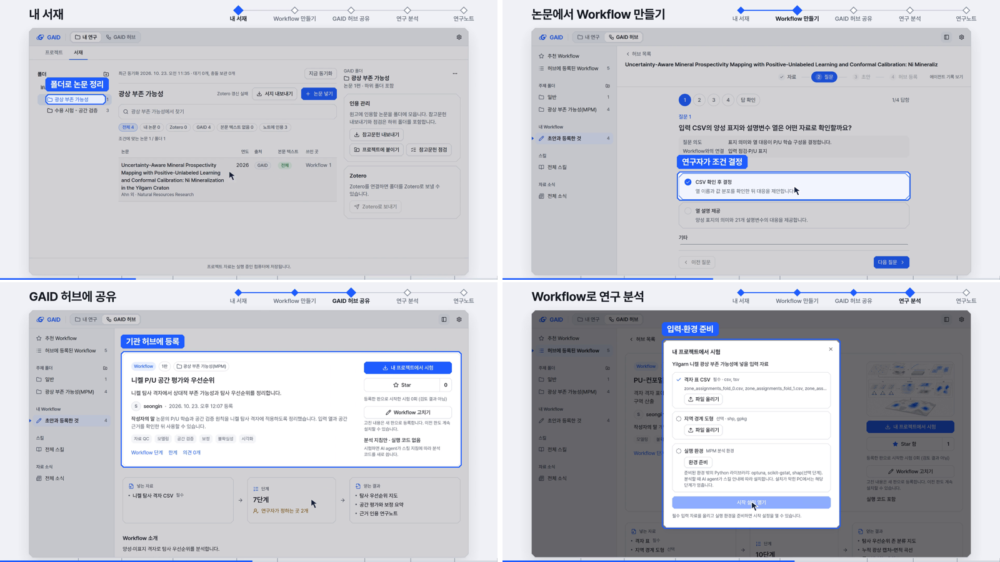
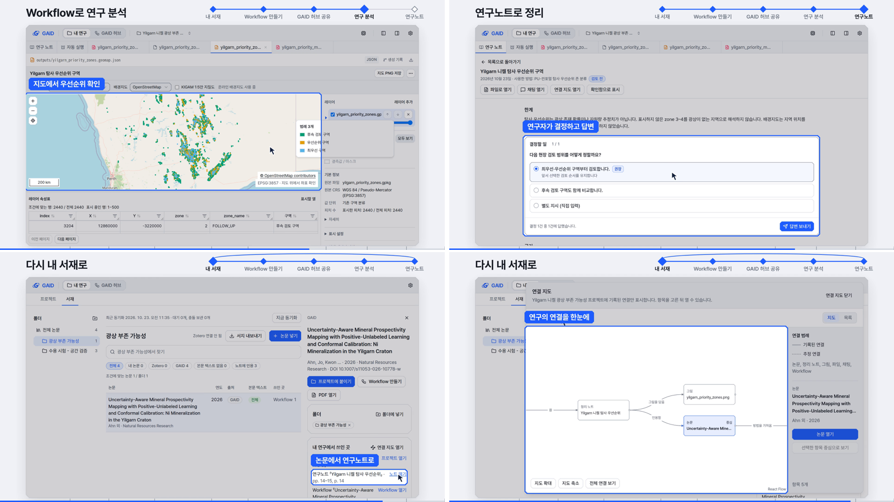

# GAID 홍보 영상 v2 — 연구 순환으로 다시 짠 105초 영상 (내부 검토용)

## 0. 한눈에

| | |
|---|---|
| 요청 | v1 영상의 시연 방식과 순서를 바꿔, 연구자가 AI agent와 연구하며 논문에서 Workflow를 만들고 공유·발전시키는 연구 순환을 중심으로 다시 만듭니다. |
| 결론 | 105초 영상을 만들었습니다. 배경(흩어진 스킬 생태계) → 연구 순환 → 여섯 단계 실제 시연 → KIGAM Second brain → 마무리 순서입니다. 시연은 앱 화면 전체를 한 크기로 보여 주고 기능마다 강조 상자와 이름표를 붙였습니다. |
| 믿을 수 있는 정도 | 실제 화면은 검토용 앱에서 진행한 한 연구에서 찍었습니다. 홍보용 연출을 허용한 지시에 따라 학습은 돌리지 않고, 논문 작업 때 만든 결과를 가져와 지도와 연구노트로 정리했습니다. 대화 문장 몇 줄은 촬영 화면에서만 바꿨습니다(5절). |
| 결정할 일 | 없음. 영상 검토 의견을 받습니다. |

## 1. 요청한 것

> 홍보영상과 관련한 피드백이다. 모션그래픽은 좋은데 실제 허브와 시스템을 담고 시연하는 과정에서 확대하고 스크롤을 하다보니 사람 시청자 입장에서는 어떤 내용을 설명하는지 눈에 들어오지 않는다. 또한, 사용자의 피드백에 따라 순서 상관없이 추가하다보니 내용 순서가 체계적이지 못하다. 그리고 연구자가 본인의 연구를 에이전트와 수행하고 논문을 수집하고 논문으로부터 지구과학 AI 생태계 활성화를 위한 워크플로우를 생성하여 공유하고 발전해나가는 내용이 중심으로 다뤄져야하며, 현재 프로토타임의 스킬이나 워크플로우수를 억지로 통계로 나타낼 필요는 없이 기존 K-dense-AI를 비롯하여 Geoscience의 스킬 생태계를 소개하면서 분산된 정보들을 모아서 연구자 친화적인 플랫폼을 만들어갈 수 있게 하는 배경도 설명되어야 한다. 실제 시연 과정에서는 기능들을 설명할 때 무리한 확대나 스크롤보다 seoul_geomodel의 가시화시스템 설명처럼 기능별로 설명할 수 있게 하여야 하고, 내서재에서 부터 논문 및 서지 관리하고 해당 논문에서 워크플로우를 생성하고 공유하고, 워크플로우를 이용해 GAID 시스템에서 연구분석을 수행(수행하는 과정에 MAPViewer나 작업 화면을 보여줄 필요가 있다.)하고 분석된 내용을 연구노트로 관리하고 해당 노트를 다시 내서재에 가져오면서 연구 선순환의 고리를 보여줄 필요가 있다. 전체적인 체계를 다시 먼저 잡고 홍보영상을 수정하는 작업을 진행하자. — 2026-10-23 요청

작업 중에 받은 지시입니다.

> 그리고 마무리 절 전에 해당 순환을 통해 지구과학 에이전트 생태계가 활성화되면서 개념적인 KIGAM의 Second brain화 되는 모션 그래픽이 추가되었으면 한다. — 2026-10-23

> 검토용 앱에서 연구를 진행하고 Workflow를 기관 허브 서버에 등록해도 된다. — 2026-10-23

> 모션그래픽 영상 작업은 writer가 직접 모두 수행하자. 워커는 자료 수집 정도로만 활용하자. — 2026-10-23

> baggingPU까지 실행할 필요 없다. 홍보영상을 만드는 것이며, 실제 분석결과까지 모두 다 가져오는 모습을 보일 필요 없다. 필요하다면 유사한 기 작업 결과를 가져와도 되므로 모든 과정을 돌리지 말아라. 특히 BaggingPU는 계산이 오래걸린다. — 2026-10-23

> 정직한 영상을 원하는 것이 아니라 홍보용 영상을 원하는 것이다. — 2026-10-23

> 홍보 영상 체계에 적절한 결과들 위주로 보여줘야하는 것이다. 이전 영상에서는 적절한 자료들을 사용했지만 연출과 구성이 적절하지 않았을 뿐이다. 정직하려고 하면 오히려 퀄리티가 떨어진다. — 2026-10-23

> 면적표와 LAS검층은 불필요 하다. — 2026-10-23

완료 기준: 구성을 먼저 정해 보여 드린 뒤 영상을 고칩니다. 연구 순환이 중심이고, 기존 스킬 생태계를 배경으로 소개하며 개수 통계는 넣지 않습니다. 실제 시연은 확대·스크롤 없이 기능별로 설명하고, 서재 → Workflow 만들기 → 공유 → 분석(지도 또는 작업 화면) → 연구노트 → 서재 순서로 보여 줍니다. Second brain 장면을 마무리 앞에 넣습니다. 무음, 1920×1080, 30fps, 내부 검토용입니다.

## 2. 수행한 것

1. 구성을 먼저 정해 보여 드렸습니다. seoul_geomodel 검토 시스템 영상처럼 앱 화면 전체를 한 크기로 두고, 기능마다 강조 상자와 이름표 하나로 설명하는 방식을 골랐습니다.
2. 모션그래픽 장면을 새로 만들었습니다. 배경 장면에는 K-Dense AI 과학 스킬, KIGAM 지구과학 스킬, GitHub 공개 저장소, 논문 속 방법, 기관 자료, 개인 폴더가 흩어져 있다가 GAID의 칸으로 모입니다. 연구 순환 장면은 "연구자 + AI agent"를 가운데 두고 다섯 단계를 한 바퀴 돕니다. Second brain 장면은 여러 연구자의 고리가 GAID 허브로 이어져 논문·Workflow·연구노트의 지식망으로 자라는 모습입니다.
3. 검토용 앱에서 한 연구를 실제로 진행했습니다(자료 수집은 하위 작업자). 사용자 논문(Yilgarn 니켈 광상, PU 학습과 컨포멀 보정)을 서재에 넣고, 그 논문으로 Workflow를 만들어 기관 허브 서버에 등록했습니다. 분석 프로젝트에서는 논문 작업 때 만든 우선순위 존 결과를 가져와 AI agent가 지도, 결과 그림, 논문을 인용한 연구노트를 만들게 했습니다. 연구노트의 결정에 답했고, 서재의 "내 연구에서 쓰인 곳"과 연결 지도에서 노트가 이어지는 것을 촬영했습니다.
4. 촬영본 14장면을 시연 여섯 단계에 배치하고, 화면 위쪽 띠에 지금 단계를 표시했습니다. 강조 상자 31개는 각 장면의 가운데 프레임에 직접 그려 위치를 맞췄습니다.
5. 정지 화면으로 글자 크기, 겹침, 연출이 드러나는 문구를 검토하며 다시 찍고 고친 뒤 최종 영상을 렌더했습니다.

## 3. 결과

그림 1. 모션그래픽 장면입니다(왼쪽 위부터 배경, 모이는 장면, 연구 순환, Second brain). 볼 것: 스킬 이름은 실제 이름이고 개수 차트는 없습니다. 흩어진 자료 장면과 Second brain 장면에는 "개념도" 표시가 있습니다.

그림 2. 시연 앞부분입니다(서재, 논문에서 Workflow, 허브 등록, Workflow 시작 설정). 볼 것: 앱 화면 전체가 한 크기로 보이고, 기능마다 파란 상자와 이름표가 붙습니다. 위쪽 띠가 지금 단계를 표시합니다.

그림 3. 시연 뒷부분입니다(지도 보기, 연구노트 결정, 서재의 쓰인 곳, 연결 지도). 볼 것: 우선순위 구역 지도가 배경지도 위에 보이고, 연구노트가 서재 논문을 인용하며, 마지막에 고리가 서재로 돌아옵니다.

| 시간 | 장면 | 내용 |
|---|---|---|
| 0–5초 | 시작 | GAID 로고 |
| 5–20초 | 배경 (개념도) | 공개된 스킬 생태계와 흩어진 방법·자료·노트 → GAID의 서재·스킬·Workflow·자료와 지도·연구노트 |
| 20–28초 | 연구 순환 | 내 서재 → Workflow 만들기 → GAID 허브 공유 → 연구 분석 → 연구노트, 판 1 → 판 2 |
| 28–38초 | 시연: 내 서재 | 폴더로 논문 정리, 논문과 PDF, PDF·DOI로 논문 넣기, 서지 내보내기 |
| 38–51초 | 시연: 논문에서 Workflow | 논문을 자료로, 근거가 있는 질문, 연구자가 조건 결정, 단계별 지침 |
| 51–59초 | 시연: GAID 허브 공유 | 주제 폴더에 등록, 등록한 Workflow와 판, 내 프로젝트로 가져오기 |
| 59–75초 | 시연: 연구 분석 | 설치와 입력 준비, 단계별 시작 설정, AI agent 작업, 지도에서 우선순위 확인 |
| 75–84초 | 시연: 연구노트 | 노트 목록, 결과 그림, 결정과 답변, 서재 논문 인용 |
| 84–92초 | 시연: 다시 내 서재로 | 논문이 쓰인 연구노트, 연결 지도 |
| 92–100초 | KIGAM Second brain (개념도) | 여러 연구자의 고리 → 논문·Workflow·연구노트의 지식망 |
| 100–105초 | 마무리 | 로고, "내부 검토용 영상" |

| 완료 기준 | 결과 | 근거 |
|---|---|---|
| 구성을 먼저 정해 보여 드림 | 충족 | 작업 탭에서 구성안을 보여 드린 뒤 진행 |
| 연구 순환 중심 | 충족 | 표, 그림 2–3 |
| 기존 스킬 생태계 배경, 개수 통계 없음 | 충족 | 그림 1 |
| 확대·스크롤 없이 기능별 설명 | 충족 | 그림 2–3 |
| 서재 → Workflow → 공유 → 분석(지도) → 연구노트 → 서재 | 충족 | 표 |
| Second brain 장면 | 충족 | 그림 1 |
| 무음, 1920×1080, 30fps | 충족. 길이는 90초에서 105초로 늘었습니다(시연 여섯 단계와 Second brain 장면) | 4절 |

보는 방법: PC74에 있는 MP4 파일(부록 A의 "영상")을 동영상 플레이어로 엽니다. 파일이 커서 저장소에는 넣지 않았습니다.

## 4. 검증

- 과학적 검증: 해당 없음. 새로 계산한 연구 결과가 없습니다. 지도와 그림은 논문 작업 때 만든 우선순위 존 결과를 다시 그린 것입니다.
- 영상 출력: @@VIDEO_CHECK@@
- 실제 화면: 촬영 프레임 1,950장이 모두 2880×1620입니다. 강조 상자 31개를 각 장면 가운데 프레임에 그려 화면 요소와 맞는지 눈으로 확인했습니다. 브라우저 오류는 없었습니다.
- 검토용 앱: 연구 전에 있던 프로젝트, 서재 항목, 허브 기록 27건의 크기와 수정 시각이 그대로입니다. 바뀐 것은 이번 연구가 만든 기록, 기존 허브 Workflow의 시험 횟수 1회 증가, 자동 동기화 기록입니다.
- 화면 검토: 정지 화면으로 글자 크기, 겹침, 연출이 드러나는 문구를 확인하고 다시 찍었습니다.

## 5. 한계

- 내부 검토용입니다. 기관 로고의 외부 공개 승인이 아직 나지 않았습니다(gaid-release-proof#2).
- 홍보용 연출이 들어 있습니다(2026-10-23 사용자 지시).
  - 분석 장면의 학습은 돌리지 않았습니다. 논문 작업 때 만든 우선순위 존 결과를 프로젝트로 가져왔고, AI agent는 그 결과로 지도·그림·연구노트를 만들었습니다.
  - 지도에는 우선순위가 높은 세 분류만 보입니다. 좌표계는 격자 좌표가 서호주 Web Mercator 값과 맞아 EPSG:3857로 지정했고, 따로 검증하지 않았습니다.
  - AI agent 작업 장면의 대화 문장 세 곳은 촬영 화면에서만 자연스러운 요청과 답으로 바꿨습니다. 저장된 대화는 그대로입니다.
  - 시작 설정과 분석 대화는 새 Workflow 초안이 늦게 나와 같은 논문에서 먼저 만든 허브 Workflow로 진행했습니다. 허브 등록 장면은 새로 등록한 Workflow입니다.
- 검토용 앱의 기본 모델이 연결되지 않은 OpenRouter로 되어 있어, 연구에는 연결된 구독 모델(GPT-6.1 Sol)을 작업 화면에서 골라 썼습니다. 설정은 바꾸지 않았습니다.
- 작업 중 기관 허브의 다른 Workflow 한 건의 별이 1에서 0으로 바뀌었습니다. 이번 작업이 바꾼 것이 아니고, 누가 바꿨는지는 확인하지 못했습니다.
- 흩어진 자료 장면과 Second brain 장면은 개념도입니다. 화면에 그렇게 표시했습니다.

## 6. 결정할 일

없음.

## 7. 대체되었거나 실패한 시도

펼치기 — 4건

- 처음에는 별도 촬영용 GAID를 제안했습니다. 모델 로그인을 다시 해야 해서, 사용자 허락을 받아 검토용 앱에서 진행했습니다.
- 처음 계획은 Workflow로 학습까지 돌리는 것이었습니다. 오래 걸리는 계산이라 사용자 지시에 따라 논문 작업 결과를 가져오는 방식으로 바꿨습니다.
- 첫 촬영본에는 지도 파일 이름, 그림의 단서 문구, 대화 문장에 연출이 드러났고, 일부 강조 상자가 화면 요소와 어긋났습니다. 이름을 바꾸고 다시 그리고 다시 찍었습니다.
- 첫 Workflow 초안은 형식 검사에서 걸리고 이어서 모델 서버 과부하로 실패했습니다. 다시 만든 초안을 앱 화면에서 고쳐 형식 검사를 통과시킨 뒤 등록했습니다.

## 용어

없음. 기존 용어집을 따릅니다.

## 부록 A. 근거 위치

펼치기 — 실행 방법, 원본, 해시, 커밋

| 항목 | 위치 |
|---|---|
| 제작 소스 | `geo/promo/` (`README.md`, `CONTRACT.md` v2, `CAPTURE.md`, `render.py`, `scene/`, `capture*.py`) |
| 구성안 | `docs/tasks/gaid-promo-video-v2.md` → "Structure draft v2" |
| 실제 화면 촬영 | PC74: `~/data/geoaidesk/work/gaid-promo-video-v2/capture-v2/capture.json` (14 shots, 1,950 frames), `beat-checks/`, `study.json` |
| 검토용 앱 기록 | 서재 항목 `li-9c9d1be4e0ca` (`ahn2026`), 폴더 `lc-0a58cae5488a`, Workflow 초안 `ap-33965983-5f2`, 기관 허브 `entry-ap-33965983-5f2` 1판, 프로젝트 `yilgarn-cd7814`, 대화 `01a166b1-256d-71f4-b5e3-53298806a36d`, 노트 `연구노트/2026-10-23-yilgarn-priority/index.md` |
| 가져온 결과 | `~/pc71-projects/narr/mpm_nested_cv/outputs/test_evaluation_oof/baggingpu_xgboost/outer_fold_{0..4}/zone_assignments.csv` (해시 `prior-results.json`) |
| 렌더 job | @@JOB@@ |
| 영상 | @@VIDEO@@ |
| 출력 기록 | @@MANIFEST@@ |
| 도구 | Google Chrome, Playwright 1.63.0, imageio-ffmpeg 0.6.0 (H.264, CRF 17), Pillow 12.3.0 |
| 아이콘·글꼴 | Lucide (Icon Wiki 20261007, ISC/MIT), Pretendard (OFL) |

작성 시점: 2026-10-23.

