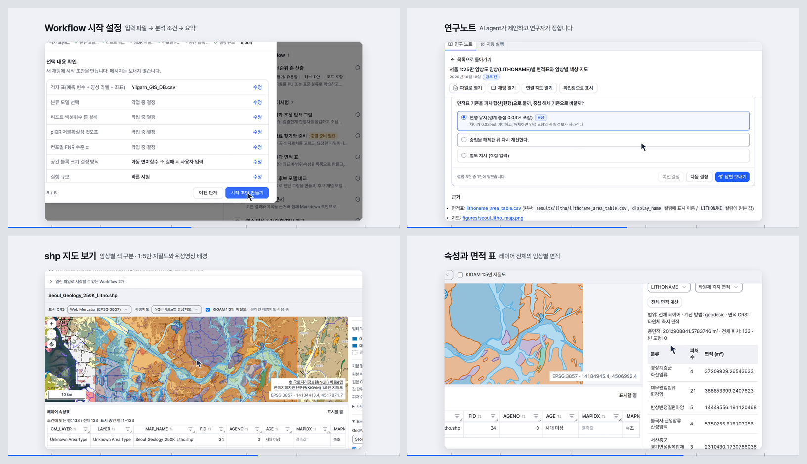
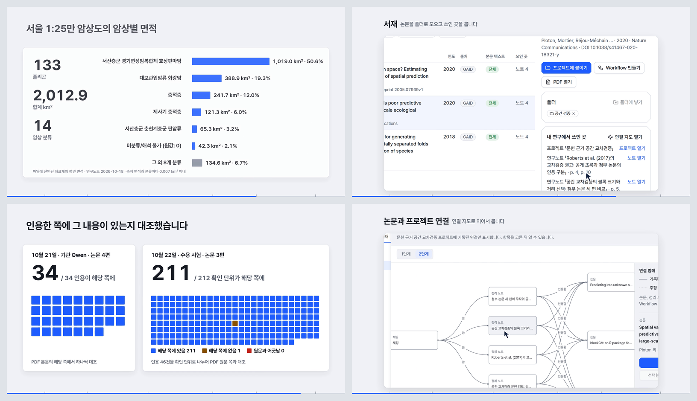

# GAID 90초 홍보 영상 (내부 검토용)

## 0. 한눈에

| | |
|---|---|
| 요청 | 다른 두 프로젝트의 모션그래픽을 참고해 GAID의 취지, 배경, GAID 허브, 독창적인 점, 연구자 지원을 보여 주는 90초 홍보 영상을 만듭니다. |
| 결론 | 90초 영상을 만들었습니다. 모션그래픽과 차트 약 50초, 실제 GAID 화면 약 40초를 섞었고, 실제 수치로 그린 차트 다섯 개가 들어 있습니다. 서재, shp 지도 뷰어, 허브, 연구노트는 실제 화면으로 보여 줍니다. |
| 믿을 수 있는 정도 | 실제 화면은 검토용 앱 자료를 복사한 별도 GAID에서 촬영했습니다. 차트의 수치는 카탈로그, 허브 기록, 연구노트 면적표, 두 번의 인용 대조 보고서에서 읽었습니다. 장면 하나는 개념도이고, 화면에 그렇게 표시했습니다. 허브 스킬 선반은 기록이 없어 넣지 못했습니다. |
| 결정할 일 | 없음. 영상 검토 의견을 받습니다. 기관 로고의 외부 공개 승인은 기존 결정 대기 항목(gaid-release-proof#2)에서 다룹니다. |

## 1. 요청한 것

> Gaid 시스템에 대해서도 seoul_geomodel 이나 ccs_transport 프로젝트에서 모션그래픽을 생성한것처럼 1분 30초짜리 홍보 모션그래픽을 생성하자. 두 프로젝트에서 어떤관점으로 생성했는지 참조하고 이번 gaid 모션그래픽에서는 소량의 텍스트와 차트들을 적극사용하여 프로젝트의 취지와 gaid 허브와 프로젝트를 만든배경과 독창적인 포인트와 연구자 지원형 플랫폼이 잘드러날수 있게해야한다. 작업은 opus 5.5 high fast로 작업하자. 실제 시스템 모습과 모션그래픽을 적절히 섞어서 마켓팅 프로덕션급으로 생성해야한다. — 2026-10-22 요청

작업 중에 받은 지시입니다.

> 무음이고 내부검토용 영상이다. — 2026-10-22

> 영상에서 카드박스나 글자가 너무작아도 안된다. 시인성을 생각하고 공간여백을 너무 크게두어서 어색한부분이 생기는것을 조심해야한다. — 2026-10-23

> 그리고 서재기능도 강조되어야한다. 최신기능들이 반영되어있어야한다. — 2026-10-23

> Gaid시스템에서 shp형식의 맵데이터 뷰어기능들도 소개되어야한다. — 2026-10-23

> 맵뷰어는 lithoname으로 분류색이 입혀지는것을 사용하고 배경맵에 kigam 1:5만지질도와 위성영상이 사용가능함을 보여야한다 — 2026-10-23 (촬영 작업자에게)

완료 기준: 1920×1080, 초당 30프레임, 무음 90초 영상입니다. 실제 화면과 모션그래픽을 섞고, 글자는 적게 쓰되 차트는 적극적으로 씁니다. 취지, 배경, 허브, 독창적인 점, 연구자 지원, 서재, shp 지도 뷰어가 드러나야 하고, 영상 글자와 카드는 1080p에서 읽을 수 있어야 합니다.

## 2. 수행한 것

1. 두 참고 영상의 방식을 읽었습니다. 서울 지질모델 영상은 작업 단계 다음에 실제 검토 시스템을 조작하는 구성이고, 개념도 한 장면만 빼고 모두 실제 자료를 씁니다. 광양·여수 영상은 글자보다 움직임을 앞세우고, 실제 화면에 커서 이동과 패널 강조를 넣습니다. 이번 영상도 두 방식을 따랐습니다.
2. 영상 디자인은 GAID 화면 지침의 계측 스타일을 따랐습니다. 흰 면과 알루미늄색 바탕, 45° 모서리, 눈금, 브랜드 파랑을 강조에만 쓰는 규칙, Pretendard 글꼴입니다. 궤도 위를 도는 점은 화면 지침에서처럼 "AI agent가 일하는 중"을 뜻합니다.
3. 차트에 쓸 수치를 실제 기록에서 모았습니다. 기본 카탈로그 구성, 등록된 허브 Workflow 한 건의 단계·판·설치 기록, 서울 1:25만 암상도 연구노트의 면적표, 쪽 인용을 대조한 두 시험(10월 21일, 10월 22일) 결과입니다.
4. 실제 화면은 별도 GAID 인스턴스에서 촬영했습니다. 검토용 앱의 자료를 복사해 썼고, 인증 정보는 복사하지 않았으며, 모델 호출도 하지 않았습니다. 촬영 단위(하위 작업)가 10개 장면을 찍었습니다. 화면은 1280×720 크기로 찍어, 영상에서 읽을 영역을 1.2~1.5배로 확대했습니다.
5. 사용자 의견에 따라 구성을 한 번 바꿨습니다(구성안 v2). 글자를 키웠고, 서재 장면과 shp 지도 장면을 따로 넣었습니다. 화면과 차트를 나란히 두면 앱 글자가 작아지는 두 곳은 실제 화면 다음에 차트를 전체 화면으로 보여 주게 바꿨습니다.
6. 영상을 프레임 단위로 렌더하고 인코딩한 파일을 다시 읽어 길이와 규격을 확인했습니다. 정지 화면 19장으로 글자 크기, 잘림, 빈 공간을 검토했습니다.

## 3. 결과

그림 1. 모션그래픽 장면입니다(왼쪽 위부터 21.5초, 29.6초, 37.6초, 84.6초). 볼 것: 차트 수치가 실제 기록에서 왔습니다. 카탈로그 0.3.0의 구성, 허브 Workflow 한 건의 10단계(연구자 결정 2단계), 판 1→2와 설치 4건입니다.

그림 2. 실제 GAID 화면입니다(42.5초, 49.8초, 56.0초, 61.4초). 볼 것: Workflow 시작 설정, 연구노트의 결정, LITHONAME 분류색으로 칠한 서울 1:25만 암상도 shp(위성영상 배경, KIGAM 1:5만 지질도 겹침), 레이어 전체 면적표입니다.

그림 3. 서재 장면입니다(64.0초, 67.5초, 74.5초, 77.6초). 볼 것: 암상별 면적 차트, 서재 논문이 쓰인 프로젝트와 노트, 두 시험의 쪽 인용 대조, 논문과 프로젝트의 연결 지도입니다.

| 시간 | 장면 | 실제 화면 / 차트 |
|---|---|---|
| 0–5초 | 궤도 고리와 G가 그려지며 GAID 로고 | 로고 원본 도형 |
| 5–14초 | 배경: 연구 방법이 논문과 개인 폴더에 흩어져 있음 | 개념도 표시. 허브 Workflow 한 건이 담은 원본 코드 55개 파일 |
| 14–24초 | 취지: 서재·자료 → Workflow → AI agent 실행 → 연구노트 → GAID 허브 | 기본 Workflow 7, 스킬 17, 공개 자료 출처 21과 분야별 막대 |
| 24–30초 | 논문과 코드에서 Workflow 초안 | 연구자가 정할 조건 8개 중 3개, 10단계 초안 |
| 30–35초 | GAID 허브 | 실제 화면: 허브 첫 화면 → 판 2 Workflow → 단계 상세 |
| 35–38초 | 판과 설치 기록 | 판 1·판 2와 프로젝트 설치 4건 타임라인, 별 4·댓글 4 |
| 38–54초 | 연구 실행 | 실제 화면: 시작 설정, Workflow 대화와 결과 그림, 연구노트 결정, LAS 검층 |
| 54–64초 | shp 지도 | 실제 화면: 암상 분류색, 위성영상 배경, 1:5만 지질도 겹침, 속성, 면적표. 차트: 암상별 면적(폴리곤 133개, 2,012.9 km²) |
| 64–78초 | 서재 | 실제 화면: 서재 폴더와 논문이 쓰인 곳, 쪽 인용 노트, 연결 지도. 차트: 쪽 인용 대조 두 시험 |
| 78–85초 | GAID가 연구자를 돕는 여덟 가지 | 팔각 G를 둘러싼 여덟 구간 |
| 85–90초 | 마무리 로고 | "내부 검토용 영상" 표시 |

| 완료 기준 | 결과 | 근거 |
|---|---|---|
| 90초, 1920×1080, 30fps, 무음 | 충족 | 4절 |
| 실제 화면과 모션그래픽의 혼합 | 충족. 실제 화면 약 40초, 모션그래픽과 차트 약 50초 | 표, 그림 1–3 |
| 적은 글자와 차트 | 충족. 장면마다 제목 한 줄, 실제 수치 차트 다섯 개(원본 코드 파일, 카탈로그 구성, 판·설치 기록, 암상별 면적, 쪽 인용 대조) | 그림 1, 3 |
| 취지·배경·허브·독창성·연구자 지원 | 충족 | 표 |
| 서재 강조, 최신 기능 | 부분. 서재는 14초 장면으로 넣었습니다. 허브 스킬 선반은 기록이 없어 실제 화면 없이 마지막 장면에 이름만 넣었습니다. | 5절 |
| shp 지도 뷰어 | 충족. 분류색, 위성영상 배경, 1:5만 지질도 | 그림 2 |
| 글자 크기 | 충족. 모션그래픽 글자는 22px 이상, 주요 이름표는 30px 이상입니다. 실제 화면은 읽을 영역을 1.2~1.5배 확대했습니다. | 정지 화면 19장 |

보는 방법: PC74에 있는 MP4 파일(부록 A의 "영상")을 동영상 플레이어로 엽니다. 파일이 커서 저장소에는 넣지 않았습니다.

## 4. 검증

- 수치 대조: 차트의 수치는 원래 기록과 같습니다. 카탈로그 수치는 고정된 카탈로그 파일의 해시를 확인한 뒤 읽었습니다. 허브 Workflow 기록은 검토용 앱의 원본과 촬영용 복사본에서 해시가 같았습니다. 면적표는 연구노트의 표(폴리곤 133개, 합계 2,012.9 km²)를 그대로 썼고, 노트 본문의 값과 같습니다. 쪽 인용 수치는 두 보고서의 값(34건 중 34건, 확인 단위 212개 중 211개)입니다.
- 반복과 다른 설명: 해당 없음. 새로 계산한 연구 결과가 없습니다. 인용 대조는 각각 한 번씩 한 시험이고, 차트 아래에 날짜와 시험 이름을 적었습니다.
- 실제 화면: 촬영한 프레임 1,380장이 모두 2880×1620이고, 브라우저 오류는 없었습니다. 촬영 뒤 검토용 앱 자료 폴더의 파일 목록, 크기, 수정 시각이 촬영 전과 같았습니다. 촬영 인스턴스는 멈췄습니다.
- 영상 출력: 인코딩한 파일을 다시 읽었습니다. 90.00초, 2,700프레임, 1920×1080, 30fps, H.264이고 음성 트랙이 없습니다. 장면 전환 18곳의 프레임을 최종 파일에서 뽑아 확인했고, 보고서 그림도 최종 파일에서 뽑았습니다.
- 화면 검토: 정지 화면 19장을 직접 보고 겹친 카드, 잘린 화면, 작은 앱 글자를 고친 뒤 다시 확인했습니다.

## 5. 한계

- 내부 검토용입니다. 기관 로고의 외부 공개 승인이 아직 나지 않았습니다(gaid-release-proof#2). 영상에 로고를 썼으므로 외부에 올리지 않습니다.
- 허브 스킬 선반은 실제 화면이 없습니다. 복사한 허브에 스킬 기록이 없어 촬영하지 못했습니다. 마지막 "여덟 가지" 장면에 이름만 나옵니다.
- Workflow 대화 장면은 허브 Workflow의 시작 설정으로 시작한 실제 대화입니다. 다만 Workflow 지침 블록이 생기기 전의 대화라 첫 메시지는 이전 형식입니다.
- 서재 자료에는 Zotero 항목이 없습니다. 서재 장면은 GAID에서 관리하는 논문 세 편과 폴더 하나를 보여 주고, Zotero 연결은 마지막 장면에 이름만 나옵니다.
- 허브의 별 4, 설치 4, 댓글 4는 검토용 허브의 기록이고 시험 계정이 포함됩니다. 차트 아래에 그렇게 적었습니다.
- 초안 만들기 장면에서 선택지가 골라지는 움직임은 답하는 과정을 보여 주는 연출입니다. 질문과 선택지는 실제 Workflow의 조건이지만, 골라지는 선택지는 실제 기록된 답이 아닙니다.
- 촬영용 복사본에서 이름만 바꿨습니다. 프로젝트 이름의 "검토용 -", 시험 사용자 이름이 대상입니다. 인증 정보가 없는 촬영 인스턴스에서 보이는 "연결 안 됨" 표시 두 곳도 숨겼습니다. 값과 결과는 바꾸지 않았습니다.
- 흩어진 파일 장면은 개념도입니다. 화면에 "개념도"로 표시했습니다.

## 6. 결정할 일

없음.

## 7. 대체되었거나 실패한 시도

펼치기 — 3건

- 구성안 v1은 글자가 작고 빈 공간이 컸고, 서재와 shp 지도 장면이 없었습니다. 사용자 의견에 따라 v2로 바꿨습니다.
- 면적표와 쪽 인용 장면은 처음에 실제 화면 옆에 차트를 두었습니다. 화면이 좁아져 앱 글자가 작아졌으므로 실제 화면을 크게 보여 준 뒤 차트를 전체 화면으로 보여 주게 바꿨습니다.
- 처음에는 버튼처럼 작은 대상까지 확대해 주변 내용이 잘렸습니다. 영역만 확대하고 확대 비율을 1.5배로 제한했습니다.

## 용어

없음. 기존 용어집을 따릅니다.

## 부록 A. 근거 위치

펼치기 — 실행 방법, 원본, 해시, 커밋

| 항목 | 위치 |
|---|---|
| 제작 소스 | `geo/promo/` (`README.md`, `CONTRACT.md`, `CAPTURE.md`, `prepare_data.py`, `render.py`, `scene/`, `capture*.py`) |
| 참고 영상 | PC74: `~/repos/ccs_transport/reports/2026-10-22-testbed-motion-video/`, `~/repos/seoul_geomodel/reports/2026-10-21-viewer-v2-video/` |
| 차트 수치 | PC74: `~/data/geoaidesk/work/gaid-promo-video/data-v3/data.json` |
| 실제 화면 촬영 | PC74: `~/data/geoaidesk/work/gaid-promo-video/capture-v1/capture.json`, `shots/` (1,380 frames) |
| 촬영 자료 복사본 | PC74: `~/data/geoaidesk/work/gaid-promo-video/home`, 검증 `capture-evidence/geoaidesk-{before,after}.tsv` |
| 렌더 job | `job-geoaidesk-gaid-promo-video-1`, PC74: `~/data/geoaidesk/runs/gaid-promo-video-20261022T155452.185441Z/receipt.json`, 렌더 소스 `537a917e0919dba1a14565eb670ea0370a598e51` |
| 영상 | PC74: `~/data/geoaidesk/runs/gaid-promo-video-20261022T155452.185441Z/out/gaid-promo-v1.mp4`, 20,210,783 bytes, SHA256 `8cbb2d57525fc7d9241f7b51f173962e40c5042d4a733c87d12d19ed329fcdc7` |
| 출력 기록 | `out/manifest.json` SHA256 `8dcf92700f0f0d53540e43f5a913d9514980f364e070ec3b94f30a5f7539326e`, `out/contact-sheet.jpg` SHA256 `1e3172b0b8529d00eca5794f3a056efdf2ec701305f67012745f1d3ded3f3170`, 인코딩 후 검사 PC74: `~/data/geoaidesk/work/gaid-promo-video/qa-v1/probe.json`, `encoded-transitions.jpg` |
| 도구 | Google Chrome 156, Playwright 1.63.0, imageio-ffmpeg 0.6.0 (H.264, CRF 17), Pillow 12.3.0 |
| 아이콘·글꼴 | Lucide (Icon Wiki 20261007, ISC/MIT, `geo/brand/licenses/LUCIDE-LICENSE.txt`), Pretendard (OFL) |

작성 시점: 2026-10-23.

