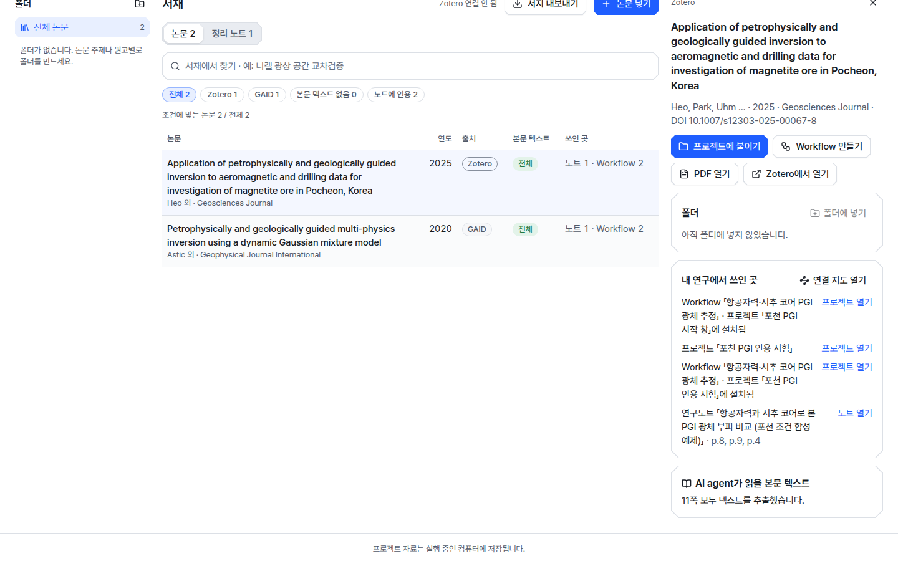
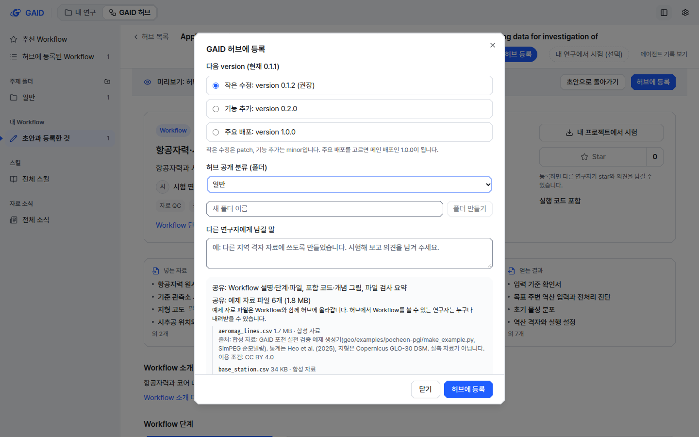

# Workflow의 근거 논문을 프로젝트 인용 범위에 붙여 서재·Workflow·노트를 잇기

## 0. 한눈에

| | |
|---|---|
| 요청 | 포천 검증(D)에서 남은 두 가지를 처리합니다. F23은 서재 논문 → Workflow → 분석 → 노트 → 서재 순환이 논문에서 닫히지 않는 문제입니다. F21은 허브 등록 창이 예제 자료 공유를 알리지 않는 문제입니다. |
| 결론 | Workflow 시작 창의 소개 단계에 Workflow의 근거 논문이 서재 상태와 함께 나옵니다. 연구자가 "근거 논문 붙이기"를 누를 때만 인용 범위에 붙습니다. 실제 포천 Workflow로 분석한 노트가 두 논문을 쪽 번호와 함께 인용했고, 서재에서 논문 ↔ Workflow ↔ 노트가 이어졌습니다. 허브 등록 창은 예제 자료 파일 6개를 크기·출처·이용 조건·합성 여부와 함께 보여 주고, Workflow를 볼 수 있는 연구자가 누구나 내려받는다고 알립니다. |
| 믿을 수 있는 정도 | 자동 시험과 전체 검사, 그리고 검토 앱이 아닌 별도 인스턴스에서 실제 순환 한 번으로 확인했습니다. 분석은 기관 Qwen(Qwen3.8 Flash Next)으로 77분 걸렸습니다. 다른 모델과 다른 Workflow에서는 반복하지 않았습니다. |
| 결정할 일 | 없음 |

## 1. 요청한 것

> 남은일과 F23 작업까지 수행하자. — 2026-10-23 요청

"남은 일"은 포천 검증 보고서의 F21입니다. 허브가 정리한 완료 기준은 다음과 같습니다.

- F23: 설치하거나 시작 설정을 열 때, 서재에 있는 Workflow의 근거 논문을 프로젝트에 붙일지 묻습니다. 동의 없이 바꾸지 않습니다. 서재에 없는 논문은 없다고 표시하고, 기존 확인 절차로만 넣습니다. 붙인 뒤에는 AI agent가 그 논문을 인용할 수 있고, 노트 인용 점검과 참고문헌 목록이 그 논문을 보며, 서재가 논문 ↔ Workflow ↔ 노트 연결을 보여 줍니다. 근거 논문을 기록하지 않은 Workflow는 지금처럼 동작합니다. 검증은 검토 앱이 아닌 별도 인스턴스에서 실제 순환으로 합니다.
- F21: 등록 미리보기가 Workflow에 들어 있는 예제 파일(이름, 크기, 이용 조건·출처, 합성 여부)을 나열하고, 등록 항목을 볼 수 있는 모든 사람과 공유된다고 확인 전에 알립니다.

## 2. 수행한 것

1. 허브 Workflow 패키지에 이미 기록된 근거 자료 목록에서 논문을 골라, 연구자의 서재와 DOI로 맞춥니다. DOI가 없으면 제목이 정확히 같은 논문과 맞춥니다. 서재 항목 번호는 연구자마다 다르기 때문입니다. 패키지 형식은 바꾸지 않아 이미 등록된 포천 Workflow도 그대로 됩니다.
2. Workflow 시작 창의 소개 단계에 "근거 논문" 줄을 넣었습니다. 논문마다 "인용 범위에 있음 / 서재에 있음 / 서재에 없음"을 보여 주고, 서재에 있는 논문은 "근거 논문 N편 붙이기" 한 번으로 붙입니다. 서재에 없는 논문의 "서재에 넣기"는 기존 논문 넣기 창을 DOI가 채워진 채로 엽니다. 서지 확인은 연구자가 합니다. 모든 설치 경로가 이 시작 창으로 이어져서 한 곳에서 묻습니다.
3. 붙인 논문은 Workflow 지침 첫 메시지에 인용 키와 함께 "근거 논문"으로 들어갑니다. 연구 노트 규칙에는 방법·기준값·비교를 가져온 서재 논문을 인용하라는 문장을 더했습니다.
4. 서재의 "내 연구에서 쓰인 곳"과 연결 지도에, 그 논문을 근거로 하는 Workflow가 설치된 프로젝트를 표시합니다.
5. 허브 등록 창에 예제 자료 목록을 넣었습니다. 예제별로 파일 이름·크기, 합성 여부, 출처, 이용 조건을 보여 줍니다. "공유하지 않음" 문구는 "예제 자료로 넣지 않은 연구 자료"로 고쳤습니다. 목록 때문에 창이 길어져도 "허브에 등록" 버튼이 늘 보이도록 버튼 줄을 고정했습니다.
6. 검토 앱에서 읽기 전용으로 복사한 포천 Workflow 초안과 두 논문으로, 별도 인스턴스에서 등록부터 서재까지 순환을 끝까지 돌렸습니다. 허브 등록, 새 프로젝트에 설치, 시작 창에서 붙이기, 분석, 노트 작성, 노트를 서재에 넣기 순서입니다.

## 3. 결과

그림 1. 포천 Workflow를 새 프로젝트에 설치한 직후의 시작 창입니다. 볼 것: 근거 논문 두 편이 DOI로 서재에서 찾아져 "서재에 있음"으로 나옵니다. "근거 논문 2편 붙이기"는 보조 버튼이고, 창의 주 동작은 "입력 자료 고르기" 하나입니다.

그림 2. 분석이 끝난 뒤 서재에서 Heo et al. (2025)를 연 화면입니다. 볼 것: "내 연구에서 쓰인 곳"에 Workflow가 설치된 프로젝트 두 곳, 논문을 붙인 프로젝트, 이 논문을 p.8, p.9, p.4로 인용한 연구노트가 함께 나옵니다. 목록의 "쓰인 곳" 칸도 두 논문 모두 "노트 1 · Workflow 2"입니다.

그림 3. 허브 등록 창입니다. 볼 것: "공유: 예제 자료 파일 6개 (1.8 MB)"와 "허브에서 Workflow를 볼 수 있는 연구자는 누구나 내려받을 수 있습니다"가 목록 위에 나오고, 파일마다 크기·합성 여부·출처·이용 조건이 있습니다. 아래 버튼 줄은 고정되어 있습니다.

| 완료 기준 | 결과 | 근거 |
|---|---|---|
| 설치·시작 때 근거 논문을 붙일지 묻고, 동의 없이 바꾸지 않음 | 충족. 시작 창 소개 단계에서 묻습니다. 조회만으로는 아무것도 붙지 않는 것을 시험으로 확인했습니다. | 그림 1, 4절 |
| 서재에 없는 논문은 없다고 표시하고 기존 확인 절차로만 넣음 | 충족. "서재에 없음"과 "서재에 넣기"(기존 논문 넣기 창, DOI 조회 후 연구자 확인)입니다. 실제 순환에서는 두 논문이 모두 서재에 있어 이 경로는 자동 시험으로만 확인했습니다. | 4절 |
| AI agent가 인용하고, 노트 인용 점검과 참고문헌이 봄 | 충족. 노트가 두 논문을 8곳에서 쪽 번호와 함께 인용했고, 인용 점검에서 두 키가 모두 서재 항목으로 풀리며 인용 범위 안이었습니다. | 4절 |
| 서재에 논문 ↔ Workflow ↔ 노트 연결 | 충족. 노트를 서재에 넣은 항목의 "인용한 논문"도 두 논문으로 풀렸습니다. | 그림 2 |
| 근거 논문이 없는 Workflow는 지금처럼 | 충족. 근거 논문 줄이 나오지 않습니다(시험). | 4절 |
| 등록 창에 예제 파일 목록과 공유 범위 | 충족 | 그림 3 |
| 두 스타일 × 두 테마 × 두 크기 화면 확인 | 충족. 바뀐 두 화면을 16장으로 확인했습니다. | 부록 A |

## 4. 검증

- 과학적 검증: 해당 없음. 분석 방법은 바꾸지 않았습니다. 실제 순환의 분석 결과(합성 예제의 광체 부피)는 이 작업의 판단 대상이 아니라서 수치를 평가하지 않았습니다.
- 인용의 근거: 노트의 Heo et al. (2025) 인용 가운데 p.8은 AI agent가 서재 도구로 그 쪽을 읽고 썼습니다. Astic et al. (2020)의 p.40 인용은 서재 도구로 읽지 않았고, Workflow에 들어 있는 근거 메모가 같은 쪽을 인용한 것을 따랐습니다. 쪽 번호가 실제 논문 내용과 맞는지 한 줄씩 대조하지는 않았습니다.
- 소프트웨어 검증: 서버 시험 3개를 새로 넣었습니다. DOI·제목 맞춤, 다른 DOI를 가진 같은 제목 제외, 조회만으로는 붙지 않음, Workflow의 논문만 붙음, 붙인 뒤 AI agent의 서재 검색, 노트와 Workflow 사용처, 근거 논문이 없는 Workflow를 확인합니다. 웹 시험 4개도 넣었습니다. 시작 창의 붙이기 동작과 서재에 넣기 연결, 첫 메시지의 근거 논문, 등록 창의 예제 목록을 확인합니다. 관련 기존 시험 묶음, 문구·UI 가이드 검사, 전체 검사를 통과했습니다.
- 실제 순환: 별도 인스턴스에서 그림 1–3의 흐름을 연구자 화면으로 진행했습니다. 반복 실행은 하지 않았습니다(1회).

## 5. 한계

- 논문 맞춤은 DOI가 우선이고, DOI가 없으면 제목이 정확히 같아야 합니다. 서지 정보가 다르게 적힌 같은 논문은 "서재에 없음"으로 나옵니다. 제목으로 찾은 경우에는 "제목으로 찾음"을 표시하고, DOI가 서로 다르면 맞추지 않습니다.
- 근거 논문을 붙이면 프로젝트의 인용 범위가 생깁니다. 이전에 아무것도 붙이지 않아 서재 전체가 인용 범위였던 프로젝트에서는, 붙인 뒤 다른 서재 논문 인용이 "범위 밖"으로 표시됩니다. 기존 "프로젝트에 붙이기"와 같은 동작입니다.
- 실제 순환에서 Qwen은 노트를 쓴 뒤 채팅 답변 본문 없이 끝났습니다. 노트와 결과 파일은 정상으로 남았습니다. 모델 쪽 동작으로 보고 이 작업에서는 고치지 않았습니다.
- 등록 창은 예제 자료를 다 보여 주려면 창 안에서 스크롤해야 합니다. 공유 범위 문장과 개수·크기는 목록 위에 있어 스크롤 없이 보입니다.
- 검토 앱과 기관 허브 서버는 건드리지 않았습니다. 허브 서버 코드는 바뀌지 않았고, 검토 앱 반영은 허브가 합니다.
- 전체 검사는 중간 커밋에서 통과했고, 마지막 커밋에서 다시 돌린 결과는 작업 문서에 기록합니다.

## 6. 결정할 일

없음.

## 7. 대체되었거나 실패한 시도

- 등록 창 첫 구현은 파일마다 같은 출처 문장을 되풀이하고 공유 범위 문장을 목록 맨 아래에 두었습니다. 실제 창에서 길어지고 범위 문장이 스크롤 아래로 밀려, 예제별로 묶고 범위 문장을 개수 바로 아래로 옮겼습니다.
- 그 상태에서도 version 선택지가 있는 갱신 등록에서는 "허브에 등록" 버튼이 첫 화면 아래로 밀려, 버튼 줄을 고정했습니다.

## 용어

없음. 기존 용어 "인용 범위", "서재", "Workflow", "version"을 그대로 썼습니다.

## 부록 A. 근거 위치

펼치기 — 실행 방법, 원본, 문구, 커밋

- 코드: `server/src/geo/library/workflow-papers.ts` (맞춤), `server/src/geo/routes/library.ts` (`GET /geo/library/workflow-papers?method=`, `POST /geo/library/workflow-papers/attach`, 사용처 주입), `server/src/geo/library/uses.ts` (`ProjectWorkflowPapers`), `server/src/geo/connections/index.ts` (연결 지도), `server/src/geo/instructions.ts` (`RESEARCH_NOTE_RULE`), `web/src/geo/workspace/source-papers.tsx`, `web/src/geo/workspace/start-intro.tsx`, `web/src/geo/workspace/task-setup.tsx`, `web/src/geo/contracts/workflow-doc.ts` (`settings.papers`), `web/src/geo/library/add-paper-dialog.tsx` (`initialDoi`), `web/src/geo/library/library-screen.tsx`, `web/src/geo/hub/hub-dialogs.tsx` (`SharedExamples`, 고정 버튼 줄), `web/src/geo/hub/hub-screen.tsx`.
- 시험: `server/test/geo-workflow-papers.test.ts`, `web/src/geo/workspace/source-papers.test.tsx`, `web/src/geo/workflow/workflow-card.test.tsx`, `web/src/geo/hub/hub.test.tsx`.
- 전체 검사: job `job-geoaidesk-gaid-workflow-cite-scope-1`, 커밋 02e10dfa, "All geoaidesk checks passed". 마지막 커밋의 재검사는 작업 문서 `docs/tasks/gaid-workflow-cite-scope.md`에 기록합니다.
- 별도 인스턴스: systemd user unit `gaid-cite-scope-app`, 포트 3360/18360, `GAID_HOME=~/data/geoaidesk/work/gaid-workflow-cite-scope/home`. 검토 앱 자료에서 읽기 전용으로 복사한 것: 서재 항목 `li-79b57a297a46`(heo2025, Zotero), `li-a313027670f8`(astic2020)와 PDF·쪽 텍스트, 저작 프로젝트 `ap-43431e17-f09`, `models.json`(kigam-qwen). 인증 정보는 복사하지 않았습니다.
- 실제 순환: 로컬 허브 항목 `entry-ap-43431e17-f09` version 0.1.0 등록(화면 촬영 중 0.1.1이 한 번 더 등록됨, 이 인스턴스 안에서만). 프로젝트 `pgi-b937d9`: 붙인 뒤 `.kady/geo/literature.json` itemIds = [li-79b57a297a46, li-a313027670f8]. 대화 세션 `01a168af-848d-72ed-b527-180a7b88402f`(2026-10-23 12:14–13:32 UTC, 모델 `kigam-qwen/qwen3.8-flash-next`, 도구 호출 중 `library_search` 2회, `library_read` 1회). 노트 `연구노트/2026-10-23-pgi-orebody-volume-example/index.md`: `[@heo2025]` 5곳(p.4, p.8 ×2, p.9, 쪽 없음 1), `[@astic2020]` 3곳(p.12, p.40, 쪽 없음 1). 노트 서재 항목 `li-74b1ed77b62d`의 인용: heo2025 → li-79b57a297a46 (p.8, p.9, p.4), astic2020 → li-a313027670f8 (p.12, p.40). 두 번째 프로젝트 `pgi-944a90`(설치만, 붙이지 않음)는 그림 1 촬영용입니다.
- 화면: `~/data/geoaidesk/work/gaid-workflow-cite-scope/shots/`: `start-intro-{1440,1280}-{instrument,mapsheet}-{light,dark}.png`, `register-{1440,1280}-{instrument,mapsheet}-{light,dark}.png`, `library-uses.png`. 스타일·테마는 `<html data-style>`와 `dark` 클래스로 바꿔 찍었습니다.
- UI 가이드 규칙: P2(시작 창 주 동작 하나 유지, 등록 버튼 고정), B1(붙이기는 테두리 버튼), P3(긴 출처는 두 줄로 줄이고 전체는 툴팁), S1(색은 역할 토큰만), D2(시트·대화상자 동작 수 유지). 어긴 규칙 없음. `node geo/ui/check-ui.mjs` 오류 0, 새 부채 없음.
- 바뀐 문구(문자열 id, 한·영):
  - `workspace.start.fact.papers` 신규: "근거 논문" / "Source papers"
  - `workspace.start.papers.*` 신규: `state.attached` "인용 범위에 있음" / "In the citation scope", `state.in-library` "서재에 있음" / "In the library", `state.not-in-library` "서재에 없음" / "Not in the library", `byTitle` "제목으로 찾음" / "matched by title", `add` "서재에 넣기" / "Add to library", `attach` "근거 논문 {count}편 붙이기" / "Attach # source paper(s)", `attachHint` "붙인 논문은 AI agent가 찾아 읽고 연구 노트에 인용할 수 있습니다." / "The AI agent can find, read and cite attached papers in research notes.", `attachedNote`, `missingNote`, `failed`, `summary`, `review`
  - `library.detail.useWorkflowProject` 신규: "Workflow 「{title}」 · 프로젝트 「{name}」에 설치됨" / "Workflow “{title}” · installed in project “{name}”"
  - `hub.register.notShared` 변경 전: "공유하지 않음: 올린 원문 PDF와 압축 파일 원본, 연구 자료, 프로젝트 실행 기록과 시험 평가" / "Not shared: original uploaded PDFs and archives, research data, project run records and trial assessments" → 변경 후: "공유하지 않음: 올린 원문 PDF와 압축 파일 원본, 예제 자료로 넣지 않은 연구 자료, 프로젝트 실행 기록과 시험 평가" / "Not shared: original uploaded PDFs and archives, research data not added as example data, project run records and trial assessments"
  - `hub.register.examples.*` 신규: `shared` "공유: 예제 자료 파일 {count}개 ({size})", `who` "예제 자료 파일은 Workflow와 함께 허브에 올라갑니다. 허브에서 Workflow를 볼 수 있는 연구자는 누구나 내려받을 수 있습니다.", `remote`, `source`, `license`, `synthetic`, `unstated` (영어 같은 뜻)
  - `workflowDoc.section.papers`, `workflowDoc.papers.rule` 신규(AI agent가 받는 지침).
- 미결 항목: `Closes: gaid-pocheon-trial#2`(F21).

