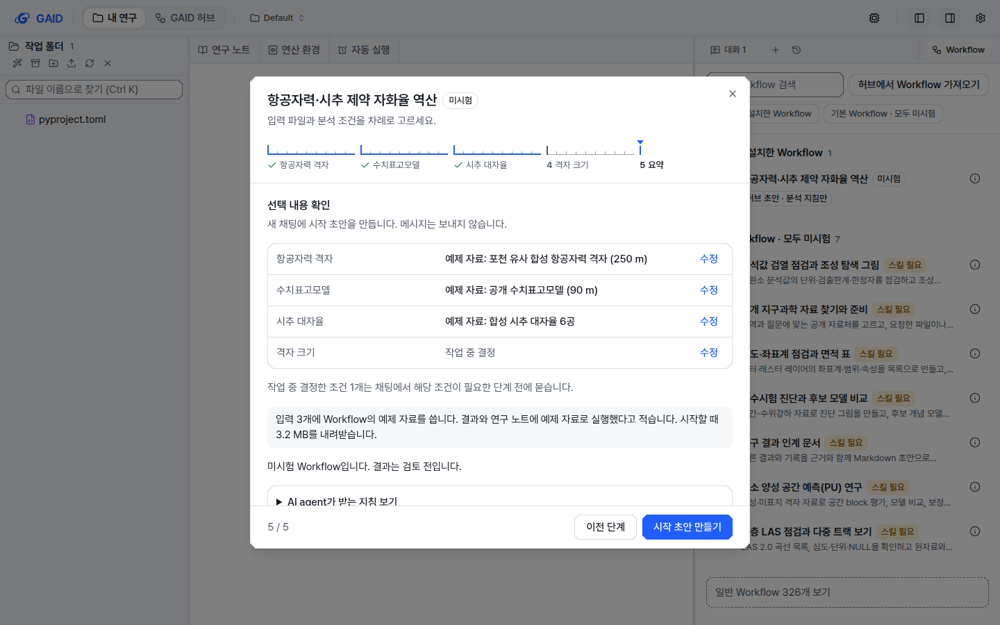
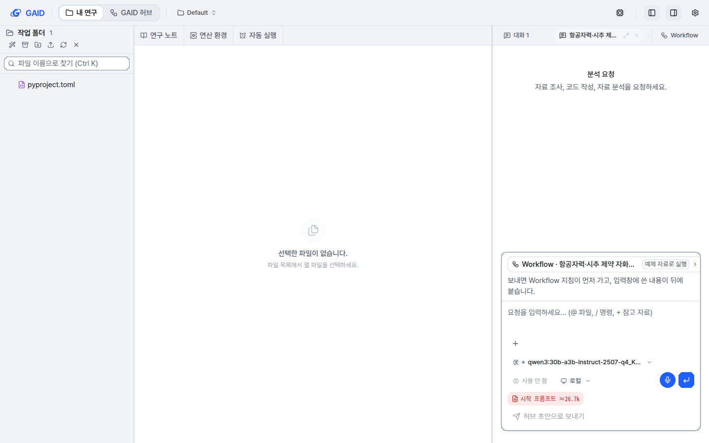
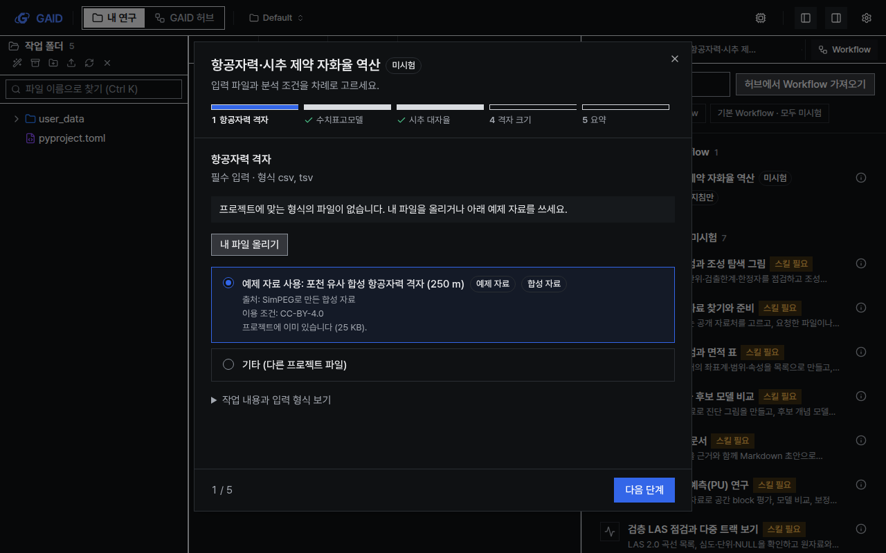
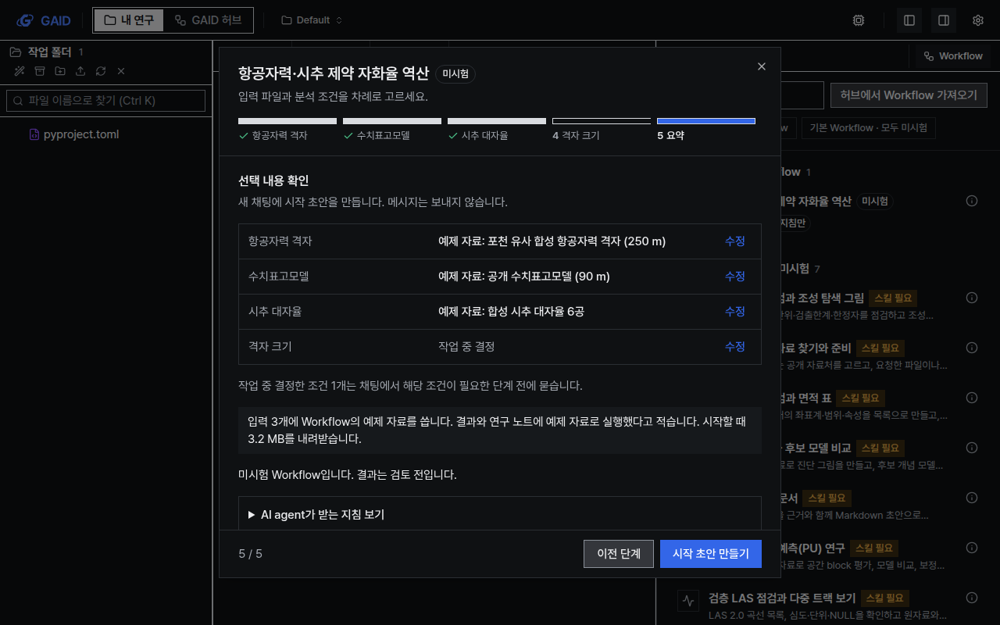
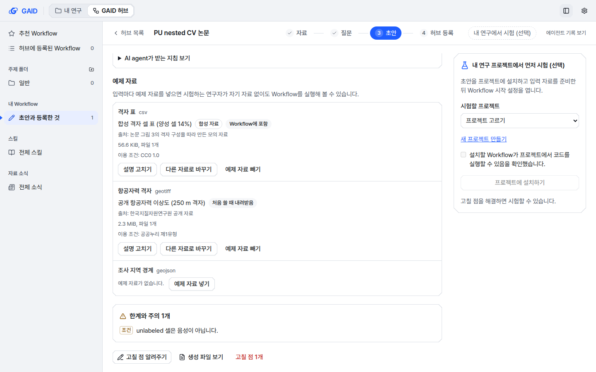
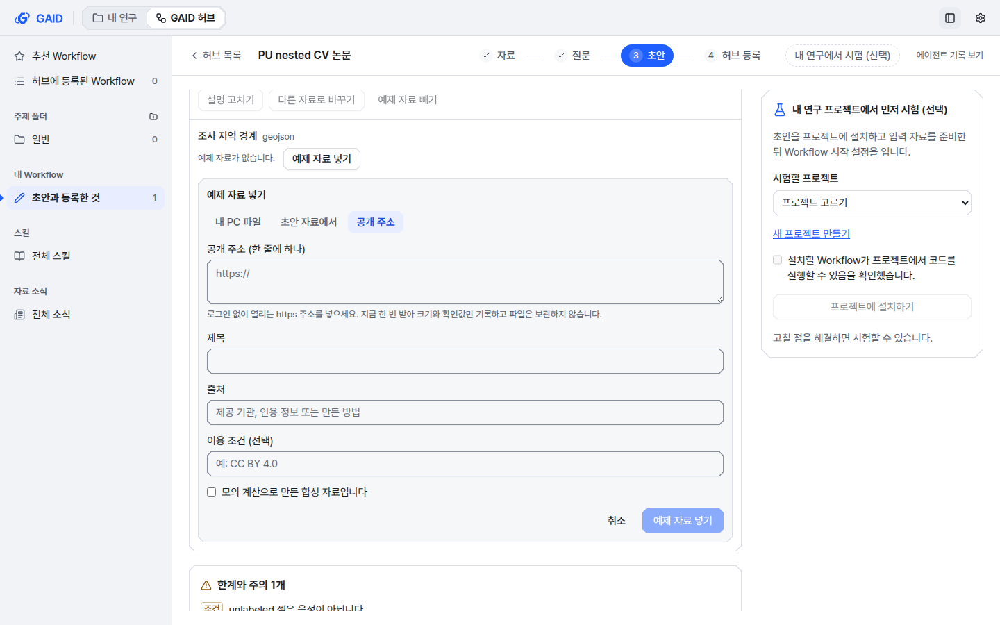
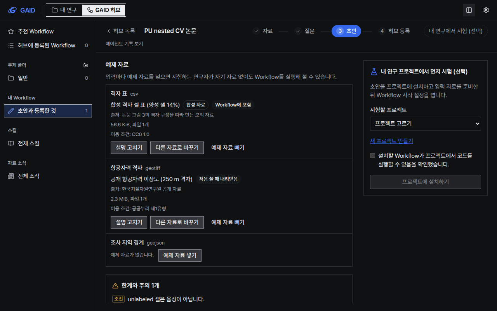

# Workflow 예제 자료, 내 자료가 없어도 분석 시작하기

## 0. 한눈에

| | |
|---|---|
| 요청 | 논문 자료가 공개되지 않은 경우에도 Workflow를 시험할 수 있도록, 연구자가 자료를 올리거나 지정하지 않으면 기본 예제 자료가 선택되게 합니다. |
| 결론 | Workflow는 입력마다 예제 자료를 함께 가질 수 있습니다. 시작 설정은 연구자 파일이 없으면 예제 자료를 고르고, 시작할 때 프로젝트에 넣으며, 지침과 채팅에 예제 자료로 실행했다고 적습니다. 허브에서 Workflow를 만들 때도 입력마다 예제 자료를 붙일 수 있습니다. |
| 믿을 수 있는 정도 | 자동 시험과 개발 앱의 실제 시작 과정으로 확인했습니다. 실제 공개 자료를 원격 주소에서 받는 경우와 포천 Workflow로 하는 실전 시험은 이 작업에서 하지 않았습니다(실전 검증 단위가 이어서 합니다). |
| 결정할 일 | 없음 |

## 1. 요청한 것

> 해당 논문의 데이터는 제공되지 않기 때문에 워크플로우를 만들 때 데이터를 사용하지 못한다. 이런 경우 가장 유사한 공개 데이터를 기반으로 워크플로우를 만들고 이용자들은 본인의 데이터를 올리거나 현재 테스트에서 사용되는 공개 데이터를 기반으로 워크플로우를 테스트 할 수 있게 하여야 한다. 즉, 워크플로우를 이용할 때 사용자가 이상적으로 데이터를 업로드하거나 지정하면 좋겠지만 이것이 어려울 경우 default example이 선택되어야 GAID 시스템에서 분석을 수행해 볼 수 있을 것이다. — 2026-10-23 요청(발췌)

수락한 권장안: "작은 예제(약 10 MB 이하)는 Workflow 패키지에 넣고, 큰 예제는 공개 주소와 sha256으로 적어 처음 쓸 때 내려받는다."

완료 기준: Workflow가 입력마다 예제 자료를 가질 수 있고, 시작 설정에서 연구자가 자기 자료를 올리거나 고르며, 고르지 않으면 예제 자료가 선택되어 GAID에서 분석을 시작할 수 있습니다. 채팅과 지침은 예제 자료를 썼다고 밝힙니다. 허브 작성 도구로 예제 자료를 붙일 수 있고, 설치·준비 상태·CLI 내보내기가 예제 자료를 다룹니다. 예제 자료가 없는 기존 Workflow는 전과 같이 동작합니다.

## 2. 수행한 것

1. Workflow의 입력 정의에 예제 자료 항목을 더했습니다. 예제 자료에는 이름, 출처, 이용 조건, 합성 자료 여부, 파일 목록이 들어갑니다. 파일은 Workflow 안에 넣거나(파일 하나 10 MB, Workflow 전체 15 MB까지) 공개 주소와 해시로 적습니다(파일 하나 512 MB까지).
2. GAID 서버가 설치된 Workflow의 예제 자료 상태를 알려 줍니다. 상태는 프로젝트에 있음, Workflow에 들어 있음, 내려받아야 함, 손상됨 가운데 하나입니다. 시작할 때는 예제 자료를 프로젝트의 입력별 폴더에 씁니다. 내려받는 자료는 크기와 시간을 제한하고 해시를 확인하며, 기존 파일은 덮어쓰지 않습니다. 쓴 파일은 업로드와 같은 출처 기록을 남깁니다.
3. 시작 설정의 입력 단계에 "예제 자료 사용" 선택지와 "내 파일 올리기"를 넣었습니다. 연구자에게 맞는 파일이 없으면 예제 자료가 선택됩니다. 선택 입력은 연구자 자료를 하나도 쓰지 않을 때 예제 자료를 따라갑니다. 예제 자료와 내 자료를 섞으면 지역이나 좌표계가 다를 수 있다고 알립니다.
4. AI agent가 받는 지침에 어떤 입력이 예제 자료인지 적고, 답변·결과 파일·연구 노트 첫머리에 예제 자료로 실행했다고 쓰게 했습니다. 예제 지역의 결과를 연구자 지역의 결론으로 쓰지 말라는 지시도 넣었습니다. 채팅의 Workflow 카드에는 "예제 자료로 실행"이 붙습니다.
5. Workflow 보기, 허브의 입력 준비 화면, CLI 내보내기 안내문에 예제 자료를 표시했습니다.
6. 허브의 Workflow 초안 화면에 "예제 자료" 영역을 만들었습니다. 입력마다 내 PC 파일, 초안에 넣은 자료, 공개 주소 가운데 하나로 예제 자료를 넣고, 제목·출처·이용 조건·합성 자료 여부를 적습니다. 공개 주소는 GAID가 한 번 받아 크기와 해시만 기록합니다. 작성 보조 AI agent는 예제 자료를 보거나 바꾸지 못하고, 초안을 다시 만들어도 연구자가 넣은 예제 자료는 같은 입력에 그대로 남습니다. 등록한 Workflow를 고칠 때는 패키지에서 예제 파일을 되살립니다.

## 3. 결과

그림 1. 시작 설정의 첫 입력 단계(계측 스타일, 밝은 테마, 1440×900). 볼 것: 프로젝트에 맞는 파일이 없어서 예제 자료가 선택되어 있고, 출처·이용 조건·크기와 합성 자료 표시가 함께 나옵니다. "내 파일 올리기"로 자기 자료를 바로 올릴 수 있습니다.

그림 2. 요약 단계. 볼 것: 입력마다 "예제 자료: …"로 표시되고, 예제 자료를 쓰는 입력 수와 시작할 때 내려받을 크기를 알려 줍니다.

그림 3. "시작 초안 만들기" 뒤의 채팅 입력창. 볼 것: Workflow 카드에 "예제 자료로 실행"이 붙어 있습니다. 이때 예제 파일 4개가 프로젝트에 써졌습니다.

그림 4. 같은 입력 단계를 예제 자료 준비 뒤에 다시 연 화면(도폭 스타일, 어두운 테마, 1280×800). 볼 것: 상태가 "프로젝트에 이미 있습니다"로 바뀌었고, 프로젝트에 써진 예제 파일이 연구자 파일 목록에 섞이지 않습니다.

그림 5. 요약 단계(도폭 스타일, 어두운 테마, 1280×800).

그림 6. 허브 Workflow 초안의 예제 자료 영역(시험용 초안). 볼 것: 입력마다 예제 자료가 Workflow에 들어 있는지, 처음 쓸 때 내려받는지가 표시되고, 예제 자료가 없는 입력에는 "예제 자료 넣기"가 있습니다.

그림 7. 예제 자료 넣기 양식. 볼 것: 내 PC 파일, 초안 자료, 공개 주소 가운데 하나를 고르고 제목과 출처를 적습니다.

그림 8. 같은 영역(도폭 스타일, 어두운 테마, 1280×800).

| 완료 기준 | 결과 | 근거 |
|---|---|---|
| 입력마다 예제 자료(Workflow 안 파일 또는 공개 주소+해시)를 가질 수 있음 | 충족 | 2절 1, 4절 |
| 처음 쓸 때 제한과 해시 확인을 거쳐 내려받음 | 충족 | 4절 |
| 시작 설정에서 자기 자료를 올리거나 고르고, 없으면 예제 자료가 선택됨 | 충족 | 그림 1, 2 |
| 채팅과 지침이 예제 자료 사용을 밝힘 | 충족 | 그림 3, 4절 |
| 허브 작성 도구로 예제 자료를 붙임 | 충족 | 그림 6–8, 4절 |
| 설치·준비 상태·CLI 내보내기가 예제 자료를 다룸 | 충족 | 2절 2, 5 |
| 예제 자료가 없는 Workflow는 전과 같음 | 충족 | 4절 |

## 4. 검증

- 과학적 검증: 해당 없음. 이 작업은 자료를 전달하는 기능이며 분석 결과를 만들지 않습니다.
- 소프트웨어 검증:
  - 자동 시험으로 확인한 것(작성 쪽): 내 PC 파일·초안 자료·로컬 공개 주소로 예제 넣기, 제목·출처 고치기, 크기 제한과 알 수 없는 입력 거부, 초안을 다시 만들 때 예제 유지, 패키지에 예제 파일이 들어가고 실행 쪽 검증을 통과함, 예제 없는 패키지가 이전과 같은 바이트임, 등록한 Workflow를 고칠 때 패키지에서 예제 파일을 되살림.
  - 자동 시험으로 확인한 것(실행 쪽): 선언 형식 검사, 예제 복사, 로컬 서버에서 내려받기, 해시가 다른 파일 거부, 선언보다 큰 내려받기 중단, 기존 파일을 덮어쓰지 않음, 지침 문장(채팅·미리보기·CLI), 시작 설정의 기본 선택과 업로드.
  - 전체 검사: 프로젝트 전체 검사를 모두 통과했습니다. 서버 시험 2277건 가운데 2269건이 통과했고 8건은 원래 건너뛰는 시험입니다. 웹 시험 1241건, 문구 검사(오류 0), UI 검사(오류 0, 새 부채 0), 배포판 실행 확인도 통과했습니다. 통합 전 첫 전체 검사에서는 허브 서버 실행기 시험 1건이 PC 부하(load average 약 35)로 5초 제한을 넘겼습니다. 이 시험은 단독 재실행과 최종 검사에서 통과했습니다.
  - 개발 앱에서 확인한 것: 예제 입력 3개(Workflow 안 2개, 로컬 주소에서 받는 1개)를 가진 시험용 Workflow로 시작 설정을 열었습니다. 예제 자료가 선택됐고, 시작할 때 파일 4개가 입력별 폴더에 써졌습니다. 채팅 카드에는 "예제 자료로 실행"이 표시됐습니다. 계측·도폭 스타일과 밝은·어두운 테마를 1440×900, 1280×800에서 확인했습니다.
  - 기존 시험은 기대값 하나만 고쳤습니다. 지침 블록을 읽은 결과에 예제 여부 항목이 더해졌기 때문입니다. 나머지 기존 시험은 그대로 통과했습니다.

## 5. 한계

- 실제 공개 자료를 인터넷 주소에서 받는 경우는 시험하지 않았습니다. 로컬 주소로 같은 경로를 확인했습니다. 기관 네트워크에서 막힌 주소(예: raw.githubusercontent.com)를 예제 주소로 쓰면 내려받기가 실패합니다.
- 예제 자료는 입력마다 따로 폴더에 써집니다. Workflow의 스킬 지침이 여러 입력이 한 폴더에 있다고 가정하면 안 됩니다. 지침에는 입력마다 경로가 적힙니다.
- 왼쪽 작업 폴더 목록은 15초 주기로 다시 읽으므로, 예제 파일이 목록에 나타나기까지 잠시 걸릴 수 있습니다.
- 기본 제공(카탈로그) Workflow의 예제 묶음은 이번 작업에서 연결하지 않았습니다.

## 6. 결정할 일

없음

## 7. 대체되었거나 실패한 시도

펼치기 — 1건

- 예제 자료 선택지를 "기타 (다른 프로젝트 파일)" 뒤에 두었다가, "기타"를 마지막에 두는 UI 지침(Q3)에 맞춰 앞으로 옮겼습니다.

## 용어

| 용어 | 새 정의 / 정의 변경 | 정의 |
|---|---|---|
| [예제 자료](../../docs/glossary.md) | 새 정의 | Workflow가 입력마다 함께 제공하는 자료입니다. 연구자가 자기 파일을 고르지 않으면 이 자료로 분석을 시작하고, 지침과 결과에 예제 자료로 실행했다고 적습니다. |

## 부록 A. 근거 위치

펼치기 — 실행 방법, 원본, 해시, 커밋

| 항목 | 위치 |
|---|---|
| 계약 | `web/src/geo/contracts/workflow-examples.ts` |
| 서버 | `server/src/geo/methods/examples.ts`, `server/src/geo/methods/method-file.ts`, `server/src/geo/routes/methods.ts` (`POST /geo/methods/examples`), `server/src/geo/workflow-doc.ts`, `server/src/geo/cli-export.ts` |
| 화면 | `web/src/geo/workspace/task-setup.tsx`, `web/src/geo/workspace/setup-steps.tsx`, `web/src/geo/workflow/workflow-card.tsx`, `web/src/geo/workflow/workflow-view.tsx`, `web/src/geo/hub/input-prep.tsx` |
| 지침 문장 | `web/src/geo/contracts/workflow-doc.ts`, 문구 `web/src/geo/locales/workflowDoc/` |
| 허브 작성 | `server/src/geo/authoring/examples.ts`, `server/src/geo/authoring/package.ts`, `server/src/geo/authoring/routes.ts` (`POST /geo/authoring/projects/:id/examples[/:roleId[/remove]]`), `server/src/geo/authoring/agent.ts`, `server/src/geo/hub-shared/edit.ts`, `web/src/geo/hub/example-data.tsx`; 하위 작업 gaid-workflow-example--example-authoring |
| 시험 | `server/test/geo-workflow-examples.test.ts`, `server/test/geo-authoring-examples.test.ts`, `web/src/geo/workspace/task-setup-examples.test.tsx`, `web/src/geo/hub/example-data.test.tsx` |
| 개발 앱 자료 | PC74 `~/data/geoaidesk/work/gaid-workflow-example/app/` (시험용 Workflow pocheon-mag), 화면 원본 `~/data/geoaidesk/work/gaid-workflow-example/playwright/` |
| 문구 id (새로 추가) | `workspace.setup.example.*`, `workspace.setup.input.{upload,uploading,uploadFailed,emptyExample}`, `workflowDoc.settings.{syntheticTitle,researcherPicksExample,exampleUsed,examplesUsed,exampleRule,cliExample,cliExampleBundled,cliExampleRemote}`, `workflowDoc.card.example`, `workflowView.{example,exampleSynthetic,exampleBundled,exampleRemote}`, `hub.prep.{example,exampleAlso}`, `hub.example.*` (모두 새 문구로, 바꾼 기존 문구는 없음) |
| UI 규칙 | 시작 설정: Q1, Q2(연구자 파일이 없을 때만 예제를 미리 고르고 이유를 표시), Q3, Q4, Q5. 초안 화면: B1, B3, F5, G1, G2, I2, V9, R1. 새로 받아들인 UI 부채 없음 |

작성 시점: 2026-10-23, commit c2180e52.

