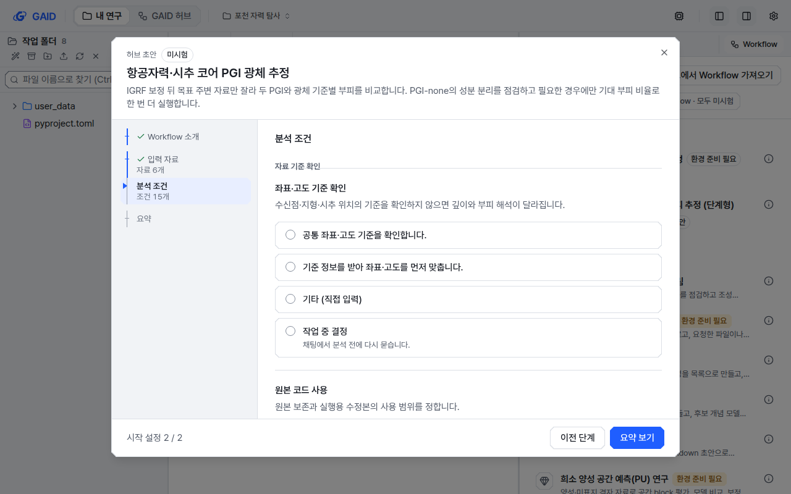
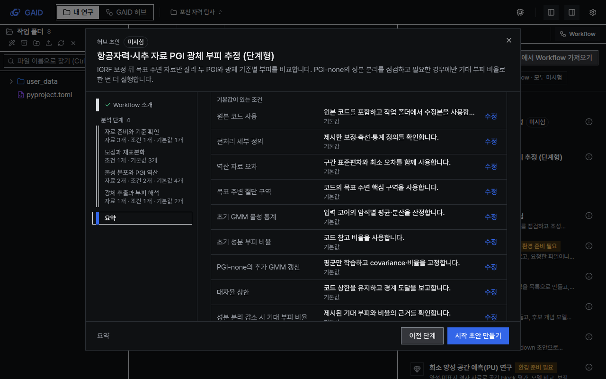

# Workflow를 분석 흐름 단계로 나누고 시작 창 단계를 7칸 이하로 줄임

## 0. 한눈에

| | |
|---|---|
| 요청 | Workflow 단계 수에 상한을 두고, 한 단계에서 여러 자료를 받으며, 항목별이 아니라 분석 흐름에 맞게 단계를 나눕니다. |
| 결론 | 시작 창은 모든 Workflow에서 7칸 이하입니다. 새 지침으로 다시 만든 포천 Workflow는 분석 흐름 5단계, 꼭 정할 조건 4개이고 방법의 처리 단계는 빠지지 않았습니다. |
| 믿을 수 있는 정도 | 화면은 실제 앱에서 두 스타일·두 테마·두 해상도로 확인했고, 초안은 실제 모델로 한 번씩 만들어 형식 검사와 지침 대조까지 했습니다. 새 초안으로 분석을 실행하지는 않았습니다. |
| 결정할 일 | 없음 |

## 1. 요청한 것

> gaid-pocheon-trial와 관련해서는 권장으로 진행한다. 그런데 사용자가 검토했을 때 워크플로우의 단계가 너무 많아서 팝업 창에서도 눈금 단계가 매우좁게 표현되는 것을 확인하였다. 이것은 워크플로우 생성 기능과도 관련있다고 생각한다. 워크플로우의 적정 단계로 최대 단계 수를 설정할 필요가 있으며, 하나의 단계에서 여러 자료를 입력 받을 수 있게 하면 단계수도 충분히 줄일 수 있다고 생각한다. 또한, 단계를 무분별하게 나누는 것이 아니라 데이터 분석 흐름 또는 연구 분석 흐름 절차에 맞게 나누어야 한다. 항목별로 나누면 워크플로우라기보다는 절차서가 되어버리고 더더욱 특정 과업에만 맞춘 워크플로우가 되버릴 수 있다. 사용자의 피드백을 확인한 후 어떻게 개선하도록 작업할지 보고먼저 하자. 작업은 opus 5.5 high fast writer들로 작업해야한다. — 2026-10-23 요청

> 권장으로 진행하자. 그리고 예제 테스트를 할 때에는 테스트가 주요 작업 목표의 달성을 지연시키지 않으면서도 품질은 떨어지지 않는 범위에서 수행해야함을 유의하자. — 2026-10-23 답변

완료 기준: 시작 창은 소개 → 분석 단계 → 요약으로 7칸 이하이고, 한 단계 페이지가 그 단계의 입력(여러 파일)과 조건을 모두 받습니다. 저작은 분석 흐름 3~5단계, 꼭 정할 조건 6개 이하로 만들고, 검사가 이를 어긴 Workflow에 경고합니다. 기존 Workflow는 저장 자료를 바꾸지 않고 화면에서만 묶으며, 편집할 때 새 형식으로 고칠 수 있습니다.

## 2. 수행한 것

1. 단계를 나누는 규칙을 하나로 정했습니다. Workflow의 단계마다 처음 쓰는 입력 자료와 조건을 적고, 입력 하나가 여러 파일을 받을 수 있게 했습니다. 연구자가 꼭 정할 조건은 6개까지이고, 나머지는 기본값을 가진 조건으로 둡니다. 시작 창과 저작 검사가 같은 규칙을 씁니다.
2. 시작 창을 단계 페이지로 바꿨습니다. 한 페이지에 그 단계의 입력 자료와 조건이 모두 나오고, 기본값이 있는 조건은 접혀 있다가 요약에서 따로 보이고 고칠 수 있습니다.
3. Workflow 작성 지침을 바꿨습니다. AI agent는 분석 흐름에 따라 3~5단계로 나누고, 단계별 입력과 조건을 적고, 조건 대부분에 기본값을 둡니다. 새 초안이 규칙에 맞지 않으면 한 번 고쳐 달라고 요청합니다.
4. 패키지·등록 검사에 단계 구성 참고 사항을 넣고, 허브 초안 화면에 "분석 흐름으로 단계 나누기"를 넣었습니다. 기존 Workflow를 편집할 때 이 동작으로 새 형식 초안을 만들고, 등록할 때 version을 올립니다.
5. 포천 Workflow를 새 지침으로 다시 만들고, 기존 0.2.0을 단계 나누기로 고쳐 비교했습니다. 두 하위 작업자(Claude Opus 5.5, 추론 높음, Fast)가 시작 창과 저작을 나눠 맡았습니다.

## 3. 결과

그림 1. 새 형식 Workflow의 시작 창. 왼쪽 목록은 소개, 분석 단계 4개, 요약의 6칸이고, 칸마다 "자료 2개 · 조건 2개 · 기본값 4개"처럼 그 단계에 든 것을 적습니다. 볼 것: 한 페이지에 시추공과 코어 두 입력이 함께 있고, 1280×800에서도 단계 이름이 잘리지 않습니다. 이 Workflow는 화면 확인용으로 포천 내용을 4단계로 다시 묶은 것이며 허브에 등록하지 않았습니다.

그림 2. 기존 포천 0.2.0. 단계가 입력과 연결되지 않아 "입력 자료"와 "분석 조건" 두 페이지로 묶였습니다. 볼 것: 목록이 4칸이고, 조건 15개는 그 조건을 처음 쓰는 단계 제목("자료 기준 확인" 등) 아래로 나뉩니다.

그림 3. 요약 페이지. 볼 것: 기본값이 있는 조건이 따로 묶이고 바꾸지 않은 값에는 "기본값"이 붙으며, 각 줄의 수정은 해당 단계 페이지의 그 조건으로 갑니다.

표 1. 시작 창 목록 칸 수 (소개와 요약 포함)

| Workflow | 전 | 후 | 묶는 방식 |
|---|---|---|---|
| 포천 0.2.0 (입력 6, 조건 15, 단계 10) | 23 | 4 | 입력 자료 / 분석 조건 |
| 포천, 새 지침으로 다시 만든 초안 | 해당 없음 | 7 | 분석 단계 5 |
| 포천 0.2.0을 단계 나누기로 고친 초안 | 해당 없음 | 6 | 분석 단계 4 (정할 것이 없는 마지막 단계는 페이지 없음) |
| PU-컨포멀 탐사 우선순위 존 분류 0.1.0 (입력 2, 조건 8, 이전 형식) | 12 | 4 | 입력 자료 / 분석 조건 |
| 희소 양성 공간 예측(PU) 연구 (기본 Workflow) | 7 | 4 | 입력 자료 / 분석 조건 |

표 2. 포천 Workflow 초안 비교 (GPT-6.1 Sol, 추론 높음, 각 한 번)

| | 기존 0.2.0 | 새 지침으로 다시 만듦 | 0.2.0을 단계 나누기로 고침 |
|---|---|---|---|
| 단계 | 10 | 5 | 5 |
| 조건 (꼭 정할 조건) | 15 (15) | 16 (4) | 15 (6) |
| 단계에 연결된 입력 | 0 / 6 | 6 / 6 | 6 / 6 |
| 패키지 검사 오류 / 단계 참고 사항 | 0 / 8 | 0 / 0 | 0 / 0 |

새 초안의 단계는 자료 준비와 자력 보정 → 코어 물성과 역산 설계 → 두 PGI 역산 → 광체 분리와 부피 비교 → 평가와 결과 정리입니다. 세 초안의 지침을 대조했을 때 모두 일주변화·IGRF 보정과 재표본화, 코어 GMM, PGI-full과 PGI-none, 물성·확률 두 경계, 낮은 감도 구역 제외, 시추공으로 목표 광체 지정, 기준 광체와 부피·깊이 비교, 빠른 시험과 전체 설정을 담고 있습니다. 기존 10단계는 새 단계 안의 소절로 남았습니다.

| 완료 기준 | 결과 | 근거 |
|---|---|---|
| 시작 창 7칸 이하, 단계 이름을 1280×800에서 읽을 수 있음 | 충족 | 표 1, 그림 1–2 |
| 한 단계 페이지에 여러 자료와 조건 | 충족. 입력 하나에서 파일 여러 개를 고를 수 있고 모두 시작 메시지와 첨부에 들어갑니다. | 그림 1 |
| 분석 흐름 3~5단계, 꼭 정할 조건 6개 이하 | 충족 (새 초안 5단계·4개, 고친 초안 5단계·6개) | 표 2 |
| 검사가 단계 수·조건 수·항목별 분할에 경고 | 충족. 기존 0.2.0에 8건 | 표 2 |
| 기존 Workflow 저장 자료 유지, 편집 때 새 형식 | 충족. 화면에서만 묶고, 단계 나누기는 새 초안으로 만듭니다. | 표 1, 2 |
| 기본값 조건을 요약에서 보이고 고침 | 충족 | 그림 3 |

## 4. 검증

- 과학적 검증: 다시 만든 초안이 논문 방법을 줄이지 않았는지 지침 본문을 기존 0.2.0과 항목별로 대조했습니다(3절). 새 초안으로 분석을 실행하지 않았으므로 분석 결과가 0.2.0과 같은지는 미검증입니다. 사용자 지시에 따라 시험이 목표를 늦추지 않게 하려고, 단계 구성과 지침 대조로 확인했습니다.
- 반복과 편차: 모델 초안은 조건마다 한 번씩만 만들었습니다. 같은 지침으로 다시 만들 때 단계 수가 얼마나 달라지는지는 확인하지 못했습니다. 처음 두 번의 실행은 시험 환경 문제(같은 작성 프로젝트 두 벌의 이름 충돌)로 거절되었는데, 그 응답도 4·5단계와 꼭 정할 조건 5·6개였습니다.
- 소프트웨어 검증: 전체 검사(상위 작업의 scripts/check)가 통과했습니다. 첫 실행에서 이 작업과 무관한 웹 시험 2개(지도 뷰어, 설정 창)가 PC 부하 평균 45에서 시간 초과로 실패했고, 따로 실행하면 통과하며 다시 실행한 전체 검사에서도 통과했습니다. 단계 규칙, 시작 창(포천형·PU형·새 형식), 저작 고치기, 검사 경고, 허브 안내에 새 시험을 더했습니다.
- 화면: 별도 앱 인스턴스에서 한국어로 계측·도폭, 라이트·다크, 1440×900·1280×800을 모두 찍었습니다(포천, PU, 새 형식 예시 각각 8가지). 새 형식 예시 사진은 저작 쪽 변경을 통합한 뒤 실제 서버 응답으로 다시 찍었습니다. 포천과 PU 사진은 새 항목이 없는 Workflow라 처음 찍은 것을 씁니다.

## 5. 한계

- 새 초안 두 개 모두 입력 6개를 전부 "여러 파일 입력"으로 표시했습니다. 지형 고도처럼 보통 파일 하나인 입력도 포함됩니다. 연구자가 파일을 하나 고르면 AI agent가 받는 지침은 같지만, 화면에 체크 상자가 나옵니다. 작성 지침에 "파일 하나인 입력은 표시하지 않는다"를 더하려면 모델로 다시 확인해야 하므로 선택 과제로 남깁니다.
- 기본값 몇 개는 설정 여러 개를 한 문장으로 적었습니다(역산 반복·정규화 값 12개 등). 요약에서 길게 보입니다.
- 이전 형식 Workflow(포천 0.2.0, PU-컨포멀)는 다시 등록하기 전까지 두 페이지로 보입니다. 조건이 15개인 Workflow는 분석 조건 페이지가 깁니다.
- 기관 허브 서버와 검토 앱은 이 작업에서 바꾸지 않았습니다. 사용자 환경에는 hub가 통합 뒤 배포할 때 반영됩니다.
- 포천 초안을 다시 만들 때 검토 앱의 OpenAI 로그인을 한 번 함께 썼습니다(사용자 결정 2026-10-23 "검토 앱 로그인을 이번만 공유"). 실행 뒤 검토 앱 연결이 유지되는 것을 확인했습니다.

## 6. 결정할 일

없음

## 7. 대체되었거나 실패한 시도

펼치기 — 2건

- 하위 작업자를 모델 지정으로 만들었을 때 권한 모드가 "매번 묻기"로 시작해, 작성자가 권한을 묻지 않고 진행하는 모드로 바꿨습니다.
- 처음 두 번의 포천 초안 실행은 같은 작성 프로젝트를 한 저장소에 두 벌 복사해 이름이 충돌하면서 거절되었습니다. 고치기용 복사본을 별도 저장소로 옮겨 다시 실행했습니다.

## 용어

없음

## 부록 A. 근거 위치

펼치기 — 실행 방법, 원본, 해시, 커밋

| 항목 | 위치 |
|---|---|
| 규칙(공유 계약) | `web/src/geo/contracts/workflow-stages.ts` (`workflowStages`, `stageWarnings`), 시험 `workflow-stages.test.ts` |
| 시작 창 상세 (하위 작업 A) | `reports/2026-10-23-gaid-workflow-stages/start-window.md` (UI 가이드 규칙, 문구 id 한·영) |
| 저작·검사 상세 (하위 작업 B) | `reports/2026-10-23-gaid-workflow-stages/authoring.md` (문구 id 한·영, 프롬프트 판 `gaid-draft/2026-10-23.3`) |
| UI 가이드 | `docs/design/ui-guide.md` Q1, Q4, D2, 12장 5번 |
| 통합 커밋 | 하위 작업 B 59baf023, A 5131e3be (상위 branch `task/gaid-workflow-stages`) |
| 다시 만든 초안 | PC74 `~/data/geoaidesk/work/gaid-stages-authoring/stages-draft-draft-r10.json` sha256 30cd3794ab19981d0b7305ddea66e157941d356196f1a04a76e5be0d55103fcf |
| 단계 나누기로 고친 초안 | 같은 폴더 `stages-regroup-draft-r10.json` sha256 c837618a00b61cf85d5ac4695c149125e33b592cf904c9473a34ed16a2ecb979 |
| 기존 0.2.0 | PC74 `~/data/geoaidesk/work/gaid-pocheon-trial/authoring-pass2-revise.json` `drafts[-1]` |
| PU-컨포멀 | 설치된 패키지 `pu-conformal-targeting` 0.1.0 (검토 앱 agent 폴더, 읽기만 함) |
| 표 1 계산 | `workflowStages`를 각 초안의 Workflow와 단계(이전 형식은 패키지 `atlas.yaml`의 절차)에 적용 |
| 화면 사진 원본 | PC74 `~/data/geoaidesk/work/gaid-stages-window/shots/` (64장) |

작성 시점: 2026-10-24, 상위 branch 5131e3be 이후.

