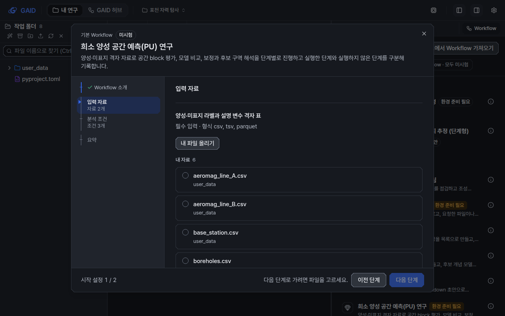

# Workflow 시작 창: 분석 단계별 페이지 (gaid-stages-window)

## 결과

Workflow 시작 창의 왼쪽 단계 목록이 입력·조건 하나마다 한 칸이던 방식에서 분석 단계마다 한 칸으로 바뀌었습니다. 목록은
`Workflow 소개 → 단계 페이지 → 요약`이며 최대 7칸입니다. 한 단계 페이지에 그 단계가 쓰는 입력 자료(여러 파일 포함)와 분석 조건이
모두 들어갑니다.

| Workflow | 이전 단계 목록 | 지금 단계 목록 |
|---|---|---|
| 포천 0.2.0 실제 초안 (입력 6, 조건 15, 단계 10) | 23칸 | 4칸: 소개 · 입력 자료 · 분석 조건 · 요약 |
| 희소 양성 공간 예측(PU) 연구 (기본 Workflow, 이전 형식 단계) | 7칸 | 4칸: 소개 · 입력 자료 · 분석 조건 · 요약 |
| 새 형식 예시 (4단계, `inputIds`, 여러 파일 입력, 기본값 10개) | 23칸 | 6칸: 소개 · 단계 4개 · 요약 |

- 단계가 입력과 조건을 3~5쪽으로 나누는 Workflow(`flow`)는 단계 제목이 페이지 이름입니다. 단계 목록은 "분석 단계 n" 아래에
  묶이고, 각 칸 아래에 "자료 2개 · 조건 2개 · 기본값 4개"처럼 그 단계에 든 것을 한 줄로 적습니다. 아래쪽 위치 표시는
  "분석 단계 3 / 4"입니다.
- 단계가 입력·조건을 나누지 않거나 5쪽을 넘는 이전 Workflow(`grouped`)는 "입력 자료"와 "분석 조건" 두 쪽으로 보입니다. 조건이
  4개 이상이면 분석 조건 쪽을 그 조건을 처음 쓰는 단계 제목으로 나눠 보여 줍니다(포천: "자료 기준 확인", "보정과 재표본화" …).
  위치 표시는 "시작 설정 1 / 2"입니다. 저장된 자료는 바꾸지 않습니다.
- 여러 파일을 받는 입력(`multiple`)은 파일 카드가 체크 상자입니다. 고른 파일은 모두 시작 메시지에 쉼표로 이어 적히고
  (`user_data/line_a.csv, user_data/line_b.csv`), 새 채팅에 첨부됩니다. 요약에는 "aeromag_line_A.csv 외 1개"로 보입니다.
- 기본값이 있는 조건은 처음부터 기본값으로 답해져 있습니다(저장한 시작 설정 값과 `작업 중 결정` 상태가 우선). 단계 페이지에서는
  "기본값이 있는 조건 n개" 접힘 안에 있고, 요약에서는 "기본값이 있는 조건" 묶음에 따로 나열됩니다. 값을 바꾸지 않았으면 값 아래에
  "기본값"이라고 적습니다. 요약의 `수정`을 누르면 그 단계 페이지가 열리고 접힘이 펼쳐진 채 해당 조건으로 스크롤됩니다.
- 한 페이지에 입력이 여러 개이고 파일이 이미 골라져 있으면 고른 파일만 보이고 나머지 후보는 "다른 파일 고르기 n" 뒤에 있습니다.
  페이지가 짧아집니다. 예제 자료, 이름 맞춤(F17), 내 파일 올리기, 요약의 F17 표시는 입력마다 그대로 동작합니다.
- 페이지에 필수 입력이 하나라도 비어 있으면 `다음 단계`가 꺼지고 "다음 단계로 가려면 파일을 고르세요."가 보입니다.
- 일반 Workflow(K-Dense)는 같은 창에서 `소개 → 입력 자료 → 분석 조건(빈칸 전부 한 쪽) → 요약`으로 바뀌었습니다.

## 확인한 것

- `cd web && npx tsc --noEmit`: 통과. `npx vitest run src/geo`: 355개 가운데 354개 통과. 실패한 1개는
  `src/geo/viewers/map/viewer.test.tsx`의 "inspects before paging …"이 전체 실행에서 5초 시간 초과로 실패한 것입니다(두 번 재현).
  이 파일만 실행하면 9개 모두 통과합니다. 이 하위 작업은 `web/src/geo/viewers/`를 바꾸지 않았습니다. 상위 작업의 `scripts/check`에서
  다시 확인해야 합니다.
- 새 시험(`web/src/geo/workspace/start-window.test.tsx` "start window by analysis-flow stage"):
  포천형(입력 6, 조건 15, 단계 10 → 4칸, 입력 쪽 제목 6개, 조건 쪽 15개와 단계 소제목), PU형(이전 형식 단계 7개 → 4칸, 조건 3개는
  소제목 없음), 새 형식(4단계 → 6칸, 여러 파일 체크, 다음 단계 막힘, 기본값 접힘, 요약의 기본값 묶음과 `수정`, 시작 메시지의 두
  파일과 첨부 목록).
- `node geo/ui/check-ui.mjs`: 오류 0. `node geo/copy/validate-copy.mjs web/src/geo/locales`: 오류 0, `workspace` 경고 0.
- 화면 사진: 자체 인스턴스(포트 3393/18393, 자료 `~/data/geoaidesk/work/gaid-stages-window/home`)에서 한국어, 계측·도폭,
  라이트·다크, 1440×900·1280×800으로 8가지씩 찍었습니다. 원본 64장은
  `~/data/geoaidesk/work/gaid-stages-window/shots/`에 있습니다(스크립트 `scripts/appshot.sh`).
  - 포천: authoring-pass2-revise.json `drafts[-1].workflow`를 그대로 설치된 method 폴더로 넣었습니다.
  - 새 형식 예시: 같은 포천 내용을 4단계로 다시 묶고 측선 입력을 `multiple`, 조건 10개에 기본값을 준 사진용 Workflow입니다
    (`~/data/geoaidesk/work/gaid-stages-window/scripts/build_methods.py`). 허브에 등록하지 않았습니다.
  - 주의: 이 시점(9949b08d 기준)의 서버는 `GET /geo/methods` 요약에 `inputRoles[].multiple`과
    `requiredScientificChoices[].default`를 아직 싣지 않습니다(패키지 B 담당 매핑). 그래서 사진에서는 브라우저가 받는
    `/geo/methods` 응답에 method 파일의 두 필드를 채워 넣었습니다(playwright route). 화면 코드는 계약대로 요약 필드만 읽습니다.
    B가 통합된 뒤에는 이 대체 없이 같은 화면이 나와야 합니다.

## UI 가이드 규칙

- 따른 규칙: D2(920 px 창, 고정 머리·바닥), Q2·Q3(선택지 카드, 기타, 작업 중 결정 유지), Q4 일부(단계 이름 전부 표시, 이전
  단계 클릭, `다음 단계` 꺼짐과 한 줄 이유, 소개 먼저, 저장한 시작 설정은 요약부터), Q5(요약과 `수정`, 주 동작 하나), P3(기본값과
  나머지 파일 후보는 접힘 뒤), L7(1280×800에서 주 동작이 스크롤 없이 보임), T1(단계 목록 칸 아래 줄 13 px 이상, `text-xs`),
  T4(개수에 tabular-nums), W2(새 제목 문자열 30자 이내).
- 바꾼 규칙(이유: 사용자 결정 2026-10-23 "하나의 단계에서 여러 자료를 입력 받을 수 있게 하면 단계수도 충분히 줄일 수 있다고
  생각한다"): Q1 "한 단계에 질문 하나"를 "한 단계 페이지에 그 분석 단계의 입력과 조건 전부"로 바꿨습니다. Q4의 "입력 자료와 분석
  조건으로 묶은 StepList"는 `flow`에서는 "분석 단계" 한 묶음입니다. `docs/design/ui-guide.md`의 Q1·Q4·D2 문장과 12장 5번은 이
  변경에 맞게 고쳐야 합니다(문서는 이 하위 작업의 범위 밖이라 상위 작업에 넘깁니다).

## 문구 변경 (`web/src/geo/locales/workspace/`)

기존 문자열은 바꾸지 않았고 아래를 더했습니다.

| id | ko | en |
|---|---|---|
| `workspace.start.group.stage` | 분석 단계 | Analysis stages |
| `workspace.start.group.settings` | 시작 설정 | Start settings |
| `workspace.start.group.default` | 기본값이 있는 조건 | Conditions with a default |
| `workspace.start.otherChoices` | 다른 조건 | Other conditions |
| `workspace.start.hint.inputs` | 자료 #개 | # input(s) |
| `workspace.start.hint.choices` | 조건 #개 | # condition(s) |
| `workspace.start.hint.defaults` | 기본값 #개 | # default(s) |
| `workspace.start.defaults` | 기본값이 있는 조건 #개 | # condition(s) with a default |
| `workspace.start.defaultsHint` | 바꾸지 않으면 기본값으로 진행합니다. | Unchanged conditions run on their default. |
| `workspace.start.defaultsChanged` | #개를 기본값과 다르게 정했습니다. | # set to a value other than its default. |
| `workspace.start.choicesDefaults` | 기본값이 있는 조건 #개는 바꾸지 않으면 기본값으로 진행합니다. | # condition(s) with a default run on it unless you change it. |
| `workspace.setup.input.many` | 여러 파일을 고를 수 있습니다 | you can pick several files |
| `workspace.setup.input.files` | {first} 외 {rest}개 | {first} and {rest} more |
| `workspace.setup.input.addOther` | 다른 프로젝트 파일 더하기 | Add another project file |
| `workspace.setup.input.showAll` | 다른 파일 고르기 | Choose another file |
| `workspace.setup.choice.default` | 기본값 | Default |

위치 표시는 기존 `workspace.start.position` ("{group} {n} / {total}")을 그대로 쓰고, `{group}`이 "입력 자료"/"분석 조건"에서
"분석 단계"(flow) 또는 "시작 설정"(grouped)으로 바뀌었습니다. 예: "입력 자료 1 / 2" → "시작 설정 1 / 2", "분석 조건 3 / 8" →
"분석 단계 2 / 4".

## 범위 밖으로 한 줄 바꾼 곳

`web/src/geo/workflow/render.ts`의 `workflowStartMessage`가 받는 입력 값 타입을 `Record<string, string>`에서
`WorkflowDocSettings["inputs"]`(`string | string[]`)로 넓혔습니다. 여러 파일 입력을 시작 메시지에 넣기 위한 것이고 동작은 계약의
`settingPaths`가 맡습니다.
