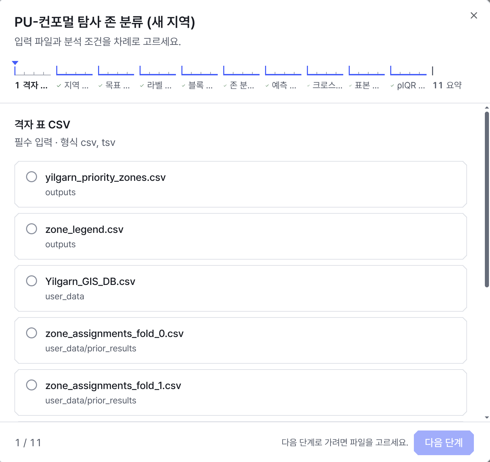
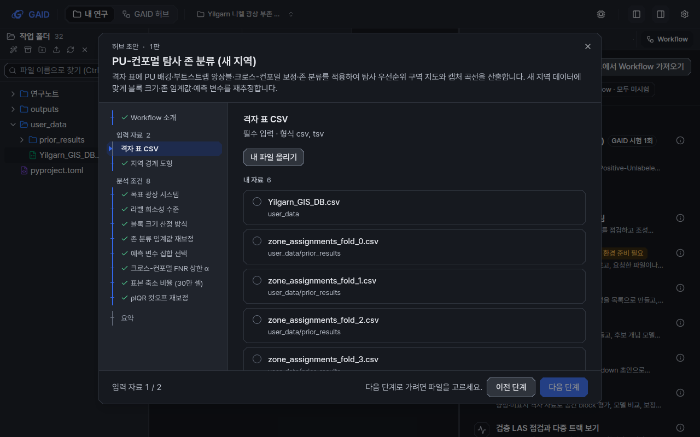
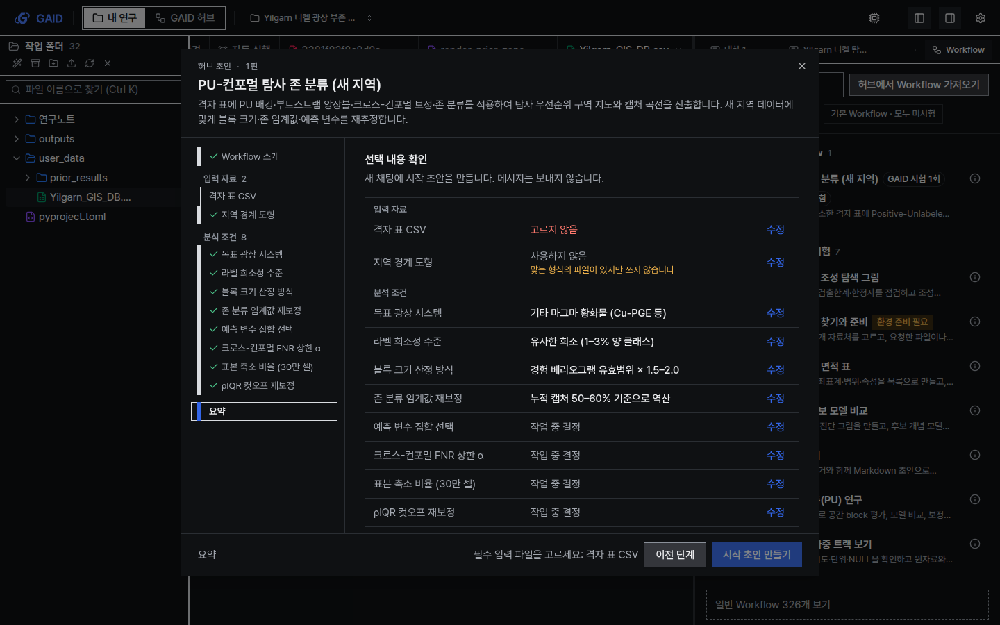
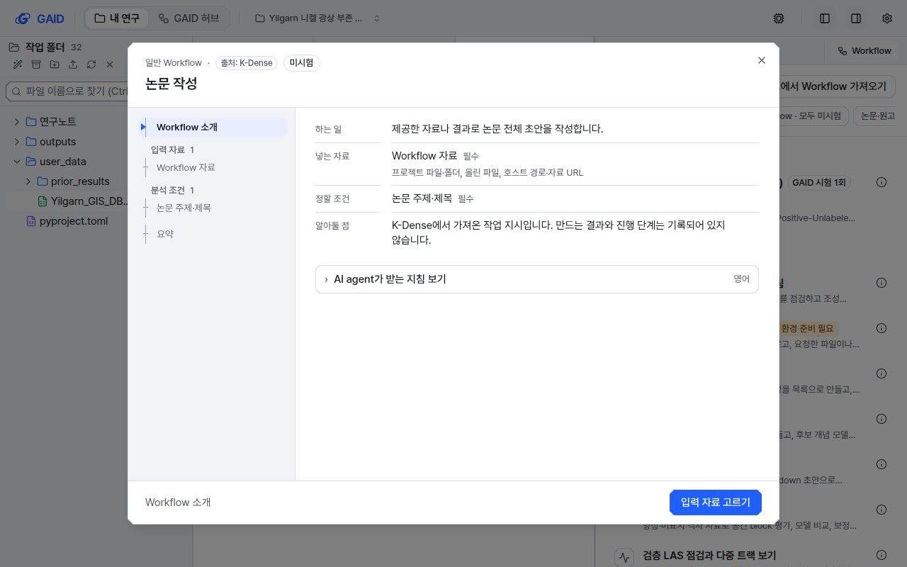

# 모든 Workflow를 같은 시작 창으로 열고 먼저 무엇을 하는지 보여 주기

## 0. 한눈에

| | |
|---|---|
| 요청 | 맞춤 Workflow는 설명 없이 바로 자료를 받고, 일반 Workflow는 창 모양이 달라 일관성이 없으니 하나로 맞추기 |
| 결론 | 기본 Workflow, 허브에서 가져온 Workflow, 일반 Workflow가 모두 같은 시작 창으로 열립니다. 창은 Workflow 소개 → 입력 자료 → 분석 조건 → 요약 순서이고, 단계가 11개여도 왼쪽 목록에 이름이 모두 보입니다. 파일 후보는 형식이 맞는 것만, 내 자료 먼저, 이전 결과는 접어서 보여 주며, 포천 검증에서 나온 선택 입력 문제(F17)도 함께 고쳤습니다. |
| 믿을 수 있는 정도 | 자동 시험과 UI·문구 검사, 실제 앱 화면 48장(두 스타일 × 두 테마 × 두 크기)으로 확인했습니다. 일반 Workflow는 실제 앱에서 새 채팅에 시작 초안이 들어가는 것까지 확인했고, 그 초안을 보내 AI agent가 실행하는 과정은 확인하지 않았습니다. |
| 결정할 일 | 없음 |

## 1. 요청한 것

> GAID 시스템에서 Workflow를 동작하려고 개별 워크플로우를 클릭하면 첨부한 이미지처럼 일관성이 없게 나타난다. 특히 커스텀한 geoscience 워크플로우는 어떤 기능인지에 대한 설명도 없으며 바로 관련자료를 입력 받게 하고 있다. 현재 구조자체는 사용자 친화적이긴하지만 워크플로우가 어떤 기능을 제공하는지에 대한 이해가 없으면 이용자들은 이용하지 않는다. 두번째 첨부한 기존 BYOK 워크플로우의 경우에는 단순하지만 설명은 있다. 하지만 결과적으로 시스템은 일관성이 있어야 하는데 커스텀 하는 것과 기존 워크플로우를 불러오는 창의 모습이 다른것은 ui/ux 측면에서 개선이 필요한 부분이라고 생각한다. — 2026-10-23 요청

이어서 사용자가 정한 것:

> Opus 5.5 high fast로 진행하고 모두 권장대로 진행하자. — 2026-10-23

> 시안 및 선택 모두 권장대로 진행하자. — 2026-10-23 (시안 검토 후)

완료 기준: 모든 Workflow가 같은 시작 창으로 열리고, 먼저 Workflow가 하는 일을 보여 준 뒤 자료와 분석 조건, 요약과 시작 동작으로 이어집니다. 내용은 기존 Workflow 지침에서 가져오고, 단계가 많아도 단계 표시가 읽혀야 합니다. 일반 Workflow의 지시문은 접어 두되 편집할 수 있어야 하고, 파일 후보는 형식이 맞는 것만, 내 자료 먼저, 이전 결과는 따로 접어서 보여 줍니다. 시안에서는 왼쪽 단계 목록과, 일반 Workflow도 새 채팅에 시작 초안을 넣는 방식을 골랐습니다.

## 2. 수행한 것

1. 두 가지 단계 표시안과 일반 Workflow 시작 방식을 시안으로 만들어 보였고, 사용자가 권장안을 골랐습니다.
2. 시작 창 틀 하나를 만들었습니다. 머리말에는 출처(기본 Workflow, 허브 Workflow, 허브 초안, 일반 Workflow), 판, 미시험 표시가 들어갑니다. 왼쪽에는 모든 단계 이름이 입력 자료·분석 조건으로 묶여 나오고, 아래쪽에는 현재 위치와 시작 단추 하나가 있습니다.
3. 첫 단계 "Workflow 소개"를 만들었습니다. Workflow에 기록된 하는 일, 넣는 자료와 예제 자료 여부, 정할 조건, 만드는 결과, 진행 단계, 해석 한계만 보여 줍니다. 기록이 없는 항목은 줄을 빼고, 전체 Workflow 보기는 접어 둡니다. 환경 준비가 필요하면 그 안내와 해결 단추도 이 단계에 나옵니다.
4. 입력 단계의 파일 후보를 형식이 맞는 파일로 한정했습니다. 내 자료(프로젝트의 자료 폴더)를 먼저 보여 주고, 나머지는 접힌 "이전 결과"로 넣었습니다. 포천 검증의 지적 F17에 따라, 파일 이름이 한 입력과만 맞으면 그 파일을 고른 상태로 시작하고 "이름이 맞음"으로 표시합니다. 맞는 파일이 있는데도 쓰지 않는 선택 입력은 요약에 따로 표시합니다.
5. 일반 Workflow를 같은 창으로 옮겼습니다. 영어 지시문은 "AI agent가 받는 지침 보기" 아래 접혀 있고 요약에서 편집할 수 있습니다. 시작하면 새 채팅에 시작 초안과 고른 파일이 들어가며, 모델은 채팅 입력창에서 고릅니다.
6. 별도 앱 인스턴스에서 Yilgarn 프로젝트 사본으로 PU-컨포멀 Workflow와 논문 작성 Workflow를 열어 계측·도폭, 밝은·어두운 테마, 1440×900·1280×800 화면을 찍고 UI 가이드 12절과 대조했습니다.

## 3. 결과

그림 0. 바뀌기 전 PU-컨포멀 Workflow 시작 창. 볼 것: 설명 없이 첫 입력 파일부터 묻고, 11개 단계 이름이 "격자 …"처럼 잘립니다.

그림 1. 같은 Workflow의 새 시작 창, 첫 단계. 볼 것: 하는 일, 넣는 자료(예제 자료 없음), 정할 조건 8개, 만드는 결과, 진행 단계 10개, 해석 한계가 자료를 묻기 전에 나옵니다. 왼쪽 목록에는 11개 단계의 이름이 모두 보입니다.

그림 2. 입력 자료 단계. 볼 것: 형식이 맞는 파일만 보이고, 자료 폴더 바로 아래 원본 파일이 먼저 나옵니다. 다른 폴더의 결과 파일은 "이전 결과" 묶음에 접혀 있습니다(이 화면에서는 아래로 스크롤해야 보입니다).

그림 3. 요약 단계. 볼 것: 입력 자료와 분석 조건이 묶여 있습니다. 선택 입력 "지역 경계 도형"은 맞는 형식의 파일이 있지만 쓰지 않는다고 표시됩니다(F17). 필수 입력을 고르지 않아 시작 단추가 꺼져 있고, 그 이유가 단추 왼쪽에 나옵니다.

그림 4. 일반 Workflow "논문 작성"이 같은 창으로 열린 모습. 볼 것: 출처 K-Dense와 미시험 표시, 일반 Workflow에 기록된 항목만 보이는 소개, 접힌 영어 지침이 있고 모델 선택 칩은 없습니다.

| 완료 기준 | 결과 | 근거 |
|---|---|---|
| 기본·허브·일반 Workflow가 같은 창으로 열림 | 충족 | 그림 1, 4 |
| 먼저 하는 일·자료·결과·주요 단계·한계·예제 자료 여부를 보여 줌 | 충족. 일반 Workflow는 기록된 항목만 보임 | 그림 1, 4 |
| 단계가 많아도 단계 표시가 읽힘 | 충족. 11개 단계 이름이 모두 보임 | 그림 1–3 |
| 일반 Workflow 지시문은 접어 두고 편집은 유지 | 충족 | 그림 4, 자동 시험 |
| 파일 후보: 형식이 맞는 것만, 내 자료 먼저, 이전 결과는 접음 | 충족 | 그림 2 |
| F17: 선택 입력이 몰래 빠지지 않게 함 | 충족. 이름이 맞는 파일 자동 선택, 요약 표시 | 그림 3, 자동 시험 |
| 두 스타일 × 두 테마 × 두 크기 확인 | 충족. 48장 | 부록 A |

## 4. 검증

- 과학적 검증: 해당 없음. 분석 방법이나 결과는 바꾸지 않았습니다. 시작 초안의 지침 내용은 지금과 같은 생성 방식을 씁니다.
- 소프트웨어 검증: 웹 자동 시험에 새 시험 4개를 더했습니다. 이름 맞춤, 소개 단계, 파일 묶음과 요약 표시, 일반 Workflow의 단계 진행·지침 편집·새 채팅 전달을 확인합니다. 단계가 하나 늘어 바뀐 기존 시험 3개 파일도 고쳤습니다. 전체 검사(백엔드 시험 2,278개, 프론트엔드 시험 1,249개, 문구·UI 가이드 검사, 실제 배포 형태의 시작·종료 시험)를 통과했습니다. 실제 앱에서는 일반 Workflow를 끝까지 진행해, 새 채팅 입력창에 지침과 고른 파일이 들어가는 것을 확인했습니다.
- UI 가이드: P2, P3, P9, B1, B3, B5, Q1–Q5, Q7, I9·I10·I14·I15(세로 눈금과 축척 막대로 그림), R1, S1, W6을 따릅니다. D2의 시트 너비(최대 720 px)는 시작 창만 920 px로 넓혔습니다. 단계 이름을 모두 보이게 하려는 사용자 결정이고, 가이드 D2·Q4와 규칙 파일에 이 예외를 적었습니다. W5(첫 화면 본문 300자)는 PU-컨포멀 소개에서 문단 글자 수가 이를 조금 넘을 수 있습니다. 긴 설명과 해석 한계는 두 줄로 줄이고 "더 보기"로 펼치게 했습니다.

## 5. 한계

- 파일 이름 맞춤은 입력의 영문 식별자와 영어 이름에 든 단어를 파일 이름과 비교합니다. 파일 안의 열 이름은 읽지 않습니다. 같은 점수의 후보가 둘 이상이면, 그중 내 자료가 하나뿐일 때만 그 파일을 고릅니다.
- 자료 폴더 안의 하위 폴더(예: 이전 결과를 옮겨 둔 폴더)도 "내 자료"로 분류합니다. 폴더 이름만으로 나누기 때문입니다.
- 1280×800에서는 소개 단계 맨 아래의 "Workflow 자세히 보기"가 스크롤해야 보입니다. 시작 단추는 창 아래에 고정되어 늘 보입니다.
- 일반 Workflow는 이제 바로 실행하지 않고 새 채팅에 초안을 넣습니다. 보내기를 한 번 더 눌러야 하고, 모델은 그 채팅의 모델을 씁니다.
- Firefox·Safari 화면, 200% 글자 확대, 화면 낭독기 읽기 순서는 확인하지 않았습니다.

## 6. 결정할 일

없음

## 7. 대체되었거나 실패한 시도

펼치기 — 2건

- 단계 표시 가)안(창 위쪽 눈금자를 묶음별로 표시, 720 px)은 시안에서 비교했고, 묶음 안 단계 이름이 마우스를 올려야 보여 쓰지 않았습니다.
- 허브 Workflow가 기본 시작 설정을 가지고 열릴 때 요약이나 첫 입력부터 보여 주던 규칙은, 사용자가 지적한 "설명 없이 바로 자료를 묻는" 화면을 그대로 만들어 바꿨습니다. 이제 연구자가 직접 저장한 시작 설정 파일로 열 때만 요약부터 보여 줍니다.

## 용어

| 용어 | 새 정의 / 정의 변경 | 정의 |
|---|---|---|
| [Workflow 시작 창](../../docs/glossary.md) | 새 정의 | Workflow를 고르면 열리는 하나의 창입니다. Workflow 소개, 입력 자료, 분석 조건, 요약 순서로 진행하고 마지막에 새 채팅에 시작 초안을 만듭니다. 기본 Workflow, 허브 Workflow, 일반 Workflow가 모두 이 창을 씁니다. |
| [내 자료 / 이전 결과](../../docs/glossary.md) | 새 정의 | 입력 파일 후보를 나누는 두 묶음입니다. 프로젝트 자료 폴더 아래 파일이 내 자료이고, 그 밖의 파일이 이전 결과입니다. |

## 부록 A. 근거 위치

펼치기 — 실행 방법, 원본, 문구, 커밋

| 항목 | 위치 |
|---|---|
| 코드 | `web/src/geo/workspace/{start-window,start-intro,upstream-start,task-setup,setup-steps}.tsx`, `web/src/geo/shell/step-list.tsx`, `web/src/app/globals.css` (`.gaid-steplist-*`), 상위 코드 연결점 `web/src/components/workflows-panel.tsx` (`extension.renderLaunch`) |
| 시험 | `web/src/geo/workspace/start-window.test.tsx`, `workspace.test.tsx`, `task-setup-examples.test.tsx`, `web/src/geo/workflow/workflow-mounts.test.tsx` |
| 전체 검사 | `scripts/check`, 통과 기록 PC74 `~/data/geoaidesk/work/gaid-workflow-start-ui/check-2.log` |
| 시안 | PC74 `~/data/geoaidesk/work/gaid-workflow-start-ui/mockups/start.html`, 비교 문서 `.../proposal/index.md` |
| 실제 앱 화면 48장 | PC74 `~/data/geoaidesk/work/gaid-workflow-start-ui/app-shots/` (`appshot.sh <style> <theme> <w> <h>`로 다시 찍음; 앱은 포트 3392/18392, 자료 `.../home/`의 Yilgarn 프로젝트 사본) |
| 가이드·규칙 | `docs/design/ui-guide.md` §0, D2, Q4; `geo/ui/ui-rules.json` `sheetPx.workflowStart`; `AGENTS.md` Workflow panel 항목 |

문구 변경(문자열 id, 한국어 / 영어):

- 새 문자열: `workspace.start.*` 전체. 대표: `intro` "Workflow 소개" / "About this Workflow"; `toInputs` "입력 자료 고르기" / "Choose input data"; `fact.purpose|inputs|choices|outputs|steps|boundary|note` "하는 일·넣는 자료·정할 조건·만드는 결과·진행 단계·해석 한계·알아둘 점" / "What it does · Data it takes · Conditions to set · What it makes · Steps · Limits · Note"; `mine` "내 자료" / "Your data"; `earlier` "이전 결과" / "Earlier results"; `nameMatch` "이름이 맞음" / "Name matches"; `unusedFit` "맞는 형식의 파일이 있지만 쓰지 않습니다" / "A file in a fitting format exists but is not used"; `upstream.note` "K-Dense에서 가져온 작업 지시입니다. 만드는 결과와 진행 단계는 기록되어 있지 않습니다." / "Task instructions taken from K-Dense. Outputs and steps are not recorded."
- 지운 문자열(더는 쓰지 않음): `workspace.setup.description` "입력 파일과 분석 조건을 차례로 고르세요." / "Choose the input files and analysis conditions step by step."; `workspace.setup.moreAbout` "작업 내용과 입력 형식 보기" / "Show what it does and input formats"; `workspace.setup.group.inputs|choices` "입력 파일·분석 조건" / "Input files · Analysis conditions"; `workspace.setup.counter` "{n} / {total}".

작성 시점: 2026-10-23, 작업 브랜치 `task/gaid-workflow-start-ui`.

