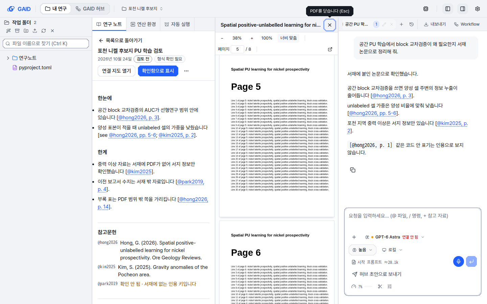
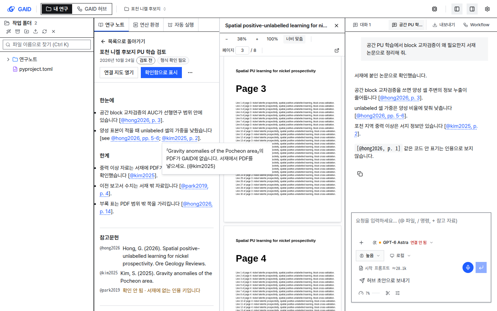
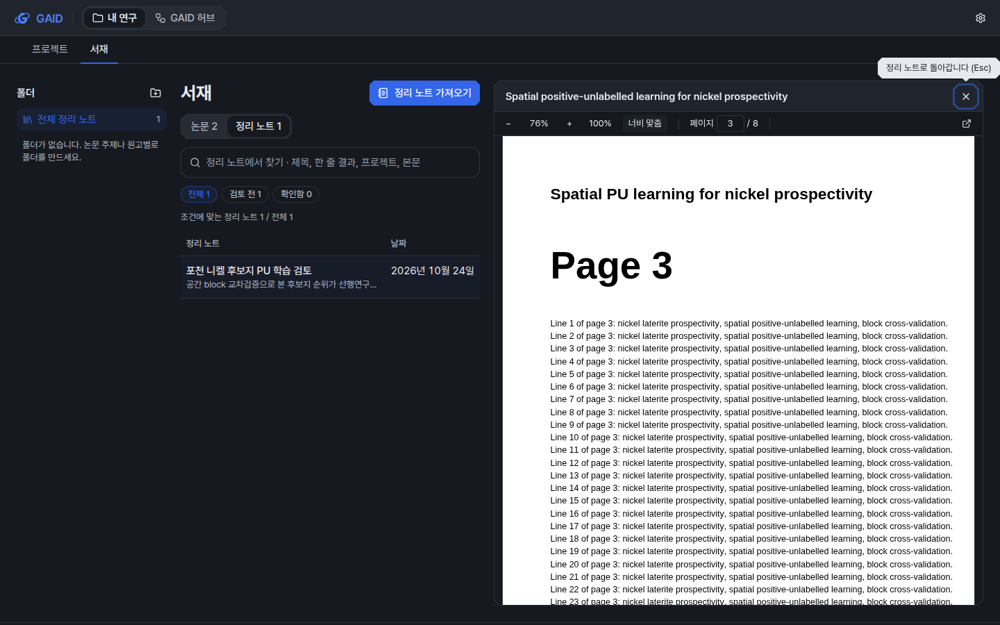

# 인용을 눌러 PDF 쪽 열기

## 0. 한눈에

| | |
|---|---|
| 요청 | 채팅과 연구 노트의 서재 인용을 누르면 옆 PDF 패널에서 그 쪽이 열리게 합니다(제안 1). |
| 결론 | 작업 공간의 채팅 답변과 연구 노트, 서재의 정리 노트에서 인용을 누르면 PDF가 인용한 쪽에서 열립니다. 서재에 없는 인용, PDF가 없는 논문, PDF에 없는 쪽은 각각 그 이유를 보여 줍니다. |
| 믿을 수 있는 정도 | 시험용 PDF(8쪽)와 시험용 노트·대화로 실제 앱에서 확인했습니다. 실제 논문 PDF와 모델이 새로 쓴 답변으로는 확인하지 않았습니다. |
| 결정할 일 | 없음 |

## 1. 요청한 것

> gaid-notebooklm-review 모두 권장대로 진행하자. — 2026-10-24 요청

이 답은 결정 1의 가) "인용을 눌러 PDF 쪽 열기와 연구 노트 결과 묶음을 먼저 만든다"를 고른 것입니다. 이 작업은 그 가운데 첫째인 제안 1입니다.

완료 기준: AI agent와 노트 인용 점검이 쓰는 서재 인용(인용 키와 쪽)을 누를 수 있고, 누르면 그 논문의 PDF가 옆 PDF 패널에서 인용한 쪽으로 열립니다. 원본 픽셀은 그대로 둡니다. 풀 수 없는 인용(PDF 없음, 모르는 키, 범위 밖 쪽)은 아무 반응 없이 지나가지 않고 그 이유를 알립니다. 작업 공간과 서재의 노트 화면에서 모두 됩니다.

## 2. 수행한 것

1. 서재에 인용 키를 물으면 논문에 PDF가 GAID에 저장돼 있는지, 몇 쪽인지도 함께 돌려주게 했습니다.
2. 채팅 답변, 연구 노트, 서재 정리 노트의 본문에서 대괄호 안 인용(예: `@hong2026, p. 3`)을 하나씩 누를 수 있는 링크로 바꿨습니다. 코드 안의 표기, 일반 링크, 이메일 주소는 그대로 둡니다.
3. 작업 공간에서는 PDF를 미리보기와 대화 사이의 열로 엽니다. 미리보기와 너비를 반씩 나눠, 인용이 있는 노트를 읽으면서 PDF를 함께 봅니다. 서재에서는 이미 있던 PDF 패널을 씁니다.
4. 열 수 없는 인용은 누른 인용 바로 옆에 이유를 띄웁니다. 인용한 쪽이 PDF에 없으면 PDF는 첫 쪽으로 열고 패널 위에 그 사실을 적습니다.
5. 실제 앱을 띄워 계측·도폭 두 스타일, 밝은·어두운 테마, 1440×900·1280×800 화면에서 확인했습니다.

## 3. 결과

그림 1. 작업 공간, 계측 스타일, 밝은 테마, 1440×900. 연구 노트의 `@hong2026, p. 3`을 누른 뒤입니다. 볼 것: 노트는 왼쪽에 그대로 있고, 가운데 PDF 패널이 3쪽(쪽 번호 칸 3 / 8)에서 열렸습니다. 인용은 점선 밑줄로 표시됩니다.

그림 2. 채팅 답변의 `@hong2026, pp. 5-6`을 누른 뒤입니다. 볼 것: 쪽 범위 인용은 첫 쪽(5쪽)으로 열립니다. 답변 안 코드 표기 `[@hong2026, p. 1]`은 인용으로 바뀌지 않았습니다.

그림 3. 도폭 스타일, 밝은 테마. 서재에는 있지만 PDF가 없는 논문의 인용(`@kim2025, p. 2`)을 누른 뒤입니다. 볼 것: 이미 열린 PDF는 바뀌지 않고, 누른 인용 옆에 "PDF가 GAID에 없습니다. 서재에서 PDF를 넣으세요."가 뜹니다.

그림 4. 서재, 계측 스타일, 어두운 테마. 정리 노트 상세의 인용을 누른 뒤입니다. 볼 것: 정리 노트 표는 제목과 날짜만 남기고, PDF는 원래 픽셀(흰 바탕)로 3쪽에서 열립니다. 닫으면 같은 정리 노트로 돌아갑니다.

| 완료 기준 | 결과 | 근거 |
|---|---|---|
| 채팅 답변의 서재 인용을 누르면 PDF가 인용한 쪽에서 열림 | 충족 | 그림 2 |
| 연구 노트의 서재 인용을 누르면 PDF가 인용한 쪽에서 열림(작업 공간) | 충족 | 그림 1 |
| 서재의 노트 화면에서도 됨 | 충족 | 그림 4 |
| 원본 픽셀 유지 | 충족(어두운 테마에서도 PDF는 그대로) | 그림 4 |
| 모르는 키를 누르면 이유를 알림 | 충족: "서재에 없는 인용 키라 PDF를 열 수 없습니다." | 4절 |
| PDF가 없는 논문은 이유를 알림 | 충족 | 그림 3 |
| 범위 밖 쪽은 이유를 알림 | 충족: "인용한 14쪽이 없습니다. PDF는 8쪽까지라 첫 쪽을 보여 줍니다." 패널은 1쪽으로 이동 | 4절 |
| 두 스타일·두 테마·두 화면 크기 확인 | 충족(24장) | 부록 A |

## 4. 검증

- 동작 확인: 실제 앱(개발 모드)에 시험용 프로젝트, 8쪽짜리 시험 PDF가 붙은 논문 하나, PDF 없는 논문 하나, 인용 여섯 개가 든 연구 노트, 인용 세 개가 든 대화를 만들었습니다. 각 인용을 눌러 PDF가 몇 쪽에 있는지 화면 위치로 확인했습니다. 3쪽 인용은 3쪽, 5-6쪽 인용은 5쪽, 범위 밖 14쪽 인용은 1쪽이었습니다. 모르는 키, PDF 없음, 범위 밖 쪽은 위의 안내 문장이 떴습니다.
- 소프트웨어 검증: 인용 위치를 찾는 규칙, 쪽 번호 읽기(`p. 12`, `pp. 3-5`, `12쪽` 등), 인용 링크 만들기, 열 수 없는 경우의 안내, PDF 쪽수를 나중에 알게 된 경우의 범위 밖 판정을 단위 시험으로 확인했습니다. 서재가 PDF 유무와 쪽수를 돌려주는지는 서버 시험으로 확인했습니다. 전체 검사 결과는 부록 A에 적습니다.
- 수치 다섯 점검: 이 보고서의 결론은 수치에 기대지 않습니다. 해당 없음.

## 5. 한계

- 쪽 번호는 PDF의 쪽 순서입니다. 서재 도구와 노트 인용 점검이 이미 그 기준으로 쓰므로 맞지만, 사람이 학술지 인쇄 쪽 번호로 손으로 고친 인용은 다른 쪽을 엽니다.
- 쪽 범위(`pp. 5-6`)는 첫 쪽으로 엽니다. 인용한 문장의 위치 표시(강조)는 하지 않습니다.
- PDF가 GAID에 저장된 논문만 열립니다. Zotero에만 PDF가 있는 논문은 "PDF가 GAID에 없습니다"로 안내합니다.
- 1024~1279 px의 좁은 데스크톱 화면에서는 대화가 미리보기 위를 덮는 시트로 뜹니다. 이때 PDF 열은 시트 왼쪽에 놓이도록 했지만 화면으로 확인하지는 않았습니다.
- 실제 논문 PDF, Zotero 연결 논문, 모델이 새로 쓰는 중인 답변에서는 확인하지 않았습니다. 쓰는 중인 답변은 대괄호가 닫힌 뒤에 인용이 링크로 바뀝니다.
- 노트 아래 참고문헌 목록의 항목은 누를 수 없습니다. 본문의 인용만 PDF를 엽니다.

## 6. 결정할 일

없음

## 7. 대체되었거나 실패한 시도

펼치기 — 3건

- 열 수 없는 인용의 안내를 처음에는 화면 구석의 짧은 알림으로 띄웠습니다. UI 가이드(오류는 문제 옆에, 저절로 사라지는 알림에 오류를 담지 않음)에 맞지 않아, 누른 인용 옆에 남는 안내로 바꿨습니다.
- 인용을 일반 버튼으로 만들었더니 줄 끝에서 인용 전체가 다음 줄로 넘어가 여는 괄호만 남았습니다. 문장과 함께 줄바꿈되는 인라인 요소로 바꿨습니다.
- PDF 열의 너비를 화면의 36%로 고정했더니 1440 px에서 노트가 약 200 px로 좁아졌습니다. 미리보기와 반씩 나누도록 바꿨습니다.

## 용어

없음

## 부록 A. 근거 위치

펼치기 — 실행 방법, 원본, 해시, 커밋

| 항목 | 위치 |
|---|---|
| 인용 링크·열기 | `web/src/geo/library/citation-links.tsx`, `web/src/geo/library/citation-pdf.tsx`, `web/src/geo/pdf/pdf-pane.tsx` (`notice`, `closeHint`, `onDocumentReady`) |
| 연결 지점 | `web/src/components/ai-elements/message.tsx` (`libraryCitations`), `web/src/components/chat-tab.tsx`, `web/src/geo/notes/research-notes-panel.tsx`, `web/src/geo/library/note-items.tsx`, `web/src/app/page.tsx`, `web/src/geo/library/library-screen.tsx` |
| 계약·서버 | `web/src/geo/contracts/library.ts` (`citationSpans`, `citationPage`, `CitationResolution.pdf`), `server/src/geo/routes/library.ts` (`GET /geo/library/citations`) |
| 문구 | `web/src/geo/locales/library/{ko,en}.json` `cite.*` |
| 시험 | `web/src/geo/library/citation-pdf.test.tsx`, `web/src/geo/contracts/library.test.ts`, `server/test/geo-library.test.ts`, `server/test/geo-library-folders.test.ts` |
| 화면 묶음 24장 | PC74:`~/data/geoaidesk/work/gaid-cite-open-pdf/playwright/matrix/` (목록과 해시 `matrix.sha256`, sha256 `71b1ed286ebb5bbcf3e80ac2ae3ad47711c5dfa1a46beea5e9266b7577782a8a`) |
| 범위 밖 쪽 화면 | PC74:`~/data/geoaidesk/work/gaid-cite-open-pdf/playwright/06-page-missing.png` sha256 `8747928b1e118e08adccf96476ec101f32d6ed5039190b26586ecccffac1d85e` |
| 시험 자료 | PC74:`~/data/geoaidesk/work/gaid-cite-open-pdf/` (`fixtures/pu.pdf`, `projects/`, `agent/`) |
| 검사 | `scripts/check` (결과는 task 문서 Current state) |

작성 시점: 2026-10-24, 브랜치 `task/gaid-cite-open-pdf`.

