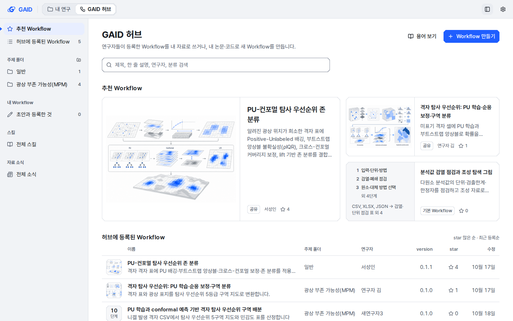
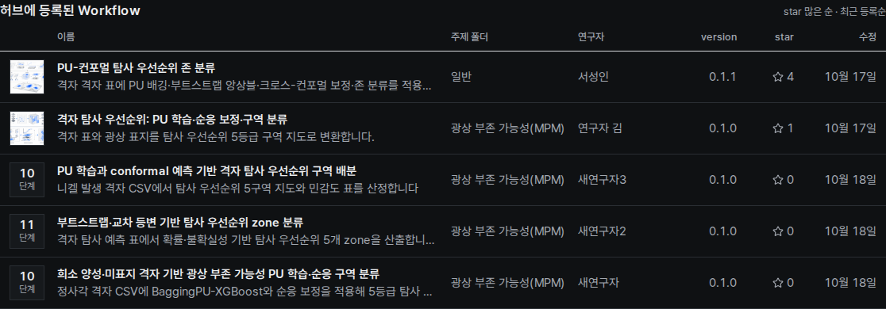
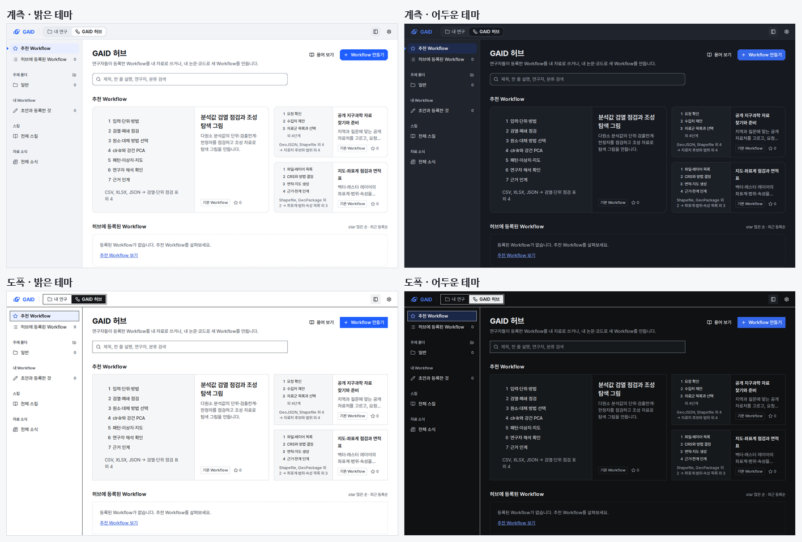
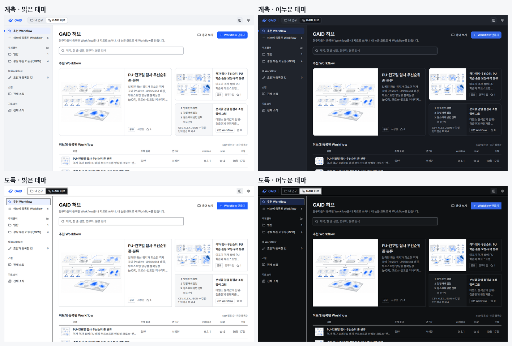

# 허브 카드에 Workflow의 분석 단계 그리기

## 0. 한눈에

| | |
|---|---|
| 요청 | 개념 그림이 없는 허브 추천 카드에 그 Workflow의 분석 단계와 입력·결과 형식을 그리고, 목록 줄에 단계 수를 보입니다(시나리오 A). |
| 결론 | 추천 카드와 등록된 Workflow 목록 모두 그림이 없을 때 Workflow 지침의 단계를 그대로 보입니다. 그림이 있으면 지금처럼 그림을 씁니다. 단계는 번호 목록으로 그리고 눈금은 쓰지 않습니다(UI 가이드 I10 유지). |
| 믿을 수 있는 정도 | 실제 앱 화면을 네 조합과 두 크기로 찍어 확인했고, 접근성 검사(axe)는 네 조합 모두 위반 0건입니다. 기관 허브 서버에 로그인한 상태의 화면은 찍지 않았습니다. 같은 코드 경로를 쓰지만 화면으로는 확인하지 않았습니다. |
| 결정할 일 | 없음 |

## 1. 요청한 것

> "모두 권장으로 진행하자." — 2026-10-24, gaid-uiux-skills-scan 6절의 두 결정에 대한 답

hub가 넘긴 이 단위의 목표(시나리오 A) 원문:

> Hub recommended cards without a concept picture draw the Workflow's own analysis stages (from WorkflowDoc `steps[]`, which are 3-5 analysis-flow stages since gaid-workflow-stages) plus input/output formats, instead of the title-guessed icon; list rows show a stage-count readout; concept pictures keep precedence. Older Workflows without steps keep a sensible fallback (no invented stages).
>
> Decide and record how the stage diagram sits with UI guide I10 (scales only where they show a position): a stage diagram that is not a position readout must not reuse StepScale's graduated look, or the guide gets an amendment proposed for the user.

완료 기준: 그림 없는 추천 카드는 단계와 입력·결과를, 그림 없는 목록 줄은 단계 수를 보입니다. 그림이 우선이고, 단계가 없는 Workflow에는 단계를 지어내지 않습니다. I10과의 관계를 정해 가이드에 적습니다. 네 조합 화면과 규칙 번호로 보고합니다.

## 2. 수행한 것

1. 허브가 카드와 목록에 보내는 자료에 Workflow의 단계 요약(단계 이름, 입력 형식, 결과 이름)을 더했습니다. 요약은 Workflow 상세 화면이 쓰는 지침에서 그대로 뽑습니다. 등록된 Workflow는 최신 version의 지침에서, 기본 Workflow는 카탈로그 지침에서 뽑습니다.
2. 그림 없는 추천 카드의 그림 자리에 단계 번호 목록과 "입력 → 결과" 한 줄을 그렸습니다. 큰 첫 카드는 8단계까지 본문 크기로, 옆 카드는 4줄까지 그리고 나머지는 "외 n단계"로 줄입니다.
3. 그림 없는 목록 줄의 작은 칸에 단계 수 표시(숫자 위, "단계" 아래)를 넣었습니다. 화면 낭독기에는 "분석 단계 n개: …"로 단계 이름까지 읽힙니다.
4. I10을 정했습니다. 카드의 단계 목록은 지금 어느 단계인지를 보이지 않으므로 번호 목록으로 그렸고, 가이드 I10에 이 경우를 한 문장으로 적었습니다.
5. 격리한 자료 폴더로 실제 앱을 띄워 두 상태를 찍었습니다. 하나는 공유 Workflow가 없는 새 설치, 다른 하나는 검토용 앱 허브 자료의 사본입니다.

## 3. 결과

그림 1. 공유 Workflow가 없는 새 설치 상태의 허브 첫 화면(1440×900, 네 조합). 볼 것: 추천 카드 세 장 모두 그림이 없어, 각 기본 Workflow의 단계와 "입력 형식 → 결과"가 그림 자리에 들어갑니다. 계측과 도폭은 같은 부품을 쓰고 바탕색만 역할 색으로 달라집니다.

그림 2. 개념 그림이 있는 공유 Workflow가 추천에 오른 상태(계측, 밝은 테마, 1440×900). 볼 것: 그림이 있는 두 카드는 그림을 그대로 쓰고, 그림 없는 기본 Workflow 카드만 단계를 그립니다. 바뀌기 전 화면은 gaid-uiux-skills-scan 보고서 그림 1의 "현재"에 있습니다(같은 자리에 제목으로 고른 플라스크 아이콘).

그림 3. 등록된 Workflow 목록(도폭, 어두운 테마). 볼 것: 그림이 있는 두 줄은 작은 그림을 쓰고, 그림 없는 세 줄은 10·11·10단계를 숫자로 보입니다. 이 셋은 단계 규칙이 생기기 전에 등록되어, 스킬 절차에서 뽑은 단계가 5개를 넘습니다.

그림 4. 그림 1과 같은 상태를 1280×800으로 찍은 화면. 볼 것: 좁은 창에서 "입력 → 결과" 줄이 두 줄로 접히고, 단계 이름은 잘리지 않습니다.

그림 5. 그림 2와 같은 상태를 1280×800, 네 조합으로 찍은 화면. 볼 것: 도폭 어두운 테마에서도 흰 바탕의 이전 개념 그림은 받침 위에 그대로 놓이고(I6), 단계 카드는 다른 카드와 같은 역할 색 바탕을 씁니다.

| 완료 기준 | 결과 | 근거 |
|---|---|---|
| 그림 없는 추천 카드에 Workflow의 단계와 입력·결과 형식 | 충족 | 그림 1, 2, 4 |
| 그림 없는 목록 줄에 단계 수 표시 | 충족 | 그림 3 |
| 개념 그림 우선 | 충족 | 그림 2, 3, 5 |
| 단계 없는 Workflow는 단계를 지어내지 않음 | 충족: 단계가 없으면 이전 중립 칸(카드)과 격자 아이콘(목록)을 그대로 씁니다 | 4절 서버 시험 |
| I10과의 관계 결정·기록 | 충족: 번호 목록, 눈금 없음, 가이드 I10에 한 문장 추가 | 2절 4번 |
| 네 조합·두 크기 화면, 규칙 번호 | 충족 | 그림 1–5, 아래 규칙 표 |
| 이전 부채 gaid-ui-audit#1 중 작은 것 함께 고치기 | 해당 없음: 두 항목 모두 작지 않고 이 화면에 없습니다 | 5절 |

UI 가이드 규칙:

| 규칙 | 지킨 방법 |
|---|---|
| I10 | 단계 목록에 눈금, 채움, 축척 막대를 쓰지 않습니다. 목업의 눈금형 칸은 쓰지 않았습니다. |
| I11 | 목록 줄의 단계 수는 짧은 판 위의 숫자 표시입니다. |
| I5 | 단계 번호와 단계 수는 고정폭 숫자입니다. 장식용 번호(01, 02)는 없습니다. |
| I6 | 개념 그림이 있으면 그림을 먼저 쓰고, 그림 픽셀은 손대지 않습니다. |
| G3 | 카드는 지금처럼 추천 Workflow에만 쓰고, 목록은 줄로 둡니다. |
| T1 | 옆 카드의 단계는 설명 크기(13 px), 첫 카드는 본문 크기(15 px), 단계 수 아래 "단계"는 단위 크기(12 px)입니다. |
| V1, 2절 | 색은 역할 토큰만 쓰고, 부품은 계측·도폭을 코드에서 나누지 않습니다. |
| S2 | 단계가 없는 오래된 기록은 이전 중립 칸과 아이콘을 그대로 씁니다. |

## 4. 검증

- 과학적 검증: 해당 없음(화면 표시 변경). 카드의 단계 이름이 Workflow 상세 화면의 단계와 같은지는 같은 지침에서 뽑는 코드로 맞췄고, 서버 시험이 등록 Workflow의 단계·입력·결과를 대조합니다.
- 소프트웨어 검증:
  - 서버 시험 한 건을 더했습니다. 등록된 Workflow의 목록 항목과 추천 카드에 단계 3개, 입력 CSV, 결과 "점수 표"가 실리는지 봅니다. 단계도 절차도 없는 기본 Workflow 카드에는 단계가 실리지 않는지도 봅니다. 허브 공유 시험 파일 17건이 통과했습니다.
  - 화면 시험 두 건을 더했습니다. 5단계 Workflow가 옆 카드에서 3단계 + "외 2단계"로 줄고 "CSV, XLSX → 점검 표 외 1"이 보이는지, 그림이 있으면 단계를 그리지 않는지, 목록 줄에 단계 수가 보이는지 봅니다. 허브 화면 시험 59건이 통과했습니다.
  - 실제 앱 화면: 네 조합 × 두 크기 × 두 상태로 16장을 찍었습니다. 1440×900 여덟 장에서 axe 접근성 검사(WCAG 2.1 A/AA)는 위반 0건입니다.
  - 문구 검사와 UI 규칙 검사는 오류 0건이고, 새 문구에 경고가 없습니다. 전체 검사 결과는 부록 A에 적습니다.

## 5. 한계

- 기관 허브 서버에 로그인한 상태의 화면은 찍지 않았습니다. 단계 요약은 연구자의 GAID가 서버에서 받은 등록 기록으로 계산하므로 같은 코드 경로를 지나지만, 화면으로는 확인하지 않았습니다. 허브 서버 코드는 바꾸지 않았습니다.
- 단계 규칙(3–5단계)이 생기기 전에 등록된 Workflow와 지금의 기본 Workflow는 스킬 절차에서 뽑은 단계라 4–11개입니다. 카드는 "외 n단계"로 줄여 보이지만, 단계 수 자체는 그 Workflow를 다시 등록해야 줄어듭니다.
- 결과 이름이 길면 "입력 → 결과" 줄이 두 줄에서 잘립니다. 전체 문장은 마우스를 올리면 보입니다.
- 이전 부채 gaid-ui-audit#1의 두 항목(허브 저작 단계 표시, 브라우저 기본 선택 상자 63곳)은 고치지 않았습니다. 저작 흐름 전체를 다시 배치하거나 공용 부품을 새로 만들어야 하고, 이 화면에는 없습니다.

## 6. 결정할 일

없음

## 7. 대체되었거나 실패한 시도

펼치기 — 2건

- 시나리오 목업의 눈금형 단계 칸(계측 눈금자, 도폭 축척 막대): I10은 눈금을 위치를 보일 때만 쓰게 합니다. 카드의 단계 목록에는 현재 위치가 없으므로 쓰지 않았습니다.
- 첫 카드의 단계 글자를 옆 카드와 같은 설명 크기로 그린 첫 화면: 넓은 칸에 작은 글자만 남아 비어 보여서, 첫 카드만 본문 크기로 바꿨습니다.

## 용어

없음

## 부록 A. 근거 위치

펼치기 — 실행 방법, 원본, 해시, 커밋

| 항목 | 위치 |
|---|---|
| 코드 | 브랜치 task/gaid-hub-stage-cards: `web/src/geo/contracts/hub-shared.ts` (`HubWorkflowStages`, `hubWorkflowStages`, `hubFormatName`), `server/src/geo/hub-shared/routes.ts` (`entryView`, `/geo/hub/recommended`), `web/src/geo/hub/stage-plate.tsx`, `hub-home.tsx`, `shared-browse.tsx`, `hub-screen.tsx`, 문구 `web/src/geo/locales/hub/{ko,en}.json` `home.stages.*` |
| 가이드 | `docs/design/ui-guide.md` I10 한 문장 추가 |
| 시험 | `server/test/geo-hub-shared.test.ts` "carries the Workflow's own stages…", `web/src/geo/hub/shared-browse.test.tsx` "Workflow stages without a picture" |
| 화면 원본 | pc74:`~/data/geoaidesk/work/gaid-hub-stage-cards/shots/` (16장 + 목록 2장, axe 결과 `axe-hub.json`, `axe-fresh.json`), 촬영 스크립트 `.../scripts/` |
| 실행 환경 | 격리 자료 폴더 pc74:`~/data/geoaidesk/work/gaid-hub-stage-cards/home` (허브 자료는 `~/.geoaidesk/pi-agent/skill-hub/shared` 사본), backend `tsx src/index.ts` 8710, `next dev -p 3710`, 카탈로그 0.3.0 |
| 전체 검사 | `scripts/check` 기록 pc74:`~/data/geoaidesk/work/gaid-hub-stage-cards/check.log` |

문구 id(한·영 새로 추가, 바꾼 문구 없음):

| id | 한국어 | English |
|---|---|---|
| `hub.home.stages.label` | 분석 단계 {count}개: {list} | {count} analysis stages: {list} |
| `hub.home.stages.more` | 외 {count}단계 | {count} more stages |
| `hub.home.stages.moreItems` | 외 {count} | +{count} |
| `hub.home.stages.firstAndMore` | {first} 외 {count} | {first} +{count} |
| `hub.home.stages.flow` | {from} → {to} | {from} → {to} |
| `hub.home.stages.unit` | 단계 | stages |

작성 시점: 2026-10-24.

