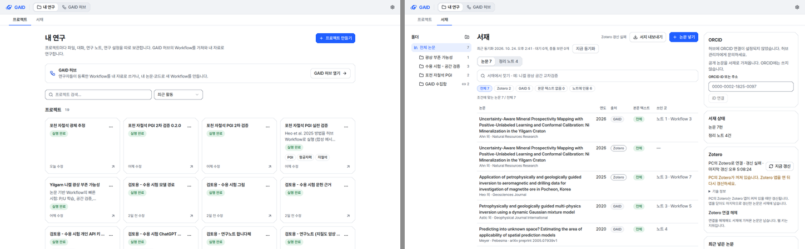
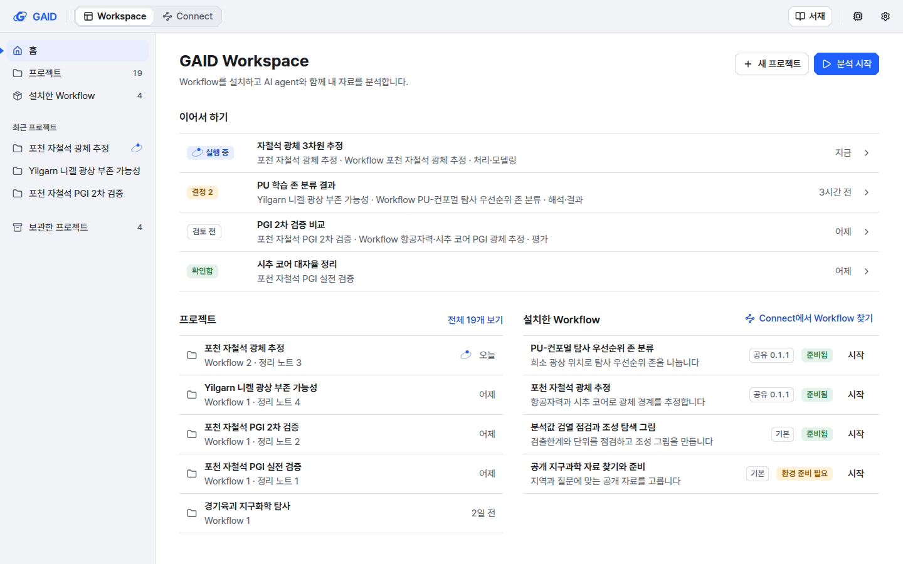
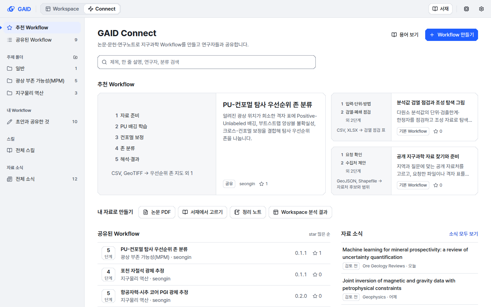
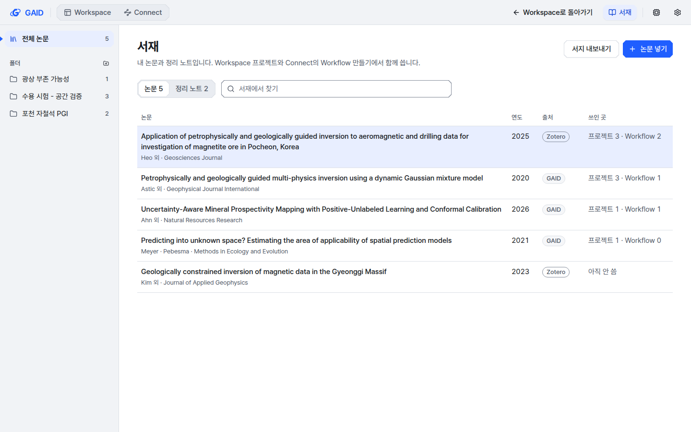
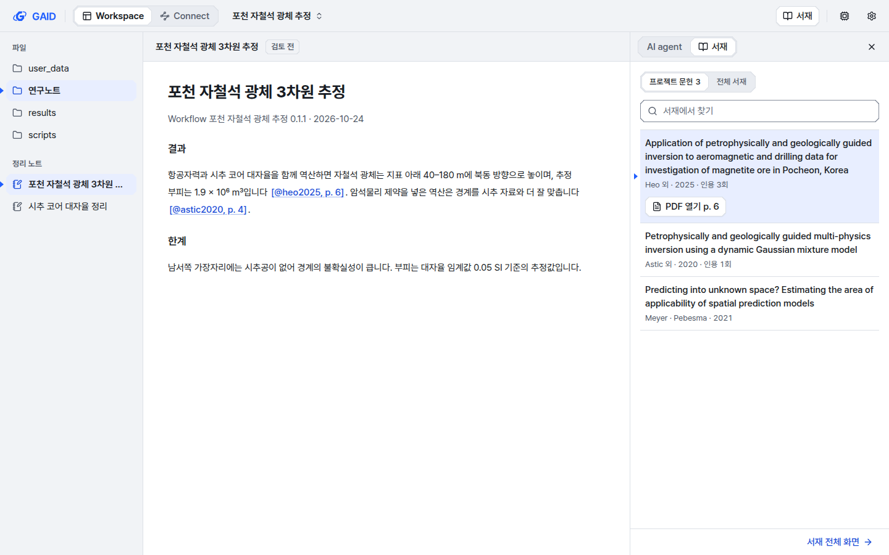
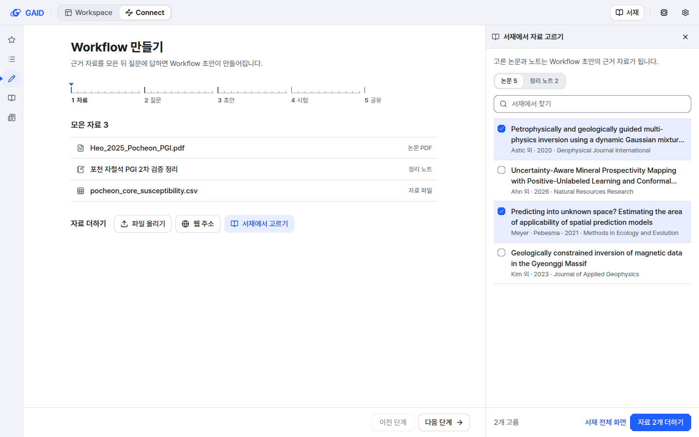
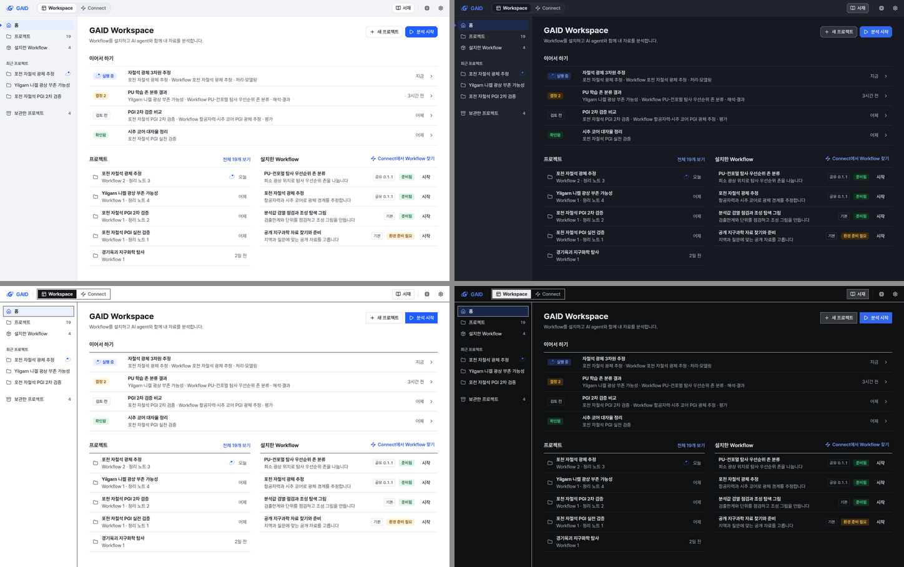
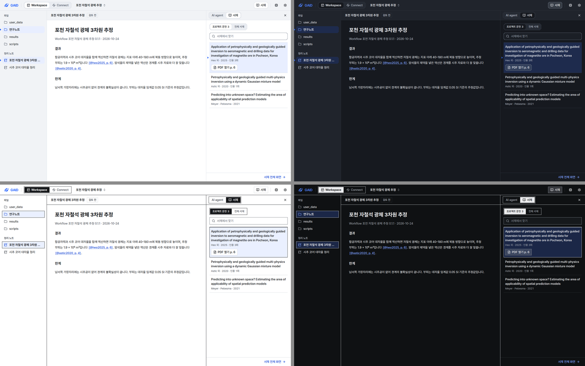
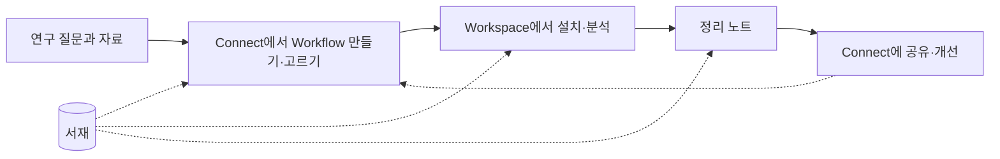

# GAID Connect와 GAID Workspace로 나눈 화면 구조 시안

## 0. 한눈에

| | |
|---|---|
| 요청 | 허브와 시스템이 따로 노는 구조, 서재가 시스템의 주 기능처럼 보이는 문제를 GAID Connect와 GAID Workspace 구조로 바로잡고, 먼저 시안으로 확인 |
| 결론 | 앱 바에 Workspace와 Connect 두 장소를 두고, 서재는 오른쪽 끝의 개인 버튼과 쓰는 곳의 옆 패널로 옮긴 시안을 만들었습니다. 앱 화면은 아직 바꾸지 않았습니다. |
| 믿을 수 있는 정도 | 시안은 실제 색 토큰과 공용 부품으로 그렸고 계측·도폭, 밝은·어두운 테마에서 캡처했습니다. 표본 자료로 그린 화면이라 실제 자료 연결과 동작은 확인하지 않았습니다. |
| 결정할 일 | 4건 (6절) |

그림 0. 지금 화면. 왼쪽은 "내 연구 → 프로젝트", 오른쪽은 "내 연구 → 서재"입니다. 볼 것: 시스템 쪽 첫 화면이 프로젝트 목록과 서재 두 탭뿐이라, Workflow 설치와 분석이라는 핵심이 프로젝트를 열기 전에는 보이지 않습니다.

## 1. 요청한 것

> 사용자의 피드백이다.어느새 GAID를 허브와 시스템으로 완전히 분리하고 있으며, GAID 시스템을 마치 서재가 메인 기능인것처럼 간주하고 있다. GAID 허브는 지구과학 연구자들이 논문, 문헌, 연구노트 등을 기반으로 양질의 지구과학용 워크플로우(또는 스킬)을 생성하고 공유하는 공간이고, 시스템은 해당 워크플로우를 설치하고 에이전트형 분석 작업을 수행하고 IDE와 에이전틱 기반 작업 및 지구과학친화적 분석 시스템이 종합된 분석 프레임워크이다. 이를 모두 합친 것이 GAID이며, 서재의 경우에는 GAID 시스템에 포함되어도 되고, 허브에 포함될 수 있지만 전체적으로 연구자 개인의 문헌 관리 공간으로 간주해야한다. 어떻게 체계화하여야 사용자가 제기한 문제를 해결할 수 있을지 진단 후 답변하여라. — 2026-10-24 요청

> 1번과 관련하여 허브와 시스템에 적절한 이름을 후보군을 조사하여 알려줘. ... 2, 3은 권장이다.

> 제목은 GAID Connect 와 GAID Workspace가 적절한것 같다.

완료 기준(1단계): 앱 바, Workspace 홈, Connect 홈, 서재 전체 화면, 쓰는 곳의 서재 패널을 실제 토큰과 부품으로 그린 시안을 한국어로 계측·도폭, 밝은·어두운 테마에서 1440×900(1280×800 일부)으로 캡처하고, 바뀌는 문구와 문서 변경안을 함께 제안합니다. 사용자가 승인하면 2단계에서 실제 화면에 적용합니다.

## 2. 수행한 것

1. 지금 화면을 검토용 앱에서 그대로 캡처했습니다(그림 0). 앱 데이터는 바꾸지 않았습니다.
2. 장소 이름이 나오는 문구, 주소, 문서를 모두 찾아 겹치는 이름을 정리했습니다(3.6절).
3. 개발용 시안 페이지를 만들어 5개 화면을 그렸습니다. 공용 앱 바 구조, 사이드바 항목, 페이지 머리, 단계 눈금, Workflow 단계 판을 그대로 썼고 문구는 문자열 카탈로그에 넣었습니다.
4. 5개 화면을 계측·도폭 × 밝은·어두운 테마로 1440×900에서, 4개 화면을 1280×800에서 캡처해 UI 가이드 12절 점검표로 확인했습니다.
5. 결정 기록(ADR) 초안을 썼고, 용어 목록, AGENTS.md, UI 가이드 변경안을 정리했습니다(3.7절).

## 3. 결과

### 3.1 앱 바: 두 장소와 개인 서재

모든 화면의 맨 위 막대는 왼쪽부터 GAID 표지, 장소 전환 `Workspace | Connect`, 그 화면의 조작(프로젝트 안에서는 프로젝트 바꾸기), 오른쪽 끝의 `서재` 버튼, 컴퓨터 자원, 설정 순서입니다. 서재는 두 장소 어디에서든 여는 개인 공간이라 장소 전환 밖, 설정 옆에 둡니다. 표지를 누르면 Workspace 홈으로 갑니다.

### 3.2 Workspace 홈

그림 1. Workspace 홈(계측, 밝은 테마, 1440×900). 볼 것: 첫 화면에 `이어서 하기`(여러 프로젝트의 최근 분석과 정리 노트, 실행 중·결정 2·검토 전·확인함 상태), 프로젝트, 설치한 Workflow가 함께 보이고 주 동작은 `분석 시작` 하나입니다. 설치한 Workflow 옆의 `Connect에서 Workflow 찾기`가 두 장소를 잇습니다.

지금의 "내 연구" 화면은 프로젝트 카드 목록이 전부입니다. 시안에서는 Workflow를 설치하고 분석하는 곳이라는 점이 첫 화면에서 보입니다. 사이드바는 홈, 프로젝트(전체 목록), 설치한 Workflow, 최근 프로젝트, 보관한 프로젝트입니다. 지금 프로젝트 목록 위에 있는 "GAID 허브" 안내 줄은 앱 바로 대신하므로 없앱니다.

### 3.3 Connect 홈

그림 2. Connect 홈. 볼 것: 지금의 허브 홈과 같은 구성(추천 Workflow, 공유된 Workflow, 사이드바)에 `내 자료로 만들기` 줄을 더했습니다. 논문 PDF, 서재에서 고르기, 정리 노트, Workspace 분석 결과 네 가지가 Workflow를 만드는 출발점이라는 점이 보입니다. 오른쪽 아래는 자료 소식 최근 3건입니다.

### 3.4 서재 전체 화면

그림 3. 앱 바의 `서재`를 누른 화면. 볼 것: 장소 전환에는 선택된 장소가 없고 `서재` 버튼이 선택된 모양입니다. `Workspace로 돌아가기`로 연 곳으로 돌아갑니다. 머리 설명이 "Workspace 프로젝트와 Connect의 Workflow 만들기에서 함께 씁니다"라고 두 장소와의 관계를 밝힙니다. `쓰인 곳` 열은 프로젝트 수와 Workflow 수를 보입니다.

서재 안의 내용(폴더, 논문·정리 노트, Zotero·ORCID 카드, 논문 상세)은 지금 화면을 그대로 옮깁니다. 시안에서는 화면 틀과 진입 방식만 그렸고 오른쪽 Zotero·ORCID 카드는 생략했습니다.

### 3.5 쓰는 곳에서 여는 서재 패널

그림 4. Workspace 프로젝트에서 정리 노트를 읽는 화면. 볼 것: 오른쪽 패널이 `AI agent | 서재` 두 보기를 오갑니다. 서재 보기는 이 프로젝트에 붙인 문헌 3편을 먼저 보이고, 노트의 인용 `[@heo2025, p. 6]`를 누르면 그 논문이 선택되어 `PDF 열기 p. 6`이 나옵니다. 아래 `서재 전체 화면`으로 전체 서재로 갑니다.

그림 5. Connect에서 Workflow를 만드는 첫 단계(자료). 볼 것: `서재에서 고르기`를 누르면 오른쪽에 서재 패널이 열리고, 논문이나 정리 노트를 골라 `자료 2개 더하기`로 근거 자료에 넣습니다. 같은 서재 부품이 두 장소에서 같은 모양으로 열립니다.

그림 6. Workspace 홈의 네 조합(위: 계측 밝은·어두운, 아래: 도폭 밝은·어두운). 볼 것: 장소 전환은 계측에서 떠 있는 면, 도폭에서 반전된 잉크로 선택을 보입니다. 파란색은 주 동작, 현재 선택, 실행 중 표시에만 쓰였습니다.

그림 7. 서재 패널을 연 프로젝트 화면의 네 조합. 볼 것: 패널 머리와 파일 목록은 기능층 색, 노트 본문과 패널 본문은 내용 면 색으로 나뉩니다.

### 3.6 겹치는 이름과 바꿀 문구

| 지금 | 제안 | 비고 |
|---|---|---|
| 앱 바 `내 연구` | `Workspace` | 홈 제목은 `GAID Workspace` |
| 앱 바 `GAID 허브`, 허브 홈 제목, 프로젝트 목록의 "GAID 허브" 안내 줄 | `Connect`, 홈 제목 `GAID Connect`, 안내 줄 없앰 | |
| 프로젝트 화면 제목 `내 연구`와 설명 "GAID 허브의 Workflow를 가져와…" | Workspace 홈(3.2절)으로 대체 | |
| 서재 탭 `프로젝트 / 서재`, 탭 묶음 이름 "내 연구 화면" | 탭 없앰, 앱 바 `서재` | 서재 상세의 "내 연구에서 쓰인 곳"은 "쓰인 곳" |
| "허브 목록 숨기기", "허브 목록" | "Connect 목록 숨기기", "Connect 목록" | |
| "허브에 등록된 Workflow", "GAID 허브에 등록", 상태 "등록됨" | 결정 4: "공유된 Workflow", "Connect에 공유", "공유됨" | version 표기는 그대로 |
| Workflow 패널 "허브에서 Workflow 가져오기", 고르기 창 "GAID 허브에서 찾기" | "Connect에서 Workflow 가져오기", "Connect에서 찾기" | |
| "허브 스킬" (용어 목록에 있음) | "Connect 스킬" | 용어 목록 정의도 함께 |
| 설정 → 서비스 "기관 GAID 허브", "기관 허브와 서재 동기화" | 결정 3: "기관 Connect 서버", "기관 서버와 서재 동기화" | 자료 소식, ORCID 안내 문구 포함 |
| 설정 사이드바 묶음 "작업 환경" / 영어 "Workspace" | 한국어 그대로, 영어 "App" | 영어 화면에서 GAID Workspace와 겹침 |
| 프로젝트 안 "작업 공간" (작업 공간을 찾지 못했습니다, Office 편집 작업 공간) | "프로젝트" 또는 그대로 | 고유명 Workspace와 다른 일반어라 뜻이 겹치는 문장만 고칩니다 |
| 미리보기 화면 "연구 공간" | "Workspace" | |
| 외부 skill_hub를 가리키는 "외부 허브" | 그대로 | GAID의 장소가 아님 |
| 주소 `#hub…`, `#library` | 새 주소 `#connect…`를 쓰고 옛 `#hub…` 주소도 계속 열림. `#library`는 서재 전체 화면 | 코드 이름, 서버 경로, 문자열 묶음 이름은 바꾸지 않음 |

장소 이름이 나오는 문구는 Connect(허브) 쪽 약 90개, 기관 서버 쪽 약 20개입니다. 2단계에서 문구 변경 보고에 문자열 id와 한·영 변경 전후를 적습니다.

### 3.7 문서 변경안

- 결정 기록(ADR) 초안: "GAID = GAID Connect + GAID Workspace, 서재는 개인 문헌 공간". 2026-10-21 서재 ADR의 "서재는 내 연구 아래" 부분을 대체합니다. 상태는 시안 승인 전까지 "제안"입니다.
- 용어 목록에 세 줄을 더합니다.
  - GAID Workspace: Workflow를 설치하고 AI agent와 내 자료를 분석하는 곳입니다. 프로젝트, 파일과 코드, 지구과학 뷰어, 정리 노트가 여기에 있습니다. 금지어: 내 연구(장소 이름으로), GAID 시스템.
  - GAID Connect: 논문·문헌·연구노트·자료·분석 결과로 지구과학 Workflow와 스킬을 만들고 공유하고 평가하는 곳입니다. 자료 소식도 여기에 있습니다. 금지어: GAID 허브, 허브(장소 이름으로).
  - 서재: 연구자 개인의 논문과 정리 노트 공간입니다. 두 장소에서 함께 씁니다.
- AGENTS.md: "GAID hub", "내 연구", "Projects/GAID hub header switch"를 새 이름과 구조로 바꿉니다.
- UI 가이드: L2(앱 틀)와 N1(장소 전환)을 `Workspace | Connect` + 오른쪽 개인 항목(서재, 자원, 설정)으로, N5의 "GAID 허브"를 "GAID Connect"로, D6(오른쪽 패널)에 "AI agent 또는 서재"를 적습니다.
- 지금 서재에서 시작하는 연구 흐름 설명(도움말, 문서, 홍보 영상)을 연구 질문에서 시작하도록 고칩니다.

그림 8. 제안하는 연구 흐름. 볼 것: 흐름은 연구 질문에서 시작하고, 서재는 모든 단계에 문헌을 댑니다.

### 3.8 따른 규칙과 어긴 규칙

따른 규칙: P2·B1(화면마다 채운 버튼 하나), L2·L3(앱 틀, 기능층과 내용 면), L7(1280×800에서 주 동작이 첫 화면에 보임), N1·N2(장소 전환, 사이드바), D6(오른쪽 패널), G2(Workflow 줄의 출처·version·상태), I1(표지 한 번), I2(파란색은 신호만), I4(실행 중 궤도), I9·I14(선택 표시), I10(단계 눈금), W5(첫 화면 글 분량).

어긴 규칙: N4는 "창 제목에 앱 이름을 쓰지 않는다"입니다. 두 홈의 제목을 `GAID Workspace`, `GAID Connect`로 썼습니다. 새 장소 이름을 처음 익히는 화면이라 이름을 제목으로 둡니다. 결정 2에서 바꿀 수 있습니다.

| 완료 기준 | 결과 | 근거 |
|---|---|---|
| 앱 바(두 장소, 서재 진입) | 충족 | 그림 1–5 |
| Workspace 홈(프로젝트, 설치한 Workflow, 최근 분석, 분석 시작) | 충족 | 그림 1, 6 |
| Connect 홈(추천, 만들기, 공유된 Workflow, 자료 소식) | 충족 | 그림 2 |
| 서재 전체 화면과 쓰는 곳의 옆 패널 | 충족 | 그림 3–5, 7 |
| 계측·도폭 × 밝은·어두운, 1440×900과 1280×800 일부 | 충족 | 그림 6, 7, 부록 A |
| 겹치는 이름과 바꿀 문구 | 충족 | 3.6절 |
| ADR, 용어 목록, AGENTS.md, UI 가이드, 연구 흐름 변경안 | 충족(ADR은 초안, 나머지는 2단계에서 적용) | 3.7절 |

## 4. 검증

- 과학적 검증: 해당 없음. 화면 구조 시안입니다.
- 소프트웨어 검증: 문구 검사기는 시안 문구에서 경고 없이 통과했습니다. UI 규칙 검사는 오류 0건입니다. 프런트엔드 타입 검사에서 시안 파일 오류는 없었습니다. 시안 페이지는 개발 서버에서만 열리고 배포 빌드에는 없습니다. 전체 검사(scripts/check)는 앱 변경이 없는 1단계라 돌리지 않았습니다.
- 화면 점검: 36장을 캡처해 UI 가이드 12절 점검표로 확인했습니다. 1280×800에서도 각 화면의 주 동작이 스크롤 없이 보입니다.

## 5. 한계

- 표본 자료로 그린 정지 화면입니다. 버튼은 동작하지 않습니다.
- Workspace 홈의 `이어서 하기`와 `설치한 Workflow`는 여러 프로젝트를 한꺼번에 모아야 합니다. 지금 서버는 프로젝트마다 따로 알려 주므로 2단계에서 모아 주는 기능을 새로 만듭니다.
- `분석 시작`을 누른 뒤의 창(프로젝트와 Workflow 고르기)은 그리지 않았습니다. 지금 있는 Workflow 시작 창을 그대로 씁니다.
- 서재 전체 화면은 틀만 그렸습니다. 안의 기능과 배치는 지금 그대로입니다.

## 6. 결정할 일

1. 시안 구조를 승인합니까?
   - 가) 그대로 2단계(실제 화면 적용)를 진행합니다. (권장: 피드백의 세 가지, 즉 두 장소의 역할, 서재의 개인 공간화, 시스템 핵심의 첫 화면 노출을 모두 화면에 반영했습니다.)
   - 나) 고칠 화면과 내용을 알려 주시면 시안을 고친 뒤 다시 보여 드립니다.
2. 앱 바의 장소 이름 표기
   - 가) 앱 바에는 `Workspace` `Connect`만 쓰고, 홈 제목에 `GAID Workspace` `GAID Connect`를 씁니다. (권장: 바로 왼쪽에 GAID 표지가 있어 GAID를 두 번 쓰지 않습니다.)
   - 나) 앱 바에도 `GAID Workspace` `GAID Connect` 전체 이름을 씁니다.
3. 기관 서버의 이름
   - 가) "기관 Connect 서버"로 바꿉니다. (권장: "허브"라는 말이 화면에서 사라지고, 이 서버가 Connect의 공유 기록을 맡는다는 점이 이름에 드러납니다.)
   - 나) "기관 GAID 허브"를 그대로 둡니다.
4. Workflow를 올리는 동작의 이름
   - 가) "등록"을 "공유"로 바꿉니다: 목록 "공유된 Workflow", 버튼 "Connect에 공유", 상태 "공유됨". (권장: 피드백이 Connect를 "생성하고 공유하는 공간"으로 정의했고, 장소 이름과 동작이 맞습니다.)
   - 나) "등록"을 그대로 둡니다: "Connect에 등록된 Workflow", "Connect에 등록", "등록됨".

## 7. 대체되었거나 실패한 시도

펼치기 — 2건

- 서재를 장소 전환의 세 번째 칸으로 두는 안: 서재가 두 장소와 같은 급으로 보여 피드백이 지적한 문제를 되풀이하므로 쓰지 않았습니다.
- 프로젝트 화면 안의 인용 표시를 대괄호 밖에 두는 첫 그림: 줄바꿈에서 괄호가 떨어져 인용 버튼 안에 대괄호를 넣었습니다.

## 용어

| 용어 | 새 정의 / 정의 변경 | 정의 |
|---|---|---|
| [GAID Workspace](../../docs/glossary.md) | 새 정의(2단계에서 용어집에 넣음) | Workflow를 설치하고 AI agent와 내 자료를 분석하는 곳 |
| [GAID Connect](../../docs/glossary.md) | 새 정의(2단계에서 용어집에 넣음) | 지구과학 Workflow와 스킬을 만들고 공유하고 평가하는 곳 |
| [서재](../../docs/glossary.md) | 정의 변경(2단계) | 연구자 개인의 논문과 정리 노트 공간. 두 장소에서 함께 씀 |

## 부록 A. 근거 위치

펼치기 — 실행 방법, 원본, 해시, 커밋

| 항목 | 위치 |
|---|---|
| 시안 코드 | commit bd22855a: `web/src/geo/dev/places/` (app-bar.tsx, screens.tsx, fixtures.ts, places-page.tsx), 경로 `web/src/app/dev/places/page.dev.tsx`, 문구 `web/src/geo/locales/devPlaces/{ko,en}.json`. 2단계 구현 뒤 삭제 |
| 시안 열기 | commit bd22855a를 checkout한 뒤 `cd web && npx next dev`, `/dev/places?screen=workspace|connect|library|project|authoring&style=instrument|mapsheet&theme=light|dark` |
| 캡처 스크립트 | PC74 `~/data/geoaidesk/work/gaid-ia-connect-workspace/shoot.sh <outdir> <w> <h> [screens…]` |
| 원본 캡처 | PC74 `~/data/geoaidesk/work/gaid-ia-connect-workspace/shots/v1/` (1440×900, 20장), `shots/v1-1280/` (1280×800, 16장), `shots/before/` (지금 화면) · 해시 `shots/SHA256SUMS` |
| 이름 겹침 조사 | 이 작업의 읽기 전용 조사(문자열 id 목록은 2단계 문구 변경 보고에 옮김) |
| ADR 초안 | `docs/adr/2026-10-24-gaid-connect-workspace.md` |

작성 시점: 2026-10-24, 브랜치 task/gaid-ia-connect-workspace.

