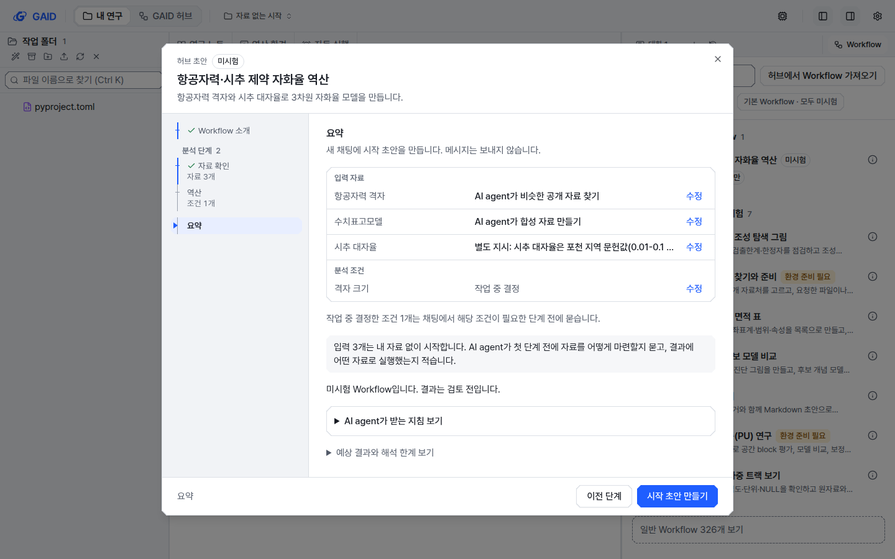
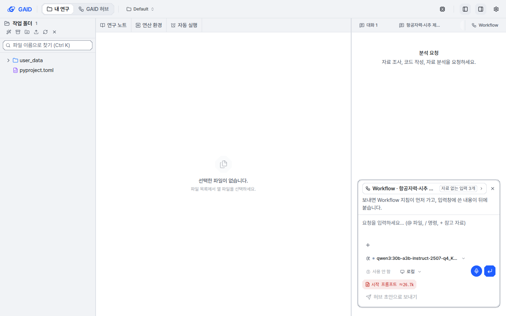
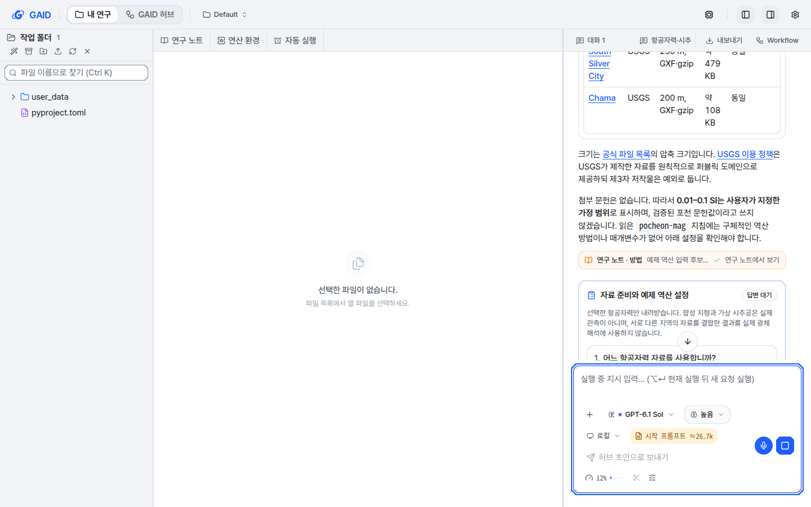
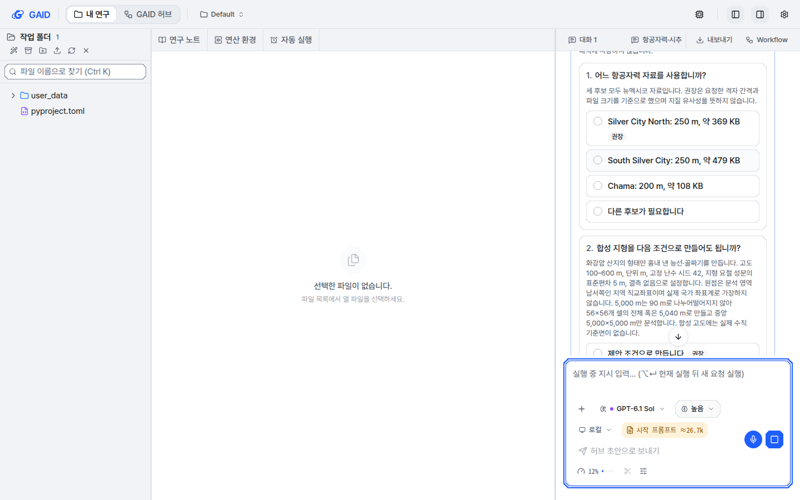
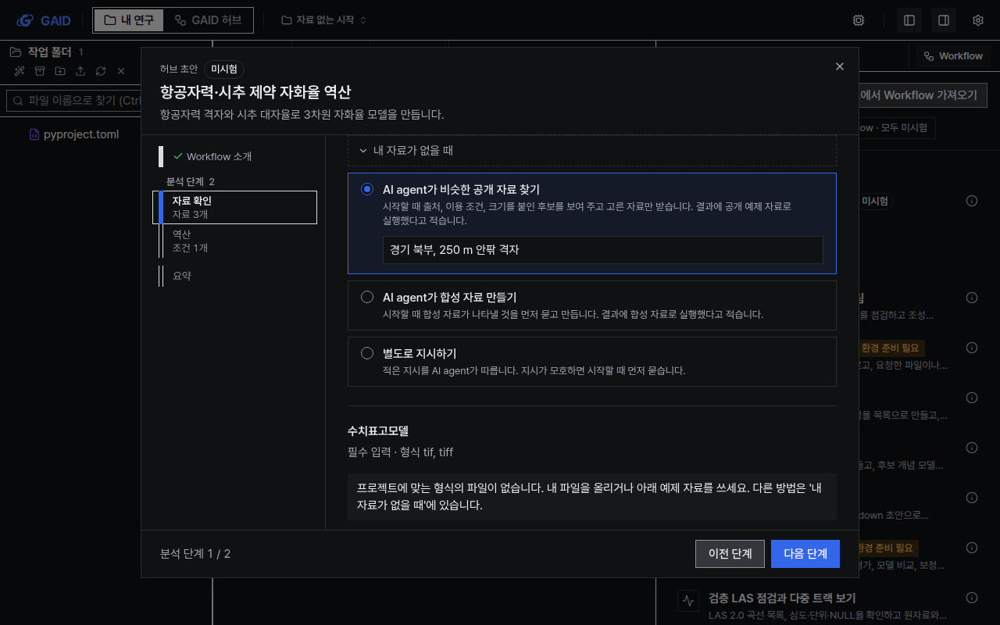

# 입력 자료가 없을 때 AI agent가 자료를 마련하는 세 가지 방법

## 0. 한눈에

| | |
|---|---|
| 요청 | Workflow 입력에 자료가 없으면 AI agent가 비슷한 공개 자료(toy 자료)를 찾거나, 합성 예제를 만들거나, 별도 지시를 따르도록 고르게 하고, 시작할 때 AI agent가 묻게 합니다. |
| 결론 | 시작 설정의 입력마다 "내 자료가 없을 때" 아래에 세 방법이 있습니다. 고른 방법은 요약과 지침에 기록됩니다. 실제 앱에서 AI agent는 자료를 받거나 만들기 전에 질문 양식으로 물었고, 받은 자료와 합성 자료를 출처·가정 기록과 함께 프로젝트에 두었습니다. 연구 노트에도 toy·합성 자료로 실행했다고 적었습니다. |
| 믿을 수 있는 정도 | 자동 시험과 실제 앱에서 한 번 실행해 확인했습니다. 모델 하나(GPT-6.1 Sol)와 Workflow 하나로 확인했으므로 다른 모델이 같은 순서를 지키는지는 확인하지 않았습니다. |
| 결정할 일 | 없음 |

## 1. 요청한 것

> 다음으로 GAID 워크스페이스에서 워크플로우 입력을 받을 때 자료가 없으면 에이전트가 자료를 검색해서 유사한 토이샘플을 구하거나 합성예제 또는 별도지시를 선택하여 워크플로우 시작시 에이전트가 질문할수 있게 해야한다. — 2026-10-24 요청(발췌)

완료 기준: 자료가 없는 입력에 (가) 비슷한 공개 자료 찾기, (나) 합성 자료, (다) 별도 지시를 고를 수 있고, 요약과 지침에 기록됩니다. 시작하면 AI agent가 먼저 묻습니다. 공개 자료는 후보를 출처·이용 조건·크기와 함께 보여 주고 고른 것만 받습니다. 합성 자료는 무엇을 나타낼지 확인합니다. 별도 지시는 모호할 때만 묻습니다. 받거나 만든 파일은 프로젝트의 기록된 자료가 되고, 연구 노트는 toy·합성 자료임을 밝힙니다. 기존 Workflow와 이 방법을 고르지 않은 시작은 그대로입니다.

## 2. 수행한 것

1. 시작 설정의 입력마다 "내 자료가 없을 때" 묶음을 두고 그 안에 세 방법을 넣었습니다. 맞는 파일도 예제 자료도 없으면 펼쳐 두고, 있으면 접어 둡니다. 셋 중 어느 것도 미리 고르지 않습니다. 권장할 근거가 없기 때문입니다.
2. 찾기와 합성에는 선택 메모 칸(지역·해상도, 나타낼 대상·규모)을, 별도 지시에는 필수 지시 칸을 붙였습니다. 요약은 입력마다 고른 방법을 보여 주고, 내 자료 없이 시작하는 입력의 수를 알립니다.
3. AI agent가 받는 지침에 "자료가 없는 입력" 절을 더했습니다. 입력마다 방법, 파일 위치, 연구자 메모를 적고, 고른 방법의 규칙만 붙입니다. 첫 단계 전에 질문 양식으로 모아 묻기, 공개 자료 후보 2-3개를 출처 URL·제공 기관·이용 조건·크기·지역·형식과 함께 보이기, 이용 조건이 불분명하거나 로그인이 필요하거나 100 MB를 넘는 자료는 받지 않기, 받은 자료 옆에 출처 기록 남기기, 합성 자료 옆에 생성 코드와 가정 기록 남기기, 결과와 연구 노트에 toy·합성 자료로 실행했다고 적기도 규칙에 넣었습니다.
4. 채팅 첫 메시지의 Workflow 표시에 어느 입력이 어떤 방법을 쓰는지 기록하고, 카드에 "자료 없는 입력 n개"를 표시했습니다. 이 표시가 없는 이전 메시지는 전과 같이 읽힙니다.
5. 개발 앱에서 허브 초안 Workflow "항공자력·시추 제약 자화율 역산"(입력 3개)으로 세 방법을 하나씩 골라 실행했습니다.

## 3. 결과

그림 1. 시작 설정 "자료 확인" 단계(계측, 밝은 테마, 1440×900). 볼 것: 예제 자료와 다른 파일 아래의 "내 자료가 없을 때" 묶음과 세 방법, 고른 방법의 메모 칸.

그림 2. 요약 단계. 볼 것: 입력마다 고른 방법(찾기, 합성, 별도 지시와 그 내용)과 "입력 3개는 내 자료 없이 시작합니다" 안내.

그림 3. 시작 초안을 만든 뒤의 채팅 입력창. 볼 것: Workflow 카드의 "자료 없는 입력 3개" 표시.

그림 4. 시작 메시지를 보낸 뒤 AI agent의 첫 답(일부). 볼 것: 공개 항공자력 후보 3개의 제공 기관, 격자·형식, 크기, 이용 조건 표와, 문헌 근거가 없는 자화율 범위를 연구자 지정 가정으로 다룬다는 설명. 경기 북부 자료는 찾지 못했다고 밝혔습니다.

그림 5. AI agent의 질문 양식. 볼 것: 받을 항공자력 후보 선택(크기 포함, 권장 이유는 격자 간격과 크기이며 지질 유사성을 뜻하지 않는다고 적음)과 합성 지형 조건 확인. 같은 양식에 가상 시추공 표 확인과 역산 격자 질문이 이어집니다.

그림 6. 같은 단계의 도폭 스타일, 어두운 테마, 1280×800.

실제 앱에서 권장안으로 답한 뒤 AI agent가 한 일은 다음과 같습니다.

- 공개 자료: 고른 후보 하나(미국 USGS 공개 항공자력, 압축 약 369 KB)만 받았습니다. 출처 기록에 출처 URL, 받은 시각, 이용 조건, 파일 5개의 크기와 sha256을 적었습니다.
- 합성 자료: 확인한 조건(고도 범위, 격자, 난수 시드 42, 좌표계 없음)으로 지형을 만들고, 생성 코드와 가정을 적은 설명 파일을 함께 두었습니다.
- 별도 지시: 지시한 대로 가상 시추공 5개 표를 만들었습니다. 지시에 없던 위치와 심도는 질문 양식에서 먼저 확인받았습니다.
- 기록: 받거나 만든 파일 15개가 이 채팅의 작업 기록(provenance)에 모두 올랐습니다.
- 연구 노트: 첫머리에 "공개 예제(toy 자료)와 합성 자료를 사용했습니다. 실제 포천 관측이 아니며 실제 광체를 해석하지 않았습니다."라고 적고, 한계 절에 같은 내용을 적었습니다. 관측 고도와 자기장 조건이 정해지지 않아 역산은 보류하고 결정할 일로 넘겼습니다.

| 완료 기준 | 결과 | 근거 |
|---|---|---|
| 세 방법 선택, 요약과 지침에 기록, 이전 Workflow는 그대로 | 충족 | 그림 1-3, 자동 시험 |
| 시작할 때 먼저 묻고, 공개 자료는 후보를 보이고 고른 것만 받기 | 충족 | 그림 4-5, 3절 목록 |
| 합성 자료는 나타낼 것을 확인하고 합성 자료라고 밝히기 | 충족 | 그림 5, 연구 노트 첫머리 |
| 별도 지시는 따르고 모호할 때만 묻기 | 충족 | 3절 목록 |
| 받거나 만든 파일이 기록된 자료가 되고 연구 노트에 toy·합성 표시 | 충족 | 3절 목록 |
| 문구 규칙, UI 가이드, 전체 검사 | 충족 | 4절 |
| 실제 앱에서 세 방법을 한 번씩 골라 AI agent의 질문 확인 | 충족 | 그림 4-5 |

## 4. 검증

- 과학적 검증: 해당 없음. 자료를 마련하는 절차를 바꾼 작업이며 분석 결과의 타당성은 다루지 않았습니다. 실제 실행에서 AI agent가 고른 공개 자료와 합성 조건이 연구 목적에 맞는지는 검토하지 않았습니다.
- 소프트웨어 검증: 새 자동 시험 5건(지침 절 내용, 이전 지침이 그대로인지, 메시지 표시의 기록·읽기, 시작 설정에서 세 방법 선택부터 요약과 시작 메시지까지, 파일이 있을 때 접힘)과 관련 시험을 통과했습니다. 문구 검사 오류 0건, UI 검사 오류 0건입니다. 전체 검사(웹·서버 시험, GAID 검사, production smoke, UI 품질 검사)를 통과했습니다. UI 품질 검사에서 차단 항목인 impeccable과 axe의 지적은 0건입니다. 보고용 shadcn lint는 새 묶음 제목의 13 px 글자 크기 지정을 지적했습니다. 같은 화면의 기존 "내 자료" 제목과 같은 값입니다.
- 화면: 두 스타일(계측, 도폭) × 두 테마 × 1440×900, 1280×800에서 자료 확인 단계와 요약을 캡처해 12절 점검표로 확인했습니다. 따른 규칙은 Q1(단계 화면 안에서 입력마다 선택지), Q2(근거가 없어 미리 고르지 않음), Q3(직접 입력 칸), Q5(요약과 수정 링크), Q6(입력 칸 안내 문구), P3(파일이나 예제 자료가 있으면 접음), P5(AI agent가 제안하고 연구자가 고름), P9(toy·합성 자료 표시), W2·W4(문구 길이)입니다.

## 5. 한계

- 모델 하나와 Workflow 하나로 한 번 실행했습니다. 지침 규칙을 다른 모델, 특히 작은 로컬 모델이 같은 순서로 지키는지는 확인하지 않았습니다.
- 지침은 AI agent에게 규칙을 알리는 방식입니다. 서버가 질문 없이 받는 일을 막지는 않습니다. 100 MB 상한과 이용 조건 확인도 AI agent가 지킬 규칙입니다.
- "AI agent가 받는 지침 보기"를 펼치면 질문 도구와 웹 검색 같은 AI agent용 표현이 보입니다. 이 보기는 원래 AI agent가 받는 글을 그대로 보여 주는 곳입니다(R1의 기존 예외).
- 저장한 시작 설정 파일은 이 선택을 담지 않습니다. 다시 열면 고른 방법은 비어 있습니다.
- 지침이 없는 이전 서버용 시작 초안 경로에는 이 선택이 들어가지 않습니다. 현재 서버는 모든 Workflow에 지침을 보내므로 이 경로를 쓰지 않습니다.

## 6. 결정할 일

없음

## 7. 대체되었거나 실패한 시도

펼치기 — 1건

- 받은 자료와 합성 자료를 연구자 자료 폴더 아래에 두려 했으나, 이 폴더는 원자료 보호 규칙으로 AI agent의 쓰기가 막혀 있습니다. 그래서 공개 자료는 toy 자료 폴더, 합성 자료는 합성 자료 폴더에 입력별로 둡니다.

## 용어

없음

## 부록 A. 근거 위치

펼치기 — 실행 방법, 원본, 해시, 커밋

| 항목 | 위치 |
|---|---|
| 지침 계약과 렌더링 | `web/src/geo/contracts/workflow-doc.ts` (`InputFallback`, `fallbackFolder`, `fallbackSection`, 블록 속성 `fallback="<role>=<kind>;…"`), `web/src/geo/workflow/render.ts` |
| 시작 설정 | `web/src/geo/workspace/setup-steps.tsx` (`InputAnswer` mode `fallback`, `FallbackOptions`), `web/src/geo/workspace/task-setup.tsx` |
| 카드 표시 | `web/src/geo/workflow/workflow-card.tsx` |
| 문구 | `web/src/geo/locales/workspace/{ko,en}.json` `workspace.setup.fallback.*`, `workspace.setup.input.empty`, `emptyExample`; `web/src/geo/locales/workflowDoc/{ko,en}.json` `workflowDoc.section.fallback`, `workflowDoc.fallback.*`, `workflowDoc.card.fallback` |
| 자동 시험 | `web/src/geo/workspace/input-fallback.test.tsx`; `web/src/geo/contracts/workflow-doc.test.ts` (round-trip에 `fallbacks: {}`) |
| 파일 위치 규칙 | 공개 자료 `toy_data/<입력 id>/`, 합성 자료 `synthetic_data/<입력 id>/` (`user_data/`는 원자료 보호 규칙 대상) |
| 개발 앱 | PC74 `~/data/geoaidesk/work/gaid-input-fallback/app` (설정·Workflow는 gaid-workflow-example 개발 앱 사본, 로그인은 gaid-hub-followups 개발 홈 사본), 포트 3390/18390, 실행 후 중지 |
| 실제 실행 | 프로젝트 Default, 세션 `01a16cc2-4e2c-70dd-a2a7-f67a1aa14a2c`, 모델 OpenAI Codex (legacy) GPT-6.1 Sol; 결과 `toy_data/aeromag/SOURCE.md`, `synthetic_data/dem/README.md`, `synthetic_data/boreholes/`, `연구노트/2026-10-24-mag-inversion/index.md`; provenance `.kady/provenance/01a16cc2-…/steps.jsonl` (43행, 파일 15개) |
| 화면 원본 | `~/data/geoaidesk/work/gaid-input-fallback/shots/` (16장: 2 화면 × 계측·도폭 × 밝은·어두운 × 1440·1280), `…/playwright/`; 캡처 스크립트 `…/appshot.sh` |
| 검사 | `scripts/check` 2회차 통과 `~/data/geoaidesk/work/gaid-input-fallback/check-2.log` (1회차 `check-1.log`는 부하 중 웹 시험 3건이 5초 제한을 넘겨 중단, 단독 재실행 통과; 새 긴 시험은 30초 제한) |
| 문자열 변경 (한·영 전후) | `workspace.setup.input.empty` 전: "프로젝트에 맞는 형식의 파일이 없습니다. 작업 폴더에 파일을 올린 뒤 고르세요." / "The project has no file in a matching format. Upload a file to the work folder, then choose it." → 후: "프로젝트에 맞는 형식의 파일이 없습니다. 파일을 올리거나, AI agent가 자료를 마련할 방법을 아래에서 고르세요." / "No project file has a matching format. Upload a file, or choose below how the AI agent provides the data." `workspace.setup.input.emptyExample` 전: "… 내 파일을 올리거나 아래 예제 자료를 쓰세요." / "… Upload your own files or use the example data below." → 후: 뒤에 "다른 방법은 '내 자료가 없을 때'에 있습니다." / "Other ways are under 'When you have no data'." 추가. 나머지는 새 문자열입니다. |

작성 시점: 2026-10-24, commit 13676fec (보고서 커밋 전).

