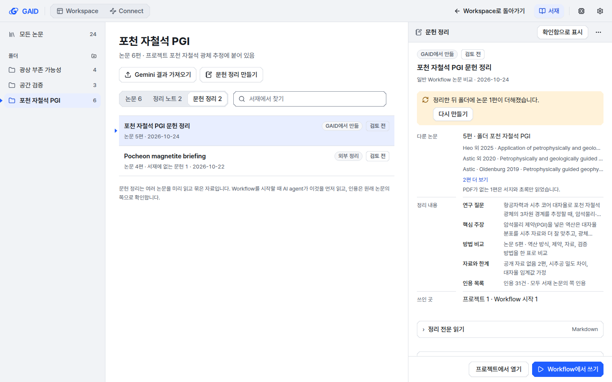
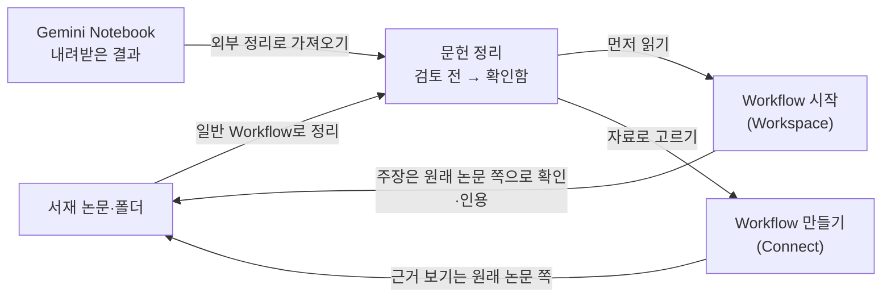
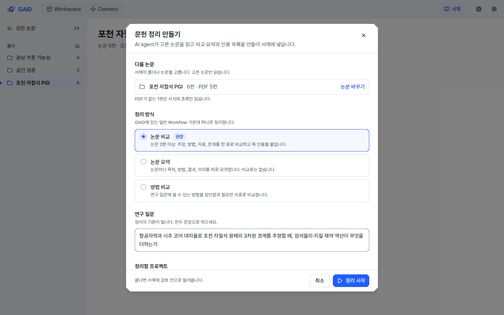
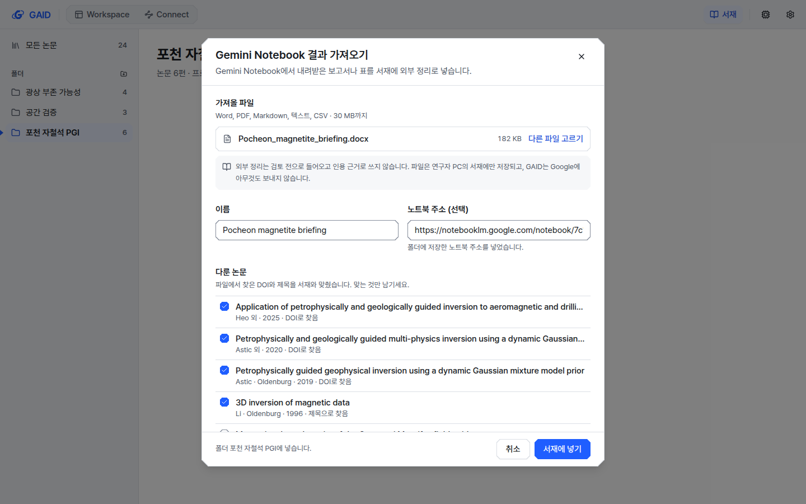
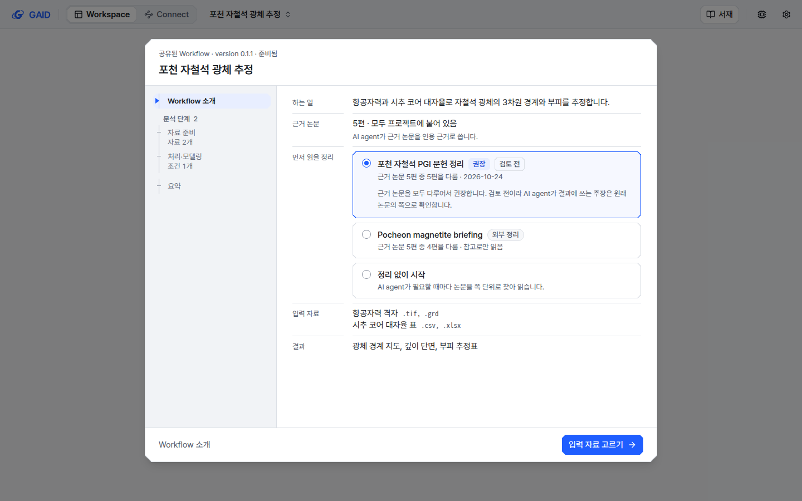
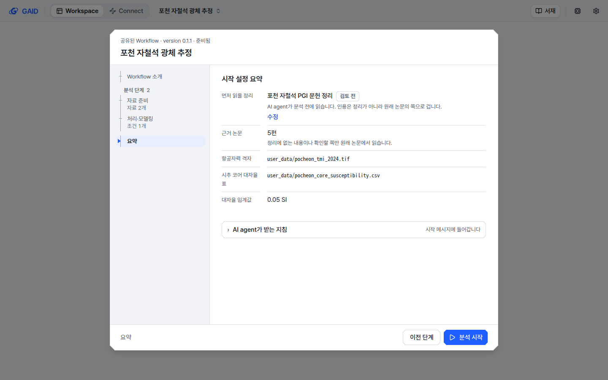
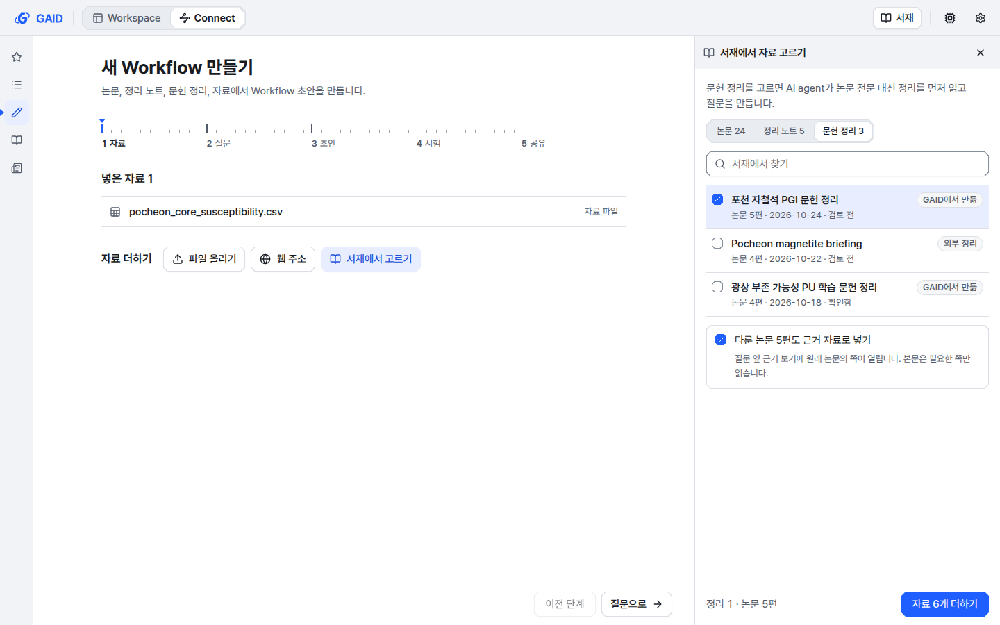
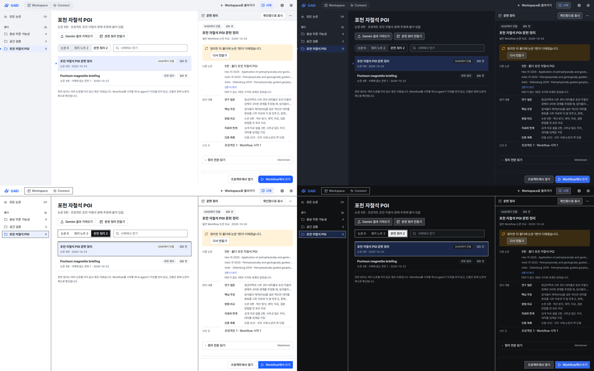

# 서재의 문헌 정리로 Workflow를 바로 시작하기 (설계 시안)

## 0. 한눈에

| | |
|---|---|
| 요청 | 서재에서 Workflow로 논문과 자료를 읽히는 과정을 체계화합니다. 서재에서 미리 정리한 자료(GAID 일반 Workflow로 만든 것, Gemini Notebook에서 가져온 것)로 Workflow를 바로 시작하게 합니다. |
| 결론 | 지금은 미리 정리한 자료를 담을 곳이 없습니다. Workflow 시작에서는 AI agent가 논문을 쪽 단위로 다시 찾아 읽고, Workflow 만들기는 논문 본문을 모델 호출마다 통째로 보냅니다. 서재에 "문헌 정리" 항목을 두고, 만들기·가져오기·Workflow 시작·Workflow 만들기에서 쓰는 화면 6개를 시안으로 그렸습니다. |
| 믿을 수 있는 정도 | 지금 경로는 코드에서 확인했습니다. 시안은 실제 색 토큰과 공용 부품으로 그렸고 계측·도폭과 밝은·어두운 테마, 1440×900·1280×800에서 캡처했습니다. 표본 자료로 그린 화면이라 동작은 아직 없습니다. 토큰을 얼마나 줄일지는 측정하지 않았습니다. |
| 결정할 일 | 3건 (6절) |

그림 1. 서재 폴더 "포천 자철석 PGI"에서 문헌 정리를 고른 화면입니다(계측, 밝은 테마, 1440×900). 볼 것: 논문·정리 노트 옆에 `문헌 정리`가 세 번째 종류로 있습니다. 오른쪽 상세에서 어떤 방식으로 언제 만들었는지, 다룬 논문과 정리 내용을 봅니다. 정리 뒤 폴더에 논문이 더해지면 `다시 만들기`를 권합니다. 주 동작은 `Workflow에서 쓰기`입니다.

## 1. 요청한 것

> 그리고 서재에서 워크플로우로 논문이나 자료를 읽히는 과정과 관련하여 더 체계적으로 개선가능하다. 현재 기본 BYOk 워크플로우들에는 논문 검색 부터 이해하고 정리하고 인용정리하는 워크플로우가 다수 있다. 내서재에서 해당 기능들을 사용하여 미리 자료들에 대해 정리한 자료가 있으면 워크플로우에서도 해당자료를 기반으로 바로시작할수 있을것이다. 이것은 GAID 서재에서도 구현하지만 gemini 노트북과 연계한 자료를 업로드 하게 하는것도 같이 구현해두면 사용자의 선택폭을 넓힐수 있다. — 2026-10-24 요청

같은 메시지의 다른 부분은 다른 작업 단위가 맡습니다. 이 작업을 나눌 때 사용자는 "둘은 지금, library-prep은 뒤"를 골랐습니다. 지금은 설계와 시안만 만들고, 구현은 서재를 옆 패널로 바꾸는 작업(gaid-ia-connect-workspace--library-panels)이 main에 들어온 뒤에 합니다.

완료 기준(1단계): 지금 경로를 진단하고, (가) 서재 논문으로 일반 문헌 Workflow를 돌려 만든 문헌 정리, (나) Gemini Notebook 결과를 외부 정리로 가져오기, (다) 그 정리로 Workflow 시작과 Workflow 만들기를 시작하는 설계를 실제 토큰과 부품으로 그린 한국어 시안과 함께 제안합니다.

## 2. 수행한 것

1. 서재에서 AI agent로 문헌이 넘어가는 경로 네 곳을 코드에서 따라갔습니다. 서재 항목, 프로젝트 인용 범위와 AI agent의 서재 도구, Workflow 시작 창, Workflow 만들기의 서재 자료입니다.
2. GAID에 있는 일반 Workflow 가운데 문헌을 다루는 것과 카탈로그의 문헌 스킬을 확인했습니다.
3. 서재에 "문헌 정리"라는 항목 종류를 두는 설계를 세웠습니다. 만드는 법, 가져오는 법, Workflow가 읽는 법, 인용 규칙입니다.
4. 개발용 시안 페이지에 화면 6개를 그리고, 계측·도폭과 밝은·어두운 테마에서 1440×900과 1280×800으로 캡처했습니다(48장).

## 3. 결과

### 3.1 지금 서재에서 Workflow로 문헌이 가는 길

| 경로 | 지금 하는 일 | 문제 |
|---|---|---|
| 채팅과 Workflow 시작 | 프로젝트에 붙인 논문만 AI agent가 찾고 읽습니다. 찾기는 논문마다 쪽 3개의 짧은 발췌를 돌려주고, 읽기는 한 번에 PDF 5쪽까지입니다. | 미리 정리한 자료를 넘길 방법이 없습니다. 시작 메시지에는 근거 논문 목록과 "확인하라"는 한 문장만 들어가서, 같은 논문을 Workflow마다 처음부터 다시 읽습니다. |
| Workflow 시작 창 | 공유된 Workflow의 근거 논문을 서재에서 DOI나 제목으로 찾고, 연구자가 누르면 인용 범위에 붙입니다. | 정리 노트도, 미리 만든 요약도 고를 수 없습니다. |
| Workflow 만들기 | 서재 논문은 PDF 전체를 복사하고 모든 쪽의 글자를 뽑습니다. 모델 호출마다 논문 글자를 최대 26만 자(약 6만5천~9만 토큰)까지 함께 보냅니다. | 같은 본문이 분석·초안·고치기 호출마다 다시 갑니다. 측정 기록에서도 논문 한 편으로 초안 하나를 만들 때 입력이 25만~29만 토큰이었습니다(토큰 측정은 gaid-authoring-tokens가 맡습니다). |
| 일반 문헌 Workflow | 문헌 검색, 논문 요약, 논문 비교, 방법 비교, 인용 분석, 참고문헌 확인 등이 있습니다. | 모두 웹 검색이나 "올린 논문"을 전제로 하고 결과를 프로젝트 폴더에 Markdown으로 남깁니다. 서재를 읽지도, 서재에 넣지도 않습니다. |
| Gemini Notebook | 노트북 주소 저장과 공개 자료 내보내기만 있습니다. | 결과를 가져오는 기능이 없습니다(2026-10-24 비교 보고서의 연계 제안 다). |

진단 중에 이 작업과 맞닿은 문제 두 가지를 찾았습니다.

- 기관 서버 동기화로 다른 PC에서 받은 PDF는 쪽 글자를 뽑아 두지 않습니다. 그 PC에서는 AI agent가 그 논문의 쪽을 읽으면 빈 내용이 돌아올 수 있습니다. 코드만 읽고 내린 판단이며 실제로 재현하지는 않았습니다. 문헌 정리는 쪽 읽기에 기대므로 2단계에서 함께 고치기를 권합니다.
- 작업 지시에는 카탈로그 0.3.0의 문헌 스킬 넷이 모두 꺼진 채 들어간다고 적혀 있었습니다. 실제로는 Zotero 스킬 하나만 꺼져 있고 나머지 셋은 켜져 있습니다. 쓰는 Workflow는 아직 없습니다.

### 3.2 설계: 서재의 "문헌 정리"

문헌 정리는 서재의 세 번째 항목 종류입니다. 여러 논문을 미리 읽고 묶은 자료이며 두 가지 출처가 있습니다.

| | GAID에서 만듦 | 외부 정리 (Gemini Notebook) |
|---|---|---|
| 만드는 법 | 서재 폴더나 논문을 골라 일반 Workflow(논문 비교, 논문 요약, 방법 비교)를 돌립니다. AI agent는 고른 논문만 서재 도구로 읽습니다. | Gemini Notebook에서 내려받은 Word·PDF·Markdown·텍스트·CSV 파일을 가져옵니다. |
| 원본 | 프로젝트의 문헌정리 폴더에 남는 Markdown 파일. 정리 노트처럼 파일이 원본이고 서재는 그 사본을 갖습니다. | 서재에 저장한 가져온 파일 |
| 다룬 논문 | 실제로 읽은 서재 논문 | 파일에서 찾은 DOI와 제목을 서재와 맞추고, 연구자가 확인한 것만 연결합니다. |
| 기록 | 쓴 일반 Workflow, 날짜, 연구 질문, 읽은 쪽, 채팅. 모델 이름은 `만든 기록 보기` 안에만 둡니다. | 파일 이름, 가져온 날짜, 노트북 주소(선택) |
| 상태 | 검토 전 → 연구자가 `확인함으로 표시` | 검토 전 → 연구자가 `확인함으로 표시` |
| 인용 | 정리 자체는 인용하지 않습니다. 결과의 인용은 원래 논문의 쪽으로 겁니다. | 인용 근거로 쓰지 않고 참고로만 읽습니다. |

그림 2. 제안하는 흐름입니다. 볼 것: 문헌 정리는 읽는 순서만 바꿉니다. 인용과 근거 보기는 언제나 원래 논문의 쪽으로 돌아갑니다.

### 3.3 화면 시안

그림 3. 서재 폴더에서 `문헌 정리 만들기`를 누른 창입니다. 볼 것: 다룰 논문(폴더 6편, PDF 없는 1편은 서지와 초록만 읽음), 정리 방식(일반 Workflow 셋 중 `논문 비교` 권장), 연구 질문, 정리할 프로젝트(폴더가 붙은 프로젝트)를 고르고 `정리 시작` 하나로 시작합니다. 끝나면 서재에 검토 전으로 들어온다고 아래에 적었습니다.

그림 4. `Gemini 결과 가져오기` 창입니다. 볼 것: 파일 바로 아래에 "외부 정리는 검토 전으로 들어오고 인용 근거로 쓰지 않으며, GAID는 Google에 아무것도 보내지 않는다"는 한계가 보입니다. 노트북 주소는 폴더에 저장한 주소로 채웁니다. 다룬 논문은 파일의 DOI·제목으로 맞춘 결과를 연구자가 확인하고, 서재에 없는 문헌은 연결하지 않습니다.

그림 5. Workflow 시작 창의 첫 쪽(Workflow 소개)입니다. 볼 것: 근거 논문 아래 `먼저 읽을 정리`에서 근거 논문 5편을 모두 다루는 GAID 문헌 정리가 권장으로 골라져 있습니다. 외부 정리는 "참고로만 읽음"으로, `정리 없이 시작`은 지금처럼 쪽 단위로 찾아 읽는다고 적었습니다.

그림 6. 시작 창의 요약 쪽입니다. 볼 것: 먼저 읽을 정리가 검토 전 표시와 함께 맨 위에 있고, "인용은 정리가 아니라 원래 논문의 쪽으로 건다"는 한 줄이 붙습니다. AI agent가 받는 지침은 접어 둡니다.

그림 7. Connect에서 Workflow를 만드는 첫 단계의 서재 패널입니다. 볼 것: 패널에 `문헌 정리` 종류가 더해졌습니다. 정리를 고르면 `다룬 논문 5편도 근거 자료로 넣기`가 켜진 채 나와서, 질문 옆 근거 보기는 원래 논문의 쪽을 엽니다.

그림 8. 그림 1을 계측·도폭과 밝은·어두운 테마로 나란히 놓은 것입니다. 볼 것: 상태 표시(검토 전, 외부 정리)와 다시 만들기 안내가 네 조합 모두에서 읽힙니다.

### 3.4 AI agent가 읽는 방식 (2단계 구현 내용)

- Workflow 시작: 시작 메시지에 "먼저 읽을 문헌 정리" 절을 넣습니다. 정리의 이름, 상태, 다룬 논문의 인용 키가 들어갑니다. AI agent는 분석 전에 문헌 정리를 읽는 서재 도구로 정리를 읽습니다. 결과에 쓰는 주장은 원래 논문의 쪽을 읽어 확인하고 그 쪽으로 인용합니다. 정리 자체를 인용하면 노트 인용 점검이 알립니다.
- Workflow 만들기: 문헌 정리는 새 자료 종류로 들어갑니다. 모델은 논문 본문 대신 정리의 글을 먼저 받습니다. 함께 넣은 논문은 질문의 근거 위치를 찾는 데 씁니다. 호출마다 논문 본문을 얼마나 보낼지는 gaid-authoring-tokens의 측정과 결론을 따릅니다. 그 작업이 먼저 끝나면 그 방식 위에 붙입니다.
- 서재 패널(옆 패널 작업): 프로젝트 문헌 목록에 그 프로젝트의 논문을 다룬 문헌 정리를 함께 보입니다.
- 오래된 정리: 정리 뒤에 폴더에 논문이 더해지거나 다룬 논문이 바뀌면 상세와 시작 창에 표시합니다. 정리를 자동으로 다시 만들지는 않습니다.

### 3.5 완료 기준 대조

| 완료 기준 | 결과 | 근거 |
|---|---|---|
| 지금 경로 진단 | 충족 | 3.1 |
| (가) 일반 Workflow로 만든 문헌 정리 | 충족(설계·시안) | 3.2, 그림 1·3 |
| (나) Gemini Notebook 결과를 외부 정리로 | 충족(설계·시안) | 3.2, 그림 4 |
| (다) 문헌 정리로 Workflow 시작·만들기 | 충족(설계·시안) | 3.4, 그림 5–7 |
| 한국어 시안, 두 스타일·두 테마 | 충족 | 그림 8, 부록 A |

## 4. 검증

- 과학적 검증: 해당 없음(설계 시안). 문헌 정리가 실제로 Workflow 결과의 품질을 지키는지, 토큰을 얼마나 줄이는지는 2단계에서 논문 폴더 하나로 확인합니다. 지금은 미확인입니다.
- 소프트웨어 검증: 지금 경로는 코드를 읽어 확인했고 실행해 보지는 않았습니다. 시안 페이지는 웹 타입 검사, 문구 검사(오류 0, 이 시안의 경고 0), UI 규칙 검사(오류 0)를 통과했습니다. 48장을 UI 가이드 12절 점검표로 보았고, 한계 문구가 스크롤 아래로 가려진 가져오기 창 하나를 고쳤습니다.
- 수치 다섯 점검: 이 보고서의 수치(26만 자, 쪽 5개, 25만~29만 토큰)는 코드의 한도와 다른 작업 단위의 측정 기록을 옮긴 것입니다. 새로 측정한 값은 없고, 줄어드는 토큰 수도 추정하지 않았습니다.

## 5. 한계

- 시안은 표본 자료로 그린 정적 화면입니다. 실제 서재, 채팅, 서버와 연결하지 않았습니다.
- 서재 옆 패널 작업의 최종 모양이 main에 들어오면, 그림 7의 패널과 서재 상세의 배치를 그 구조에 맞춰 조정합니다.
- Gemini Notebook에서 내보낸 파일의 실제 형식(Word의 표, 인용 표기)은 확인하지 않았습니다. DOI·제목 맞추기의 정확도는 2단계에서 실제 파일로 확인해야 합니다.
- 일반 Workflow 지침은 영어이고 웹 검색을 전제로 합니다. 서재 논문만 읽도록 하는 지시를 덧붙이는 방식이 얼마나 지켜지는지는 시험하지 않았습니다.
- 동기화로 받은 PDF의 쪽 읽기 문제는 코드로만 판단했습니다.

## 6. 결정할 일

1. 이 설계와 시안대로 2단계(구현)를 진행할지
   - 가) 시안대로 진행합니다. 서재 옆 패널 작업이 main에 들어온 뒤 시작하고, Workflow 만들기 쪽은 gaid-authoring-tokens 결과 위에 붙입니다. (권장: 서재에서 미리 정리하기, Gemini 결과 가져오기, 정리로 바로 시작하기를 모두 화면에 담았고, 결과의 인용은 계속 원래 논문의 쪽으로 겁니다.)
   - 나) 고칠 곳을 알려 주시면 시안을 고친 뒤 다시 봅니다.
2. 이름을 "문헌 정리"로 할지
   - 가) "문헌 정리"로 합니다. Gemini에서 온 것은 출처 표시로 "외부 정리"를 붙입니다. (권장: 분석마다 쓰는 "정리 노트"와 겹치지 않고, 여러 논문을 묶었다는 뜻이 드러납니다.)
   - 나) "문헌 요약"으로 합니다. 용어 목록이 "요약 노트"를 금지어로 두고 있어 정리 노트와 헷갈릴 수 있습니다.
3. 외부 정리를 Workflow 시작에서 고를 수 있게 할지
   - 가) 고를 수 있게 하되 "참고로만 읽음"으로 표시하고, 권장으로 미리 고르지 않습니다. (권장: 사용자가 요청한 "선택폭"을 지키면서, 검토되지 않은 외부 결과가 인용 근거가 되지 않습니다.)
   - 나) 서재 안에서만 보고 Workflow 시작에는 내놓지 않습니다.

## 7. 대체되었거나 실패한 시도

펼치기 — 1건

- 문헌 정리를 정리 노트의 한 종류로 넣는 안: 정리 노트는 분석 하나의 결과 노트이고 프로젝트 인용 범위와 논문 목록에서 빠지도록 되어 있습니다. 여러 논문을 다룬 정리를 같은 종류로 두면 "다룬 논문", "오래됨", "외부 출처"를 표시할 곳이 없어 따로 두었습니다.

## 용어

| 용어 | 새 정의 / 정의 변경 | 정의 |
|---|---|---|
| [문헌 정리](../../docs/glossary.md) | 새 정의(제안, 승인 뒤 용어집에 넣음) | 서재의 여러 논문을 미리 읽고 비교·요약과 인용 목록으로 묶은 서재 항목입니다. GAID의 일반 Workflow로 만들거나 Gemini Notebook 결과를 가져옵니다. Workflow가 먼저 읽지만 인용은 원래 논문의 쪽으로 겁니다. |
| [외부 정리](../../docs/glossary.md) | 새 정의(제안, 승인 뒤 용어집에 넣음) | Gemini Notebook처럼 GAID 밖에서 만든 결과 파일을 가져온 문헌 정리입니다. 검토 전으로 들어오고 인용 근거로 쓰지 않습니다. |

## 부록 A. 근거 위치

펼치기 — 코드 위치, 시안, 캡처

| 항목 | 위치 |
|---|---|
| 서재 항목·폴더 계약 | `web/src/geo/contracts/library.ts` (LibraryItem, LibraryCollection) |
| PDF 쪽 글자 캐시 | `server/src/geo/library/reader.ts` (400쪽, 쪽당 40,000자) |
| AI agent 서재 도구 | `server/src/geo/library/tools.ts` (`library_search` 논문당 쪽 3개, `library_read` 호출당 5쪽, 24 KiB) |
| 프로젝트 인용 범위 | `server/src/geo/library/uses.ts`, `.kady/geo/literature.json` |
| 시작 메시지의 근거 논문 | `web/src/geo/contracts/workflow-doc.ts` 근거 논문 절, `web/src/geo/workspace/source-papers.tsx` |
| Workflow 만들기의 서재 자료 | `server/src/geo/authoring/library-sources.ts`; 모델 문맥 `server/src/geo/authoring/agent.ts` (`PAPER_BUDGET = 260_000`) |
| 동기화 PDF의 쪽 캐시 누락 | `server/src/geo/library/sync/index.ts` (저장만 하고 `readStoredPdf`를 부르지 않음) |
| 일반 문헌 Workflow | `web/src/data/workflows.json` (`literature-search`, `summarize-paper`, `compare-papers`, `methods-comparison`, `citation-analysis`, `reference-check` 등) |
| 꺼진 채 들어가는 스킬 | `server/src/agent/skills.ts` `DEFAULT_DISABLED_SKILLS` (`pyzotero`만) |
| Workflow 만들기 토큰 측정 | gaid-authoring-tokens 작업 문서(허브가 확인한 비용 기록) |
| 시안 페이지 | `/dev/library-prep` (`web/src/app/dev/library-prep/page.dev.tsx`, `web/src/geo/dev/library-prep/`, 문구 `web/src/geo/locales/devLibraryPrep/`); 앱 바는 gaid-ia-connect-workspace 시안(커밋 bd22855a)에서 옮김 |
| 캡처 48장 | pc74:`~/data/geoaidesk/work/gaid-library-prep/shots/` (`<화면>-<스타일>-<테마>-<너비>.png`, 화면 library·make·import·start·summary·authoring), 스크립트 `shoot.sh` |

작성 시점: 2026-10-24, 브랜치 task/gaid-library-prep.

