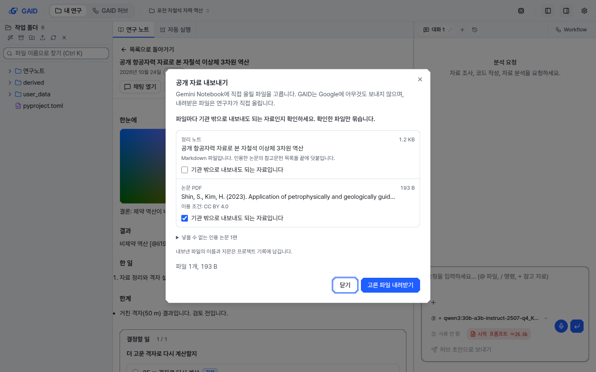
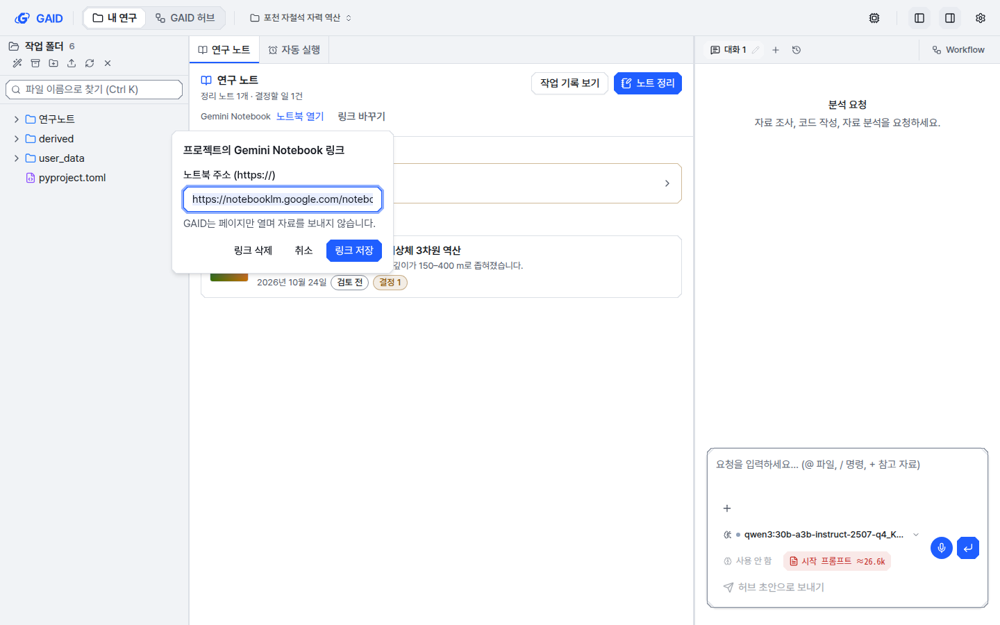

# 정리 노트 결과 묶음, 공개 자료 내보내기, Gemini Notebook 링크

## 0. 한눈에

| | |
|---|---|
| 요청 | 비교 검토(2026-10-24)에서 권장한 세 가지를 만듭니다. 정리 노트 결과 묶음, Gemini Notebook용 공개 자료 내보내기, 노트북 링크 저장입니다. |
| 결론 | 세 기능을 만들었습니다. 정리 노트의 더 보기 메뉴에서 결과 묶음과 공개 자료를 내려받습니다. 서재 폴더와 프로젝트의 정리 노트 목록에서는 저장한 Gemini Notebook 주소를 엽니다. GAID는 Google에 아무것도 보내지 않습니다. |
| 믿을 수 있는 정도 | 시험 앱에서 노트를 만들어 두 묶음을 실제로 받았습니다. 받은 파일의 지문이 서버 기록과 같았고, 묶음 안 파일의 지문 목록도 모두 맞았습니다. 시험 앱의 채팅 기록은 화면 확인용으로 직접 써 넣은 것입니다. 실제 분석 채팅에서 나온 노트로는 묶어 보지 않았습니다. Gemini Notebook에 실제로 올려 보지도 않았습니다. |
| 결정할 일 | 없음 |

## 1. 요청한 것

> gaid-notebooklm-review 모두 권장대로 진행하자. — 2026-10-24 요청

Gemini Notebook 비교 검토 보고서(2026-10-24)의 권장 가운데 이 작업이 맡은 범위는 셋입니다.

- 제안 2 "연구 노트 결과 묶음": 노트 하나에서 본문, 그림, 쓴 자료의 지문, 환경 기록, Workflow version, 인용 논문 목록을 묶어 내려받습니다. 크기에 상한을 두고, 내려받기 전에 들어갈 것을 보여 줍니다.
- 연계 나 "공개 자료 내보내기": 정리 노트(Markdown), Workflow 지침(Markdown), 공개 이용이 가능한 논문 PDF를 연구자가 골라 묶습니다. 내보내기 전에 파일 목록을 보여 주고, 파일마다 기관 밖으로 나가도 되는지 확인받습니다.
- 연계 가 "노트북 링크 저장": 서재 폴더나 프로젝트에 관련 Gemini Notebook 주소를 저장하고 거기서 엽니다.

이번에 하지 않는 것은 Gemini Notebook 결과 가져오기, Google Drive 동기화, Enterprise API입니다. 제안 1 "인용을 눌러 PDF 쪽 열기"는 다른 작업이 맡았습니다.

## 2. 수행한 것

1. 기존 증거 묶음 기능에서 안전한 파일 읽기, 분석 기록 읽기, 환경 기록 확인을 가져와 정리 노트에 이었습니다.
2. 결과 묶음의 범위를 정했습니다. 노트를 쓴 채팅의 기록에서 읽거나 만든 파일을 찾고, 그 파일의 지문과 지금 파일의 지문을 비교합니다. 자료 파일 자체는 넣지 않습니다.
3. 공개 자료 내보내기에 확인 단계를 넣었습니다. 처음에는 아무 파일도 고르지 않은 상태로 보여 줍니다. 연구자가 파일마다 반출 확인을 체크해야 묶이고, 서버도 확인 없는 파일을 거부합니다.
4. 노트북 링크는 하위 작업으로 만들었습니다. https 주소만 받고(로그인 정보가 든 주소는 거부), 저장한 주소는 브라우저 새 탭에서 열기만 합니다. 프로젝트 링크는 정리 노트 목록 머리글 아래, 서재 폴더 링크는 폴더 정보 아래에 둡니다. Zotero와 이어진 폴더에도 저장할 수 있고, Zotero에는 쓰지 않습니다.
5. 시험 앱에 예제 노트, 그림, 논문 두 편, 분석 기록을 넣었습니다. 두 묶음을 내려받아 열어 보고, UI 지침에 따라 화면 사진을 찍었습니다.

## 3. 결과

그림 1. 정리 노트의 결과 묶음 창(계측, 밝은 테마, 1440×900)입니다. 볼 것: 쓴 자료 3개 가운데 하나가 "기록 뒤 바뀜"으로 표시되고, 넣지 못한 것(이 노트는 Workflow 채팅에서 나오지 않음)을 따로 적습니다. 묶음이 재실행의 증명이 아니라는 한계 문장이 있고, 주 버튼은 스크롤 없이 보입니다.

그림 2. 공개 자료 내보내기 창입니다. 볼 것: 파일마다 "기관 밖으로 내보내도 되는 자료입니다" 체크가 따로 있고, 논문 PDF는 메타데이터의 이용 조건(CC BY 4.0)을 함께 보여 줍니다. PDF가 서재에 없는 인용 논문 1편은 접힌 목록에 이유와 함께 있습니다.

그림 3. 정리 노트 목록 머리글 아래의 Gemini Notebook 줄과 링크 바꾸기 창입니다. 볼 것: 저장한 주소는 "노트북 열기"로 새 탭에서 열리고, 창에 "GAID는 페이지만 열며 자료를 보내지 않습니다"가 있습니다. 서재 폴더에도 폴더 정보 아래에 같은 줄이 있습니다.

시험 앱에서 받은 결과 묶음은 파일 9개, 101 KB였습니다.

| 들어 있는 것 | 내용 |
|---|---|
| 노트 본문과 그림 | 노트 폴더의 파일 그대로입니다. 링크(바로가기)와 숨은 파일은 넣지 않습니다. 200개, 64 MiB까지 넣습니다. |
| 쓴 자료의 지문 | 노트를 쓴 채팅이 읽거나 만든 파일마다 쓸 때 기록한 지문과 크기를 담고, 지금 파일이 기록과 같은지, 바뀌었는지, 없는지, 비교하지 않았는지를 적습니다. 2,000개까지 넣습니다. |
| 환경 기록 | 그 채팅의 Python·R 패키지와 lockfile 지문 기록입니다. 16개까지 넣습니다. |
| Workflow | 채팅을 시작할 때의 Workflow version과 지금 설치된 Workflow의 지침입니다. Workflow가 지워졌으면 version만 남깁니다. |
| 인용 논문 | 서재에서 찾은 참고문헌 목록과 CSL JSON입니다. 서재에 없는 인용 키는 따로 적습니다. |
| 안내문과 지문 목록 | 화면 언어로 쓴 안내문, 넣지 못한 것, 한계 문장, 파일마다의 지문 목록입니다. 받은 사람은 지문 목록으로 파일이 바뀌지 않았는지 확인합니다. |

공개 자료 내보내기의 후보는 세 가지입니다. 첫째는 정리 노트 Markdown이고, 끝에 참고문헌 목록을 덧붙입니다. 둘째는 Workflow 지침 Markdown입니다. 셋째는 인용 논문의 서재 PDF로, 한 편에 50 MB까지 받습니다. 논문의 이용 조건은 서재 메타데이터에 적혀 있을 때만 보여 줍니다. 없으면 "이용 조건 확인 안 됨"으로 표시하고 연구자가 직접 확인하게 합니다. 내보낼 때마다 시각, 노트, 파일 이름, 지문을 프로젝트 기록에 남깁니다.

| 완료 기준 | 결과 | 근거 |
|---|---|---|
| 노트 하나에서 본문, 그림, 자료 지문, 환경 기록, Workflow version, 인용 논문을 묶어 내려받음 | 충족 | 그림 1, 위 표, 4절 |
| 크기 상한, 내려받기 전 보기 | 충족 | 위 표의 상한. 미리 본 내용과 달라지면 내려받기를 거부하고 다시 보게 합니다 |
| 공개 자료: 노트, Workflow 지침, 연구자가 고른 PDF를 묶음 | 충족 | 그림 2 |
| 내보내기 전 파일 목록과 파일마다 반출 확인 | 충족 | 그림 2, 서버도 확인을 검사함 |
| Google 호출 없음 | 충족 | 내보내기와 링크 모두 외부 서비스를 부르지 않습니다 |
| 서재 폴더와 프로젝트에 노트북 링크 저장, 거기서 열기 | 충족 | 그림 3 |

## 4. 검증

- 과학적 검증: 해당 없음. 분석 결과를 만드는 기능이 아닙니다. 묶음이 결과를 다시 실행했다는 뜻이 아니라는 문장은 창과 안내문에 그대로 남겼습니다.
- 소프트웨어 검증:
  - 시험 앱에서 결과 묶음을 내려받아 풀었습니다. 받은 ZIP의 지문이 서버가 알린 지문과 같았고, 안의 9개 파일도 지문 목록 검사를 모두 통과했습니다.
  - 내려받은 뒤 바꾼 자료 파일 하나는 "기록 뒤 바뀜"으로 나왔습니다.
  - 브라우저에서 내려받기를 누르면 "받은 파일의 지문이 서버 기록과 같습니다"가 창 안에 나타납니다. 지문이 다르면 파일을 저장하지 않습니다(자동 시험).
  - 자동 시험은 다음을 확인합니다. 미리 본 뒤 노트 폴더가 바뀌면 거부하는지, 반출 확인이 없는 파일과 노트에 없는 파일을 거부하는지, 링크 파일을 넣지 않는지, 설치된 Workflow의 version과 지침이 들어가는지, 웹 주소 검사(https만, 로그인 정보가 든 주소 거부)가 맞는지입니다.
  - 노트북 링크 주소는 서재의 Zotero 갱신과 기관 허브 동기화를 거쳐도 남습니다(자동 시험).
  - 화면: 결과 묶음 창, 공개 자료 창, 더 보기 메뉴, 프로젝트 링크 창, 서재 폴더 패널을 두 스타일(계측, 도폭)과 두 테마에서 1440×900과 1280×800으로 찍어(40장) UI 지침 12절과 대조했습니다. 처음 찍은 사진에서 결과 묶음 창의 주 버튼이 스크롤 아래로 밀려 있어, 버튼 줄을 창 아래에 고정하고 파일별 표는 펼침 안으로 옮겼습니다. 서재 폴더 머리글에 링크 동작을 두었을 때는 폴더 정보가 좁아져 줄이 접혀, 링크 줄을 폴더 정보 아래로 옮겼습니다.
  - 전체 검사 결과는 부록 A에 적습니다.

## 5. 한계

- 쓴 자료는 노트를 쓴 채팅의 분석 기록에서만 찾습니다. 채팅 밖에서 쓰거나 바꾼 파일은 묶음에 나오지 않습니다. 지문 없이 기록된 파일은 "넣지 못했거나 확인하지 못한 것"에 적습니다.
- 지금 파일과의 비교는 512 MB 이하 파일에 대해, 모두 2 GB까지만 합니다. 나머지는 "비교하지 않음"으로 표시합니다.
- Workflow는 노트를 쓴 채팅 가운데 가장 최근의 Workflow 채팅 하나를 따릅니다. 한 노트에 여러 Workflow 채팅이 섞이면 나머지는 묶음에 나오지 않습니다.
- 논문의 이용 조건은 서재 메타데이터에 적힌 값만 보여 줍니다. GAID가 공개 이용 여부를 확인하지는 않습니다. 반출 판단은 연구자의 확인에 맡깁니다.
- 공개 자료 묶음을 Gemini Notebook에 실제로 올려 보지는 않았습니다. Markdown과 PDF를 소스로 받는다는 것은 검토 보고서가 확인한 Google 문서에 근거합니다.

## 6. 결정할 일

없음

## 7. 대체되었거나 실패한 시도

펼치기 — 2건

- 첫 화면 사진에서 결과 묶음 창의 주 버튼이 창 안 스크롤 아래에 있었습니다. 파일 종류별 표를 첫 화면에 두었기 때문입니다. 표를 "들어갈 파일 보기" 안으로 옮기고 버튼 줄을 고정했습니다.
- 서재 폴더의 링크 동작을 처음에는 폴더 머리글의 더 보기 옆에 두었습니다. 1440 px 화면에서 폴더 정보가 좁아져 접혔고 무엇을 여는 링크인지 표지가 없어, 폴더 정보 아래 "Gemini Notebook" 줄로 옮겼습니다.

## 용어

| 용어 | 새 정의 / 정의 변경 | 정의 |
|---|---|---|
| [결과 묶음](../../docs/glossary.md) | 새 정의 | 정리 노트 하나를 다른 연구자나 심사자가 확인할 수 있도록 내려받는 ZIP 파일입니다. 노트 본문과 그림, 노트를 쓴 채팅이 읽거나 만든 자료의 지문, 환경 기록, Workflow version과 지침, 인용 논문 목록이 들어 있습니다. 자료 파일은 넣지 않으며, 결과를 다시 실행했다는 증명이 아닙니다. |
| [공개 자료 내보내기](../../docs/glossary.md) | 새 정의 | 연구자가 Gemini Notebook 같은 외부 서비스에 직접 올릴 파일을 고르는 기능입니다. 파일마다 "기관 밖으로 내보내도 되는 자료"로 확인한 것만 묶고, GAID는 외부 서비스에 아무것도 보내지 않습니다. |

## 부록 A. 근거 위치

펼치기 — 실행 방법, 원본, 해시, 커밋

| 항목 | 위치 |
|---|---|
| 계약 | `web/src/geo/contracts/note-export.ts`, `web/src/geo/contracts/notebook-link.ts` |
| 서버 | `server/src/geo/notes/export.ts`, 경로 `GET/POST /geo/notes/:id/bundle`, `GET/POST /geo/notes/:id/public-export` (`server/src/geo/routes/notes.ts`); 노트북 링크 `server/src/geo/workspace/notebook-link.ts`, `GET/PUT /geo/notebook-link`, `PUT /geo/library/collections/:id/notebook` |
| 화면 | `web/src/geo/notes/note-export.tsx` (문구 `noteExport`), `web/src/geo/notebook-link/` (문구 `notebookLink`), `web/src/geo/library/folder-panel.tsx`, `web/src/geo/notes/research-notes-panel.tsx` |
| 시험 | `server/test/geo-note-export.test.ts` (7), `web/src/geo/notes/note-export.test.tsx` (4); 노트북 링크는 서버 15개, 웹 24개(하위 작업 문서 `docs/tasks/gaid-note-bundle-export--notebook-links.md`) |
| UI 규칙 | 따름: P2 P3 P5 P9 B1 B3 B4 B5 D1 D2 D4 F2 F5 F6 F7 G1 R1 R2 I5 I6 W5. 어긴 규칙 없음 |
| 시험 앱 | PC74 `~/data/geoaidesk/work/gaid-note-bundle-export/` (`seed.sh`, `nav.sh`, `shots.sh`, `shots-links.sh`, 사진 40장 `shots/`), 앱 데이터 `home/` |
| 받은 결과 묶음 | PC74 `~/data/geoaidesk/work/gaid-note-bundle-export/bundle.zip` · sha256 `c55e820b568a5a5193f4703d269a913570296bfccfbaf3c12bc94ecf07207d32` |
| 전체 검사 | (finish 뒤 채움) |

작성 시점: 2026-10-24.

