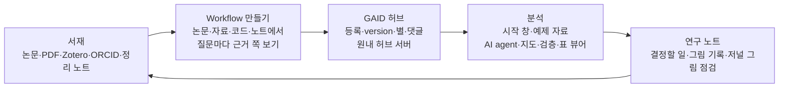

# GAID와 Gemini Notebook(구 NotebookLM) 비교, 차별화와 연계 제안

## 0. 한눈에

| | |
|---|---|
| 요청 | GAID 허브·시스템을 Google NotebookLM(현재 Gemini Notebook)과 비교하고, 차별화로 상품성을 높이는 방안과 두 도구의 연계 방안을 제안합니다. |
| 결론 | Gemini Notebook은 문헌 이해와 설명 자료(오디오·영상·슬라이드) 만들기에서 앞서고 7월부터 코드도 실행하므로, GAID의 차별점은 기관 안에서 지구과학 자료를 다루고 방법을 version이 붙은 Workflow로 공유하며 분석 계보를 노트와 서재로 잇는 데 있습니다. 먼저 인용을 눌러 PDF 쪽을 여는 기능과 연구 노트 결과 묶음을 만들고, 연계는 노트북 링크 저장과 확인 화면이 있는 공개 자료 내보내기부터 하기를 권합니다. |
| 믿을 수 있는 정도 | Gemini Notebook 쪽은 2026-10-24에 확인한 Google 공식 문서가 근거입니다. 개명, 소스 형식·한도, 코드 실행, 데이터 리전 제외 네 가지는 제가 원문을 다시 열어 확인했습니다. 실제 계정으로 써 보지는 않았습니다. GAID 쪽은 이미 검토 보고서로 확인한 기능만 적었습니다. 두 도구를 같은 과제로 나란히 시험하지는 않았습니다. |
| 결정할 일 | 2건 (6절): 다음에 만들 차별화 기능의 순서, 연계를 어디까지 할지 |

## 1. 요청한 것

> 다음 작업으로 현재 구축중인 GAID 허브와 시스템과 구글의 notebooklm(현재는 Gemini notebook)과 비교하여 장단점을 비교하고 어떻게하면 notebooklm보다 독창적이면서 해당도구가 커버하지 못하는 기능을 강화하여 상품성을 높일수 있을지 진단 및 검토하고 제안하자. 또한 도구간의 연계방안도 함께 검토해보자. — 2026-10-24 요청

완료 기준은 다섯 가지입니다. (1) 날짜가 붙은 공식 출처로 확인한 Gemini Notebook의 현재 사실, (2) 지금 GAID가 실제로 하는 일, (3) 연구자의 일별 장단점 비교, (4) 우선순위를 붙인 차별화 제안과 따라 하지 않을 것, (5) 실현 가능성과 자료 반출 문제를 적은 연계 방안입니다. 앱 코드는 고치지 않습니다.

앞선 사용자 지시도 기준에 넣었습니다. 2026-10-15에 사용자는 NotebookLM을 자료 처리 흐름의 참고로만 삼고 화면 배치나 디자인은 채택하지 않는다고 정했습니다. 이 보고서의 제안도 같은 선을 지킵니다.

## 2. 수행한 것

1. Gemini Notebook의 현재 상태를 웹에서 조사했습니다. Google 블로그, 도움말, Workspace 관리자 문서, Google Cloud 문서와 가격 페이지를 대상으로 하고 항목마다 날짜를 붙였습니다. 결과를 바꿀 만한 네 가지 사실은 제가 원문을 다시 열어 확인했습니다.
2. GAID 현황을 정리했습니다. 저장소의 제품 문서, 지시 문서와 10월 15~24일 보고서에서 검토를 거친 기능과 한계만 모았습니다.
3. 두 가지는 GAID 코드에서 직접 확인했습니다. 채팅·노트의 인용이 PDF로 이어지는지, 노트를 밖으로 내보내는 기능이 있는지입니다.
4. 연구자가 하는 일 8가지로 두 도구를 비교했습니다.
5. 차별화 제안과 연계 방안을 영향·노력·위험으로 매겨 우선순위를 정했습니다.

## 3. 결과

### 3.1 Gemini Notebook의 현재 사실 (2026-10-24 확인)

사용자가 알고 있는 이름이 맞습니다. Google은 2026-07-16에 NotebookLM을 Gemini Notebook으로 개명했고, 독립 제품으로 유지한다고 밝혔습니다. 이와 별도로 2026-04-08부터 Gemini 앱 안에 "Notebooks"가 있습니다. 대화·파일·지침을 묶는 기능이며 Gemini Notebook과 연결됩니다. 이 Gemini 앱 Notebooks는 현재 개인 계정만 대상으로 안내됩니다. 기업용은 Google Cloud의 Gemini Notebook Enterprise입니다. API와 문서 주소에는 여전히 NotebookLM 이름이 남아 있습니다.

| 항목 | 확인한 내용 |
|---|---|
| 소스 | PDF, Word, 텍스트, Markdown, CSV, PowerPoint, Google Docs·Slides(100장까지)·Sheets(10만 토큰까지), 웹 주소(본문 텍스트만), 공개 YouTube(자막), 오디오, 이미지, ePub, Gemini 대화. 소스당 50만 단어, 파일 200MB까지. XLSX는 Enterprise에서만 명시됩니다. |
| Drive | 2026-05부터 Drive 소스가 몇 분 간격으로 자동 동기화됩니다. 원본 권한을 잃으면 그 소스는 쓰이지 않습니다. |
| 인용 | 답의 인용을 누르면 소스의 해당 문맥이 열립니다. 노트로 저장해도 인용이 남습니다. 노트북 여러 개에 걸친 질문은 할 수 없습니다. |
| 만드는 결과 | 오디오 개요(한국어 포함 80개 이상 언어, 진행자와 대화하는 모드는 영어만), 영상 개요, 마인드맵, 보고서·학습 가이드, 플래시카드·퀴즈, 인포그래픽, 슬라이드(PDF·PPTX), 데이터 표(Sheets로 내보내기). 슬라이드·영상 만들기는 2026-10-19부터 모든 사용자에게 배포하는 중입니다. |
| 조사 | 웹·Drive에서 소스를 찾는 Fast Research, 웹 조사 보고서를 만드는 Deep Research |
| 코드 실행 | 2026-07-16부터 노트북마다 보안 클라우드 컴퓨터에서 코드를 쓰고 실행합니다. 차트, CSV·JSON, XLSX, PPTX, PDF를 출력합니다. 발표 당시에는 Ultra와 일부 Workspace 고객이 대상이었고 Pro로 넓힌다고 했습니다. 도움말은 "실험적 기능"이라고 적습니다. 지금 어느 요금제까지 열렸는지는 확인하지 못했습니다. |
| 지구과학 자료 | 좌표계, GeoTIFF 지리참조, shapefile·GeoPackage, LAS 검층을 다루는 전용 기능은 공식 문서에서 찾지 못했습니다. 코드 실행으로 일부는 할 수 있겠지만 시험하지 않았습니다. |
| 공유 | 뷰어·편집자 공유(개인 계정 50명), 로그인한 사용자에게 공개 링크, 채팅만 보이는 공유, 7일 사용 통계. Workspace는 관리자가 외부 공유를 막거나 허용합니다(기본은 차단, 2026-09-10). Enterprise는 같은 Cloud 프로젝트 안에서만 공유합니다. |
| 요금(한국) | 무료(노트북 100개, 노트북당 소스 50개), Google AI Plus 월 7,500원, Pro 연 290,000원(월 가격은 확인 못함), Ultra 월 119,000원부터. 개인용 한도는 2026-09부터 연산량 기준으로 5시간마다 갱신됩니다. Enterprise 단독은 라이선스당 월 9달러, 최소 15개입니다. |
| API | Enterprise만 공개 API가 있습니다. 미리보기(v1alpha) 단계이고 노트북 만들기·공유, 소스 추가, 오디오 개요 만들기를 지원합니다. 채팅 질의 API와 개인용 공식 API는 찾지 못했습니다. GitHub에 비공개 API를 쓰는 비공식 도구와 MCP 서버가 있습니다. |
| 자료 처리 | 개인 계정은 업로드 자료를 모델 학습에 쓰지 않습니다. 다만 피드백을 보내면 사람이 검토하고 최대 3년 보관할 수 있습니다. Workspace·Education 계정은 사람 검토와 학습에서 제외됩니다. Workspace 데이터 리전 정책은 Gemini Notebook에 적용되지 않고, Workspace DLP도 연동되지 않습니다. Enterprise의 처리 지역은 미국·EU 등이며 한국은 목록에 없습니다. |

출처는 부록 A에 적었습니다. 출처 목록이 있는 조사 원문은 Obsidian에 저장했습니다.

국내 공공기관이 쓸 때의 조건도 확인했습니다. 2026-05-01 시행 국가 사이버보안 기본지침은 민간 클라우드를 쓸 때 보안 기준과 도입 가능 목록 같은 조건을 둡니다. Google Cloud가 받은 CSAP 인증은 서울 리전의 IaaS·PaaS에 대한 것입니다. Gemini Notebook 같은 SaaS가 그 범위에 드는지는 확인하지 못했습니다. KIGAM 내부 자료를 올려도 되는지는 이 조사로 판단할 수 없고, 기관 보안 담당 부서가 자료 등급과 상품을 놓고 정해야 합니다.

### 3.2 지금의 GAID (검토 보고서로 확인한 것)

GAID는 연구자 PC(또는 원내 PC)에서 도는 웹 앱입니다. 연구자가 자기 모델 계정을 연결합니다. 기관 Qwen, ChatGPT 로그인, 개인 API 키 경로를 시험했습니다. 연구의 한 바퀴는 아래와 같고, 10월 23일 포천 자철석 연구 시험에서 실제 앱으로 끝까지 이어졌습니다.

그림 1. GAID 연구 순환. 볼 것: 각 단계의 결과가 다음 단계의 입력이 되고, 연구 노트가 다시 서재로 들어갑니다.

| 기능 | 확인한 범위 |
|---|---|
| 서재 | Zotero 연결 서재와 PDF만 넣는 서재, 하위 폴더, Zotero로 보내기, ORCID로 내 논문 가져오기와 본인 확인. 기관 Qwen의 쪽 인용 34개를 대조해 모두 맞았습니다. 다른 시험에서도 46건 가운데 틀린 쪽이 없었습니다. |
| Workflow 만들기 | PDF·코드·자료 파일·웹 주소·서재 논문·연구 노트를 받습니다. 한 번에 하나씩 묻고 질문 옆에 근거(PDF 쪽, 코드 줄, 자료 요약)를 보여 줍니다. 3~5단계 분석 흐름과 입력별 예제 자료가 붙은 Workflow를 만듭니다. |
| GAID 허브 | 등록, version(patch·minor·major), 복사해 고치기, 제거·복원, 별·댓글, 스킬 선반. 원내 허브 서버(계정, 서재 동기화, 자료 소식)가 PC74에서 시험 운영 중입니다. |
| 분석 | AI agent가 프로젝트 폴더에서 코드를 실행합니다. 지도(래스터 타일, 벡터, 좌표계, NGII·지질도 배경), LAS 검층, CSV·XLSX 표 점검 뷰어가 있습니다. 파일 단계 계보와 환경 기록이 자동으로 남습니다. |
| 연구 노트 | 분석마다 결과를 앞에 두고 노트를 씁니다. 결정할 일에 한꺼번에 답하고, 그림마다 만든 스크립트·자료·채팅을 보며, 목표 저널의 그림 요건으로 점검합니다. 노트를 서재에 넣습니다. |
| 다른 도구로 | Workflow 지침과 스킬을 Pi·Claude Code용 파일로 내보냅니다. |

함께 적어야 할 GAID의 현재 한계입니다.

- 아직 배포 전입니다. 앱 릴리스는 기관 브랜드 승인을 기다리고, 허브 서버는 시험 그룹용 HTTP로 돕니다.
- 설치가 필요하고 데스크톱 화면만 지원합니다. 모바일은 없습니다.
- 시험한 횟수가 적습니다. 대부분 기능을 논문 한두 편과 과제 하나로 한 번씩 시험했습니다.
- 비용과 시간이 큽니다. 서재 질문 한 번에 구독 토큰 90만~200만 개가 들었고, 분석 대화 한 번은 40분 안팎 걸렸습니다.
- 로컬 모델 시험에서는 98K 지도 과제 1건만 기준을 통과했습니다.
- 채팅과 노트의 인용은 글자로만 보입니다. 눌러도 PDF가 열리지 않습니다(코드 확인). PDF 패널은 지정한 쪽으로 넘어가는 기능이 있지만, 허브 Workflow 만들기 화면에서만 씁니다.
- 연구 노트를 밖으로 내보내는 기능이 없습니다. 증거 묶음은 작업 기록 화면 안에서만 만들 수 있습니다.
- 국내 문헌원(KCI, RISS)과 기관 보고서는 다루지 않습니다.
- Google Drive나 Gemini Notebook과 이어지는 코드는 없습니다.

### 3.3 연구자의 일별 비교

| 연구자의 일 | Gemini Notebook | GAID | 판단 |
|---|---|---|---|
| 문헌 이해 | 소스 형식이 넓고, 인용을 누르면 원문이 열리며, 요약·마인드맵·보고서를 바로 만듭니다. | 서재가 Zotero·ORCID와 이어지고 쪽 인용이 맞았습니다. 인용을 눌러도 원문이 열리지 않고, 질문 한 번에 토큰이 많이 듭니다. | Gemini Notebook 우세. GAID는 인용 열기를 메워야 합니다. |
| 설명 자료 | 오디오·영상·슬라이드·인포그래픽·퀴즈를 한국어로 만듭니다. | 연구 노트, 저널 그림 점검, 개념 그림. 오디오·영상·슬라이드는 없습니다. | Gemini Notebook 우세. GAID가 따라 할 영역이 아닙니다. |
| 자료 분석·코드 | 클라우드에서 코드를 실행합니다(실험적, 요금제 제한). 환경과 실행 기록을 묶어 다시 돌리는 기능은 확인하지 못했습니다. | 연구자 PC에서 실행하고, 계보와 환경 기록을 자동으로 남기며, Workflow 단계와 예제 자료를 씁니다. | GAID 우세. 다만 시험 횟수가 적습니다. |
| 공간 자료 보기 | 전용 기능을 찾지 못했습니다. | 지도·검층·표 뷰어, 좌표계 처리, 국내 배경지도와 지질도 | GAID 우세 |
| 재현성·근거 | 소스 인용까지 남습니다. | 파일 계보, 환경 기록, Workflow version, 그림 기록 | GAID 우세. 밖으로 내보내는 묶음이 없습니다. |
| 원내 방법 공유 | 노트북을 공유합니다. 방법을 단위로 version을 붙여 고치는 기능은 없습니다. | Workflow 등록·version·복사·제거, 원내 허브 서버, 스킬 선반 | GAID 우세. 아직 시험 운영 단계입니다. |
| 민감 자료 | 자료가 Google로 갑니다. 한국 리전이 없고 Workspace 데이터 리전·DLP가 적용되지 않습니다. | 자료가 연구자 PC에 남습니다. 기관 Qwen이나 로컬 모델을 쓰면 모델 호출도 원내에 머뭅니다. 외부 모델을 고르면 그 회사로 갑니다. | GAID 우세. 단, 원내 모델의 성능 한계가 있습니다. |
| 비용·접근성 | 무료부터 쓰고, 설치가 없으며, 모바일이 있습니다. | 설치가 필요하고, 연구자의 모델 구독이나 키를 씁니다. 토큰 사용량이 큽니다. | Gemini Notebook 우세 |

### 3.4 진단과 차별화 제안

Gemini Notebook은 "자료를 넣고 이해하고 설명한다"를 넓게 잘합니다. 코드 실행까지 더해져 범용 분석 기능의 격차도 줄었습니다. GAID가 같은 쪽에서 겨루면 설치·비용·완성도에서 집니다. GAID가 내세울 곳은 Gemini Notebook이 구조상 하기 어려운 일입니다.

1. 기관 안에 머무는 자료와 모델
2. 지구과학 자료형
3. 방법을 version이 붙은 Workflow로 원내에서 다시 쓰는 일
4. 분석의 계보가 노트와 서재로 이어지는 일

다만 지금 GAID는 이 강점을 연구자가 결과물로 손에 쥐게 해 주지 못합니다. 원문 인용이 열리지 않고, 노트를 근거째 내보낼 수 없습니다.

| 순위 | 제안 | 왜 | 영향 | 노력 | 위험 |
|---|---|---|---|---|---|
| 1 | 인용을 눌러 PDF 쪽 열기: 채팅과 연구 노트의 서재 인용을 누르면 옆 PDF 패널에서 그 쪽이 열립니다. | 문헌 이해에서 Gemini Notebook과 비교될 때 가장 먼저 눈에 띄는 차이입니다. 쪽 인용은 이미 맞고, 쪽 이동 PDF 패널도 있습니다. | 큼 | 작음 | 낮음 |
| 2 | 연구 노트 결과 묶음: 노트 하나에서 본문, 그림, 쓴 자료의 지문, 환경 기록, Workflow version, 인용 논문 목록을 묶어 내려받습니다. 다른 연구자나 심사자가 확인할 수 있게 합니다. | Gemini Notebook이 주지 않는 재현 근거를 연구자가 결과물로 갖게 됩니다. 기존 증거 묶음 기능을 노트에 잇는 일입니다. | 큼 | 중간 | 중간(묶음 범위와 크기) |
| 3 | 지역 단위로 모으기: 연구 지역(경계 상자나 지명)에 논문, 자료, Workflow, 노트를 모으고 지도에서 봅니다. 서재 폴더와 연결 지도를 공간으로 넓힙니다. | 범용 노트북에는 없는 지구과학 고유의 정리 방식입니다. "포천 지역에서 한 분석"을 한곳에서 봅니다. | 중간~큼 | 중간 | 중간(지역 정보를 어디서 얻을지) |
| 4 | 국내 문헌과 기관 보고서: KCI·RISS 서지 가져오기, KIGAM 보고서 PDF를 서재에 넣고 쪽 인용하기 | Gemini Notebook과 해외 문헌 도구가 약한 곳입니다. 기관 연구자의 실제 문헌입니다. | 중간 | 중간 | 중간(이용 조건 확인) |
| 5 | 서재 질문의 토큰 줄이기와 원내 모델 준비: 대화마다 다시 보내는 문맥을 줄이고, 기관 Qwen으로 끝까지 되는 과제를 늘립니다. | 원내에 머문다는 장점은 원내 모델로 일이 될 때만 성립합니다. | 큼 | 큼 | 중간 |
| 6 | 배포 기반: 허브 서버 HTTPS, 앱 릴리스 공개 | 차별화는 아니지만, 이것 없이는 상품이 되지 않습니다. 이미 미결 항목으로 있습니다. | 큼 | 작음 | 낮음 |

따라 하지 않을 것은 다음과 같습니다.

- 오디오·영상 개요, 플래시카드·퀴즈: Google이 이미 잘합니다. 필요하면 연계로 넘깁니다(3.5절).
- 범용 웹 조사(Deep Research)와 모바일 앱
- Gemini Notebook의 화면 배치와 시각 디자인(2026-10-15 사용자 지시)
- "코드 실행"을 그 자체로 차별점이라 쓰는 홍보 문구: 지금은 Gemini Notebook도 합니다.

### 3.5 연계 방안

| 방안 | 내용 | 실현 가능성 | 자료 반출 | 권장 |
|---|---|---|---|---|
| 가. 노트북 링크 저장 | 서재 폴더나 프로젝트에 관련 Gemini Notebook 주소를 적어 둡니다. | 바로 가능합니다. 자료가 오가지 않습니다. | 없음 | 지금 |
| 나. 공개 자료 내보내기 | 연구 노트(Markdown), Workflow 지침(Markdown), 공개 이용이 가능한 논문 PDF를 묶어 내려받습니다. 연구자가 직접 Gemini Notebook에 올립니다. 내보내기 전에 들어가는 파일 목록과 "기관 밖으로 나가도 되는 자료인가"를 확인받습니다. | 가능합니다. Gemini Notebook이 Markdown·PDF를 소스로 받습니다. 제안 2의 결과 묶음과 같은 기반을 씁니다. | 연구자가 고른 파일만 Google로 갑니다. 기관 규정 확인이 필요합니다. | 지금(확인 화면과 함께) |
| 다. Gemini Notebook 결과 가져오기 | Gemini Notebook에서 내보낸 보고서(Docs → Word/PDF), 데이터 표(Sheets → CSV), 노트를 서재에 "외부 정리"로 넣습니다. 출처는 Gemini Notebook, 상태는 검토 전으로 표시합니다. 인용 근거로는 쓰지 않습니다. | 가능합니다. 파일을 내려받아 넣는 방식입니다. | 들어오는 방향이라 반출은 없습니다. | 나 다음 |
| 라. Google Drive 폴더 연동 | GAID가 내보낸 문서를 연구자의 Drive 폴더에 쓰고, Gemini Notebook이 Drive 자동 동기화로 받습니다. | GAID에 Google 로그인과 Drive 권한을 새로 만들어야 합니다. PDF·Markdown 파일도 Drive 자동 동기화 대상인지는 확인하지 못했습니다. | 동기화되는 한 계속 나갑니다. | 보류 |
| 마. Enterprise API | GAID가 Cloud API로 노트북을 만들고, 소스를 넣고, 오디오 개요를 만듭니다. | 미리보기 단계입니다. Cloud 프로젝트와 라이선스(최소 15개)가 필요하고, 한국 리전이 없습니다. 채팅 API는 찾지 못했습니다. | 기관 단위로 Google Cloud에 올라갑니다. | 기관 보안 승인 뒤 다시 검토 |
| 바. 비공식 API·MCP | GitHub의 비공식 도구로 개인 Gemini Notebook을 조작합니다. | 공개되지 않은 API에 기대며, 언제든 끊길 수 있다고 스스로 밝힙니다. 로그인 쿠키를 다룹니다. | 개인 계정으로 나갑니다. | 쓰지 않음 |

연계의 원칙은 "공개·승인된 자료와 설명은 Gemini Notebook으로, 분석 원본·실행 환경·민감 자료는 GAID와 원내 허브에"입니다. GAID는 Google의 Gemini 모델을 다른 모델처럼 API 키로 연결할 수 있지만, 이 경로는 Gemini Notebook 연계와는 다른 일입니다. 그 경로의 자료 처리 조건은 이번에 확인하지 않았습니다.

| 완료 기준 | 결과 | 근거 |
|---|---|---|
| Gemini Notebook 현재 사실 | 충족(실제 계정 확인은 안 함) | 3.1, 부록 A |
| GAID 현황 | 충족 | 3.2 |
| 일별 장단점 | 충족(같은 과제 비교 시험은 안 함) | 3.3 |
| 차별화 제안·따라 하지 않을 것 | 충족 | 3.4 |
| 연계 방안 | 충족 | 3.5 |

## 4. 검증

- 사실 확인: Gemini Notebook의 개명·독립 제품 유지·코드 실행, 소스 형식과 한도와 Drive 동기화, Workspace 데이터 리전 제외, 코드 실행이 "실험적"이라는 표시를 제가 공식 원문에서 다시 확인했습니다. 나머지 항목(요금, Enterprise API 범위, 공유 조건, 처리 지역, 국내 지침)은 웹 조사가 인용한 공식 문서에 기댄 것이고, 제가 원문을 다시 열지는 않았습니다.
- GAID 사실: 검토를 거친 보고서의 결론과 한계 절에서 가져왔습니다. 인용 클릭, 노트 내보내기, Google 연동 여부는 코드에서 확인했습니다.
- 수치 다섯 점검: 이 보고서의 수치(요금, 한도, 시험 결과)는 원 출처의 값을 옮긴 것이며 새로 측정한 값이 없습니다. 두 도구의 성능 비교 수치는 만들지 않았습니다. 반복·편차·다른 설명은 해당 없음입니다. 같은 과제로 두 도구를 비교하는 시험은 미확인입니다.

## 5. 한계

- Gemini Notebook을 실제 계정으로 써 보지 않았습니다. 한국 계정에서 코드 실행·슬라이드·영상이 열려 있는지는 모릅니다.
- Gemini Notebook은 빠르게 바뀝니다. 이 보고서의 사실은 2026-10-24 기준입니다. 이번 조사에서도 2026년에 바뀐 점이 많았습니다(개명, 코드 실행, Drive 동기화, 사용량 한도, 외부 공유 설정).
- Google AI Pro의 한국 월 가격, 기관 Workspace 계약 가격, Gemini Notebook SaaS의 국내 보안 인증 범위는 확인하지 못했습니다.
- 차별화 제안의 영향·노력은 제 판단입니다. 연구자에게 물어 확인하지 않았습니다.
- 지구과학 과제에서 Gemini Notebook의 코드 실행이 어디까지 되는지는 시험하지 않았습니다. 시험하려면 공개 자료로만 해야 합니다.

## 6. 결정할 일

1. 다음에 만들 차별화 기능의 순서
   - 가) 1(인용을 눌러 PDF 쪽 열기)과 2(연구 노트 결과 묶음)를 먼저 만들고, 3~5는 그 뒤에 정합니다. (권장: 둘 다 이미 있는 기능을 잇는 일이라 노력은 작고, 문헌 쪽 약점과 재현성 강점을 함께 보여 줍니다.)
   - 나) 3(지역 단위로 모으기)을 먼저 만듭니다. 지구과학 고유성이 가장 잘 보입니다.
   - 다) 5(토큰 줄이기와 원내 모델 준비)를 먼저 합니다. 원내 운영의 전제를 먼저 갖춥니다.
2. 연계를 어디까지 할지
   - 가) 지금은 가(링크 저장)와 나(확인 화면이 있는 공개 자료 내보내기)만 만들고, 다(결과 가져오기)는 그 뒤에 만듭니다. Drive 연동과 Enterprise API는 기관 보안 부서의 판단 뒤로 미룹니다. (권장: 자료 반출을 연구자가 매번 고르고, Google 쪽 API 변화에 묶이지 않습니다.)
   - 나) 연계 기능을 만들지 않고 두 도구를 따로 씁니다.
   - 다) 기관 보안 부서에 Gemini Notebook Enterprise 도입 가능 여부를 먼저 묻고, 그 답에 따라 API 연동까지 검토합니다.

## 7. 대체되었거나 실패한 시도

펼치기 — 1건

- Enterprise 노트북 API 문서는 제 확인 도구로 열리지 않았습니다(응답 머리 오류). 그 범위는 웹 조사가 인용한 내용으로 적었습니다.

## 용어

없음

## 부록 A. 근거 위치

펼치기 — 조사 원문, 공식 출처, 코드 위치

| 항목 | 위치 |
|---|---|
| 웹 조사 원문(출처 목록 포함) | Obsidian `웹 조사/geoaidesk/2026-10-24-2026-10-24-google-notebooklm--a6dfb78488.md` (oracle 세션 `2026-10-24-google-notebooklm`, Pro, 2026-10-24) |
| 조사 질문과 출력 | `pc74:~/data/geoaidesk/work/gaid-notebooklm-review/q1.md`, `q1.out` |
| 개명·코드 실행(제가 다시 확인) | https://blog.google/innovation-and-ai/products/gemini-notebook/notebooklm-gemini-notebook/ (2026-07-16) |
| 소스 형식·한도·Drive 동기화(다시 확인) | https://support.google.com/gemininotebook/answer/16215270?hl=en |
| 채팅·코드 실행 "실험적"(다시 확인) | https://support.google.com/gemininotebook/answer/16179559?hl=en |
| 데이터 리전 제외(다시 확인) | https://knowledge.workspace.google.com/admin/compliance/data-covered-by-data-regions |
| Gemini 앱 Notebooks | https://blog.google/innovation-and-ai/products/gemini-app/notebooks-gemini-notebooklm/ (2026-04-08) |
| Drive 자동 동기화 발표 | https://workspaceupdates.googleblog.com/2026/05/keep-your-sources-up-to-date-with-automatic-Drive-syncing-in-NotebookLM.html |
| 슬라이드·영상 배포 | https://blog.google/innovation-and-ai/products/gemini-notebook/co-create-slides-videos/ (2026-10-19) |
| 오디오·영상 개요 | https://support.google.com/gemininotebook/answer/16212820 , https://support.google.com/gemininotebook/answer/16454555 |
| 공유·통계 | https://support.google.com/gemininotebook/answer/16206563 |
| 외부 공유 관리 | https://workspaceupdates.googleblog.com/2026/09/manage-external-sharing-for-gemini-notebook-in-the-Admin-console.html |
| 사용량 한도 | https://blog.google/innovation-and-ai/products/gemini-notebook/new-flexible-usage-limits/ , https://support.google.com/gemininotebook/answer/17670842 , Workspace https://support.google.com/gemininotebook/answer/16337734 |
| 한국 요금 | https://gemini.google/kr/subscriptions/?hl=ko , https://blog.google/intl/ko-kr/company-news/google-gemini-ai-pro-campaign-kr/ |
| Enterprise 개요·한도·공유·API | https://docs.cloud.google.com/gemini/enterprise/notebooklm-enterprise/docs/overview , …/api-notebooks , …/api-notebooks-sources , …/api-audio-overview , https://cloud.google.com/gemini-enterprise/gemini-notebook |
| 처리 지역·CMEK·VPC-SC | https://docs.cloud.google.com/gemini/enterprise/docs/locations , …/notebooklm-enterprise/docs/cmek , https://docs.cloud.google.com/vpc-service-controls/docs/supported-products |
| 개인정보 | https://support.google.com/gemininotebook/answer/17004255 , https://knowledge.workspace.google.com/admin/generative-ai/generative-ai-in-google-workspace-privacy-hub |
| 국가 사이버보안 기본지침·CSAP | https://www.ncsc.go.kr/template/resources/file/nis_guide_lines_2023_1_31.pdf (2026-05-01 시행본), https://www.kisa.or.kr/1050603 , https://cloud.google.com/security/compliance/csap?hl=ko |
| 비공식 연동 | https://github.com/teng-lin/notebooklm-py , https://github.com/PavelGuzenfeld/notebooklm-mcp |
| 독립 평가(과거 버전) | https://arxiv.org/abs/2509.25498 (2025-09-29, 문서 300개 질의에서 출력의 13%에 환각 1건 이상) |
| GAID 인용 표시 | 서재 도구가 `[@key, p. N]`로 인용하게 함: `server/src/geo/library/tools.ts:67`; 채팅·노트는 일반 Markdown으로 그림: `web/src/components/ai-elements/message.tsx`, `web/src/geo/notes/research-notes-panel.tsx`; 쪽 이동 PDF 패널 `web/src/geo/pdf/pdf-pane.tsx` (호출은 `web/src/geo/hub/hub-dialogs.tsx`) |
| GAID 노트 내보내기 없음 | `server/src/geo/routes/notes.ts` (목록·읽기·상태만), 증거 묶음은 `web/src/components/lab-notebook-view.tsx` |
| GAID 현황 근거 보고서 | `reports/2026-10-21-gaid-library-next`, `2026-10-22-gaid-user-acceptance`, `2026-10-23-gaid-pocheon-trial`, `2026-10-11-gaid-release-proof`, `2026-10-22-gaid-hub-server-trial`, `2026-10-15-gaid-researcher-ecosystem`(NotebookLM 참고 범위 지시), `2026-10-21-gaid-research-hub` |

작성 시점: 2026-10-24, 브랜치 task/gaid-notebooklm-review (main 67b73c59 기준).

