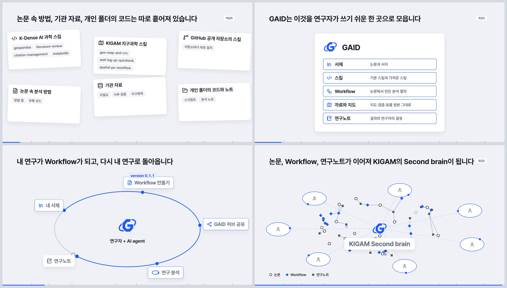
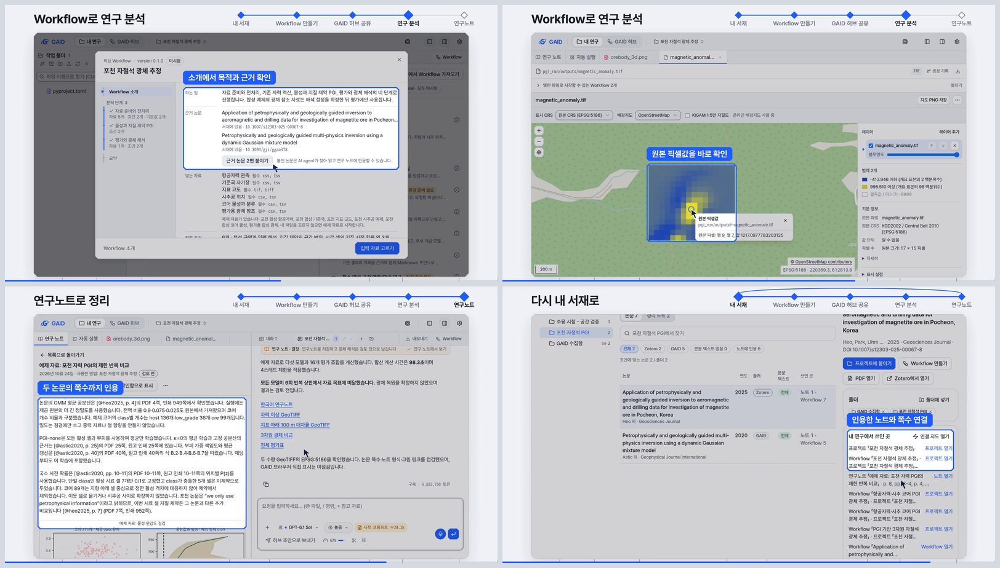

# GAID 홍보 영상 v3: 최종 앱에서 포천 연구 한 바퀴로 다시 찍은 105초 영상 (내부 검토용)

## 0. 한눈에

| | |
|---|---|
| 요청 | 현재 영상(v2)의 구성과 그 뒤 개선된 내용을 파악해 체계화하고, 최종 개선된 앱으로 홍보 영상을 업데이트합니다. |
| 결론 | 105초 영상을 만들었습니다. 배경 → 연구 순환 → 여섯 단계 실제 시연 → KIGAM Second brain → 마무리 구성은 v2와 같습니다. 시연 16장면은 최종 앱에서 새로 진행한 포천 연구 한 바퀴에서 찍었고, 22~24일 개선 기능이 순환 속 제자리에 나옵니다. |
| 믿을 수 있는 정도 | 화면은 모두 실제 앱에서 실제로 진행한 연구입니다. 촬영 화면의 문구는 바꾸지 않았습니다. 장면 순서 하나와 분석 결과의 한계는 5절에 적었습니다. |
| 결정할 일 | 없음. 영상 검토 의견을 받습니다. |

## 1. 요청한 것

> 우선 GAID 홍보 영상을 구글드라이브에 업로드 하자. 그리고 포천 예제가 끝나면 최종 개선된 앱을 바탕으로 홍보영상을 업데이트해야한다. 현재 영상의 구성과 개선된 내용을 파악한 후 체계화하여 홍보영상을 업데이트해야한다. — 2026-10-23 요청

v2 영상의 구글 드라이브 업로드는 허브가 마쳤습니다.

완료 기준: v2의 구성과 22~24일 개선 내용을 파악한 뒤, 구성을 먼저 정해 보여 드리고 최종 앱에서 실제 화면을 다시 찍어 v3를 만듭니다. v2에서 좋다고 하신 점(모션그래픽, 확대·스크롤 없는 기능별 설명, 연구 순환, 스킬 생태계 배경, 개수 통계 없음, Second brain 장면)은 유지합니다. 조건은 무음, 1920×1080, 30fps, 90~105초, 내부 검토용입니다.

## 2. 수행한 것

1. v2 영상과 보고서, 22~24일 개선 보고서 11건을 읽었습니다(서재 PDF 패널, 여러 자료로 Workflow 만들기, 근거 뷰어, Workflow 단계, 예제 자료, 시작 창, 근거 논문 인용, 노트 서재 넣기, 허브 version, 포천 실전 검증, 화면 점검). 이 내용을 연구 순환의 여섯 단계에 배치한 구성안을 작업 탭에서 보여 드렸습니다.
2. 검토용 앱에서 포천 자철석 PGI 논문(Heo et al. 2025)으로 연구 한 바퀴를 새로 진행했습니다(하위 작업자). 진행 순서는 다음과 같습니다.
   - 서재 폴더에 이 논문과 PGI 방법 논문을 넣었습니다.
   - 두 논문, 논문 보충 코드, 자료 파일 6개로 Workflow를 만들고 기관 허브에 0.1.0으로 등록했습니다.
   - 새 프로젝트에서 근거 논문을 붙이고 예제 자료로 분석을 한 번 돌렸습니다.
   - 연구노트의 결정에 답한 뒤 노트를 서재에 넣었습니다.
   - 실행에서 알게 된 점을 반영해 0.1.1을 등록했습니다.
3. 영상 장면은 v2의 움직임을 그대로 두고 시간 칸만 v3에 맞췄습니다. 시연 길이는 촬영본 길이를 따릅니다. 연구 순환 장면의 "판"은 "version 0.1.0 → 0.1.1"로 바꿨습니다.
4. 정지 화면으로 장 전환과 이름표 위치를 확인했습니다. 108초였던 길이를 모션그래픽 장면을 조금씩 줄여 105초로 맞춘 뒤 최종 영상을 렌더했습니다.

## 3. 결과

그림 1. 모션그래픽 장면입니다(왼쪽 위부터 흩어진 자료, GAID로 모이는 장면, 연구 순환, Second brain). 볼 것: 연구 순환의 Workflow 위에 "version 0.1.1"이 붙습니다. 흩어진 자료와 Second brain 장면에는 "개념도" 표시가 있습니다.

그림 2. 시연 앞부분입니다(서재 옆 PDF, 질문 옆 근거 뷰어, 네 단계 Workflow 초안, 허브 등록 창의 예제 자료 공유). 볼 것: 질문 오른쪽에 근거가 된 논문 쪽이 인용 문장과 함께 열리고, 초안은 자료 준비 → 기존 자력 역산 → 물성과 지질 제약 PGI → 평가와 광체 해석의 네 단계입니다.

그림 3. 시연 뒷부분입니다(시작 창의 근거 논문 붙이기, 지도 보기의 자력 이상 GeoTIFF, 두 논문을 쪽수로 인용한 연구노트, 서재 논문의 "내 연구에서 쓰인 곳"). 볼 것: 지도는 포천 지역 배경지도 위에 원본 좌표계로 놓이고, 클릭한 셀의 원본 값이 나옵니다. 마지막에 논문이 Workflow·프로젝트·노트로 이어집니다.

| 시간(초) | 장면 | 보여 주는 것 (개선 기능) |
|---|---|---|
| 0–4 | 시작 | GAID 로고 |
| 4–16 | 배경 (개념도) | 공개된 스킬 생태계와 흩어진 방법·자료·노트 → GAID |
| 16–22 | 연구 순환 | 서재 → Workflow 만들기 → 허브 공유 → 연구 분석 → 연구노트 → 서재, version 0.1.0 → 0.1.1 |
| 22–31 | 시연: 내 서재 | 두 논문을 한 폴더에, 서재 옆 PDF 패널 |
| 31–48 | 시연: 논문에서 Workflow | 서재 논문 두 편·코드·자료 요약을 함께 넣기, 질문 옆 근거 뷰어, 네 단계 초안, 입력마다 예제 자료 |
| 48–56 | 시연: GAID 허브 공유 | 다음 version 고르기, 함께 공유되는 예제 자료, 허브의 새 version |
| 56–76 | 시연: 연구 분석 | 시작 창 소개에서 근거 논문 붙이기, 단계마다 예제 자료, AI agent 작업, 지도 보기 |
| 76–82 | 시연: 연구노트 | 결과부터 쓴 노트, 광체 비교 그림, 두 논문 쪽수 인용, 결정에 답하기 |
| 82–93 | 시연: 다시 내 서재로 | 노트를 서재에 보관, 논문의 쓰인 곳, 연결 지도 |
| 93–101 | KIGAM Second brain (개념도) | 여러 연구자의 고리 → 논문·Workflow·연구노트의 지식망 |
| 101–105 | 마무리 | 로고, "내부 검토용 영상" |

| 완료 기준 | 결과 | 근거 |
|---|---|---|
| v2 구성과 개선 내용 파악, 구성 먼저 | 충족. 구성안을 작업 탭에서 보여 드린 뒤 진행했습니다 | 2절 |
| 최종 앱에서 실제 화면 다시 찍기 | 충족. 16장면, 72.5초 | 4절 |
| 개선 기능을 순환 속에서 보여 주기 | 충족. 위 표의 괄호 항목 | 그림 2–3 |
| v2의 좋았던 점 유지 | 충족. 구성, 기능별 이름표, 개념도 장면, 개수 통계 없음 | 그림 1 |
| 무음, 1920×1080, 30fps, 90~105초 | 충족. 105초 | 4절 |

보는 방법: PC74에 있는 MP4 파일(부록 A의 "영상")을 동영상 플레이어로 엽니다. 파일이 커서 저장소에는 넣지 않았습니다.

## 4. 검증

- 과학적 검증: 해당 없음. 영상에 나오는 분석은 합성 예제 자료로 한 홍보용 실행이며, 결과를 연구 결론으로 쓰지 않습니다(5절).
- 영상 출력: 최종 파일을 다시 읽었습니다. 105.00초, 3,150프레임, 1920×1080, 30fps, H.264이고 음성 트랙이 없습니다. 보고서 그림 세 장은 최종 파일에서 뽑았습니다. 장 전환 구간(22초, 93초, 101초)은 정지 화면으로 겹침과 빈 화면을 확인했습니다.
- 실제 화면: 촬영 프레임 2,175장이 모두 2880×1620입니다. 이름표 상자 36개를 각 장면 가운데 프레임에 그려 화면 요소와 맞는지 눈으로 확인했습니다. 브라우저 페이지 오류는 없었고, 콘솔에는 자원을 찾지 못한 404가 2건 남았습니다. 원인은 확인하지 못했고, 촬영 화면에서 빠진 요소는 보이지 않았습니다.
- 검토용 앱: 연구 전에 있던 프로젝트 18개와 기관 허브 Workflow 8건은 그대로입니다. 바뀐 것은 이번 연구가 만든 기록과, 두 논문에 붙은 새 폴더와 "쓰인 곳" 연결입니다. 앱과 허브 서버는 재시작하지 않았고 설정도 바꾸지 않았습니다.

## 5. 한계

- 내부 검토용입니다. 기관 로고의 외부 공개 승인이 아직 나지 않았습니다(gaid-release-proof#2).
- 장면 순서: 영상에서는 허브 공유 장(version 0.1.1 등록)이 분석 장보다 먼저 나옵니다. 실제로는 0.1.0으로 분석한 뒤 0.1.1을 등록했습니다. 그래서 분석 장의 시작 창에는 "version 0.1.0"이 보입니다.
- 분석 결과: 계산은 98초(역산 다섯 개, 광체 추출·평가 16조합)였습니다. 다섯 역산은 모두 반복 상한 6회에서 멈췄고 자료 오차 목표에 이르지 못했습니다. 연구노트와 AI agent는 수렴이나 광체 복원을 주장하지 않았고, 노트는 "검토 전"입니다. 결정에 답한 뒤의 후속 검토는 저장된 결과만 다시 읽었습니다(0.5초, 역산 재실행 없음).
- 자료: 합성 예제 자료이며 실제 포천 광체의 추정이 아닙니다(지형만 실제).
- 근거 뷰어: 질문의 첫 근거(Heo 논문 7쪽)는 앱이 자동으로 열었습니다. 두 번째 근거(Astic 논문 10쪽)로는 연구자가 근거 목록에서 직접 넘겼습니다. 이번 초안의 선택지에는 선택지별 근거가 붙지 않았습니다.
- 형식 검사 통과 표시는 화면 밖에 있어 영상에는 나오지 않습니다(앱 기록으로 확인).
- 분석에는 연결된 구독 모델(GPT-6.1 Sol, 추론량 높음)을 작업마다 골라 썼습니다. 대화 전체에 구독 토큰 약 1,160만 개를 썼고 청구 금액은 0달러입니다(정가 환산 약 2.24달러, 청구액 아님).
- 흩어진 자료 장면과 Second brain 장면은 개념도입니다. 화면에 그렇게 표시했습니다.

## 6. 결정할 일

없음.

## 7. 대체되었거나 실패한 시도

펼치기 — 2건

- 첫 조립본은 108초였습니다. 시연은 줄이지 않고 배경·연구 순환·Second brain·마무리 장면을 조금씩 줄여 105초로 맞췄습니다.
- 초안 작성 중 형식 검사에서 한 번 걸려 앱이 자동으로 고쳤습니다(작성 854초). 이후 초안 수정본이 형식 검사를 통과해 등록했습니다.

## 용어

없음. 기존 용어집을 따릅니다.

## 부록 A. 근거 위치

펼치기 — 실행 방법, 원본, 해시, 커밋

| 항목 | 위치 |
|---|---|
| 제작 소스 | `geo/promo/` (`README.md`, `CONTRACT.md` v3, `CAPTURE.md`, `render.py`, `scene/`, `capture*.py`) |
| 구성안 | `docs/tasks/gaid-promo-video-v3.md` → "Structure draft v3" |
| 실제 화면 촬영 | PC74: `~/data/geoaidesk/work/gaid-promo-video-v3/capture-v3/capture.json` (16 shots, 2,175 frames, 36 beats), `beat-checks/`, `study.json`, `evidence-comparison.json`, `browser-errors.json` |
| 검토용 앱 기록 | 폴더 `lc-0b809e67ade8`, 논문 `li-79b57a297a46` (`heo2025`), `li-a313027670f8` (`astic2020`), Workflow 초안 `ap-574620c7-44d` (수정본 7 → 0.1.0, 8 → 0.1.1), 기관 허브 `entry-ap-574620c7-44d` (0.1.0 package sha256 `c70475e1…f0ab3`, 0.1.1 `b37a8b2c…a8b90847`), 프로젝트 `proj-af4c46`, 대화 `01a169b9-9c13-74e2-b9da-57749e4f1203`, 노트 `연구노트/2026-10-24-pocheon-pgi/index.md`, 서재 노트 항목 `li-55a9e83b40d4` |
| 예제 자료 | 자산 `pocheon_pgi_example` = PC74 `~/assets/gaid-pocheon-pgi-example/2026-10-23/` |
| 렌더 job | `job-geoaidesk-gaid-promo-video-v3-1`, PC74: `~/data/geoaidesk/runs/gaid-promo-video-v3-20261023T174817.846561Z/receipt.json`, 렌더 소스 `344c7e441d195607c7ff6a7548c8d695f6604293` |
| 영상 | PC74: `~/data/geoaidesk/runs/gaid-promo-video-v3-20261023T174817.846561Z/out/gaid-promo-v3.mp4`, 11,338,476 bytes, SHA256 `1fe7371596ac2c53e6d18534cf43a0cc0e6f9c6e79f2f159c496d8c52572ea5f` |
| 출력 기록 | `out/manifest.json` SHA256 `b5af8724daf4eb2ce78c810784bc608d8f4076fd6d2eca5ff21a84681c81104e` (capture.json SHA256 `aab24b2ef94aea09a60748ed8b3b0168adca477af353e496406efe2b9cad2f3a`), `out/contact-sheet.jpg` SHA256 `7ef552c155f75bde5b1f2dc096ac8799288149677f85bf4e9935de374056296c`, 인코딩 후 검사 프레임 PC74: `~/data/geoaidesk/work/gaid-promo-video-v3/qa-v3/` |
| 보고서 그림 | 최종 MP4의 11.18/14.72/20.62/99.73초(그림 1), 29.25/38.55/42.95/50.5초(그림 2), 58.3/73.25/78.9/87.95초(그림 3) 프레임 |
| 도구 | Google Chrome, Playwright 1.63.0, imageio-ffmpeg 0.6.0 (H.264, CRF 17), Pillow 12.3.0 |
| 아이콘·글꼴 | Lucide (Icon Wiki 20261007, ISC/MIT), Pretendard (OFL) |

작성 시점: 2026-10-24.

