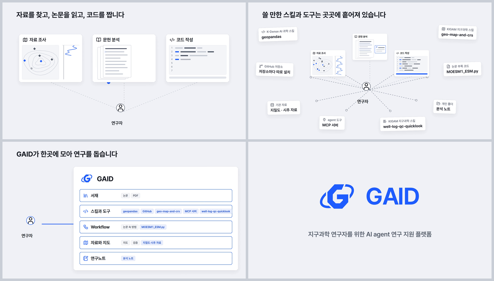
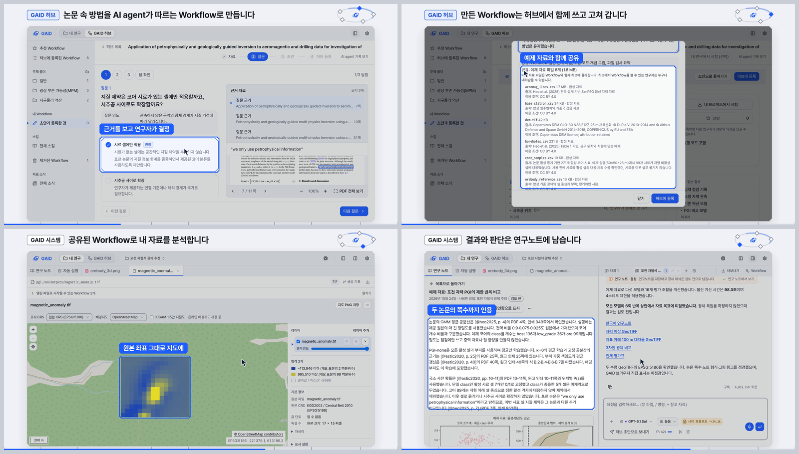

# GAID 홍보 영상 v4_brag: brag 스킬로 만든 소리 있는 영상 두 편 (101초 재편집판, 40초 홍보판; 내부 검토용)

## 0. 한눈에

| | |
|---|---|
| 요청 | brag 스킬로 v4와 같은 메시지의 소리 있는 홍보 영상을 만듭니다. 이어서 40초 길이로, 더 자유로운 홍보형 영상을 한 편 더 만듭니다. |
| 결론 | 두 편을 만들었습니다. 101초판(100.8초)은 v4의 화면 문구와 촬영본을 그대로 두고 박자에 맞춰 다시 잘랐습니다. 40초판은 코드로 새로 그린 모션그래픽입니다. 실제 앱 화면은 두 예제(포천 PGI, Yilgarn 니켈)에서 필요한 부분만 잘라 창으로 넣었습니다. |
| 믿을 수 있는 정도 | 길이, 프레임 수, 박자 정렬, 음량, 음성·영상 동기는 두 편 모두 최종 파일에서 수치로 확인했습니다. 소리를 사람 귀로 들어 보지는 못했습니다(5절). |
| 결정할 일 | 없음. 두 영상의 연출과 소리에 대한 검토 의견을 받습니다. |

## 1. 요청한 것

> 사용자는 현재 v4 영상 작업이 완료되면 https://github.com/latent-spaces/brag를 도입하고 사용하여 v4_brag로 소리까지 포함된 홍보영상을 생성하고싶다. 주요 메시지는 v4와 동등하게 하면서 brag스킬로 영상을 생성하게 하는 작업을 opus 5.5 high fast로 진행시키자. — 2026-10-24 요청

> V4와 병렬로 진행가능하면 brag 영상 작업시작하자. — 2026-10-24

> 메시지는 동등해도 되는데 연출은 오히려 더 자유롭게 홍보성으로 만들자. 그리고 분량은 40초로하고 코드로 된 영상 기반으로 전면 새로 만들어도 좋다. 현재 촬영자료가 있다고 너무 v4스타일로 만들필요는없다. 현재 렌더링중인것은 계속만들고 별도로하나더 생성하자. — 2026-10-24

> 예제도 yilgarn예제와 PGI예제를 둘다써도되고 꼭 모든 워크플로우가 하나의 예제만 보이는것이 아니라 적합한것을 사용하고 촬영 에셋이 영상 전 영역을 차지하지 않고, 해당 기능을 소개하는 모션그래픽속의 창요소처럼 보여도되므로 상품성 높은 홍보영상으로 제작하자. — 2026-10-24

허브가 물은 두 가지(길이, 소리)에는 "모두 권장방식대로하자"라고 답하셨습니다. 그래서 완료 기준은 다음과 같습니다.
- 101초판: v4와 같은 90~105초 길이에 v4의 메시지를 모두 담고, brag 규칙(첫 2초 훅, 박자에 맞춘 컷, 제대로 섞은 음악)을 따릅니다.
- 40초판: 메시지는 v4와 같고, 연출은 새로 만든 홍보형입니다. 두 예제를 알맞은 곳에 쓰고, 촬영 화면은 모션그래픽 속 창으로 넣습니다.
- 두 편 모두 음악과 효과음만 넣고 내레이션은 넣지 않습니다. 1920×1080, 30fps, 스테레오이며, brag 방식대로 첫 프레임을 대표 화면(포스터)으로 바꿉니다. 내부 검토용입니다.

## 2. 수행한 것

1. brag 저장소의 `brag-slim` 스킬을 이 PC의 사용자 스킬로 설치해 두 편 모두 이 스킬로 만들었습니다. 스킬 절차는 계획, 장면, 소리, 정지 화면 점검, 포스터와 공유 문구 순서입니다. 저장소에는 brag를 넣지 않았습니다.
2. 101초판은 톤 "polished"(절제된 정돈형)로 만들었습니다.
   - 100 BPM으로 정했습니다. 한 박이 0.6초(18프레임)여서 모든 박이 정확히 프레임 경계에 떨어집니다. 영상은 42마디입니다.
   - v4 장면 코드를 복사해 시간표만 바꿨습니다. 시작 로고는 GAID가 도구를 모은 뒤(14.4초)로 옮겼고, 영상은 연구자의 일로 바로 시작합니다.
   - 장면 전환 13곳은 마디선에, 촬영본 컷은 박 위에 놓았습니다. 촬영본은 장면마다 0.2~0.8초 줄이거나 마지막 화면을 그만큼 더 보여 줍니다.
3. 40초판은 처음부터 새로 만들었습니다.
   - 120 BPM, 20마디입니다(한 박 0.5초 = 15프레임).
   - 첫 4초에는 "자료를 / 논문을 / 코드를"이 박에 맞춰 큰 글자로 떨어지고, 흩어진 실제 스킬·도구 이름이 터지듯 퍼집니다. 8초 정박에 그것들이 가운데로 모이며 GAID 로고가 그려집니다.
   - 연구 순환을 보여 준 뒤, 증명 장면 여섯 개(서재, Workflow 만들기, 허브 공유, 분석, 연구노트, 다시 서재)가 이어집니다. 장면마다 왼쪽에는 큰 제목과 결과 이름표가 있고, 오른쪽에는 실제 GAID 화면을 잘라 만든 창이 떠서 들어옵니다.
   - 두 연구를 함께 보여 주는 편이 나은 곳(허브, 분석, 노트, 연결 지도)에는 포천 자철석 PGI(v3 촬영)와 Yilgarn 니켈 탐사(v2 촬영)를 나란히 놓았습니다.
   - 장면 경계에서는 파란 띠가 화면을 가로지르고, 마지막은 흰 바탕의 로고로 끝납니다.
4. 두 편의 음악과 효과음을 코드로 합성했습니다. 효과음은 장면 코드가 내보내는 사건 시각에 맞춰 16분음표 격자에 놓습니다. 사건은 카드 등장, 로고, 장 전환, 창 도착, 이름표 등장 같은 것이고 101초판에 82개, 40초판에 66개입니다. 효과음의 음높이는 그 마디의 화음에서 고르고, 음악과 같은 잔향을 씁니다.
5. 장면별 정지 화면과 전환 앞뒤 화면을 보고 고친 뒤 최종 영상을 렌더했습니다.

## 3. 결과

### 3.1 40초 홍보판

그림 1. 40초판의 여섯 장면입니다. 왼쪽 위부터 1.6초(훅), 6.6초(흩어진 스킬과 도구), 11.0초(로고 공개, 대표 화면), 20.6초(Workflow 만들기), 26.6초(분석: Yilgarn 지도와 포천 지도), 31.6초(다시 서재: 두 연구의 연결 지도)입니다. 볼 것: 실제 화면은 전체 화면이 아니라 기능을 설명하는 창으로 들어가고, 두 예제가 함께 나옵니다.

| 시간(초) | 장면 | 화면 문구 | 실제 화면(창) |
|---|---|---|---|
| 0–4 | 훅 | 자료를 찾고 / 논문을 읽고 / 코드를 짭니다 | 없음 |
| 4–8 | 흩어진 도구 | 쓸 만한 스킬과 도구는 곳곳에 흩어져 있습니다 | 없음(실제 스킬·도구 이름 10개) |
| 8–12 | 공개 | 흩어진 스킬과 도구를 한곳에 → 지구과학 연구자를 위한 AI agent 연구 지원 플랫폼 | 없음 |
| 12–16 | 연구 순환 | 논문이 Workflow가 되고, 쓰일수록 나아집니다 (GAID 허브 / GAID 시스템, version 0.1.0 → 0.1.1) | 없음 |
| 16–18 | 01 GAID 시스템 | 연구는 내 서재의 논문에서 · 논문을 곁에 두고 읽기 | 서재, PDF 보기 (포천) |
| 18–21 | 02 GAID 허브 | 논문 속 방법을 AI agent가 따르는 Workflow로 · 원문 근거를 바로 곁에 → 단계로 정리된 분석 절차 | 질문과 근거, 분석 단계 (포천) |
| 21–24 | 03 GAID 허브 | 허브에서 함께 쓰고 고쳐 갑니다 · 다음 version으로 등록 → 허브에서 가져다 쓰기 | 허브 Workflow 두 개 (포천, Yilgarn) |
| 24–27 | 04 GAID 시스템 | 공유된 Workflow로 내 자료를 분석 · AI agent가 Workflow대로 → 원본 좌표 그대로 지도에 | AI agent 작업 (포천), 지도 (Yilgarn, 포천) |
| 27–29.5 | 05 GAID 시스템 | 결과와 판단은 연구노트에 · 두 논문의 쪽수까지 인용 | 연구노트 (포천), 결과 그림 (Yilgarn) |
| 29.5–32 | 06 GAID 시스템 | 서재로 돌아와 다음 연구로 · 논문·Workflow·노트의 연결 | 연결 지도 (포천, Yilgarn) |
| 32–36 | Second brain | 연구자마다 고리가 돌면 생태계가 자랍니다 / 논문·Workflow·연구노트가 이어져 KIGAM의 Second brain이 됩니다 | 없음 |
| 36–40 | 마무리 | 지구과학 연구자를 위한 AI agent 연구 지원 플랫폼 · 내부 검토용 영상 | 없음 |

v4의 메시지 가운데 40초판에서 줄인 것은 이름표 수뿐입니다. v4의 이름표 22개 가운데 9개를 썼습니다. 장 목적 문장 여섯 개는 모두 짧게 줄여 넣었습니다.

### 3.2 101초 재편집판

그림 2. 101초판의 앞부분 네 장면입니다. 왼쪽 위부터 1.8초(훅: 연구자와 세 가지 일), 9.0초(흩어진 스킬과 도구), 13.6초(GAID가 한곳에 모음, 대표 화면), 17.6초(로고와 부제)입니다. 볼 것: 로고보다 연구자의 일이 먼저 나오고, 로고는 도구가 모인 뒤에 나옵니다.

그림 3. 101초판의 시연 장면 네 개입니다(Workflow 만들기, 허브 공유, 연구 분석, 연구노트). 볼 것: v4와 같은 목적 문장, GAID 허브/GAID 시스템 표시, 이름표가 그대로 나옵니다.

| 시간(초) | 마디 | 장면 | 소리 |
|---|---|---|---|
| 0–4.8 | 0–1 | 훅: 자료를 찾고, 논문을 읽고, 코드를 짭니다 | 낮은 맥박 베이스, 카드가 박마다 놓일 때 뜯는 소리 |
| 4.8–9.6 | 2–3 | 흩어진 스킬과 도구 | 하이햇 추가, 도구 등장 소리, 끝에서 고조 |
| 9.6–14.4 | 4–5 | GAID가 모음 | 패널 도착에 맞춘 타격음, 전체 화음, 도구가 날아들 때 오르는 음 |
| 14.4–19.2 | 6–7 | 로고와 부제 | 넓은 화음, 로고 반짝임 |
| 19.2–26.4 | 8–10 | 연구 순환 | 리듬 시작, 점이 정거장을 지날 때 음 |
| 26.4–88.8 | 11–36 | 시연 여섯 장(v4와 같은 목적 문장과 이름표 22개) | 장 전환마다 바람 소리와 낮은 북, 이름표마다 작은 종소리, 허브 장에는 선율 |
| 88.8–96.0 | 37–39 | KIGAM Second brain | 가장 풍성한 구간 |
| 96.0–100.8 | 40–41 | 마무리 | 마지막 화음이 마지막 프레임에서 소리 없이 끝남 |

v4와 다른 점은 세 가지입니다.
- 시작 로고(v4의 0~4초)가 14.4초로 옮겨졌습니다.
- 장면 길이가 박자 단위로 바뀌어 전체가 103.0초에서 100.8초가 되었습니다. 줄어든 곳은 연구 순환(8.2초 → 7.2초), Second brain(7.8초 → 7.2초), 시연 일부 장면입니다. 화면 문구와 이름표는 하나도 빼지 않았습니다.
- 음악과 효과음이 들어갔습니다.

### 3.3 완료 기준

| 완료 기준 | 결과 | 근거 |
|---|---|---|
| brag 스킬 도입과 사용 | 충족. brag-slim을 설치하고 그 절차대로 두 편을 제작했습니다 | 2절, 부록 A |
| 101초판: v4와 같은 메시지, 90~105초, 박자에 맞춘 컷 | 충족. 100.8초. 화면 문구와 촬영본 15개를 그대로 쓰고, 장면 전환 13곳을 마디선에 맞췄습니다 | 3.2절, 4절 |
| 40초판: 같은 메시지, 새 홍보형 연출, 40초 | 충족. 40.0초. 목적 문장 여섯 개와 핵심 메시지를 모두 담았습니다 | 3.1절, 4절 |
| 40초판: 두 예제 사용, 촬영 화면은 창 요소로 | 충족. 실제 화면은 모두 잘라 낸 창이고, 포천과 Yilgarn이 네 장면에 함께 나옵니다 | 그림 1 |
| 음악과 효과음만, 내레이션 없음 | 충족. 두 편 모두 스테레오 한 곡이고 목소리는 없습니다 | 4절 |
| 1920×1080, 30fps, 포스터 프레임 | 충족. 두 편 모두 첫 프레임이 대표 화면입니다 | 4절 |

brag 결과물로 공유 문구도 한 단락씩 나왔습니다. 40초판 공유 문구는 "자료를 찾고, 논문을 읽고, 코드를 짜는 사이 흩어진 스킬과 도구를 GAID가 한곳에 모았습니다. …"로 시작합니다.

보는 방법: PC74에 있는 MP4 파일 두 개(부록 A의 "영상")를 소리를 켜고 동영상 플레이어로 엽니다. 파일이 커서 저장소에는 넣지 않았습니다.

## 4. 검증

- 과학적 검증: 해당 없음. 화면에 나오는 분석은 v2·v3 때 예제 자료로 한 홍보용 실행입니다(5절).
- 영상: 두 최종 파일을 다시 읽었습니다.
  - 101초판: 100.80초, 3,024프레임, 1920×1080, 30fps, H.264입니다. 소리는 AAC 스테레오 48kHz입니다.
  - 40초판: 40.00초, 1,200프레임, 1920×1080, 30fps, H.264입니다. 소리는 AAC 스테레오 48kHz입니다.
- 음성·영상 동기: 최종 파일의 소리를 다시 풀어 원래 합성한 소리와 맞대 보았습니다. 101초판은 길이가 4,838,400샘플로 같고, 어긋남은 0샘플입니다. 40초판은 길이가 1,920,000샘플로 같고, 어긋남은 0샘플입니다.
- 박자 정렬: 합성한 소리에서 소리가 시작되는 지점을 자동으로 찾아 각 영상의 16분음표 격자와 비교했습니다. 101초판 299곳, 40초판 155곳이 모두 분석 분해능(5ms) 안에서 격자 위에 있었습니다.
- 음량: 101초판은 최고 −1.9 dBFS, 평균 −16.8 dBFS입니다. 구간별로는 훅 −19.6, 공개 −14.4, 시연 −15.9~−20.4, 마무리 −21.4 dBFS입니다. 40초판은 최고 −1.8 dBFS, 평균 −15.5 dBFS입니다. 구간별로는 훅 −15.7, 공개 −14.0, 증명 장면 −14.7~−15.7, 마무리 −21.9 dBFS입니다. 101초판보다 훅이 4dB 크고 전체가 약 1dB 큽니다. 두 편 모두 잘림(0 dBFS)이 없습니다.
- 화면: 장면별 정지 화면과 전환 앞뒤 화면을 눈으로 확인했습니다. 101초판은 50장, 40초판은 37장입니다. 겹침, 넘침, 빈 화면이 없는 것을 확인했고, 보고서 그림은 최종 파일에서 뽑았습니다. 렌더 중 브라우저 오류는 없었습니다(있으면 렌더가 실패합니다).
- 검토용 앱: 쓰지 않았습니다. 새로 촬영하지 않았습니다.

## 5. 한계

- 소리를 귀로 확인하지 못했습니다. 이 작업 환경에서는 소리를 재생해 들을 수 없어서 음량, 최고 음압, 주파수 대역별 세기, 박자 정렬, 동기만 수치로 확인했습니다. 음색이 어색한지, 효과음이 거슬리는지는 검토하실 때 들어 봐 주셔야 합니다.
- 음악은 이 저장소의 코드가 발진기와 잡음으로 직접 만든 것입니다. 녹음된 음원, 샘플, 다른 곡은 쓰지 않았습니다. 그래서 저작권이 걸린 소리는 없지만, 전문 작곡가의 곡보다 단순합니다.
- brag는 15~25초 영상을 권합니다. 101초판은 사용자 결정에 따라 v4와 같은 길이로 만들었고, 나머지 brag 규칙만 따랐습니다. 40초판도 권장보다 깁니다.
- 40초판의 실제 화면은 두 시기의 촬영본입니다. Yilgarn 화면(v2 촬영)은 지금보다 앞선 화면 디자인입니다. 허브 항목 창에서는 지금 쓰지 않는 "판" 표시와 작성자 이름 줄을 잘라 냈습니다.
- 40초판의 창 속 글자는 작아서 다 읽히지 않습니다. 장면의 뜻은 왼쪽 제목과 이름표가 전합니다.
- 내부 검토용입니다. 기관 로고의 외부 공개 승인이 아직 나지 않았습니다(gaid-release-proof#2).
- 설명 그림 장면: 두 편 모두 훅, 흩어진 도구, 공개, 연구 순환, Second brain은 실제 화면이 아닌 설명 그림입니다. 스킬과 도구 이름은 실제 이름이고, 개수나 시간 같은 수치는 넣지 않았습니다.
- 화면 속 분석 결과는 예제 자료로 한 홍보용 실행입니다. 포천 노트는 수렴이나 광체 복원을 주장하지 않는 "검토 전" 노트입니다. Yilgarn 지도는 v2 때 논문 저자의 결과 구역을 그린 것입니다.

## 6. 결정할 일

없음.

## 7. 대체되었거나 실패한 시도

펼치기 — 2건

- 101초판에서 처음 합성한 소리는 베이스가 다른 악기보다 6dB 이상 컸고, 아르페지오와 선율은 거의 묻혔습니다. 훅 구간도 본 구간보다 6dB 작았습니다. 악기별 음량을 다시 맞추고 훅의 화음과 베이스를 키웠습니다.
- 40초판의 첫 미리보기에서는 지난 장면의 글자와 카드가 다음 장면 위에 계속 보였습니다. 원인은 화면에서 빠진 장면을 숨김 표시로만 감춘 것이었습니다. 숨긴 부모 안에서도 따로 보이게 지정한 요소는 화면에 남습니다. 빠진 장면은 아예 그리지 않도록 바꿨습니다.

## 용어

없음. 기존 용어집을 따릅니다.

## 부록 A. 근거 위치

펼치기 — 실행 방법, 원본, 해시, 커밋

| 항목 | 위치 |
|---|---|
| brag | latent-spaces/brag `669ab9286aa28b6c3ee30e75f181ee74319d012a` (MIT), `skills/brag-slim/` → PC74 `~/.claude/skills/brag-slim/` (SKILL.md SHA256 `42f58aa8a2e0c0c1aa5b072ae77fd2674ccca699f8ecb01e97713e1eb56749af`, `SOURCE.txt`, `LICENSE`) |
| 제작 소스 | `geo/promo/brag/` (101초판: `brag-plan.md`, `scene.js`, `soundtrack.py`, `share-copy.txt`; 40초판: `promo40/{brag-plan.md,scene.js,scene.css,soundtrack.py,share-copy.txt}`; 공통 `render.py --film v4_brag|promo40`, `README.md`). 101초판은 v4 `geo/promo/scene/{index.html,scene.css,icons}`와 `geo/promo/render.py` 도우미를 재사용합니다 |
| 실제 화면 촬영 | 포천 PGI(v3) PC74 `~/data/geoaidesk/work/gaid-promo-video-v3/capture-v3/capture.json` SHA256 `aab24b2ef94aea09a60748ed8b3b0168adca477af353e496406efe2b9cad2f3a`; Yilgarn(v2) PC74 `~/data/geoaidesk/work/gaid-promo-video-v2/capture-v2/capture.json` SHA256 `4a3be64e83123389b4c98866b8d7453f5a9d93c13d278350fcd0d49d86439dcb` |
| 미리보기 | PC74 `~/data/geoaidesk/work/gaid-promo-video-v4-brag/` (`prev1`: 101초판; `p40-prev1`–`p40-prev4`: 40초판) |
| 101초판 렌더 | job `job-geoaidesk-gaid-promo-video-v4-brag-1`, PC74 `~/data/geoaidesk/runs/gaid-promo-video-v4-brag-20261024T012900.343394Z/receipt.json`, 소스 `a0b6d7741a7f5dc6feaa35276a508ac68f9dcf00` |
| 101초판 영상 | `…/out/brag.mp4`, 14,415,996 bytes, SHA256 `5b99a82c2327de1c921e3582fa8c57eb106fb28e43702ecff3382f1fd784250a`; 포스터 `brag.jpg` SHA256 `2e33ae973fc172a8880ce79e97e45ac1d0d78199950282cb77328eb9a65a5064`; 사운드트랙 `work/sound/soundtrack.wav` SHA256 `8f24da1113fe34e11fa2facacad192e4cdaa7aaaaba1afc0ff3bbf2cc3588286`; `manifest.json` SHA256 `dcce978f60840d1e661757447613ffbd3027393e3415cdb334b0c72e0eacad42` |
| 40초판 렌더 | job `job-geoaidesk-gaid-promo-video-v4-brag-2`, PC74 `~/data/geoaidesk/runs/gaid-promo-video-v4-brag-20261024T014452.245293Z/receipt.json`, 소스 `7266e701ac4ebf209fb340417b38079d74c5c159` |
| 40초판 영상 | `…/out/brag.mp4`, 8,478,424 bytes, SHA256 `9e2c07ae2bab2aac85ba44479fd126c5813dab2307a3e35bf32be13b20b37b59`; 포스터 `brag.jpg` SHA256 `b70697718ee3f6ddd1da8e12163d841264167ced597ebb330242b3dd227eb7eb`; 사운드트랙 `work/sound/soundtrack.wav` SHA256 `53a8e337696f5136465843839cbe55438f87cd9669f6bca768ab2acd4739d699`; `manifest.json` SHA256 `46a674c67474ab0ec825369def14c76b741373261312b4f607814ef583f638f7` |
| 보고서 그림 | 40초판 최종 MP4의 1.6/6.6/11.0/20.6/26.6/31.6초(그림 1); 101초판 최종 MP4의 1.8/9.0/13.6/17.6초(그림 2), 42.0/50.4/70.2/75.6초(그림 3) |
| 도구 | Google Chrome, Playwright 1.63.0, imageio-ffmpeg 0.6.0 (H.264 CRF 17, AAC 256 kbps), Pillow 12.3.0, numpy 2.5.4, scipy 1.18.1 |
| 아이콘·글꼴·로고 | Lucide (Icon Wiki 20261007, ISC/MIT), Pretendard (OFL), `geo/brand/logo/horizontal-{color,on-dark}.svg` |

작성 시점: 2026-10-24.

