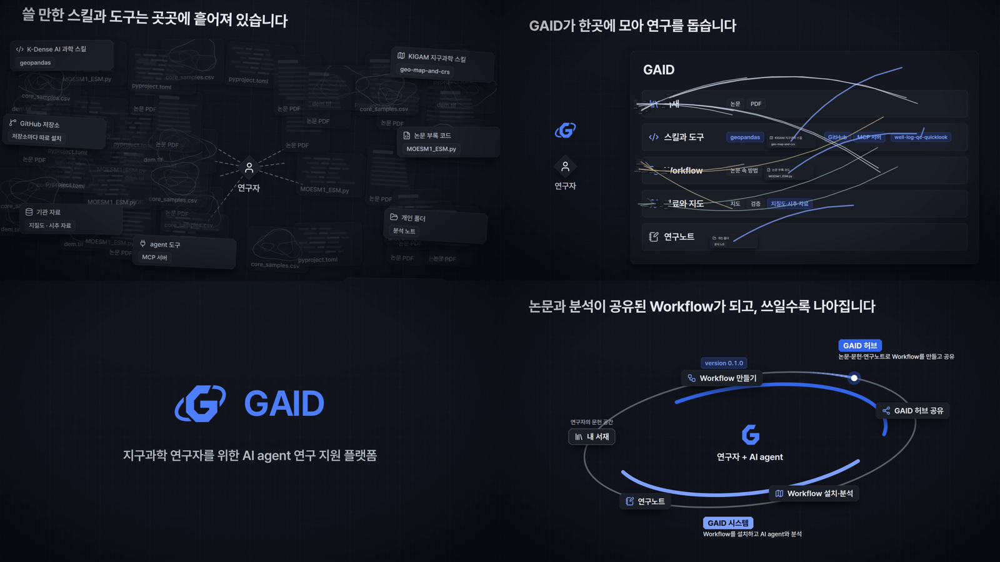
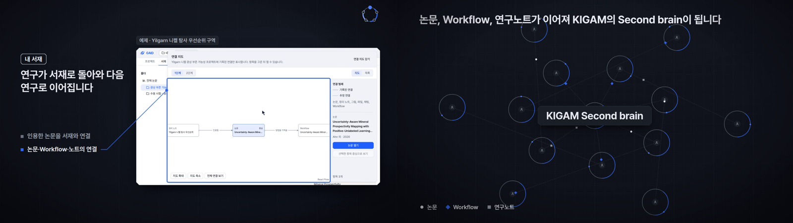
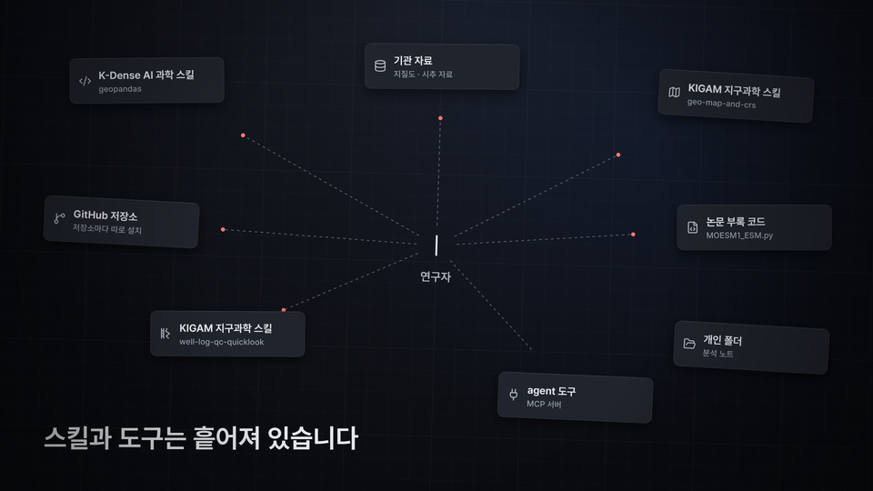
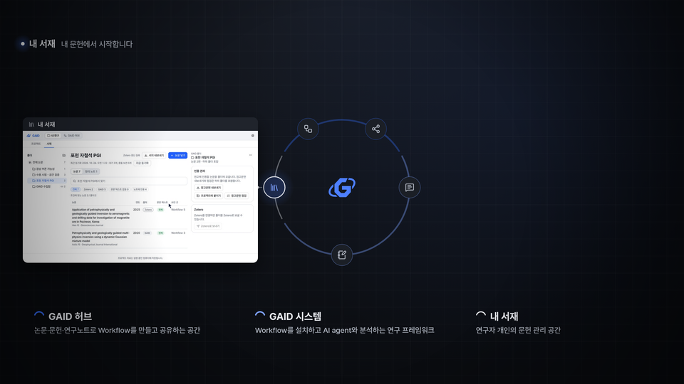
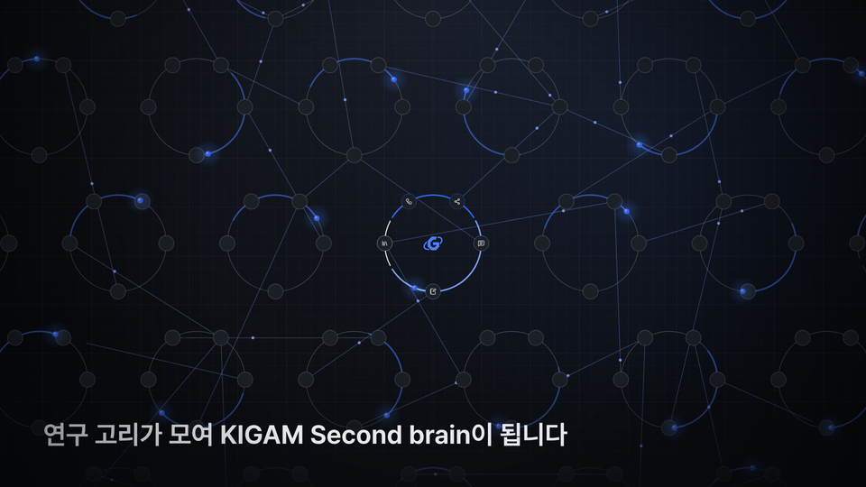
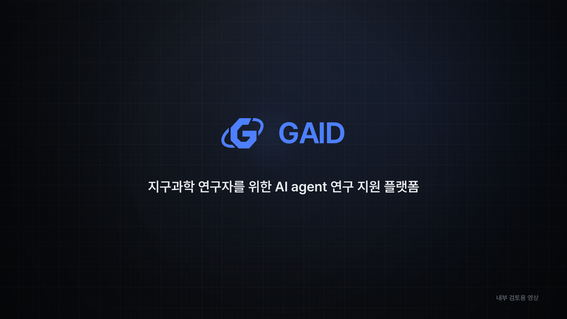

# GAID 홍보 영상 lemo판: v4 메시지를 발표 영상 스타일로 다시 만든 103초 영상과 40초 영상 (내부 검토용, 음악·효과음)

## 0. 한눈에

| | |
|---|---|
| 요청 | lemo-opuscar에서 GAID 허브 홍보에 맞는 스타일을 골라 v4 메시지로 영상을 만듭니다. 작업 중에 40초 홍보판, 두 예제 사용, 모션그래픽 속 창 배치, 박스·전환·고리 장면·속도·AI agent 실제 작업·허브와 시스템 설명에 대한 요청이 더해졌습니다. |
| 결론 | 103초판(3차 수정본, 102.9초)과 40초판(42.0초)을 만들었습니다. 둘 다 1920×1080, 30fps, 스테레오 음악·효과음, 약 −14 LUFS입니다. 103초판의 박스는 포인터가 그 영역에 있는 동안에만 보입니다. |
| 믿을 수 있는 정도 | 실제 화면은 GAID에서 촬영한 것이고 화면 문구는 바꾸지 않았습니다. AI agent 장면은 이번에 실제 실행을 한 번 촬영한 것입니다. 배경, 연구 순환, Second brain 장면은 설명 그림입니다. 소리는 측정값과 파형으로만 확인했습니다(5절). |
| 결정할 일 | 없음. 영상 검토 의견을 받습니다. |

## 1. 요청한 것

> V4와 병렬로 진행가능하면 brag 영상 작업시작하자. 그리고 또 별도로 https://github.com/lemomo-ai/lemo-opuscar 에서 GAID 허브 시스템 홍보에 적합한 것을 선정해 brag영상 제작작업과 동일한방식으로 lemo작업도 시작하자. — 2026-10-24 요청

> 메시지는 동등해도 되는데 연출은 오히려 더 자유롭게 홍보성으로 만들자. 그리고 분량은 40초로하고 코드로 된 영상 기반으로 전면 새로 만들어도 좋다. 현재 촬영자료가 있다고 너무 v4스타일로 만들필요는없다. 현재 렌더링중인것은 계속만들고 별도로하나더 생성하자. — 2026-10-24 작업 중 요청

> 예제도 yilgarn예제와 PGI예제를 둘다써도되고 꼭 모든 워크플로우가 하나의 예제만 보이는것이 아니라 적합한것을 사용하고 촬영 에셋이 영상 전 영역을 차지하지 않고, 해당 기능을 소개하는 모션그래픽속의 창요소처럼 보여도되므로 상품성 높은 홍보영상으로 제작하자. — 2026-10-24 작업 중 요청

> 102초판의 경우 피드백으로 사각형 박스로 영역을 표시할 때 올바르게 표시해야한다. 현재 해당 영역을 올바르지 못하게 표시하거나 화면에서 엉뚱한 곳을 가리키거나 화면을 자르는 사각 박스가 있는 경우도 있다. 102초판의 경우 장면 전환을 스무스하게 하고 영상을 최적화한다면 꽤 적절한 영상으로 활용가능하다고 생각한다. 자가 검토하여 무엇이 부족했는지 진단후 개선하자. — 2026-10-24 1차 영상 피드백

> lemo 버전에서 아쉬운 것은 GAID로고 이후  GAID 허브와 GAID 시스템을 설명하는 18초 이후 장면의 고리 애니메이션 품질이 낮다. V4 방식이나 BRAG 방식을 보고 개선할 필요가 있다. — 2026-10-24 1차 영상 피드백

> 103초판에 대해서는 첨부한 이미지처럼 40초 구간을 보면 마우스 포인터랑 영역 선택 부분이 일치하지 않는다. 이러한 부분이 40초 구간 뿐만 아니라 다수 존재한다. 현황 진단 후 마우스 포인터랑 영역 선택이 자연스럽게 되어야 한다. 멈춰있는 듯한 인상을 주어서는 안된다. 또한, GAID 허브와 GAID 시스템을 구분하다보니 색상을 다르게 선택했지만 오히려 이로인해 GAID 시스템쪽은 마치 활성화가 되지 않은 부분처럼 느껴진다. 이부분은 수정이 필요하다. 그리고 기능 설명을 병합하여 장면을 줄이더라도 사람의 인지적 관점에서 너무 빠른 전환이나 설명은 정보량을 받아들일 수 없다. 특히 60초 이후 구간부터는 진행이 갑자기 빨라지는 것은 너무 많은 기능을 소개하고 있어서라고 생각한다. 해당 부분들을 병합하여 설명하면 더 효과적일 것이라고 생각한다. 그리고 57초 구간 근처에 있는 에이전트 계산 부분은 실제로 에이전트 작업되고 있는 부분들이 보였으면 한다. 멈춰있는 사진들을 사용하는 것은 적절하지만 촬영을 통한 움직음으로 보이는 것이 적절한 것은 섞어가면서 완성도를 높였으면 한다. 40초에 영상에서는 첨부한 이미지처럼 내서재를 설명하는 아이콘이 왼쪽에 있는데 창은 오른쪽에 표시되어 어색하다 선이 고리를 관통하는 것은 적절하지 못하다. 이것은 5단계를 설명할 때 창의 위치가 최적이지 않다는 의미다. 그리고 GAID 시스템은 내 서재에서 분석하고 기록하는 것만 담당하는 것이 아니라 문헌을 관리하는 공간인 서재도 있지만 실제로 워크플로우를 설치하고 에이전트 기반으로 분석하는 프레임워크 도구이다. 마치 내서재만 관리하는 방식으로 설명해서는 안된다. 마지막으로, 어느새 GAID를 허브와 시스템으로 완전히 분리하고 있으며, GAID 시스템을 마치 서재가 메인 기능인것처럼 간주하고 있다. GAID 허브는 지구과학 연구자들이 논문, 문헌, 연구노트 등을 기반으로 양질의 지구과학용 워크플로우(또는 스킬)을 생성하고 공유하는 공간이고, 시스템은 해당 워크플로우를 설치하고 에이전트형 분석 작업을 수행하고 IDE와 에이전틱 기반 작업 및 지구과학친화적 분석 시스템이 종합된 분석 프레임워크이다. 이를 모두 합친 것이 GAID이며, 서재의 경우에는 GAID 시스템에 포함되어도 되고, 허브에 포함될 수 있지만 전체적으로 연구자 개인의 문헌 관리 공간으로 간주해야한다. — 2026-10-24 2차 영상 피드백

"동일한 방식"은 brag판에 정한 조건입니다. 메시지는 v4와 같고, 90~105초, 음악과 효과음만 쓰고 내레이션은 없으며, 내부 검토용이고, v4를 대체하지 않고 나란히 둡니다.

완료 기준은 다음과 같습니다.
- 스타일 후보 2~3개를 보여 드리고 하나를 고릅니다.
- v4 이야기를 그 스타일로 다시 만듭니다. 1920×1080, 30fps, 스테레오 음악과 효과음, 90~105초입니다.
- 40초 홍보판을 따로 만듭니다.
- 피드백을 반영합니다. 박스는 포인터와 같은 곳을 가리키고, 전환은 부드럽게, 설명은 사람이 따라올 속도로 합니다. AI agent가 실제로 작업하는 모습을 보여 주고, GAID 허브·GAID 시스템·내 서재를 바르게 설명합니다.
- GAID 규칙을 지킵니다. 화면 이름은 "AI agent"와 "GAID"로 쓰고, 만든 숫자와 독점 자산·글꼴을 쓰지 않으며, "개념도" 같은 모서리 표시를 넣지 않습니다.

## 2. 수행한 것

1. lemo-opuscar(커밋 3961ddb)를 받아 59개 스타일을 검토하고, 후보 세 개를 포스터와 함께 보여 드렸습니다. Dark Tech Keynote를 골랐습니다. 소프트웨어 발표 영상의 문법이고, "흩어진 것이 한 번의 동작으로 모인다"는 기본 장면이 v4 배경 이야기와 같습니다.
2. 연출안(구조 후보 세 개, 장면 목록, 120 bpm 박자 지도, 소리 설계표)을 먼저 쓰고 장면을 코드로 그렸습니다. 음악은 D 리디안의 새 곡이고, 악기는 공개(CC0) 샘플입니다. 효과음은 코드로 합성했습니다.
3. 1차 영상(102.3초)에 대한 피드백을 받고 박스, 전환, 고리 장면을 고쳤습니다(2차 수정본, 100.4초). 박스를 촬영 기록의 시간 구간 안에서만 쓰고, 장이 바뀌어도 창을 접지 않으며, 로고 궤도에서 이어지는 큰 타원으로 순환 장면을 다시 만들었습니다.
4. 2차 영상 피드백을 받고 자가 진단했습니다(7절). 촬영 프레임에서 그려진 포인터를 찾아 박스와 대조해 보니, 박스 31개 중 포인터가 박스 안에 머문 것은 11개뿐이었고 12개는 포인터가 박스 밖에만 있었습니다. 기존 AI agent 장면은 실제 분석 시간을 잘라낸 완료 화면이었습니다.
5. 3차 수정본을 만들었습니다.
   - 박스: 포인터가 그 영역에 들어오는 순간 박스가 그려지고, 포인터가 머무는 동안만 보입니다. 포인터가 가지 않는 영역은 박스 없이 왼쪽 목록만 켭니다. 박스가 나타날 때 작은 효과음이 납니다.
   - 장면: 기능 설명을 22개에서 16개로 합쳤습니다. 포인터가 실제로 움직이는 촬영본을 골랐습니다. 포천 예제(v3), Yilgarn 예제(v2·v5), 이번에 새로 찍은 AI agent 실행을 섞었습니다.
   - AI agent 실제 작업: 하위 작업이 검토용 앱에서 포천 예제 Workflow를 실제로 한 번 실행하며 촬영했습니다. 시작 클릭, 도구 호출과 코드 수정이 쌓이는 장면(3배속, "빠르게 보기" 표시), 새 결과 그림을 여는 장면입니다. 설정은 바꾸지 않았고, 허브에 사용 전후를 알렸습니다.
   - 설명과 색: GAID 허브는 "논문·문헌·연구노트로 Workflow를 만들고 공유", GAID 시스템은 "Workflow를 설치하고 AI agent와 분석"으로 고쳤습니다. 내 서재는 어느 한쪽의 주 기능이 아닌 "연구자의 문헌 공간"으로 따로 표시하고, 서재 장의 표시도 "내 서재"로 바꿨습니다. GAID 시스템 색은 회색에서 밝은 파랑으로 바꿨습니다.
6. 40초판은 하위 작업이 만들었습니다. 2차 피드백에 따라 단계마다 창을 그 단계 쪽에 열고, 허브·시스템·서재 설명과 색을 같은 기준으로 고쳤습니다(8절).

## 3. 결과

그림 1. 103초판의 앞부분 네 장면입니다. 왼쪽 위부터 흩어진 스킬과 도구, 클릭 직후 GAID로 날아드는 장면, 제목, 연구 순환입니다. 볼 것: 연구 순환에서 GAID 허브(파랑)와 GAID 시스템(밝은 파랑)이 모두 켜져 있고, 내 서재는 "연구자의 문헌 공간"으로 따로 표시됩니다.

그림 2. 시연 네 장입니다. 왼쪽 위부터 Workflow 단계(GAID 허브), 설치 후 입력 자료 선택(GAID 시스템), AI agent가 실제로 작업하는 장면(빠르게 보기), Yilgarn 지도의 원본 값입니다. 볼 것: 박스가 있는 장면에서는 포인터가 박스 안에 있고, AI agent 장면은 박스 없이 도구 호출이 쌓이는 화면을 그대로 보여 줍니다.

그림 3. 마지막 시연 장면(Yilgarn 연결 지도)과 KIGAM Second brain 장면입니다.

| 시간(초) | 장면 | 화면이 말하는 것 |
|---|---|---|
| 0–9.6 | 흩어짐 | 자료를 찾고, 논문을 읽고, 코드를 짭니다 → 쓸 만한 스킬과 도구는 곳곳에 흩어져 있습니다 |
| 9.6–13.5 | 멈춤과 모임 | GAID가 한곳에 모아 연구를 돕습니다 |
| 13.5–17.5 | 제목 | GAID, 지구과학 연구자를 위한 AI agent 연구 지원 플랫폼 |
| 17.5–24.0 | 연구 순환 | 논문과 분석이 공유된 Workflow가 되고, 쓰일수록 나아집니다 (GAID 허브 / GAID 시스템 / 내 서재, version 0.1.0 → 0.1.1) |
| 24.0–29.4 | 내 서재 | 연구는 내 서재의 논문에서 시작합니다 (주제별 폴더, 논문을 곁에 두고 읽기) |
| 29.5–44.4 | GAID 허브 | 논문 속 방법을 AI agent가 따르는 Workflow로 만듭니다 (논문·코드·자료, 원문 근거를 곁에 두고 결정, 단계로 정리된 분석 절차) |
| 44.5–51.7 | GAID 허브 | 만든 Workflow는 허브에서 함께 쓰고 고쳐 갑니다 (다음 version, 예제 자료와 공유, 가져다 쓰기) |
| 51.8–77.0 | GAID 시스템 | 허브의 Workflow를 설치하고 AI agent와 분석합니다 (설치와 자료 준비, 단계마다 자료와 조건, AI agent 실제 작업, 지도에서 원본 값까지) |
| 77.0–83.2 | GAID 시스템 | 결과와 판단은 연구노트에 남습니다 |
| 83.3–89.8 | 내 서재 | 연구가 서재로 돌아와 다음 연구로 이어집니다 (인용한 논문, 논문·Workflow·노트의 연결) |
| 90.3–99.5 | KIGAM Second brain | 연구자마다 고리가 돌면 지구과학 AI agent 생태계가 자랍니다 → 논문, Workflow, 연구노트가 이어져 KIGAM의 Second brain이 됩니다 |
| 99.5–102.9 | 마무리 | 로고, "내부 검토용 영상" |

| 완료 기준 | 결과 | 근거 |
|---|---|---|
| 스타일 후보를 보여 드리고 고르기 | 충족. Dark Tech Keynote | 2절 |
| v4 이야기, 1920×1080, 30fps, 스테레오, 90~105초 | 충족. 102.9초 | 4절 |
| 박스와 포인터 일치 | 충족. 박스 20개, 시작·끝 프레임 대조 | 4절, 그림 2 |
| 전환과 속도 | 충족. 창을 접지 않는 전환, 기능 16개, 16개 중 13개가 3초 넘게 표시 | 3절 표 |
| AI agent 실제 작업 | 충족. 새로 촬영한 실제 실행, 빠르게 보기 표시 | 그림 2 |
| 허브·시스템·서재 설명과 색 | 충족. 103초판과 40초판 모두 | 그림 1, 8절 |
| 40초 홍보판 | 충족. 42.0초 | 8절 |
| GAID 규칙 | 충족 | 5절 |

보는 방법: PC74에 있는 MP4 파일(부록 A의 "103초판 영상", "40초판 영상")을 소리를 켜고 동영상 플레이어로 엽니다. 파일이 커서 저장소에는 넣지 않았습니다.

## 4. 검증

- 과학적 검증: 해당 없음. 시연에 나오는 분석은 예제 자료로 한 홍보용 실행입니다.
- 103초판 영상: 완성 파일을 다시 읽었습니다. 102.9초, 3,087프레임, 1920×1080, 30fps입니다. 검은 화면 검사에서 걸린 구간은 없습니다. 음량은 −14.4 LUFS, 최대치 −1.1 dB입니다.
- 박스와 포인터: 박스가 보이는 구간마다 시작 직후와 끝 직전 프레임을 완성 파일에서 뽑아 대조했습니다. 박스가 보이는 동안 포인터는 박스 안에 있습니다. 포인터 위치는 촬영 때 화면에 그린 화살표(#14213d)를 프레임마다 찾아 얻었고, 새 촬영본은 촬영 기록의 포인터 좌표를 썼습니다.
- AI agent 장면: 하위 작업이 실제 실행 한 번을 촬영했습니다. 분석 계산은 약 123초였고, 전체 실행은 응답과 문서 정리를 포함해 약 10분 23초였습니다. 영상에는 그중 12초를 3배속으로 넣었고 "빠르게 보기"로 표시했습니다. 촬영 오류로 한 번 다시 실행했으며, 앱 설정은 바꾸지 않았습니다.
- 읽는 시간: 기능 목록 항목은 모두 2.2초 이상 보이고, 대부분 3초를 넘습니다. 앞부분 제목 줄과 순환 장면 설명 일부는 lemo 기준(한글 4.5자/초 + 1.5초)보다 짧습니다.
- 소리: 마스터링은 인코딩한 파일을 재서 최대치가 −1 dB 이하가 될 때까지 목표를 낮춥니다.
- 40초판: 8.2절.

## 5. 한계

- 내부 검토용입니다. 기관 로고는 쓰지 않았고, 외부 공개 승인은 따로 필요합니다(gaid-release-proof#2).
- 설명 그림: 흩어짐, 모임, 연구 순환, Second brain 장면은 실제 화면이 아닙니다. 도구와 파일 이름은 실제 이름이고, 수치는 넣지 않았습니다.
- 소리는 측정값과 파형으로만 확인했습니다. 이 작업 환경에서는 소리를 직접 들어 보지 못했습니다.
- 박스 없는 장면: 포인터가 가지 않는 영역(PDF 읽기, AI agent의 도구 목록, 결과 그림 등)은 박스 없이 왼쪽 목록만 켭니다.
- AI agent 장면의 실행에서 다섯 모델 모두 수렴하지 않았습니다. 자료는 합성 예제이고, 내부 점검은 독립적인 과학 검증이 아닙니다. 결과 그림을 여는 장면의 채팅 창에는 나중에 고친 문서 정리 오류가 그대로 보입니다.
- 분석 장은 Yilgarn 설치 장면 → 포천 실행 장면 → Yilgarn 지도 순서로 예제가 바뀝니다. 창 위 표시가 예제를 알려 줍니다.
- 장면 순서는 v4와 같아서 허브 공유(version 0.1.1 등록)가 분석보다 먼저 나옵니다.
- 스타일에서 벗어난 점: Dark Tech Keynote 원문은 실제 앱 화면을 쓰지 않지만, 이 영상은 실제 촬영본을 창으로 넣었습니다. 글꼴은 Pretendard입니다.

## 6. 결정할 일

없음.

## 7. 대체되었거나 실패한 시도

펼치기 — 1차·2차 영상 진단 외

- 2차 영상(100.4초)의 박스: 박스는 촬영 기록에 정해 둔 영역과 시간 구간을 따랐습니다. 촬영 기록에는 포인터 위치가 없어서, 박스가 포인터와 상관없이 켜지고 꺼졌습니다. 프레임에서 포인터를 찾아 대조하니 박스 31개 중 포인터가 박스 안에 머문 것은 11개, 박스 밖에만 있던 것은 12개였습니다.
- 2차 영상의 AI agent 장면: 촬영 기록상 실제 분석 132초와 1,328초를 잘라내고 완료 화면만 이어 붙인 컷이라, 작업하는 움직임이 없었습니다. v2·v5 촬영본도 같은 방식이었습니다.
- 2차 영상의 속도: 60초 이후 분석·연구노트 장에서 기능 이름표가 1.6~3초마다 바뀌었습니다.
- 2차 영상의 색과 설명: GAID 시스템을 회색으로 칠해 꺼진 것처럼 보였고, "내 서재에서 분석하고 기록하는 연구"라는 설명과 서재 장의 "GAID 시스템" 표시가 GAID 시스템을 서재 중심으로 오해하게 했습니다.
- 1차 영상(102.3초)의 박스는 촬영 기록의 영역을 그 시간 구간 밖에서도 썼고, 두 영역을 합친 큰 박스와 창 가장자리에 겹친 박스가 있었습니다. 장 전환에서는 창이 막대로 접혔고, 고리 장면은 작은 회색 원이었습니다.
- 3차 최종 렌더 직전 점검에서, AI agent 시작 장면의 박스가 클릭 뒤 창이 닫힌 뒤에도 1초 남는 것을 찾아 클릭 0.4초 뒤에 끝나게 고쳤습니다.
- 마스터링에서 리미터를 낮춰도 최대치가 오히려 올라갔습니다. 인코딩 전후를 따로 재 보니 리미터가 AAC 인코딩 뒤의 튐을 키우고 있었습니다. 리미터를 빼고, 인코딩한 파일을 재서 목표를 낮추는 방식으로 바꿨습니다.
- 처음 판은 실제 화면을 거의 전체 크기로 두었다가, 요청에 따라 왼쪽 설명과 오른쪽 창 구성으로 바꿨습니다.

## 8. 40초 홍보판

결과: 42.0초 홍보 영상을 만들었습니다. 1920×1080, 30fps, 스테레오 음악·효과음이고, 완성 파일의 음량은 −14.1 LUFS, 최대 실제 피크는 −1.1 dBTP입니다. 모든 장면을 코드로 그렸고, 실제 GAID 화면은 모션그래픽 속 창 여섯 개로만 나옵니다. 103초판과 같은 메시지를 담았지만 장면 순서와 구성은 새로 짰습니다.

### 8.1 영상이 보여 주는 것

영상의 주인공은 AI agent를 뜻하는 점 하나입니다. 이 점이 흩어진 일 사이에서 GAID 파랑으로 바뀌고, 연구 순환을 한 바퀴 돌고, 마지막에 GAID 로고의 궤도가 됩니다.

| 시간 | 장면 | 화면 문구 |
|---|---|---|
| 0–6초 | 자료 조사·문헌 분석·코드 작성 창이 점점 빠르게 쌓입니다. | 자료를 찾고, 논문을 읽고, 코드를 짭니다 |
| 6–10초 | v4와 같은 실제 스킬·도구 이름 카드가 화면 가장자리로 흩어지고, 연구자에게서 뻗은 점선이 닿지 못합니다. | 스킬과 도구는 흩어져 있습니다 |
| 10–15초 | 0.5초 동안 화면과 소리가 멈춘 뒤, 점이 파랗게 눌리면 카드가 GAID 창의 격자로 한 박자에 모입니다. | GAID가 한곳에 모읍니다 |
| 15–30초 | 점이 연구 순환을 그리고, 고리 가운데에 GAID 로고가 놓입니다. 고리는 GAID 허브(#3366e8), GAID 시스템(#7fa2ff), 내 서재(흰색) 구간으로 나뉩니다. 고리는 화면 가운데에 고정되어 있고, 역마다 그 역이 있는 쪽에 창이 열립니다(내 서재·Workflow는 왼쪽, GAID 허브·연구 분석·연구노트는 오른쪽). 내 서재 → Workflow → GAID 허브 → 연구 분석 → 연구노트 → 내 서재 순서로 역마다 실제 화면 창이 열립니다. | 양쪽 창 위에 역마다 한 줄, 아래쪽에 세 구간 설명(그림 2) |
| 30–35초 | 카메라가 물러나며 순환 하나가 여러 연구자의 순환이 되고, 서로 선으로 이어집니다. | 연구 고리가 모여 KIGAM Second brain이 됩니다 |
| 35–42초 | 순환이 하나로 모여 GAID 로고의 궤도가 되고, 빛이 지나가며 로고가 드러납니다. | 지구과학 연구자를 위한 AI agent 연구 지원 플랫폼 / 내부 검토용 영상 |

그림 1. 9.4초. 흩어진 스킬과 도구 카드입니다. 볼 것: 연구자에게서 뻗은 점선이 카드에 닿지 못합니다. 빨간 점은 이 장면에만 나오고, 이후에는 다시 나오지 않습니다.

그림 2. 17.9초. 연구 순환의 내 서재 역입니다. 볼 것: 고리 왼쪽 역(내 서재)의 창이 왼쪽에 열리고, 연결선은 역에서 바깥쪽으로 짧게 뻗어 고리를 지나지 않습니다. 오른쪽 역(GAID 허브, 연구 분석, 연구노트)의 창은 오른쪽에 열립니다. 아래쪽 설명은 GAID 허브와 GAID 시스템을 한 플랫폼의 두 부분으로, 내 서재를 연구자 개인의 문헌 관리 공간으로 소개합니다.

그림 3. 31.5초. 순환 하나가 여러 연구자의 순환으로 늘어나는 장면입니다. 볼 것: 이 장면은 설명 그림이며 실제 연구자 수나 연결 수를 나타내지 않습니다.

그림 4. 39.0초. 끝 화면입니다. 볼 것: 로고 경로는 바꾸지 않았고, 오른쪽 아래에 "내부 검토용 영상"이 있습니다.

역마다 열리는 창과 촬영본은 다음과 같습니다. 촬영본은 창 안에서 한 배율로 재생하고, 확대하거나 스크롤하지 않습니다.

| 역 | 구분 | 촬영본 | 역 문구 |
|---|---|---|---|
| 내 서재 | 개인 문헌 공간 | 포천 예제 L1 | 내 문헌에서 시작합니다 |
| Workflow | GAID 허브 | 포천 예제 A3 | 논문 속 방법을 Workflow로 |
| GAID 허브 | GAID 허브 | 포천 예제 H2 | 공유하고 고쳐 다음 version으로 |
| 연구 분석 | GAID 시스템 | Yilgarn 예제 R2 | 설치한 Workflow로 AI agent와 분석 |
| 연구노트 | GAID 시스템 | Yilgarn 예제 N1 | 결과와 판단은 연구노트에 |
| 내 서재 | 개인 문헌 공간 | 포천 예제 L3 | 연구노트도 내 서재로 |

2차 수정(2026-10-24 사용자 의견)에서 바꾼 것은 다음과 같습니다.
- 역의 창 위치: 내 서재 역은 고리 왼쪽에 있는데 창은 오른쪽에 있어, 연결선이 고리를 가로질렀습니다. 이제 왼쪽 역의 창은 왼쪽에, 오른쪽 역의 창은 오른쪽에 열립니다. 창은 역 쪽 가장자리에서 바깥으로 펼쳐지고, 다섯 역 모두 연결선이 고리 밖의 짧은 선입니다. 중간에 고리를 돌려 창을 늘 오른쪽에 두는 방식을 시도했지만, 창이 한쪽에만 열려 요청과 달라 버렸습니다.
- 설명 문구: "GAID 시스템 — 내 서재에서 분석하고 기록합니다"를 없앴습니다. 대신 세 구간 설명을 넣었습니다(GAID 허브: 논문·문헌·연구노트로 Workflow를 만들고 공유하는 공간 / GAID 시스템: Workflow를 설치하고 AI agent와 분석하는 연구 프레임워크 / 내 서재: 연구자 개인의 문헌 관리 공간). 고리 가운데의 GAID 로고로 두 부분이 한 플랫폼임을 보여 줍니다.
- 색: GAID 시스템을 회색에서 #7fa2ff로 바꿔, 두 부분이 모두 켜진 상태로 보이게 했습니다.

### 8.2 영상 파일과 확인한 것

| 항목 | 값 |
|---|---|
| 영상 파일 | PC74의 MP4 파일(부록 A의 "40초판 영상") |
| 길이 | 42.0초, 1260프레임, 1920×1080, 30fps |
| 음량 | −14.1 LUFS(통합), LRA 7.5 LU, 실제 피크 −1.1 dBTP |
| 렌더 기록과 소스 | 부록 A |

- 빈 화면: 완성 파일에서 완전한 검은 화면은 없었습니다(blackdetect). 무대 위에 그린 요소가 거의 없는 프레임도 없었습니다(모든 프레임을 480×270으로 줄여 밝은 픽셀 비율을 셌습니다).
- 읽기 시간: 화면 문구 46개를 lemo 기준(한글 ÷ 4.5 + 기타 문자 ÷ 15 + 1.5초)으로 쟀고, 짧은 문구는 없었습니다. 가장 빠듯한 문구는 끝 화면의 플랫폼 문장(필요 5.74초, 표시 5.84초)입니다. 창 제목처럼 왼쪽 목록과 같은 말을 되풀이하는 작은 표시는 재지 않았습니다.
- 검토 순서: 정지 화면 모음을 두 번 보고, 전체 미리보기에서 멈춤·모임·순환 시작·창 전환·끝 화면을 0.2초 간격 프레임으로 확인했습니다. lemo 데모와 비교해 구조, 시작, 대표 장면, 끝 네 가지가 다릅니다.
- 자동 검사: 이 영상 소스에는 자동 검사가 없습니다. 위 확인은 빌드 스크립트의 측정값과 제가 본 화면입니다.

### 8.3 스타일, 소리, 라이선스

- 스타일: lemo-opuscar Dark Tech Keynote(커밋 3961ddb)의 규칙을 따랐습니다. 어두운 무대, 48px 가는 격자, 강조색 하나(GAID 파랑 #3366e8, 글자 #7fa2ff, 로고 #4d7fff), 박자에 맞춘 움직임, 창이 열리고 닫히는 전환, 빛으로 드러내는 끝 화면입니다. 글꼴은 Pretendard 하나입니다.
- 음악: 120 bpm, D 리디안의 새 곡입니다. 흩어진 장면은 음높이를 수십 cent 어긋나게 하고 좌우로 흩은 여러 악기 소리이고, GAID가 나온 뒤는 한 조성의 가운데 소리입니다. 순환에서는 역마다 마림바 음이 하나씩 늘고, 마지막 한 바퀴에서 박을 16분음표로 나눕니다. 끝은 화음 하나로 모입니다.
- 무음: 10.0–10.5초는 모든 트랙이 0인 완전한 무음이고, 35.0–35.6초는 방 소리만 남긴 거의 무음입니다.
- 샘플과 소리: VCSL 샘플(CC0)의 글로켄슈필, 핸드 차임, 마림바, 셰이커, 비브라폰, 활로 켠 비브라폰, 실로폰을 썼습니다. 효과음과 배경음은 lemo의 sfx.py로 합성했습니다. 저음(20–120Hz)은 120–500Hz보다 약 3dB 낮게 맞췄습니다.
- 라이선스: lemo-opuscar 코드는 MIT, 샘플은 CC0, Pretendard는 OFL, 아이콘은 Lucide(ISC)입니다. lemo 데모 영상과 정지 화면(CC BY 4.0)은 쓰지 않았습니다. 전체 목록은 부록 A의 출처 목록에 있습니다. Yilgarn 지도 화면에는 GAID가 표시하는 OpenStreetMap 출처 문구가 그대로 들어 있습니다.

### 8.4 한계

- 소리는 측정값(음량, 대역별 에너지)과 파형으로만 확인했고, 제가 직접 들어 보지는 못했습니다. 음악과 효과음의 균형은 검토자가 들어 봐야 합니다.
- 흩어진 창, 연구 순환 그림, 여러 연구자의 순환, Second brain 장면은 설명 그림입니다. 숫자, 사용자 수, 성능은 화면에 넣지 않았습니다.
- 실제 화면 창은 776×436 크기로 작아서, 창 안의 작은 글자는 영상에서 읽히지 않습니다. 창은 기능이 실제로 있다는 것을 보여 주는 역할이고, 메시지는 왼쪽 목록과 제목 문구가 전합니다.
- 실제 화면은 밝은 화면 테마로 촬영한 것이어서 어두운 무대 위에서 밝은 창으로 보입니다.
- 영상 길이는 42.0초로, 요청한 40초 범위(38–42초)의 끝입니다.

## 용어

없음. 기존 용어집을 따릅니다.

## 부록 A. 근거 위치

펼치기 — 실행 방법, 원본, 해시, 커밋

| 항목 | 위치 |
|---|---|
| 103초판 제작 소스 | `geo/promo-lemo/` (`TREATMENT.md`, `scene/film.js`, `render.py`, `pointer_track.py`, `mix.py`, `master.py`, `build.sh`, `CREDITS`, `README.md`) |
| 40초판 제작 소스 | `geo/promo-lemo-40/`, 출처 목록 `geo/promo-lemo-40/CREDITS` |
| AI agent 촬영 소스 | `geo/promo-lemo/capture/` (하위 작업 gaid-promo-video-v4-lemo--agent-capture) |
| 스타일 후보 | PC74: `~/data/geoaidesk/work/gaid-promo-video-v4-lemo/style-choice/`, vault `연구 보고서/geoaidesk/2026-10-24-style-choice` |
| lemo-opuscar | `lemomo-ai/lemo-opuscar@3961ddb3d24d8876e0e2754f7790d66908acee51`, 자산 `lemo_opuscar` (`configs/inputs.toml`, PC74 `~/assets/lemo-opuscar/3961ddb`) |
| 실제 화면 촬영 | 포천 PC74: `~/data/geoaidesk/work/gaid-promo-video-v3/capture-v3/capture.json` SHA256 `aab24b2ef94aea09a60748ed8b3b0168adca477af353e496406efe2b9cad2f3a`; Yilgarn: `~/data/geoaidesk/work/gaid-promo-video-v2/capture-v2/capture.json` SHA256 `4a3be64e83123389b4c98866b8d7453f5a9d93c13d278350fcd0d49d86439dcb`, `~/data/geoaidesk/work/gaid-promo-video-v5/capture-v5/capture.json`; AI agent 실행: `~/data/geoaidesk/work/gaid-promo-video-v4-lemo--agent-capture/capture-v6/capture.json` SHA256 `e4f120e64293ef46917a2b858552d566d3d4cc7c9dafba44acff3f0a4a15ab98` (검토용 앱 4e198c76, GPT-6.1 Sol/높음) |
| 103초판 렌더 job | `job-geoaidesk-gaid-promo-video-v4-lemo-8`, PC74: `~/data/geoaidesk/runs/gaid-promo-video-v4-lemo-20261024T062754.451258Z/receipt.json`, 소스 `c7f20680a0f4f7404ebcaeec06369a1f57670757`, 명령 `sh geo/promo-lemo/build.sh`; `out/picture.mp4` SHA256 `9b112a8b25125d317859ba8ec5d438b4259450f71f2d55f18d611540e8e6e324`, `out/mix.wav` SHA256 `a338a424d278f5de24ff61f4599ae15fa09828b4df60cc3b455dbe8f9e4f68a2`, `out/events.json` SHA256 `cf694e9f12898842e9cf14502be0f5ec9a03e3047994f55a244f349b211dcb59`, `out/picture-manifest.json` SHA256 `3c23b27dc30d5136a560f73ffe1fcd96f14956d699559dc367e577b6da6f3a8a` |
| 103초판 영상 | PC74: `~/data/geoaidesk/runs/gaid-promo-video-v4-lemo-20261024T062754.451258Z/out/gaid-promo-lemo.mp4`, 22,604,083 bytes, SHA256 `499c7b538aae69768005a831308f4601f8c46ae2272742f7f951cbf12a28f40e`; `out/master.json` SHA256 `7427fc81d15369a3e4698dbd38c11ee3e4139862cf946bdee59b18be68aad664` |
| 40초판 영상 | PC74: `~/data/geoaidesk/runs/gaid-promo-video-v4-lemo--promo-40s-20261024T052859.356543Z/out/gaid-promo-40s.mp4` SHA256 `52b0055d004bad90b8ac1428cdf7923d1912d14543bf514af3283fcf958e3546`; job `job-geoaidesk-gaid-promo-video-v4-lemo--promo-40s-3`, 소스 `1c5a8798bf50` |
| 대체된 영상 | 1차 job-1 SHA256 `22dba68e4a95455f4be451628c2392b68bda2a321025899ff5ee250607665717`; 2차 job-5 SHA256 `36290838484486d5945dbf7c9cdea31af4a5a38f42b6cce0ffa8128edd96f075`; 중간 렌더 job-2·job-3·job-4·job-6·job-7 |
| 자가 검토 자료 | PC74: `~/data/geoaidesk/work/gaid-promo-video-v4-lemo/look/` (`tagqa0-*` 1차, `tagqa3-*` 2차, `tagqa4-*`·`tagqa6-*`·`tagqa7-*`·`tagqa8-*` 3차 박스 대조), `pointer/` (프레임에서 찾은 포인터 위치) |
| 보고서 그림 | 103초판 최종 화면의 8.6/11.4/16.5/22.4초(그림 1), 42.6/57.0/64.0/75.0초(그림 2), 88.0/97.0초(그림 3) 프레임; 40초판 그림은 그 영상의 9.4/17.9/31.5/39.0초 |
| 도구 | Google Chrome, Playwright 1.63.0, imageio-ffmpeg 0.6.0, Pillow 12.3.0, numpy 2.3.4, scipy 1.16.3, soundfile 0.13.1, soxr 1.0.0 |
| 음원·글꼴·아이콘 | VCSL 샘플(CC0), lemo `core/audio` 합성 효과음(MIT), Pretendard(OFL), Lucide(ISC/MIT). 목록 `geo/promo-lemo/CREDITS` |
| 라이선스 | lemo-opuscar 코드·문서 MIT, 데모 영상·정지 화면 CC BY 4.0(영상에는 쓰지 않음; 후보 비교 포스터에만 출처 표시와 함께 사용). 라이브러리로 만든 영상은 만든 사람의 것이며 출처 표시 의무가 없습니다(lemo README "Licence") |

작성 시점: 2026-10-24.

