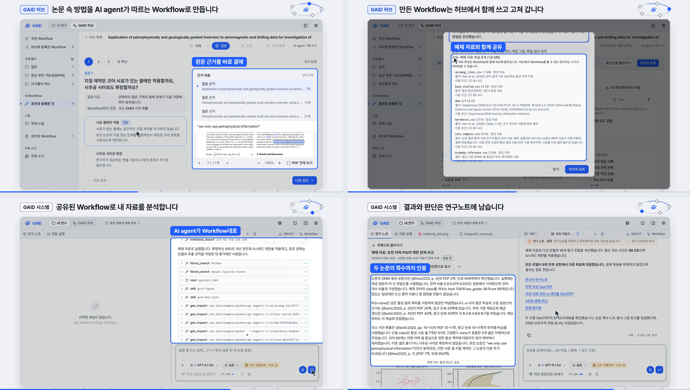

# GAID 홍보 영상 v4: 배경을 움직이는 그림으로 바꾸고 목적부터 말하는 103초 영상 (내부 검토용)

> 이 보고서는 2026-10-24-gaid-promo-video-v5로 대체되었습니다.

## 0. 한눈에

| | |
|---|---|
| 요청 | 배경 파트를 글 대신 그래픽으로 보여 주고, "개념도" 같은 잔재를 지우고, 허브와 시스템의 목적이 드러나도록 시연을 다시 연출합니다. |
| 결론 | 103초 영상을 만들었습니다. 장면 구성은 v3와 같습니다. 배경 15초는 세 단계 모션그래픽이 되었고, 시연 장마다 목적 문장이 먼저 나옵니다. 기능 이름표는 36개에서 22개로 줄였고, 기능 이름 대신 연구에서 얻는 결과를 적었습니다. |
| 믿을 수 있는 정도 | 시연 화면은 v3 때 실제 앱에서 진행한 포천 연구를 촬영한 것이며 화면 문구는 바꾸지 않았습니다. 배경, 연구 순환, Second brain 장면은 실제 화면이 아닌 설명 그림입니다(5절). |
| 결정할 일 | 없음. 영상 검토 의견을 받습니다. |

## 1. 요청한 것

> 홍보영상과 관련하여 피드백이다. 현재 장면구성등은 비교적 적절하다. 오히려 배경 설명 파트에서 글자만 떠있는시간이 오래걸리고 그래픽없이 글만 있는것 같다.또한 오른쪽 상단에 개념도 텍스트와 같은 ai슬롭형 잔재도 남아있다. 지질자원연구자들이 자료를 조사하고 문헌을 분석하고 코드를 작성하는것과 유용한 지구 과학 스킬이나 에이전트 도구들이 흩어져있어 이용하기 어려운 현황이 그래픽적으로 잘드러나게 연출할필요가 있다. 두번째 피드백으로 허브와 시스템 연출은 좋지만 너무 좁은기능 설명 위주로 표현된다. 현재프로젝트와 GAID 허브와 시스템의 주요목적이 잘 드러나면서 중간중간 기능들이 같이 설명되어야하는데 현재 연출은 세부적인기능 나열소개식 연출에 가깝다. 현황 분석 후 어떻게 연출할지 검토하고 수정할필요가 있다. — 2026-10-24 v3 피드백

완료 기준은 다섯 가지입니다.
- v3를 먼저 분석하고, 연출 방향을 다시 렌더하기 전에 보여 드립니다.
- 배경 파트를 글이 적은 모션그래픽으로 바꿉니다.
- "개념도" 표시를 지웁니다.
- 허브와 시스템 파트를 목적 중심으로 연출합니다.
- 조건은 v3와 같습니다. 무음, 1920×1080, 30fps, 90~105초, 내부 검토용입니다.

## 2. 수행한 것

1. v3 영상, 장면 소스, 촬영 기록을 분석했습니다.
   - 배경 12초 동안 문장 제목 세 개가 4.8초씩 떠 있었습니다. 그 아래 카드도 제목과 이름표만 있는 글 상자였습니다.
   - 시연 장 제목은 동작 이름이었고, 기능 이름표 36개가 2초 안팎마다 바뀌었습니다. 각 장이 왜 필요한지는 화면에 나오지 않았습니다.
2. 이 분석과 연출 방향(장면별 의도, 장마다 목적 문장, 이름표 목록)을 작업 탭에서 보여 드린 뒤 작업했습니다.
3. 배경을 세 단계 모션그래픽으로 새로 만들었습니다(3절 그림 1).
4. 연구 순환 장면의 고리를 두 부분으로 나눴습니다. GAID 허브는 함께 쓰고 고쳐 가는 Workflow이고, GAID 시스템은 내 서재에서 분석하고 기록하는 연구입니다. 제목도 플랫폼의 목적을 말하는 문장으로 바꿨습니다.
5. 시연은 v3 촬영본을 다시 썼습니다.
   - 각 장 머리에 목적 문장과 "GAID 시스템" 또는 "GAID 허브" 표시를 두었습니다.
   - 오른쪽 위의 작은 순환 고리가 지금 위치를 보여 줍니다.
   - 이름표는 장면마다 연구에서 얻는 결과 하나로 줄였습니다.
   - 길이를 맞추려고 예제 자료 연결 장면 하나를 빼고 다섯 장면을 0.5~1.2초씩 줄였습니다.
6. "개념도" 표시는 두 장면에서 모두 지웠습니다. 시작과 마무리의 부제는 "지구과학 연구자를 위한 AI agent 연구 지원 플랫폼"으로 바꿨습니다.
7. 정지 화면으로 장면 사이의 겹침을 확인하고 고친 뒤 최종 영상을 렌더했습니다.

## 3. 결과

그림 1. 배경 세 단계와 연구 순환입니다. 왼쪽 위부터 차례로 다음 장면입니다.
- 연구자가 자료 조사, 문헌 분석, 코드 작성 사이를 오가는 장면
- 스킬과 도구가 곳곳에 흩어져 연구자에게서 뻗은 선이 닿지 못하는 장면
- 그것들이 GAID의 서재·스킬과 도구·Workflow·자료와 지도·연구노트로 모이는 장면
- 연구 순환

볼 것: 글은 단계마다 한 줄뿐이고, 장면의 내용은 움직이는 그림이 보여 줍니다. 연구 순환에는 GAID 허브와 GAID 시스템이 나뉘어 표시됩니다.

그림 2. 시연 장면 네 개입니다(Workflow 만들기, 허브 공유, 연구 분석, 연구노트). 볼 것: 장마다 목적 문장과 GAID 허브/GAID 시스템 표시가 먼저 나오고, 기능은 그 목적을 따라 이름표 하나로 나옵니다.

| 시간(초) | 장면 | 화면이 말하는 것 |
|---|---|---|
| 0–4 | 시작 | GAID, 지구과학 연구자를 위한 AI agent 연구 지원 플랫폼 |
| 4–19 | 배경 | 자료를 찾고, 논문을 읽고, 코드를 짭니다 → 쓸 만한 스킬과 도구는 곳곳에 흩어져 있습니다 → GAID가 한곳에 모아 연구를 돕습니다 |
| 19–27 | 연구 순환 | 논문과 분석이 공유된 Workflow가 되고, 쓰일수록 나아집니다 (GAID 허브와 GAID 시스템, version 0.1.0 → 0.1.1) |
| 27–35 | 시연: 내 서재 (시스템) | 연구는 내 서재의 논문에서 시작합니다 |
| 35–48 | 시연: Workflow 만들기 (허브) | 논문 속 방법을 AI agent가 따르는 Workflow로 만듭니다 |
| 48–56 | 시연: 허브 공유 (허브) | 만든 Workflow는 허브에서 함께 쓰고 고쳐 갑니다 |
| 56–74 | 시연: 연구 분석 (시스템) | 공유된 Workflow로 내 자료를 분석합니다 |
| 74–80 | 시연: 연구노트 (시스템) | 결과와 판단은 연구노트에 남습니다 |
| 80–91 | 시연: 다시 서재로 (시스템) | 연구가 서재로 돌아와 다음 연구로 이어집니다 |
| 90–98 | KIGAM Second brain | 연구자마다 고리가 돌면 지구과학 AI agent 생태계가 자랍니다 |
| 98–103 | 마무리 | 로고, "내부 검토용 영상" |

시연 이름표 22개는 장면 순서대로 다음과 같습니다.
- 내 서재: 주제별 폴더에 모은 논문, 논문을 곁에 두고 읽기
- Workflow 만들기: 논문·코드·자료를 함께, 원문 근거를 바로 곁에, 근거를 보고 연구자가 결정, 단계로 정리된 분석 절차
- 허브 공유: 다음 version으로 등록, 예제 자료와 함께 공유, 허브에서 가져다 쓰기
- 연구 분석: Workflow의 목적과 근거, 근거 논문을 붙여 시작, 단계마다 자료와 조건, AI agent가 Workflow대로, 결과 그림까지 저장, 원본 좌표 그대로 지도에, 원본 값을 바로 확인
- 연구노트: 결과부터 쓴 연구노트, 두 논문의 쪽수까지 인용, 판단은 연구자가 답합니다
- 다시 서재로: 연구노트도 서재에, 논문에서 이어진 연구 이력, 논문·Workflow·노트의 연결

| 완료 기준 | 결과 | 근거 |
|---|---|---|
| v3 분석, 다시 렌더하기 전에 방향 보여 드리기 | 충족. 작업 탭에서 보여 드린 뒤 진행했습니다 | 2절 |
| 배경을 글이 적은 모션그래픽으로 | 충족. 세 단계, 단계마다 자막 한 줄 | 그림 1 |
| "개념도" 표시 지우기 | 충족. 두 장면 모두 | 그림 1 |
| 목적이 먼저 나오는 허브·시스템 연출 | 충족. 장마다 목적 문장과 영역 표시, 이름표 36 → 22개 | 그림 2, 위 표 |
| 무음, 1920×1080, 30fps, 90~105초 | 충족. 103초 | 4절 |

보는 방법: PC74에 있는 MP4 파일(부록 A의 "영상")을 동영상 플레이어로 엽니다. 파일이 커서 저장소에는 넣지 않았습니다.

## 4. 검증

- 과학적 검증: 해당 없음. 시연에 나오는 분석은 v3 때 합성 예제 자료로 한 홍보용 실행입니다(5절).
- 영상 출력: 최종 파일을 다시 읽었습니다. 103.00초, 3,090프레임, 1920×1080, 30fps, H.264이고 음성 트랙이 없습니다. 보고서 그림 두 장과 장 전환 구간(4, 19, 27, 48, 56, 90, 98, 103초 부근)의 검사 프레임은 최종 파일에서 뽑았고, 겹침과 빈 화면이 없는 것을 눈으로 확인했습니다. 렌더 중 브라우저 오류는 없었습니다(있으면 렌더가 실패합니다).
- 장면 확인: 배경 세 단계의 전환(15.0~17.3초)을 0.5초 간격 정지 화면으로 보고, GAID 패널이 날아드는 카드를 가리던 문제와 연구자 표시가 패널과 겹치던 문제를 고쳤습니다. 장 머리의 목적 문장이 오른쪽 위 순환 고리와 겹치지 않는 것을 가장 긴 문장으로 확인했습니다.
- 검토용 앱: 이번 작업에서는 쓰지 않았습니다. 새로 촬영하지 않았습니다.

## 5. 한계

- 내부 검토용입니다. 기관 로고의 외부 공개 승인이 아직 나지 않았습니다(gaid-release-proof#2).
- 설명 그림 장면: 배경(4–19초), 연구 순환(19–27초), KIGAM Second brain(90–98초)은 실제 화면이 아닌 설명 그림입니다. 배경에 나오는 스킬과 도구 이름은 실제 이름입니다. 개수나 시간 같은 수치는 넣지 않았습니다. v3까지 화면에 붙이던 "개념도" 표시는 지웠고, 이 절로 대신합니다.
- 장면 순서: v3와 같이 허브 공유 장(version 0.1.1 등록)이 분석 장보다 먼저 나옵니다. 실제로는 0.1.0으로 분석한 뒤 0.1.1을 등록했습니다. 그래서 분석 장의 시작 창에는 "version 0.1.0"이 보입니다.
- 분석 결과: v3 보고서에 적은 대로 다섯 역산이 모두 반복 상한에서 멈췄습니다. 노트는 수렴이나 광체 복원을 주장하지 않으며 "검토 전" 상태입니다. 자료는 합성 예제 자료이고 지형만 실제입니다.
- 예제 자료 연결 장면을 뺐습니다. 예제 자료는 허브 등록 장면과 시작 창 장면에 계속 나옵니다.

## 6. 결정할 일

없음.

## 7. 대체되었거나 실패한 시도

펼치기 — 1건

- 배경 셋째 단계의 첫 정지 화면에서는 GAID 패널이 카드보다 위에 그려져, 날아드는 카드가 패널 뒤로 숨었습니다. 연구자 표시도 패널 한가운데에 남았습니다. 패널을 카드 아래로 옮기고, 연구자를 패널이 나타나기 전에 왼쪽으로 옮기고, 왼쪽 카드부터 날아가게 바꿨습니다.

## 용어

없음. 기존 용어집을 따릅니다.

## 부록 A. 근거 위치

펼치기 — 실행 방법, 원본, 해시, 커밋

| 항목 | 위치 |
|---|---|
| 제작 소스 | `geo/promo/` (`README.md`, `render.py`, `scene/scene.js` — 배경 `S2`, 장 목적 `CHAPTERS`, 이름표 `TAGS`, 줄인 구간 `USE`) |
| 분석과 연출 방향 | `docs/tasks/gaid-promo-video-v4.md` → "Analysis of v3", "Direction v4" |
| 실제 화면 촬영 | v3 촬영본 PC74: `~/data/geoaidesk/work/gaid-promo-video-v3/capture-v3/capture.json` (16 shots 중 15개 사용, A4 제외) |
| 미리보기 | PC74: `~/data/geoaidesk/work/gaid-promo-video-v4/prev1`–`prev4t` |
| 렌더 job | `job-geoaidesk-gaid-promo-video-v4-1`, PC74: `~/data/geoaidesk/runs/gaid-promo-video-v4-20261024T005812.015692Z/receipt.json`, 렌더 소스 `f66c4f89f9b9e985966ad6f1d0f93807a8ead73c` |
| 영상 | PC74: `~/data/geoaidesk/runs/gaid-promo-video-v4-20261024T005812.015692Z/out/gaid-promo-v4.mp4`, 10,706,487 bytes, SHA256 `5f6d50ca02a4364363b01ca2f430c1e9796ff6969020950692e472d3da40f098` |
| 출력 기록 | `out/manifest.json` SHA256 `18f897775152c7268dc098b2a947af7de82f110025fa2951cf82c8256f824342` (capture.json SHA256 `aab24b2ef94aea09a60748ed8b3b0168adca477af353e496406efe2b9cad2f3a`), `out/contact-sheet.jpg` SHA256 `0ecc33c9db2c0f85aa7b6e8f4ab97688b34d793a9f83a7df21fd7de5fa4e53b1`, 전환 검사 프레임 PC74: `~/data/geoaidesk/work/gaid-promo-video-v4/qa-v4/qa-transitions.png` |
| 보고서 그림 | 최종 MP4의 8.2/13.0/18.3/25.3초(그림 1), 42.0/50.5/67.2/77.0초(그림 2) 프레임 |
| 도구 | Google Chrome, Playwright 1.63.0, imageio-ffmpeg 0.6.0 (H.264, CRF 17), Pillow 12.3.0 |
| 아이콘·글꼴 | Lucide (Icon Wiki 20261007, ISC/MIT; `file-code`, `plug`, `triangle-alert` 추가), Pretendard (OFL) |

작성 시점: 2026-10-24.

