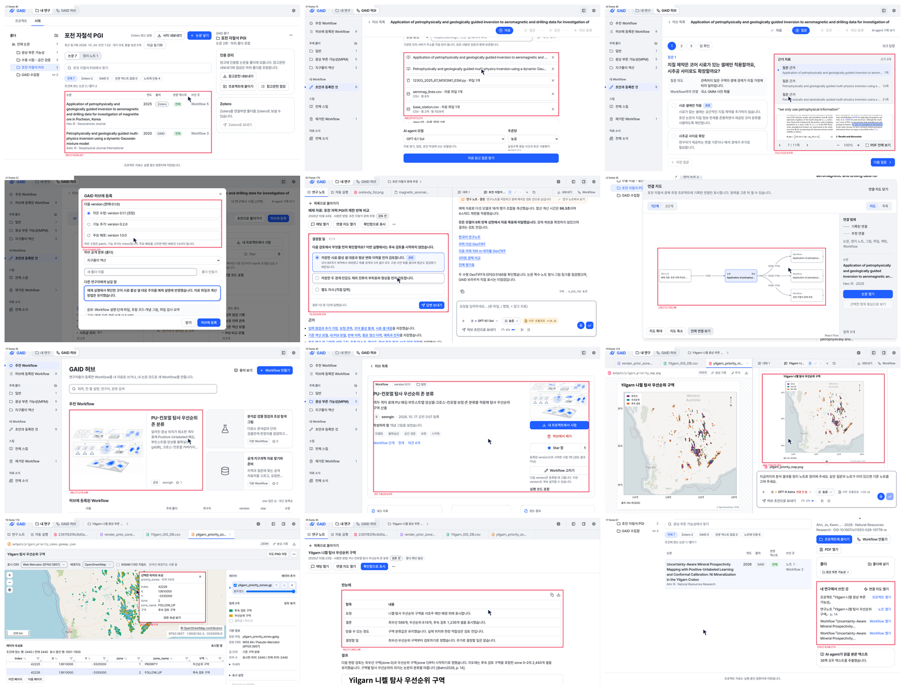

# GAID 홍보 영상 v5(93초, 두 예제와 창 배치)와 45초 제품 영상 (내부 검토용)

## 0. 한눈에

| | |
|---|---|
| 요청 | v4에서 예제를 넓히고 강조 상자가 화면 요소를 자르지 않게 하며, 실제 화면을 모션그래픽 속 창으로 넣습니다. 이어서 기능 설명 없이 강점을 보여 주는 45초 제품 영상을 소리와 함께 만듭니다. |
| 결론 | v5는 93초입니다. 시연에 쓴 촬영 장면 16개 중 7개가 Yilgarn 예제, 9개가 포천 예제이고, 허브·분석·연구노트·서재 장에는 두 예제가 함께 나옵니다. 강조 상자 27개는 모두 패널·카드·표를 통째로 감쌉니다. 45초 제품 영상은 코드로만 그린 그림과 합성한 음악·효과음으로 만들었습니다. |
| 믿을 수 있는 정도 | 실제 화면은 검토용 앱의 기존 기록을 찍은 것이고 화면 문구는 바꾸지 않았습니다. 강조 상자는 확대 화면에서 하나씩 확인했습니다. 소리는 측정값으로만 확인했고, 사람이 들어서 확인하지 않았습니다. |
| 결정할 일 | 없음. 두 영상의 검토 의견을 받습니다. |

## 1. 요청한 것

> 현재 v4 영상은 PGI예제로 치우쳐져있다. 그리고 기능을 소개할때 사각형도 영역을 중간에 어색하게 잘리게 지정하는 경우도 빈번해서 수정이 필요하다. 예제도 yilgarn예제와 PGI예제를 둘다써도되고 꼭 모든 워크플로우가 하나의 예제만 보이는것이 아니라 적합한것을 사용하고 촬영 에셋이 영상 전 영역을 차지하지 않고, 해당 기능을 소개하는 모션그래픽속의 창요소처럼 보여도되므로 상품성 높은 홍보영상이 될수 있게 v5로 개선하자. — 2026-10-24 요청

작업 중에 받은 의견입니다.

> 똑같이 만들 필요는 없지만 7a3e05f2-d0b7-4b67-8d3a-6702b12a9d7d 세션의 102초 영상 처럼 꼭 허브와 시스템을 설명하는 창이 영상 전체를 차지할 필요가 없고 모션 그래픽의 한 요소로 배치되는 것이 처음 보는 독자의 입장에서는 더 이해하기 쉽다. 사용자의 피드백이다 — 2026-10-24 의견

> 좋다. 해당 렌더와 함께 추가 영상을 제작하고 싶다. 현재 방식은 기능 설명 홍보 영상에 가깝다. 제품 홍보영상으로서는 너무 기능 위주의 설명이 가득하고 처음 보는 이용자의 입장에서는 한번에 기능을 2~3초만에 이해할 수 없다. 이러한 관점에서 제품 홍보 영상으로는 중요 메시지를 코드만 사용하는 모션 그래픽으로 잘 설명하여 그림만으로도 홍보하려는 도구의 강점을 파악하고 구매하거나 이용하고 싶게 만들어야 한다. 그리고 분량은 45초 정도로 구성해야한다. 현재 설치된 brag스킬을 활용하면 소리도 생성 가능할 것으로 기대한다. 어떻게 연출해야할지 논의하여 생성해보자. — 2026-10-24 추가 요청

완료 기준:
- v5: v4의 구성과 메시지를 유지합니다. 장면마다 맞는 예제를 고르고, 강조 상자는 화면 요소를 통째로 감쌉니다. 실제 화면은 창 요소로 넣습니다. 조건은 무음, 1920×1080, 30fps, 90~105초, 내부 검토용입니다. v4를 대체하는 `review` 항목으로 등록합니다.
- 45초 제품 영상: 연출을 먼저 논의해 정합니다. 코드로만 그린 모션그래픽에 음악과 효과음을 넣습니다. 내부 검토용이며, 다른 영상을 대체하지 않습니다.

## 2. 수행한 것

1. v4를 분석했습니다. 시연 15장면이 모두 포천 PGI 예제였습니다. 강조 상자는 장면마다 손으로 그린 사각형이어서 패널 중간에서 끝나는 경우가 있었습니다(옆 패널, 자료 목록, 단계 설명).
2. 검토용 앱에 있는 Yilgarn 니켈 광상 부존 가능성 예제를 새로 찍었습니다(7장면). 하위 작업이 맡았습니다.
   - 허브 추천 카드와 광상 부존 가능성 폴더
   - Workflow 상세
   - 시작 창
   - 분석 대화
   - 우선순위 구역 지도
   - 연구노트
   - 서재의 근거 논문
   
   기존 기록을 다시 열어 찍었고 모델은 실행하지 않았습니다. 쓰기 요청은 촬영 브라우저에서 막았습니다. 강조 영역은 화면 요소의 실제 경계를 재서 기록했습니다. 검토용 앱 사용 전후에 hub에 알렸습니다.
3. 포천 촬영본에서 쓸 강조 영역을 다시 정했습니다(최종 13개). 경계가 패널 테두리나 요소 사이의 빈 곳에 오도록 잡고, 확대 화면으로 확인했습니다. 화면 밖으로 이어지는 영역은 쓰지 않았습니다. 화면 상태가 바뀌어 영역을 벗어나는 장면은 그 직전에서 끊었습니다.
4. 시연을 창 배치로 바꿨습니다. 왼쪽 열에는 GAID 허브/GAID 시스템 표시, 장의 목적, 그 장에서 얻는 결과 목록이 있습니다. 오른쪽에는 실제 화면 창 하나가 있습니다. 지금 결과는 파란색이 되고, 연결선이 창 안의 강조 상자로 이어집니다. 지도 장면은 두 예제 창을 엇갈려 놓았습니다. 첫 배치에서는 강조 영역을 확대 창으로 꺼냈습니다. 사용자 의견에 따라 이 방식으로 바꾸고 확대 창은 뺐습니다(7절).
5. 45초 제품 영상은 연출안을 대화에서 제안했습니다. 사용자가 세 가지를 골랐습니다.
   - 구조: "한 연구자의 하루형"
   - 톤: "밝은 계측 + 블루 전환"
   - 음악: "경쾌한 미니멀"
   
   brag-slim 방식으로 장면과 소리를 한 박자 격자(96 BPM, 18마디 = 45초)에 맞춰 만들었습니다.
6. 두 영상 모두 정지 화면과 전환 구간 화면을 보고 겹침과 잘림을 고친 뒤 최종 렌더했습니다.

## 3. 결과

### 3.1 v5 (93초, 무음)

그림 1. 최종 영상의 시연 장면 네 개입니다. 왼쪽 위부터 Workflow 만들기(포천), 허브 공유(Yilgarn), 연구 분석의 두 예제 지도(Yilgarn·포천), 연구노트(Yilgarn) 순서입니다. 볼 것은 세 가지입니다.
- 왼쪽 열의 지금 결과가 파란색이고, 연결선이 창 안의 강조 상자로 이어집니다.
- 창 위 막대에 예제 이름이 있습니다.
- 강조 상자가 패널을 통째로 감쌉니다.

그림 2. 강조 상자 점검입니다. 위 두 줄은 포천 촬영본이고, 아래 두 줄은 Yilgarn 촬영본입니다. 영상에 쓴 강조 영역을 촬영 프레임 위에 빨간 선으로 그렸습니다. 볼 것: 상자마다 카드, 표, 대화 상자, 그림을 통째로 감싸고 글자나 줄을 가로지르지 않습니다.

| 시간(초) | 장면 | 예제 |
|---|---|---|
| 0–4 | 시작 | |
| 4–19 | 배경(모션그래픽, v4와 같음) | |
| 19–27 | 연구 순환(GAID 허브와 GAID 시스템) | |
| 27–33 | 연구는 내 서재의 논문에서 시작합니다 | 포천 |
| 33–43 | 논문 속 방법을 AI agent가 따르는 Workflow로 만듭니다 | 포천 |
| 43–55 | 만든 Workflow는 허브에서 함께 쓰고 고쳐 갑니다 | 포천(다음 version 등록), Yilgarn(허브 추천, 분야 폴더, Workflow 상세) |
| 54–68 | 공유된 Workflow로 내 자료를 분석합니다 | Yilgarn(시작 창, AI agent의 도구 기록과 결과 지도), 두 예제 지도 |
| 68–74 | 결과와 판단은 연구노트에 남습니다 | Yilgarn(결과부터 쓴 노트, 지도 그림), 포천(두 논문 쪽수 인용, 판단) |
| 74–81 | 연구가 서재로 돌아와 다음 연구로 이어집니다 | Yilgarn(근거 논문과 쓰인 곳), 포천(연결 지도) |
| 81–89 | KIGAM Second brain | |
| 89–93 | 마무리 | |

### 3.2 45초 제품 영상 (음악·효과음)

[[DAY45-FIGURE]]

| 시간(초) | 하루 | 그림 | 화면 글 |
|---|---|---|---|
| 0–5 | 아침 | 논문 PDF, 코드, 표, 지도 조각, 도구 이름이 책상 위로 쏟아져 쌓입니다 | 자료는 여기, 논문은 저기, 코드는 또 따로 |
| 5–10 | | 파란 화면에 GAID 마크가 찍히고, 조각들이 궤도를 돌다 다섯 선반(서재, 스킬과 도구, Workflow, 자료와 지도, 연구노트)에 꽂힙니다 | GAID에 모두 모입니다 |
| 10–20 | 오전 | 논문에서 밑줄 친 문장 네 줄이 떨어져 나와 Workflow의 네 단계(자료 준비, 처리·모델링, 평가, 해석·결과)가 되고, AI agent 표시가 단계를 따라갑니다 | 논문 속 방법이 / AI agent가 따르는 Workflow가 됩니다 |
| 20–27.5 | 오후 | "내 자료"가 Workflow에 들어가고, 지도에 등고선과 결과 셀이 차례로 켜집니다 | 내 자료에 바로 적용합니다 |
| 27.5–32.5 | | 파란 화면의 GAID 허브에서 동료 넷이 Workflow를 가져가고, 개선 하나가 돌아와 version 0.1.0이 0.1.1이 됩니다 | 동료와 함께 쓰고, 쓸수록 나아집니다 |
| 32.5–37.5 | 저녁 | 결과 지도가 근거 표시가 붙은 연구노트가 되어 서재 선반으로 돌아가고, 고리가 닫힙니다 | 결과와 근거는 연구노트로 남습니다 |
| 37.5–41 | 밤 | 연구자 고리 여러 개가 가운데로 이어지고 논문·Workflow·노트의 그물이 자랍니다 | 연구가 쌓여 KIGAM의 Second brain이 됩니다 |
| 41–45 | | 로고, 부제, "내부 검토용 영상" | 지구과학 연구자를 위한 AI agent 연구 지원 플랫폼 |

음악은 96 BPM, D장조이고 코드는 D–A–Bm–G 순서입니다. 아침에는 짧게 끊은 소리와 시계 같은 하이햇이 긴장을 만듭니다. GAID 마크가 찍히는 순간 낮은 울림과 화음이 들어오고 리듬이 시작됩니다. 효과음은 같은 조성의 짧은 음과 종소리입니다. 밑줄, 단계, 지도 셀, version, 노트에 하나씩 붙습니다. 마지막은 Dadd9 화음으로 닫힙니다. 나레이션은 없습니다.

| 완료 기준 | 결과 | 근거 |
|---|---|---|
| 예제를 장면마다 골라 쓰기 | 충족. 촬영 장면 16개 중 Yilgarn 7, 포천 9. 서재와 Workflow 만들기 장은 포천만, 나머지 네 장은 두 예제를 함께 씁니다 | 3.1 표 |
| 강조 상자가 화면 요소를 자르지 않기 | 충족. 27개(포천 13, Yilgarn 14) 모두 패널·카드·표 단위이고, 하나씩 확인했습니다 | 그림 2, 4절 |
| 실제 화면을 모션그래픽 속 창으로 | 충족. 오른쪽 창 한 개(지도 장면은 두 개)와 왼쪽 설명 열, 연결선 | 그림 1 |
| v4의 구성과 메시지 유지 | 충족. 배경, 연구 순환, 여섯 장, Second brain, 마무리 순서와 목적 문장이 같습니다 | 3.1 표 |
| 무음, 1920×1080, 30fps, 90~105초 | 충족. 93초 | 4절 |
| 45초 제품 영상, 코드만 쓴 그림, 소리 | 충족. [[DAY45-LEN]] | 3.2, 4절 |

보는 방법: PC74에 있는 MP4 파일 두 개(부록 A의 "영상")를 동영상 플레이어로 엽니다. 파일이 커서 저장소에는 넣지 않았습니다.

## 4. 검증

- 과학적 검증: 해당 없음. 화면에 나오는 분석은 v3 촬영 때 포천 합성 예제 자료로 한 실행과, 이전에 검토용 앱에서 진행한 Yilgarn 시험입니다. 이번에는 분석을 새로 하지 않았습니다.
- v5 영상 출력: 최종 파일을 다시 읽었습니다. 93.00초, 2,790프레임, 1920×1080, 30fps, H.264이고 음성 트랙이 없습니다. 렌더 중 브라우저 오류는 없었습니다(있으면 렌더가 실패합니다).
- 강조 상자:
  - 포천 13개는 촬영 프레임 위에 그린 뒤 확대해서 경계를 확인했습니다. 쓰는 구간의 앞뒤 프레임에서도 확인했습니다.
  - Yilgarn 14개는 화면 요소의 경계를 잰 값입니다. 하위 작업이 중간 프레임에 그려 하나씩 확인했고, 저도 그림 2에서 확인했습니다.
  - 영상에서는 영역 둘레에 여백을 조금 두고 테두리를 그립니다. 창 가장자리에 닿는 영역은 테두리를 창 안쪽에 맞췄습니다.
- 장면 확인: 장마다 정지 화면과 전환 구간(창이 바뀌는 순간, 장이 바뀌는 순간)을 보고 고쳤습니다. 고친 것은 7절에 적었습니다.
- 45초 영상 출력: [[DAY45-VERIFY]]
- 검토용 앱:
  - 사용 전후에 hub에 알렸습니다. 설정 변경, 재시작, 모델 실행은 없었습니다.
  - 촬영 브라우저는 쓰기 요청을 모두 막았습니다. 막지 않은 것은 지도 읽기 요청뿐입니다.
  - 촬영 전후 파일 목록 1,641개를 비교했습니다. 바뀐 것은 서재의 Zotero 연결 상태 파일 하나입니다. 앱이 스스로 하는 Zotero 재시도 기록이고, 프로젝트·허브 파일은 바뀌지 않았습니다.

## 5. 한계

- 내부 검토용입니다. 기관 로고의 외부 공개 승인이 아직 나지 않았습니다(gaid-release-proof#2).
- 설명 그림 장면: v5의 배경, 연구 순환, Second brain은 실제 화면이 아닌 설명 그림입니다(v4와 같음). 45초 영상은 전체가 설명 그림입니다.
  - 화면의 낱말은 앱의 낱말을 썼습니다(서재, Workflow, AI agent, 연구노트, version, GAID 허브).
  - 지도와 결과 셀은 꾸민 그림이고 어떤 지역의 실제 결과도 아닙니다.
  - 파일 이름(예: core_samples.csv)과 도구 이름은 실제 예제와 도구에서 가져왔습니다.
  - 수치는 넣지 않았습니다. version 0.1.0 → 0.1.1은 GAID의 version 규칙을 보여 주는 예입니다.
- 장면 순서: v4와 같이 허브 장(포천 version 0.1.1 등록)이 분석 장보다 먼저 나옵니다. 분석 장은 Yilgarn 예제라서 v4처럼 version이 어긋나 보이는 문제는 줄었습니다. 다만 Yilgarn 시작 창에는 그 예제의 version 0.1.1이 보입니다.
- 연결 지도는 프로젝트를 묶음 범위로 쓰기 때문에 논문 → Workflow → 프로젝트 → 노트를 한 줄로 그리지 않습니다. 화면은 논문, 노트, Workflow 마디를 보여 줍니다.
- 포천 연구노트의 판단 장면은 "답변 보내기" 직전에서 끝납니다. 보낸 뒤에는 카드가 길어져 강조 영역을 벗어나기 때문입니다.
- 45초 영상의 소리는 피크, 평균 크기, 박자 위치를 측정해서 확인했습니다. 사람이 들어서 확인하지는 않았습니다. 음량 기준(LUFS)으로 맞추지 않고 평균 크기(RMS)로 맞췄습니다.

## 6. 결정할 일

없음.

## 7. 대체되었거나 실패한 시도

펼치기 — 4건

- v5 첫 배치: 큰 창 하나와 오른쪽 확대 창(강조 영역을 같은 픽셀로 키운 창)을 썼고, 최종 렌더까지 했습니다(job 1). 사용자 의견을 받고 왼쪽 설명 열과 연결선 배치로 바꿨습니다. 확대 창을 쓰면 한 순간에 볼 곳이 세 군데(창, 확대 창, 이름표)가 되기 때문입니다. job 1의 영상은 쓰지 않습니다.
- 포천 AI agent 작업 장면(R3): 처음에는 대화 창 전체를 감쌌습니다. 창 윗부분에서 대화가 스크롤되어 잘린 줄이 상자 안에 들어갔습니다. 메시지와 도구 다섯 줄로 영역을 줄였다가, Yilgarn 촬영본이 다시 찍혀 도구 기록과 결과 지도를 함께 보여 주게 되자 Yilgarn 장면으로 바꿨습니다.
- 포천 강조 영역 중 서재 옆 패널, 등록 대화 상자의 공유 파일 목록, 노트 그림, 쓰인 곳 목록은 화면 밖이나 스크롤 영역으로 이어져 쓰지 않았습니다. 등록 장면은 대화 상자 전체를 감쌌습니다.
- 45초 영상 첫 정지 화면에서 고친 것:
  - 쓰지 않는 표식이 화면 위에 줄지어 남았습니다.
  - 파란 화면 위로 조각이 비쳤습니다.
  - 선반이 책상 선과 연구자 머리에 겹쳤습니다.
  - 두 줄 자막이 선반과 논문 페이지에 겹쳤습니다.
  - 오전에서 오후로 넘어갈 때 Workflow 카드가 둘 보였습니다.

## 용어

없음. 기존 용어집을 따릅니다.

## 부록 A. 근거 위치

펼치기 — 실행 방법, 원본, 해시, 커밋

| 항목 | 위치 |
|---|---|
| v5 제작 소스 | `geo/promo/` (`README.md`, `render.py`, `frame_check.py`, `scene/scene.js` — `CHAPTERS_DEF`, `V3` 강조 영역, 시연 장면), 촬영 계약 `geo/promo/CONTRACT.md` |
| 분석, 방향, 결정 | `docs/tasks/gaid-promo-video-v5.md` → "Analysis of v4", "Direction v5", "User feedback during v5", "Added scope: 45 s product film" |
| 촬영 | v3: PC74 `~/data/geoaidesk/work/gaid-promo-video-v3/capture-v3/capture.json` SHA256 `aab24b2ef94aea09a60748ed8b3b0168adca477af353e496406efe2b9cad2f3a`; v5(Yilgarn): PC74 `~/data/geoaidesk/work/gaid-promo-video-v5/capture-v5/capture.json` SHA256 `a450340738bcde196b68789e67bd395d7519d926e986712116429060a7159841`, 하위 작업 `gaid-promo-video-v5--capture`, `geo/promo/CAPTURE.md` v5 절 |
| 강조 상자 점검 | PC74 `~/data/geoaidesk/work/gaid-promo-video-v5/rects/`(포천 확대 점검), `boxcheck/`(그림 2 원본) |
| v5 렌더 job | `job-geoaidesk-gaid-promo-video-v5-2`, PC74 `~/data/geoaidesk/runs/gaid-promo-video-v5-20261024T021454.162971Z/receipt.json`, 렌더 소스 `528f09e8c097c08717de6efb13ffd7ec525b5391` |
| v5 영상 | PC74 `~/data/geoaidesk/runs/gaid-promo-video-v5-20261024T021454.162971Z/out/gaid-promo-v5.mp4`, 12,538,210 bytes, SHA256 `0e5126b80a21ed1ab748cc6258652e6817276d5b5eaf38d66d55b7e6576d05ff`; `manifest.json` SHA256 `cd2a2e82755d26d54d82aecf522f3e31e132e45361efbb3fb1a5195b4446e3f1` |
| 쓰지 않은 v5 렌더 | `job-geoaidesk-gaid-promo-video-v5-1`(첫 배치, 소스 `5346ab4b57a2`), PC74 `~/data/geoaidesk/runs/gaid-promo-video-v5-20261024T021150.866300Z/` |
| 45초 영상 소스 | `geo/promo/day45/` (`PLAN.md` 연출안, `scene/`, `soundtrack.py`, `render.py`, `README.md`) |
| 45초 영상 | [[DAY45-LOC]] |
| 보고서 그림 | 그림 1: v5 최종 MP4의 40.65/47.23/64.72/71.0초 프레임. 그림 2: 촬영 프레임 위 강조 영역(`geo/promo/frame_check.py`). [[DAY45-FIGSRC]] |
| 도구 | Google Chrome, Playwright 1.63.0, imageio-ffmpeg 0.6.0(H.264 CRF 17, AAC 192 kb/s), Pillow 12.3.0, numpy 2.3.4, brag-slim(latent-spaces/brag `669ab9286aa28b6c3ee30e75f181ee74319d012a`, MIT) |
| 아이콘·글꼴 | Lucide(Icon Wiki 20261007, ISC/MIT), Pretendard(OFL) |

작성 시점: 2026-10-24.

