# 10월 22~23일에 바뀐 화면을 UI 가이드 v2로 점검하고 고침

## 0. 한눈에

| | |
|---|---|
| 요청 | 모든 작업이 병합된 뒤, UI/UX 가이드로 개선한 화면들의 구현 상태를 점검하고 고칩니다. |
| 결론 | 위반 31건을 찾아 26건을 고쳤습니다. 가장 큰 문제는 화면마다 다른 모양이었습니다. 허브 화면 머리 세 가지, 세그먼트 컨트롤 두 가지, 상태 표시에 쓰인 파란색이 여기에 해당합니다. 지금은 허브의 목록 화면들이 같은 머리를 쓰고, 점검한 화면의 세그먼트 컨트롤은 모두 같은 모양입니다. |
| 믿을 수 있는 정도 | 검토용 앱과 같은 main 버전과 같은 자료로 따로 띄운 GAID에서 고치기 전후를 찍었습니다. 전체 점검(scripts/check) 결과는 4절에 있습니다. ORCID 가져오기 창, PDF 근거 보기, 채팅의 Workflow 카드는 이번에 다시 찍지 않았습니다. |
| 결정할 일 | 없음 (남은 다듬기 5건은 부채로 기록, 5절) |

## 1. 요청한 것

> 모든 작업이 완료된 후 메인에서 병합되고 검토용 앱에 통합된 후에 ui/ux 가이드 지침으로 개선한 시스템들의 개선 및 구현 상태를 점검해야한다. 이유는 구현할 때 이러한 가이드를 충분히 숙지하지 못하고 워커들이 작업했을 수 있기 때문이다. 사용자의 피드백이 올바른지 먼저 확인받자. — 2026-10-23 요청

> 맞다. 점검 작업도 opus 5.5 high fast로 진행하자. — 2026-10-23 답변

완료 기준: 22~23일 작업이 바꾼 화면을 계측·도폭 두 스타일, 밝은·어두운 두 테마, 1440×900·1280×800 두 크기의 한국어 화면으로 찍습니다. 가이드 12절 점검표와 관련 규칙에 대조해 위반마다 규칙 번호, 화면, 심각도를 적고 고칩니다. 화면 사이의 일관성(같은 부품, 머리, 버튼, 간격, 빈 상태, 단계 표시)도 점검 범위입니다.

## 2. 수행한 것

1. 검토용 앱 자료를 복사해 별도 GAID를 띄웠습니다. 검토용 앱과 기관 허브 서버는 건드리지 않았고, 허브 서버에는 읽기만 했습니다.
2. 22~23일 작업 보고서 14개가 다룬 화면을 목록으로 만들고, 화면을 여는 순서를 자동 캡처로 적었습니다. 대상은 서재(논문, 정리 노트, PDF 패널, ORCID), Workflow 시작 창(소개, 분석 단계, 요약, 근거 논문, 예제 자료), 허브 저작(자료, 질문과 근거, 초안, 예제 자료 첨부, 등록 미리보기), 허브 목록(version, 제거·복원, 자료 소식, 허브 스킬), 설정의 기관 허브(관리자 화면), 프로젝트 전환입니다.
3. 기본 화면(계측, 밝은 테마, 1440)으로 먼저 훑어 위반 후보를 모았습니다. 이어서 같은 화면 12종을 8가지 조합으로 찍어 테마별 문제를 따로 봤습니다.
4. 위반을 고친 뒤 같은 화면 14종을 8가지 조합으로 다시 찍어(184장) 대조했습니다. 1280×800에서 새로 생긴 문제 1건(고정 하단 아래 비침)을 찾아 고쳤습니다.
5. 가이드 문서 자체가 "판"을 쓰던 네 곳을 "version"으로 고쳤습니다. 용어 결정(10월 23일)과 가이드가 어긋나 있었기 때문입니다.

## 3. 결과

색은 거의 모든 화면이 토큰을 따르고 있었습니다. 그래서 도폭 스타일과 어두운 테마에서만 생기는 문제는 없었습니다. 위반은 대부분 작업 단위마다 부품을 따로 그린 데서 생겼습니다. 같은 역할의 부품이 화면마다 다르게 생겼고, 파란색이 상태나 장식에 쓰였습니다.

그림 1. 자료 소식 화면의 머리. 볼 것: 회색 띠 안의 제목이 허브 첫 화면과 같은 자리·크기의 제목으로 바뀌었습니다. 검색칸에는 다른 허브 검색칸처럼 돋보기가 붙었습니다. 허브 스킬과 제거된 Workflow도 같은 머리를 씁니다(그림 2).

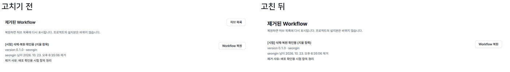

그림 2. 제거된 Workflow 화면. 볼 것: 20px 제목과 따로 떨어진 설명 줄, 옆 목록과 겹치는 "허브 목록" 버튼이 다른 허브 화면과 같은 머리로 바뀌었습니다.

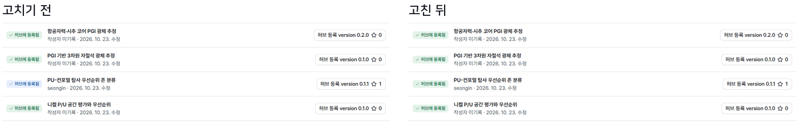

그림 3. 내가 만든 Workflow 목록. 볼 것: 고치기 전에는 같은 "허브에 등록됨"이 한 줄만 파란색이었습니다(초안 단계 색을 그대로 썼기 때문). 지금은 등록된 것은 모두 같은 성공 색입니다.

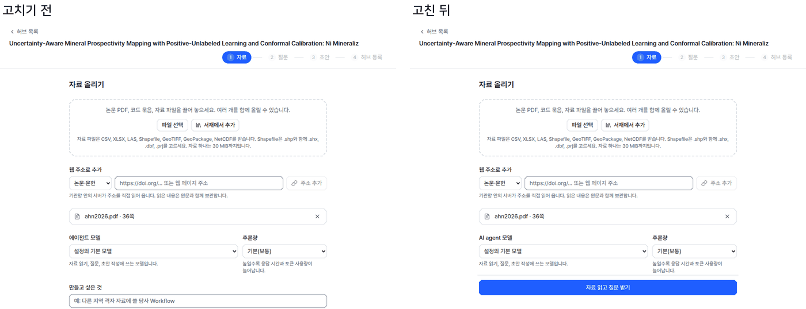

그림 4. 허브 저작의 자료 올리기 단계. 볼 것: 고치기 전에는 "자료 읽고 질문 받기"가 1280×800에서 화면 밖에 있었습니다. 지금은 질문 단계의 이전/다음처럼 아래에 고정되어 늘 보입니다. 선택지가 하나뿐이던 "만들 종류"도 없앴습니다.

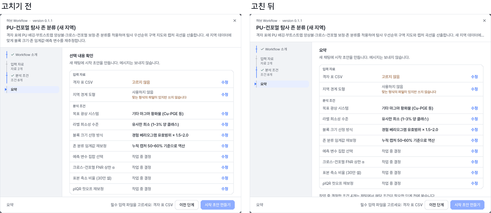

그림 5. 시작 창 요약. 볼 것: 제목이 왼쪽 단계 목록과 같은 "요약"이 되었습니다. 머리의 Workflow 설명은 두 줄에서 한 줄로 줄었습니다. 단계를 옮길 때 머리 높이가 덜 흔들리고, 전체 설명은 소개 단계와 말풍선 도움말에 있습니다.

그 밖의 전후 그림: 허브 등록 목록의 version 칸(그림 6), 저작 초안의 파란 안내 상자(그림 7), 서재 머리(그림 8), 단계 이유 문장(그림 9), 저작 질문의 권장 표시(그림 10), 연구 노트 상태 표시(그림 11), 고친 뒤 네 가지 조합(그림 12, 13).

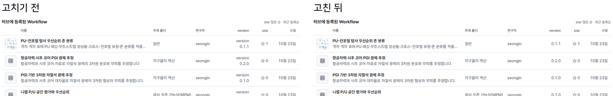

그림 6. 볼 것: "version" 낱말이 칸마다 반복되어 두 줄로 꺾이던 것이 숫자 한 줄이 되었습니다(머리글이 이미 version).

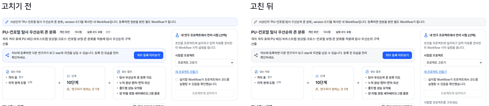

그림 7. 볼 것: 파란 바탕 안내 상자 두 개가 중립 회색 상자로 바뀌었습니다. "개인 초안"과 겹치던 "초안" 글자를 없앴습니다. 오른쪽 "프로젝트에 설치하기" 아래에는 비활성 이유가 한 줄로 나옵니다.

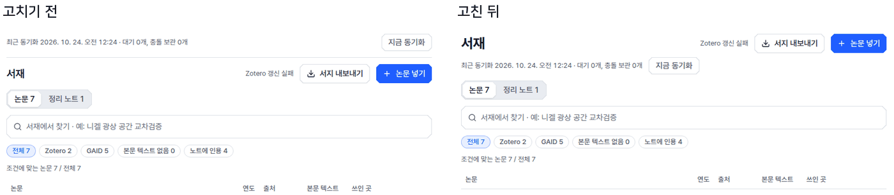

그림 8. 볼 것: 동기화 상태 줄이 제목 위에서 제목 아래로 내려갔습니다. 제목은 내 연구 화면과 같은 크기(26px)입니다.

그림 9. 포천 Workflow의 입력 단계(입력 8개). 볼 것: "다음 단계로 가려면 파일을 고르세요" 대신 빠진 입력 이름을 요약 단계와 같은 문장으로 말합니다.

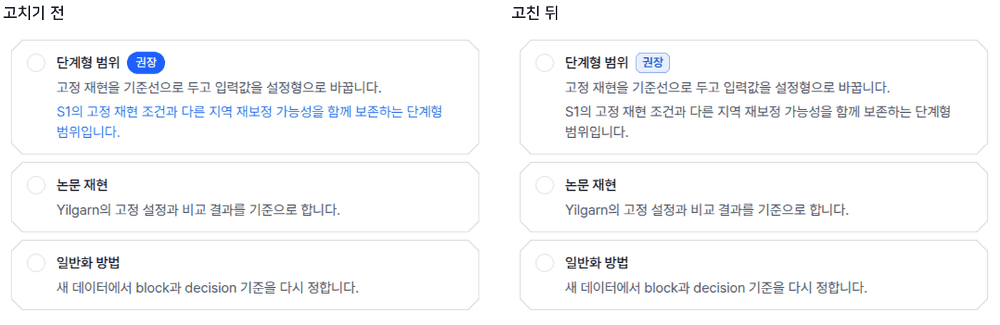

그림 10. 볼 것: 꽉 찬 파란 "권장" 배지와 링크처럼 보이던 파란 이유 문장이 연구 노트 결정 카드와 같은 옅은 판과 회색 이유 줄이 되었습니다.

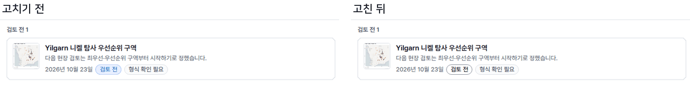

그림 11. 볼 것: "검토 전"이 파란색에서 테두리만 있는 중립 표시로 바뀌었습니다. 서재의 정리 노트 표도 같습니다.

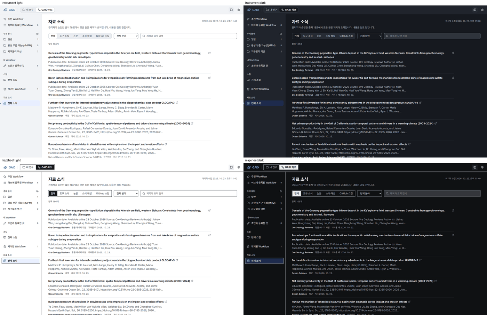

그림 12. 자료 소식 화면을 계측·도폭, 밝은·어두운 테마로 찍었습니다. 볼 것: 네 조합 모두 머리와 세그먼트 모양이 같고, 글자 대비가 읽기에 충분합니다.

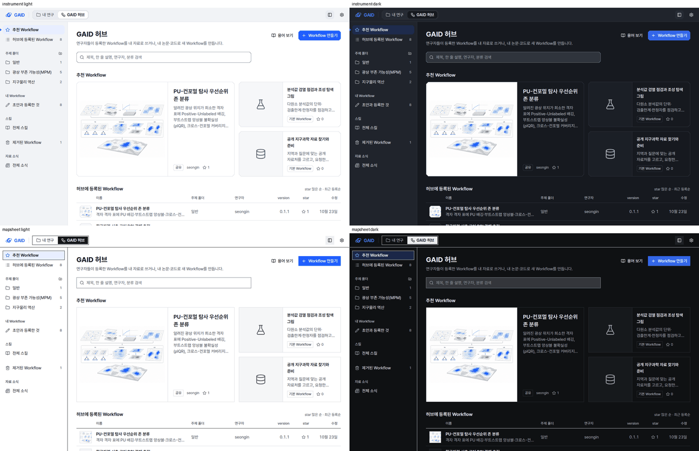

그림 13. 볼 것: 1280×800에서도 주 동작(Workflow 만들기)과 등록 목록의 version 칸이 한 줄로 보입니다.

### 찾은 위반과 처리

심각도는 세 가지입니다. 사용 막힘은 해당 없음(0건), 화면 불일치는 다른 화면과 다르게 보여 같은 것을 다르게 읽게 하는 것, 다듬기는 규칙에 어긋나지만 읽기에 큰 영향이 없는 것입니다.

| # | 화면 | 위반 | 규칙 | 심각도 | 처리 |
|---|---|---|---|---|---|
| 1 | 자료 소식, 허브 스킬 | 회색 띠 머리, 제목 위치·여백이 허브 첫 화면과 다름 | L3, L4, N4 | 화면 불일치 | 고침 |
| 2 | 제거된 Workflow | 20px 제목, 설명 줄 분리, 옆 목록과 겹치는 돌아가기 버튼 | T1, L4, W6 | 화면 불일치 | 고침 |
| 3 | 허브 첫 화면 | 한글 제목에 자간 축소 | T3 | 다듬기 | 고침 |
| 4 | 자료 소식, 허브 스킬 | 검색칸에 돋보기 없음(다른 검색칸과 다름) | N5 | 다듬기 | 고침 |
| 5 | 허브 스킬 | 스킬이 하나도 없을 때도 "조건에 맞는 스킬이 없습니다" | F4, G4 | 다듬기 | 고침 |
| 6 | 허브 스킬 | 제목 아래 한 줄 설명 없음 | W6 | 다듬기 | 고침 |
| 7 | 허브 등록 목록 | version 칸이 "version"을 반복해 두 줄로 꺾임 | X1, I5 | 화면 불일치 | 고침 |
| 8 | 초안과 등록한 것 | 같은 "허브에 등록됨"이 파란색과 초록색 두 가지 | S3 | 화면 불일치 | 고침 |
| 9 | 초안과 등록한 것 | 초안 단계 표시가 파란색 | S3, I2 | 화면 불일치 | 고침 |
| 10 | 연구 노트, 서재 정리 노트 | "검토 전" 상태가 파란색 | S3, I2 | 화면 불일치 | 고침 |
| 11 | 허브 Workflow 상세 | 종류 배지 "Workflow"가 파란 바탕 | I2 | 다듬기 | 고침 |
| 12 | 저작 초안, 자료, 시험, 편집 안내 | 파란 바탕 안내 상자 4종 | I2, S2 | 화면 불일치 | 고침 |
| 13 | 저작 흐름도 | 단계 번호 원과 입력 칩이 파란색 | I2 | 다듬기 | 고침 |
| 14 | 저작 질문 | 권장 배지가 꽉 찬 파란색, 이유 문장이 파란 글자(링크처럼 보임) | I2, Q2 | 화면 불일치 | 고침 |
| 15 | 관리자 탭, 허브 로그인, 예제 자료 출처, 그림 점검 탭 | 세그먼트 선택이 파란 틴트(다른 세그먼트는 흰 바탕) | N3, I14 | 화면 불일치 | 고침 |
| 16 | 자료 올리기 | 주 동작이 1280×800에서 화면 밖 | L7 | 화면 불일치 | 고침 |
| 17 | 자료 올리기 | 선택지가 하나뿐인 "만들 종류" | Q2 | 다듬기 | 고침 |
| 18 | 자료 올리기, 질문, 초안 | "에이전트 모델", "에이전트 기록 보기" 등 용어 불일치(AI agent) | 용어집 | 화면 불일치 | 고침 |
| 19 | 저작 개념 그림 | "hub 등록 화면" 영어 소문자 | 용어집 | 다듬기 | 고침 |
| 20 | 허브 스킬 | "별표"(다른 허브 화면은 "star") | 용어집, W6 | 화면 불일치 | 고침 |
| 21 | 저작 초안 | "개인 초안" 배지와 "초안" 글자 중복 | W5 | 다듬기 | 고침 |
| 22 | 저작 초안 시험 | "프로젝트에 설치하기"가 비활성인 이유 없음 | S7 | 화면 불일치 | 고침 |
| 23 | 저작 초안 시험 | "설치됨" 완료 문장이 파란 글자 | S3 | 다듬기 | 고침 |
| 24 | 예제 자료 첨부 | 입력 카드 안에 테두리 카드 | V5, L4 | 다듬기 | 고침 |
| 25 | 시작 창 요약 | 제목 "선택 내용 확인"이 단계 목록의 "요약"과 다름 | Q4 | 다듬기 | 고침 |
| 26 | 시작 창 분석 단계 | 머리 설명 두 줄이 단계마다 나타났다 사라짐 | W6, L9 | 다듬기 | 고침(한 줄) |
| 27 | 시작 창 분석 단계 | 비활성 이유가 빠진 입력 이름을 말하지 않음 | S7, Q4 | 화면 불일치 | 고침 |
| 28 | 서재 | 동기화 줄이 제목 위, 제목이 20px(내 연구 26px) | L4, T1 | 화면 불일치 | 고침 |
| 29 | 서재 논문 상세 | "쓰인 곳"의 긴 Workflow 제목이 6줄까지 늘어남 | G1, T5 | 다듬기 | 고침(두 줄, 도움말) |
| 30 | 서재 정리 노트 표 | 날짜가 2026-10-23 형식(다른 노트 화면은 2026년 10월 23일) | 화면 일관성 | 다듬기 | 고침 |
| 31 | 가이드 문서 | I5, G2, C3, R3이 "판"을 씀(용어는 version) | 용어집 | 화면 불일치 | 고침 |

남은 위반 5건은 5절에 있습니다.

| 완료 기준 | 결과 | 근거 |
|---|---|---|
| 22~23일에 바뀐 화면 목록 | 충족(일부 제외: 5절) | 2절 |
| 두 스타일·두 테마·두 크기, 한국어 화면 | 충족 | 그림 12, 13, 부록 A |
| 위반마다 규칙 번호·화면·심각도 | 충족 | 위 표 |
| 위반 고침 | 부분(26/31, 나머지는 부채) | 위 표, 5절 |
| 화면 사이 일관성 | 충족(머리, 세그먼트, 상태 색, 용어) | 그림 1~3, 10, 11 |
| 전후 그림, 남은 부채 | 충족 | 3절, 5절 |

## 4. 검증

- 화면 검증: 고친 화면 14종을 두 스타일·두 테마·두 크기로 다시 찍어(184장) 하나씩 대조했습니다. 1280×800에서 새로 생긴 문제 1건(자료 올리기 고정 하단 아래로 입력칸이 비침)을 찾아 고친 뒤 다시 찍어 확인했습니다. 키보드 이동과 화면 읽기 프로그램은 바꾼 부분(버튼 이름, 탭 구조)만 시험 코드로 확인했고, 실제 화면 읽기 프로그램으로는 듣지 않았습니다.
- 소프트웨어 검증: 바꾼 영역의 웹 시험 33개 파일 187건이 통과했습니다. 화면 규칙 검사(check-ui)는 오류 0건, 기존 허용 부채 78건이고 이번에 새로 추가한 허용 부채는 없습니다. 문구 검사기는 오류 0건, 경고 100건이며 경고는 모두 이번에 손대지 않은 문구입니다. 전체 점검(scripts/check) 결과: 부록 A.
- 연구 결과에 영향을 주는 계산은 바꾸지 않았습니다. 화면 표시와 문구만 바꿨습니다.

## 5. 한계

- 남은 위반 5건(부채, 다음 UI 작업에서 고칠 것):
  1. 허브 저작의 단계 표시(위쪽 1 자료 → 4 허브 등록, 질문 번호 원)가 가이드의 눈금형 단계 표시(StepScale)와 다른 모양입니다(I10, Q4, 화면 불일치). 저작 흐름 전체를 다시 배치해야 해서 이번에 고치지 않았습니다.
  2. 여러 화면의 선택 상자가 브라우저 기본 모양이라 프로젝트 정렬 상자와 다르게 생겼습니다(P6은 충족, 다듬기). 63곳이라 공용 부품을 새로 만들어야 합니다.
  3. 서재 오른쪽 열(ORCID, Zotero 카드)의 첫 화면 글자량이 W5 예산보다 많습니다(다듬기).
  4. 저작 시험 기록의 "실패한 도구 호출 n회"는 R1(도구 이름·호출을 연구자 화면에 쓰지 않음)에 가깝습니다(다듬기).
  5. 시작 창 아래 줄의 위치 표시가 소개·요약에서는 단계 이름, 분석 단계에서는 "분석 단계 1 / 1"로 형식이 다릅니다. 이전 작업(gaid-workflow-stages)이 정하고 시험한 동작이라 그대로 두었습니다(다듬기).
- 이번에 다시 찍지 않은 화면: ORCID 가져오기 창, PDF 근거 보기(질문 화면의 본문 근거는 확인), 채팅의 Workflow 카드, 연구 노트 결정 상세. 앞선 작업 보고서의 그림만 보았습니다.
- 프로젝트 재개(마지막 작업 상태)는 화면이 따로 없어 프로젝트 전환 목록만 확인했습니다.
- 검토용 앱에는 아직 반영되지 않았습니다. 이 작업을 마친 뒤 작업 관리 hub가 검토용 앱을 갱신합니다.

## 6. 결정할 일

없음.

## 7. 대체되었거나 실패한 시도

펼치기 — 2건

- 시작 창 머리 설명을 모든 단계에서 숨기는 안: 분석 단계에서 무엇을 하는 Workflow인지 놓칠 수 있어, 한 줄로 줄이고 전체 문장을 도움말로 두었습니다.
- 자료 올리기 고정 하단을 화면 아래 끝(0)에 붙인 첫 시도: 부모 영역의 아래 여백(20px) 때문에 하단 아래로 입력칸이 비쳤습니다. 하단을 그 여백 안까지 붙이게 고쳤습니다.

## 용어

없음. 이번 작업은 용어집의 기존 정의(AI agent, version, star)에 화면을 맞췄습니다.

## 부록 A. 근거 위치

펼치기 — 실행 방법, 원본, 커밋

| 항목 | 위치 |
|---|---|
| 코드 | 브랜치 task/gaid-ui-audit (PR은 finish 때 생성) |
| 공용 부품 | `web/src/geo/shell/page-header.tsx` (PageHeader, PageBody), `web/src/geo/shell/segmented.ts` (SEG_TRACK, segItem) |
| 가이드 | `docs/design/ui-guide.md` I5, G2, C3, R3 |
| 점검용 GAID | PC74 `~/data/geoaidesk/work/gaid-ui-audit/` (run-dev.sh, 포트 3410/18410, 자료 home/ = 검토용 앱 자료 복사본) |
| 캡처 | `node cap.mjs <출력 폴더> <장면> all` (같은 폴더의 cap.mjs, scenarios.mjs; 전후 사진 shots/before, shots/after, 조합 사진 shots/*-m*) |
| 그림 만들기 | `uv run --no-project --with pillow python pairs.py` |
| 전체 점검 로그 | PC74 `~/data/geoaidesk/work/gaid-ui-audit/check-1.log` |

작성 시점: 2026-10-24, 기준 main d17b6216.

