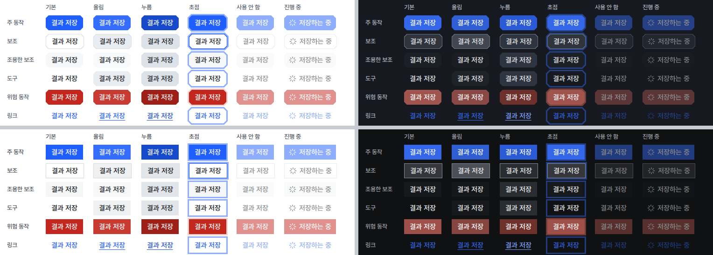

# UI 점검 체계: 부품 상태 견본과 네 화면 조합 자동 점검

## 0. 한눈에

| | |
|---|---|
| 요청 | 지난 조사의 시나리오 D(점검 체계)를 구현합니다. |
| 결론 | 개발자용 부품 상태 견본 화면, shadcn 검사기, impeccable 검사기, 네 화면 조합의 화면 비교, axe 접근성 검사를 만들어 전체 점검에 "보고만 하는" 단계로 붙였습니다. 견본을 그리며 찾은 두 가지(파란 버튼 글자 색 역할, 버튼 누름 상태)와 작업 기록 아이콘 두 개를 고쳤습니다. |
| 믿을 수 있는 정도 | PC74에서 점검을 두 번 연달아 돌려 화면 차이가 0이었습니다. 다른 PC에서는 아직 돌리지 않았고, 화면 비교 대상은 견본 화면 하나입니다. |
| 결정할 일 | 1건 (6절) |

## 1. 요청한 것

> 모두 권장으로 진행하자. — 2026-10-24 요청

조사 보고서(최신 UI/UX 스킬·템플릿 조사) 6절의 두 결정에 대한 답입니다. 이 답으로 정한 첫 작업은 다음과 같습니다(전달받은 목표 원문).

> Implement scenario D first: UI quality kit. A development-only "부품 상태 견본" page (shared parts pinned in every state with the shadcn skill's data-preview custom variants, live token contrast table), shadcn lint (`shadcn-ui/lint`, MIT) mapped onto UI guide V1 rules, impeccable detect (Apache-2.0, telemetry off via DO_NOT_TRACK), Playwright screenshot comparison of the four combos (계측/도폭 × light/dark, 1440×900) and axe-core checks, added to scripts/check first as report-only, blocking later after false positives are settled. Fix the two facts found while drawing the kit: UI guide S1 names an `--on-signal` role that globals.css does not define (buttons use `--primary-foreground`); `web/src/components/ui/button.tsx` has no press (active) style although S7 requires one. Also check `web/src/components/tool-activity.tsx` BrainIcon/WandSparklesIcon against V2.

완료 기준: 견본 화면, 가이드 규칙에 맞춘 shadcn 검사기, 원격 통계를 끈 impeccable 검사, 네 조합 화면 비교와 axe 검사를 전체 점검에 보고만 하는 단계로 붙이고 막는 단계로 바꿀 규칙을 적습니다. 색 역할 어긋남과 누름 상태를 고치고 작업 기록 아이콘 두 개를 V2에 비춰 확인합니다. 보고서에는 규칙 번호와 한국어 화면을 넣습니다.

## 2. 수행한 것

1. 토큰 파일에 파란 버튼 위 글자 역할(on-signal)과 누름 색 두 가지를 넣고, 공용 버튼의 모든 종류에 누름 모양을 붙였습니다. 작업 기록 줄의 마법봉·뇌 아이콘을 바꾸거나 뺐습니다.
2. 개발 모드에서만 열리는 부품 상태 견본 화면을 만들었습니다. 버튼, 입력칸, 스위치, 탭, 사이드바 항목, 분할 버튼, 단계 눈금, 단계 목록, 상태 표시, AI agent 작업 표시, 작업 기록 줄을 상태별로 고정해 보이고, 색 대비 표는 지금 화면의 토큰 값으로 계산합니다.
3. 점검 도구 넷을 앱과 따로 설치되는 점검 묶음으로 만들었습니다. 연구자의 앱 설치에는 들어가지 않습니다. 모든 결과에 UI 가이드 규칙 번호를 붙입니다.
4. 이 묶음을 전체 점검의 마지막 단계로 붙였습니다. 지금은 결과를 보여 주기만 하고 점검을 실패시키지 않습니다. 막는 단계로 바꾸는 조건을 규칙 파일과 가이드에 적었습니다.
5. 견본 화면의 기준 화면 네 장을 찍고, 점검을 다시 돌려 같은 화면이 나오는지 확인했습니다.

## 3. 결과

### 3.1 부품 상태 견본 화면

그림 1. 부품 상태 견본 화면을 네 조합(왼쪽 위부터 계측 밝은, 계측 어두운, 도폭 밝은, 도폭 어두운)으로 찍은 기준 화면. 볼 것: 같은 부품이 스타일마다 역할 토큰만 바꿔 그려집니다. 왼쪽 대비 표는 지금 화면에서 계산한 값이라 조합마다 숫자가 다릅니다. 연구자에게는 열리지 않는 화면이며, 운영 서버에서는 "찾을 수 없음"으로 답합니다.

### 3.2 고친 것

| 무엇 | 전 | 후 | 규칙 |
|---|---|---|---|
| 파란 버튼 위 글자 색 | 가이드는 on-signal 역할을 적었지만 토큰 파일에 없었고, 버튼은 흰색을 직접 적은 다른 변수를 썼습니다. | on-signal 역할 토큰을 만들고 버튼과 사이드바의 글자 변수가 이 역할을 따르게 했습니다. 가이드 S1은 실제 토큰 이름으로 고쳤습니다. 밝은 테마 5.1:1, 어두운 테마 5.0:1로 가이드 값과 같습니다. | S1, S4 |
| 버튼 누름 상태 | 눌러도 기본 모양과 같았습니다. | 파란 버튼은 한 단계 짙은 파랑, 위험 버튼은 짙은 빨강, 테두리·도구 버튼은 올림보다 짙은 회색, 링크는 파란 글 역할로 바뀝니다. 누름은 항상 올림과 다르고 더 짙습니다. 어두운 테마의 위험 버튼에는 없던 올림 모양도 붙였습니다. | S7, S4 |
| 작업 기록 줄 아이콘 | 스킬을 읽는 줄은 마법봉, 생각 과정 펼침은 뇌 아이콘이었습니다. | 스킬 줄은 지침 문서 아이콘으로 바꾸고, 생각 과정 펼침은 아이콘 없이 글자만 둡니다. | V2 |

그림 2. 견본 화면의 버튼 상태 행렬(기본, 올림, 누름, 초점, 사용 안 함, 진행 중)을 네 조합으로 자른 그림. 볼 것: 셋째 열(누름)이 모든 종류에서 둘째 열(올림)보다 짙습니다. 넷째 열의 초점 고리는 지금 모양 그대로이며 6절의 결정 대상입니다.

### 3.3 자동 점검과 첫 결과

| 점검 | 무엇을 보는가 | 첫 결과 (보고만 함) |
|---|---|---|
| shadcn 검사기 | GAID 화면 코드에서 색을 직접 쓰거나, 크기·글자 크기를 눈금 밖 값으로 쓰거나, 부품이 스스로 정하는 크기·색을 덧칠한 곳 | 239건: 눈금 밖 글자 크기 91(T1), 부품 덧칠 90(B2·S7), 색 직접 쓰기 35(V1), 없는 클래스 7(S1), 눈금 밖 간격 7(L5), 그림자 6(S6), 모서리 3(I8) |
| impeccable 검사기 | 화면 코드의 AI풍 표현(글자 그라데이션, 보라 그라데이션 등)과 실제로 그려진 견본 화면의 대비·글자 크기 | 코드 0건. 견본 화면 7건, 모두 대비(S4) |
| 화면 비교 | 견본 화면 네 조합을 기준 화면과 비교 | 두 번째 실행에서 차이 0 |
| axe 접근성 검사 | 견본 화면 네 조합의 대비, 이름 없는 버튼, ARIA 오류 | 11건, 모두 대비(S4) |

impeccable과 axe가 같은 다섯 곳을 서로 독립적으로 찾았습니다. 모두 이번 작업 전부터 있던 공용 부품의 문제입니다.

| 찾은 곳 | 대비 (기준) | 조합 | 규칙 |
|---|---|---|---|
| 링크 모양 버튼의 글자가 파란 글 역할 대신 파란 채움 색을 씀 | 3.5 : 1, 3.8 : 1 (4.5) | 계측·도폭 어두운 | S1, S4 |
| 파란 버튼 올림 상태(채움을 90%로 옅게 함) | 4.4 : 1 (4.5) | 계측·도폭 밝은 | S4 |
| 탭의 고르지 않은 항목 글자 | 4.4 : 1 (4.5) | 계측 밝은 | S4 |
| 사이드바 항목 올림 상태의 개수 글자 | 4.3 : 1 (4.5) | 계측 밝은 | S4 |
| 도폭 어두운 테마 입력칸의 안내 글 | 3.9 : 1 (4.5) | 도폭 어두운 | S4 |

견본 화면에서 눈으로 찾은 것이 하나 더 있습니다. 버튼 초점 고리는 3 px 두께에 50% 투명도인데, 가이드 S7은 2 px 고리와 2 px 간격을, S4는 고리 대비 3:1 이상을 요구합니다. 대비 표의 "초점 고리" 5.1:1은 불투명한 고리 색으로 계산한 값이라 실제 고리와 다릅니다.

### 3.4 막는 단계로 바꾸는 규칙

점검 도구마다 따로 바꿉니다. 아래 세 조건을 모두 채운 도구만 막는 단계로 바꿉니다.

1. 지금 main에서 나오는 결과를 모두 고쳤거나, 이유를 붙여 "받아들인 부채" 목록에 올렸습니다.
2. 전체 점검을 PC74와 다른 PC 한 대에서 연달아 돌려 같은 결과가 나왔습니다. 화면 비교는 기준 이상의 차이가 없어야 합니다.
3. 바꾸는 일을 작업 보고서에 적었습니다.

막는 단계에서는 부채 목록에 없는 새 결과가 전체 점검을 실패시킵니다. 도구가 돌지 못하면(브라우저가 없거나 네트워크가 막힘) 그 실행에서는 보고만 하고, 돌지 못했다고 적습니다.

### 3.5 완료 기준 대조

| 완료 기준 | 결과 | 근거 |
|---|---|---|
| 개발자용 부품 상태 견본 화면 (상태 고정, 실시간 대비 표) | 충족 | 그림 1 |
| shadcn 검사기를 UI 가이드 규칙에 맞춤 | 충족. V1뿐 아니라 T1, L5, B2, S7, S1, S6, I8로 나눠 붙였습니다 | 3.3절 |
| impeccable 검사, 원격 통계 끔 | 충족 | 3.3절, 부록 A |
| 네 조합 화면 비교와 axe 검사 | 충족 (1440×900) | 3.3절 |
| 전체 점검에 보고만 하는 단계로 붙이고 바꾸는 규칙 기록 | 충족 | 3.4절 |
| on-signal 어긋남, 버튼 누름 상태 수정 | 충족 | 3.2절, 그림 2 |
| 작업 기록 아이콘 두 개를 V2에 비춰 확인 | 충족 (둘 다 V2에 걸려 바꿈) | 3.2절, 그림 1 |
| 규칙 번호와 한국어 화면 | 충족 | 이 보고서 |

이 작업이 따른 규칙: S1 S4 S7 V1 V2 I1 I2 T1 A1 W1–W4. 어긴 규칙은 없습니다. 견본 화면은 개발자 화면이라 P2(주 동작 하나)를 적용하지 않습니다. 버튼 상태 행렬이 일부러 파란 버튼을 여러 개 보이기 때문입니다.

## 4. 검증

- 과학적 검증: 해당 없음(화면 점검 도구).
- 화면 검증: 견본 화면을 네 조합 1440×900으로 찍어 눈으로 확인했고, 1280×800 네 조합에서 잘리는 곳이 없음을 확인했습니다. 대비 표의 파란 버튼 글자 값(5.1:1, 5.0:1)이 가이드의 계산값과 같습니다.
- 점검 도구 검증: 같은 PC에서 두 번 연달아 돌려 화면 차이 0, 검사기 결과가 같았습니다. 다른 PC에서는 돌리지 않았습니다(미확인). 운영 서버가 견본 화면에 "찾을 수 없음"으로 답하는지는 운영 점검에 시험으로 넣어 전체 점검에서 확인했습니다.
- 소프트웨어 검증: 전체 점검을 PC74에서 단계별로 확인했습니다. 백엔드 시험 2297개 통과(8개는 원래 건너뜀), 프런트엔드 시험 1289개 통과, 배포 점검 58개 통과, 문구·UI 검사 오류 0, 환경 점검 통과, 운영 점검 통과(견본 화면 404 포함), UI 점검 묶음 실행. 백엔드 단계는 다른 작업이 PC를 크게 쓰는 동안 시험 프로세스 하나가 예기치 않게 끝나 한 번에 통과하지 못했고, 시험 자체의 실패는 없었습니다. 작업을 마칠 때 전체 점검을 한 번 더 돌립니다.

## 5. 한계

- 화면 비교 대상은 견본 화면 하나입니다. 허브, 서재, 작업 공간 같은 실제 화면은 서버와 자료가 있어야 그려져 이번에는 넣지 않았습니다.
- 기준 화면은 PC74에서 찍었습니다. 다른 PC는 글꼴 그리기가 달라 차이가 날 수 있고, 그래서 지금은 보고만 합니다.
- shadcn 검사기 결과의 상당수는 판단이 필요한 것입니다(예: 눈금에 있는 13 px를 임의 값 표기로 쓴 곳). 막는 단계로 바꾸기 전에 고칠 것과 받아들일 것을 나눠야 합니다.
- impeccable 화면 검사는 견본 화면만 봅니다. 코드 검사는 그려진 화면이 필요한 규칙을 돌리지 못합니다.
- 3.3절의 대비 미달 다섯 곳과 초점 고리는 고치지 않았습니다(6절).

## 6. 결정할 일

1. 첫 점검이 찾은 공용 부품 문제(대비 미달 다섯 곳, 초점 고리 모양)를 어떻게 할까요?
   - 가) 다음 화면 작업(A, 허브 단계 도식) 전에 작은 수정 작업 하나로 고칩니다. 공용 버튼·탭·사이드바·입력칸의 색 역할만 바꾸고, 견본 화면과 기준 화면을 함께 갱신합니다. (권장: 모든 화면에 쓰이는 부품이라 효과가 넓고, 고친 뒤 점검 결과가 줄어 막는 단계로 바꾸기 쉬워집니다.)
   - 나) 점검 결과로만 두고, 해당 화면을 다룰 때 함께 고칩니다.

## 7. 대체되었거나 실패한 시도

펼치기 — 4건

- 위험 버튼 누름 색을 처음에는 채움을 더 옅게(80%) 만들었습니다. 두 검사기가 흰 글자 대비가 3.6:1로 떨어진다고 알렸고, 짙은 빨강 토큰으로 바꿨습니다.
- impeccable의 실제 화면 검사를 처음에는 브라우저를 직접 띄우게 했는데, Ubuntu 24.04의 보안 설정이 그 브라우저를 막았습니다. Playwright가 띄운 브라우저에 붙어 검사하도록 바꿨고, 이렇게 하면 네 조합을 모두 검사할 수 있습니다.
- 견본 화면을 처음에는 운영에서 요청마다 "찾을 수 없음"을 그리게 했습니다. 운영 점검에 넣은 시험이 그 응답의 상태 코드가 404가 아니라 200임을 잡았습니다. 그래서 운영 빌드에는 그 화면 파일이 아예 들어가지 않도록 바꿨고, 운영 서버가 404로 답하는 것을 확인했습니다.
- 화면 비교에 논문에서 Workflow 만들기 시안 화면도 넣으려 했으나, 그 화면은 GAID 토큰 대신 자체 스타일을 쓰는 따로 떨어진 시안이라 뺐습니다.

## 용어

없음

## 부록 A. 근거 위치

펼치기 — 실행 방법, 원본, 해시, 커밋

| 항목 | 위치 |
|---|---|
| 견본 화면 | `web/src/geo/dev/parts-page.tsx`, 경로 `/dev/parts` (`web/src/app/dev/parts/page.dev.tsx`; 페이지 확장자 `dev.tsx`는 `next dev`나 `GAID_DEV_PAGES=1`로 만든 빌드에만 있음, `web/next.config.ts`), 문구 `web/src/geo/locales/devParts/` |
| 토큰·버튼·아이콘 | `web/src/app/globals.css` (`--gaid-on-signal`, `--gaid-press`, `--gaid-danger-press`, data-preview 변형), `web/src/components/ui/button.tsx`, `web/src/components/tool-activity.tsx` (`ScrollTextIcon`), `web/src/geo/shell/sidebar.tsx` (`preview`) |
| 점검 묶음 | `geo/ui/quality/` (`run.mjs`, `shadcn-lint.config.mjs`, `playwright.config.mjs`, `pages.spec.mjs`, 기준 화면 `baseline/`), 설정과 규칙 대응표·전환 규칙 `geo/ui/ui-rules.json` `quality`, 받아들인 부채 `geo/ui/ui-baseline.json` `quality` |
| 실행 | `cd geo/ui/quality && npm ci`, `node geo/ui/quality/run.mjs [--only shadcnLint,impeccable,visual,axe] [--update-baseline] [--out <dir>]`; 전체 점검 `scripts/check`의 마지막 단계 |
| 원격 통계 | `DO_NOT_TRACK=1`, `IMPECCABLE_NO_TELEMETRY=1` (점검 묶음이 impeccable을 부를 때 항상 넣음) |
| 판 고정 | `@shadcn/lint` 0.2.3, `impeccable` 4.7.0, `@playwright/test`·`playwright-core` 1.63.0 (PC74에 있는 Chromium 1243과 맞춤), `@axe-core/playwright` 4.14.0 |
| 결과 원본 | `pc74:~/data/geoaidesk/work/gaid-ui-quality-kit/kit-run1/` (기준 화면을 새로 쓴 실행), `kit-run2/` (확인 실행, 화면 차이 0); 각 폴더의 `summary.json` |
| 전체 점검 기록 | `pc74:~/data/geoaidesk/work/gaid-ui-quality-kit/check.log` |
| 라이선스 | `THIRD_PARTY_NOTICES.md` "UI quality kit" |

작성 시점: 2026-10-24, commit b434ae0f (작업 브랜치).

