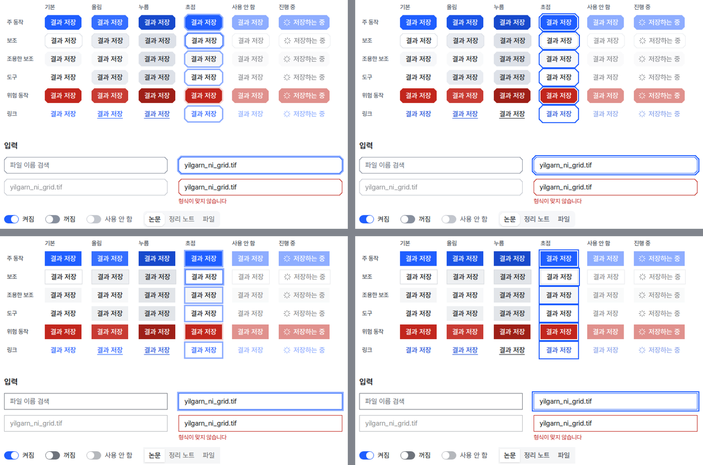
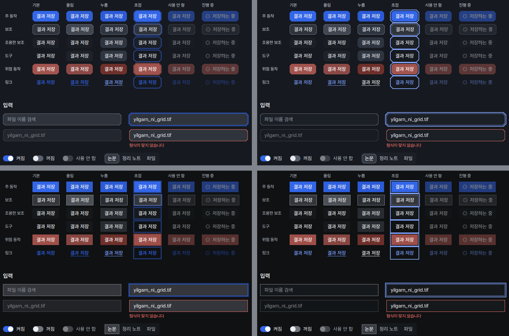
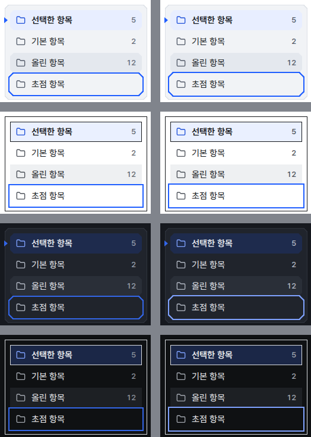

# 공용 부품 대비와 초점 고리 수정

## 0. 한눈에

| | |
|---|---|
| 요청 | UI 점검 체계가 처음 찾은 공용 부품 문제(대비 미달 다섯 곳, 초점 고리)를 다음 화면 작업 전에 고칩니다. |
| 결론 | 다섯 곳과 초점 고리를 네 조합(계측·도폭 × 밝은·어두운) 모두에서 가이드 기준에 맞췄고, 배치는 그대로 둔 채 색은 역할 토큰으로만 바꿨습니다. impeccable 결과는 7건에서 0건, axe 결과는 11건에서 0건이 되었고 shadcn 결과는 248건 그대로입니다. |
| 믿을 수 있는 정도 | 두 검사기가 서로 독립적으로 0건을 냈고, 대비 값은 견본 화면이 그 화면의 토큰으로 직접 계산합니다. 확인한 화면은 견본 화면 하나이며, 다른 PC에서는 돌리지 않았습니다. |
| 결정할 일 | 1건 (6절) |

## 1. 요청한 것

> gaid-ui-quality-kit#1 가로 진행하자. — 2026-10-24 요청

UI 점검 체계 보고서 6절의 선택지 가)입니다. 다음 화면 작업(시나리오 A, 허브 단계 도식) 전에 작은 수정 작업 하나로 공용 부품의 대비 미달 다섯 곳과 초점 고리를 고칩니다. 공용 버튼, 탭, 사이드바, 입력칸의 색 역할만 바꾸고, 부품 상태 견본 화면과 기준 화면을 함께 갱신합니다.

완료 기준: 다섯 곳과 초점 고리가 네 조합 모두에서 대비(S4)와 상태(S7) 규칙을 지키고, 점검 도구가 해결을 보여 줍니다(전후 건수). 배치는 바꾸지 않고, 특정 화면만 고치지 않으며, 색은 역할 토큰으로만 바꾸고, 두 스타일의 정체성을 지킵니다. 기준 화면을 갱신하고, 규칙 번호와 한국어 전후 화면을 보고서에 넣습니다. 점검 도구를 막는 단계로 바꿀 수 있는지 판단해 권장안을 적되, 바꾸지는 않습니다.

## 2. 수행한 것

1. 고치기 전에 점검 도구 넷을 돌려 지금 main의 결과를 남겼습니다(전).
2. 다섯 곳마다 원인이 된 색 역할을 찾아 바꿨습니다. 파란 버튼의 올림 상태에는 새 역할 하나(올린 파란 채움)를 만들었습니다.
3. 초점 고리를 반투명 3 px 고리에서 2 px 선과 2 px 간격으로 바꿨습니다. 어두운 테마에서는 고리 색을 파란 글 역할로 올렸습니다. 같은 규칙을 초점 고리를 그리는 공용 부품 전부(버튼, 입력칸, 여러 줄 입력칸, 선택 상자, 입력 묶음, 스위치, 탭, 배지, 펼침 목록, 스크롤 영역, 사이드바 항목)에 적용했습니다.
4. 견본 화면의 대비 표에 두 행(올린 주 동작 버튼 글자, 기능층 초점 고리)을 넣고, UI 가이드의 역할 표와 상태 규칙을 새 값에 맞췄습니다.
5. 기준 화면 네 장을 새로 찍고, 점검을 다시 돌려 화면 차이 0과 대비 결과 0건을 확인했습니다. 1280×800에서도 네 조합을 찍어 확인했습니다.

## 3. 결과

그림 1. 고친 뒤의 부품 상태 견본 화면. 왼쪽 위부터 계측 밝은, 계측 어두운, 도폭 밝은, 도폭 어두운입니다. 볼 것: 대비 표의 모든 행이 "통과"이고, 버튼 상태 행렬의 넷째 열(초점)에 간격을 둔 고리가 보입니다.

### 3.1 고친 곳

| 찾은 곳 | 원인 | 바꾼 것 | 대비 전 → 후 (기준) | 규칙 |
|---|---|---|---|---|
| 링크 모양 버튼의 글자 (계측·도폭 어두운) | 글자가 파란 채움 색을 씀 | 파란 글 역할로 바꿈. 누름은 본문 색과 밑줄 | 3.5, 3.8 → 7.1, 7.7 (4.5) | S1, S4 |
| 파란 버튼 올림 상태 (계측·도폭 밝은) | 채움을 90%로 옅게 함 | 올린 파란 채움 역할을 새로 만듦. 기본보다 짙고 누름보다 옅음 | 4.4 → 6.0 (4.5). 어두운 테마 5.4 | S4, S7 |
| 탭의 고르지 않은 항목 글자 (계측 밝은) | 본문 색을 60%로 옅게 함 | 보조 글 역할로 바꿈. 어두운 테마는 원래 이 역할이었음 | 4.4 → 6.5 (4.5) | S1, S4 |
| 사이드바 항목 올림 상태의 개수 글자 (계측 밝은) | 개수가 안내 글 역할을 씀 | 보조 글 역할로 바꿈 | 4.3 → 5.7 (4.5) | S4 |
| 입력칸의 안내 글 (도폭 어두운) | 어두운 테마의 입력칸 채움이 경계선 색을 30% 섞어 밝아짐 | 채움을 조용한 면 역할로 바꿈. 여러 줄 입력칸, 선택 상자, 입력 묶음도 같이 바꿈 | 3.9 → 5.7 (4.5). 계측 어두운 6.3 | S1, S4 |
| 초점 고리 (네 조합) | 3 px 두께, 50% 투명도 | 2 px 선, 2 px 간격, 불투명. 어두운 테마는 파란 글 역할 | 실제 고리 1.7–2.2 → 4.6–7.7 (3) | S4, S7, A2 |

초점 고리의 "전" 값은 반투명 고리가 실제로 그려지는 색으로 계산했습니다. 이전 보고서의 대비 표가 보인 5.1:1은 불투명한 고리 색의 값이라 실제와 달랐습니다. "후" 값은 고리 바로 옆 면(내용 면과 기능층) 기준입니다. 고리는 간격을 비워 두므로 그 아래 면이 그대로 보입니다.

그림 2. 밝은 테마의 버튼 상태 행렬, 입력칸, 스위치, 탭. 위는 계측, 아래는 도폭이고 각 줄의 왼쪽이 전, 오른쪽이 후입니다. 볼 것: 둘째 열(올림)의 파란 버튼이 기본보다 짙어졌습니다. 넷째 열(초점)의 고리가 흐린 두꺼운 테두리에서 간격을 둔 선명한 선으로 바뀌었습니다. 탭의 고르지 않은 글자가 진해졌습니다.

그림 3. 어두운 테마의 같은 부분. 위는 계측, 아래는 도폭이고 각 줄의 왼쪽이 전, 오른쪽이 후입니다. 볼 것: 맨 아래 줄(링크)의 글자가 밝은 파랑이 되었습니다. 초점 고리가 밝은 파란 선이 되어 어두운 바탕에서 보입니다. 입력칸의 채움이 바탕에 가까워져 안내 글이 또렷해졌습니다.

그림 4. 사이드바 항목. 위에서부터 계측 밝은, 도폭 밝은, 계측 어두운, 도폭 어두운이고 각 줄의 왼쪽이 전, 오른쪽이 후입니다. 볼 것: 셋째 항목(올림)의 개수 "12"가 진해졌습니다. 넷째 항목(초점)의 고리가 항목과 2 px 떨어졌습니다.

두 스타일의 정체성은 그대로입니다. 계측에서는 초점 고리도 깎은 모서리를 따르고, 도폭에서는 네모난 선으로 그려집니다. 바꾼 것은 색 역할과 고리 모양뿐이고, 부품의 크기와 배치는 같습니다. 견본 화면만 대비 표에 두 행이 늘어 아래 부분이 82 px 내려갔습니다.

### 3.2 점검 결과 전후

| 점검 | 전 | 후 | 비고 |
|---|---|---|---|
| impeccable (견본 화면 네 조합) | 7건, 모두 대비(S4) | 0건 | |
| axe 접근성 검사 (견본 화면 네 조합) | 11건, 모두 대비(S4) | 0건 | |
| 화면 비교 | 0건 | 0건 | 기준 화면을 새로 찍은 뒤 다시 돌려 차이 0 |
| shadcn 검사기 (GAID 화면 코드) | 248건 | 248건 | 이 작업은 늘리지도 줄이지도 않았습니다. 이전 보고서의 239건 이후 main에 들어온 다른 작업에서 9건이 늘었습니다 |

### 3.3 막는 단계로 바꿀 수 있는가

점검 체계의 전환 규칙은 도구마다 세 조건을 요구합니다. (1) 지금 결과를 모두 고쳤거나 받아들인 부채로 올렸다, (2) PC74와 다른 PC 한 대에서 연달아 같은 결과가 나왔다, (3) 전환을 작업 보고서에 적었다.

| 점검 | (1) 결과 정리 | (2) 두 PC에서 같은 결과 | 지금 바꿀 수 있는가 |
|---|---|---|---|
| impeccable | 충족 (0건) | PC74에서만 연달아 확인 | 아니오. 다른 PC 한 번이 남았습니다 |
| axe | 충족 (0건) | PC74에서만 연달아 확인 | 아니오. 다른 PC 한 번이 남았습니다 |
| 화면 비교 | 충족 (차이 0) | PC74에서만 확인 | 아니오. 글꼴 그리기가 PC마다 달라 다른 PC 결과가 가장 중요합니다 |
| shadcn 검사기 | 미충족 (248건, 판단이 필요한 결과가 많음) | 해당 없음 | 아니오 |

권장안은 6절에 적었습니다. 이 작업은 어떤 도구도 막는 단계로 바꾸지 않았습니다.

### 3.4 완료 기준 대조

| 완료 기준 | 결과 | 근거 |
|---|---|---|
| 다섯 곳과 초점 고리가 네 조합에서 S4/S7을 지킴, 점검 도구가 해결을 보여 줌 | 충족 | 3.1절, 3.2절 |
| 배치 변경 없음, 특정 화면만 고치지 않음, 역할 토큰으로만, 두 스타일 정체성 유지 | 충족 | 3.1절, 그림 2–4 |
| 기준 화면 갱신, 규칙 번호와 한국어 전후 화면(1440×900 네 조합, 1280×800 확인) | 충족 | 그림 1–4, 4절 |
| 전체 점검 | 충족 (통과) | 4절 |
| 막는 단계 전환 판단과 권장, 전환하지 않음 | 충족 | 3.3절, 6절 |

이 작업이 따른 규칙: S1 S4 S7 S8 A2 A7 I8 I13 V1. 어긴 규칙은 없습니다. 어두운 테마의 테두리 버튼과 고른 탭은 반투명 채움을 그대로 둡니다. 글자 대비가 기준을 넘고 이번 결과에 없었기 때문입니다.

## 4. 검증

- 과학적 검증: 해당 없음(화면 부품의 색).
- 대비 값: 견본 화면의 대비 표가 그 조합의 토큰 값으로 계산한 값과, 따로 계산한 WCAG 대비 값이 같습니다. impeccable과 axe가 그려진 화면에서 각각 0건을 냈습니다. 반복: PC74에서 기준 화면을 새로 찍은 뒤 점검 묶음 전체를 한 번, 전체 점검 안에서 한 번 더 돌렸습니다. 다른 PC는 미확인입니다.
- 화면 검증: 1440×900 네 조합을 눈으로 보고 가이드 12절 항목에 비춰 확인했습니다. 1280×800 네 조합에서는 가로로 넘치는 곳이 없고 초점 고리가 잘리지 않았습니다.
- 확인 범위: 견본 화면만 자동으로 점검합니다. 바꾼 부품은 모든 화면에 쓰이지만, 실제 화면(허브, 서재, 작업 공간)을 하나씩 찍어 보지는 않았습니다.
- 소프트웨어 검증: 전체 점검을 PC74에서 한 번에 통과했습니다. 백엔드 시험 2322개 통과(8개는 원래 건너뜀), 프런트엔드 시험 1326개 통과, 배포 점검 59개 중 58개 통과(1개 건너뜀, 실패 0), 문구·UI 검사 오류 0, 환경 점검과 운영 점검 통과입니다. 같은 실행의 점검 묶음 결과는 3.2절의 "후"와 같습니다(shadcn 248, impeccable 0, 화면 차이 0, axe 0).

## 5. 한계

- 자동 점검은 견본 화면 하나만 봅니다. 실제 화면에서 공용 부품을 덧칠한 곳(shadcn 검사기가 찾는 "부품 덧칠")은 그 색을 그대로 씁니다. 그런 곳은 이번 수정의 효과를 받지 않습니다.
- 초점 고리를 바깥에 2 px 띄워 그리므로, 넘치는 부분을 자르는 상자 안에 붙어 있는 부품은 고리가 일부 잘릴 수 있습니다. 견본 화면에서는 보이지 않았고, 실제 화면은 확인하지 않았습니다.
- 다른 PC에서 점검을 돌리지 않았습니다.

## 6. 결정할 일

1. 대비 결과가 0건이 된 impeccable과 axe를 막는 단계로 언제 바꿀까요?
   - 가) 다른 PC 한 대에서 전체 점검을 한 번 돌려 같은 결과(0건)가 나오면 두 도구를 막는 단계로 바꿉니다. 화면 비교와 shadcn 검사기는 보고만 하는 단계로 둡니다. (권장: 전환 규칙의 남은 조건 하나만 채우면 되고, 두 도구는 글꼴 차이에 덜 민감합니다. 이후 공용 부품의 대비가 다시 떨어지면 전체 점검이 바로 알립니다.)
   - 나) 지금은 모두 보고만 하는 단계로 두고, 실제 화면까지 점검 대상에 넣은 뒤 함께 바꿉니다.

## 7. 대체되었거나 실패한 시도

펼치기 — 2건

- 도폭 어두운 입력칸의 안내 글을 처음에는 안내 글 역할 자체를 밝혀 고치려 했습니다. 계산해 보니 4.5:1을 넘기려면 보조 글과 거의 같은 밝기가 되어 두 역할의 구분이 사라졌습니다. 그래서 입력칸 채움을 바꿨습니다.
- 초점 고리를 고리 그림자와 간격 색으로 그리는 방법도 검토했습니다. 이 방법은 간격 색을 정해야 해서, 부품이 기능층 위에 있으면 간격이 바탕과 다른 색으로 보입니다. 고대비 모드에서도 그려지지 않습니다. 그래서 GAID 셸 부품이 이미 쓰던 외곽선 방식으로 맞췄습니다.

## 용어

없음

## 부록 A. 근거 위치

펼치기 — 실행 방법, 원본, 해시, 커밋

| 항목 | 위치 |
|---|---|
| 토큰 | `web/src/app/globals.css`: 새 역할 `--gaid-signal-hover` (#1a54e8 / #2f60df, Tailwind `bg-gaid-signal-hover`), `.dark`의 `--ring`·`--sidebar-ring` = `--gaid-signal-ink`, 기본 외곽선 `outline-ring` (이전 `outline-ring/50`) |
| 부품 | `web/src/components/ui/{button,input,textarea,select,input-group,switch,tabs,badge,accordion,scroll-area}.tsx`, `web/src/geo/shell/sidebar.tsx`; 초점 클래스 `focus-visible:outline-2 focus-visible:outline-offset-2 focus-visible:outline-ring` (스크롤 영역은 안쪽 `-outline-offset-2`), 오류 상태 `aria-invalid:outline-destructive`, 어두운 입력 채움 `dark:bg-gaid-face-2` |
| 견본 화면 | `web/src/geo/dev/parts-page.tsx` (대비 표 `onSignalHover`, `ringChrome`), 문구 `web/src/geo/locales/devParts/{ko,en}.json` |
| 가이드 | `docs/design/ui-guide.md` 계측 토큰 표, 대비 값, S1, S7; `geo/ui/ui-rules.json` `tokens.colour.roles` (`signalHover`, `signalPressed`, `onSignal`) |
| 기준 화면 | `geo/ui/quality/baseline/parts-*.png` (갱신) |
| 실행 | `node geo/ui/quality/run.mjs --out <dir>`; 기준 화면 갱신 `--only visual --update-baseline`; 전체 점검 `scripts/check` |
| 점검 결과 원본 | `pc74:~/data/geoaidesk/work/gaid-ui-shared-contrast/before/` (전), `after1/` (고친 뒤 기준 화면 갱신 전, 화면 차이 4), `update/` (기준 화면 갱신), `after2/` (후); 각 폴더의 `summary.json` |
| 1280×800 확인 화면 | `pc74:~/data/geoaidesk/work/gaid-ui-shared-contrast/shots/` (`scripts/shots.mjs`) |
| 그림 | `figures/*.png`는 이전 기준 화면(`baseline-before/`)과 새 기준 화면을 잘라 붙인 것 (`scripts/figures.py`) |
| 전체 점검 기록 | `pc74:~/data/geoaidesk/work/gaid-ui-shared-contrast/check.log` |

작성 시점: 2026-10-24, 작업 브랜치 `task/gaid-ui-shared-contrast`.

