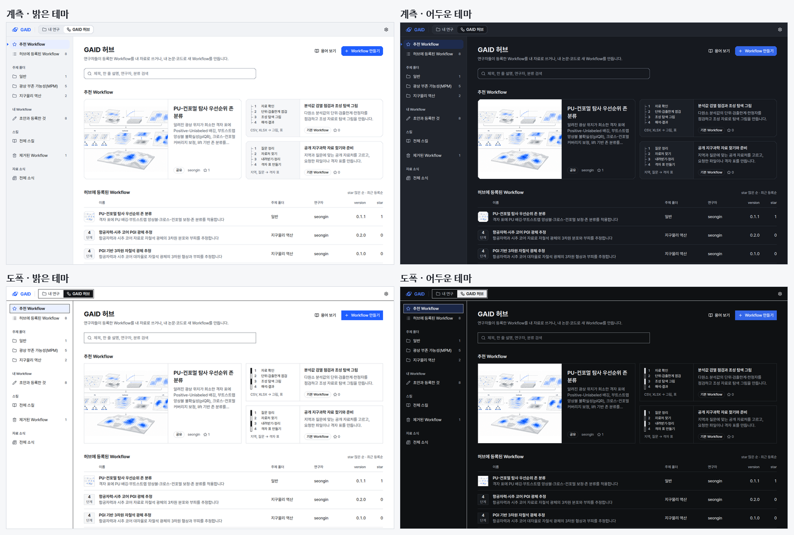
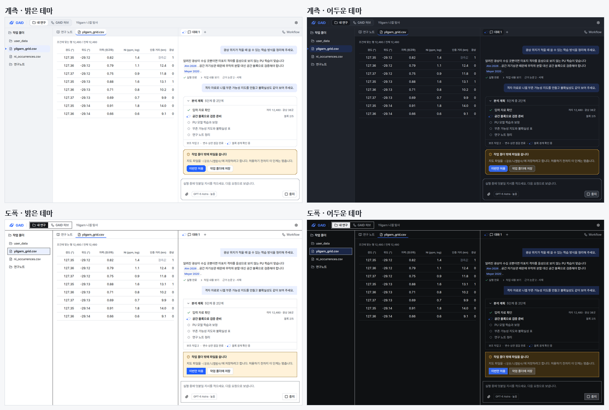
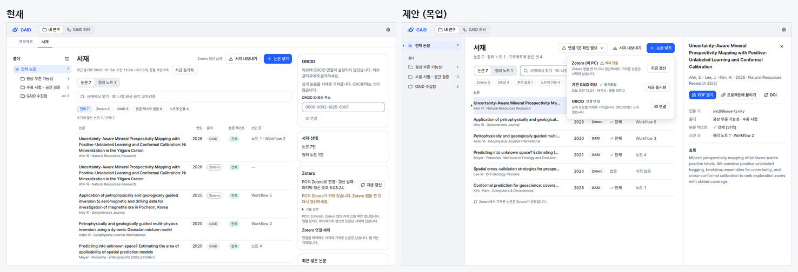
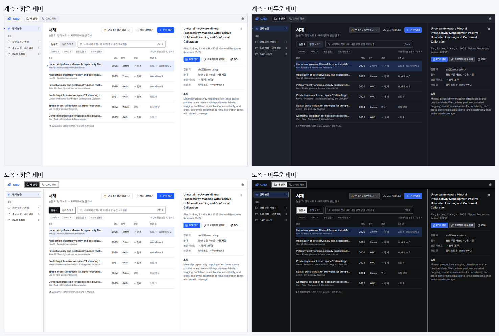
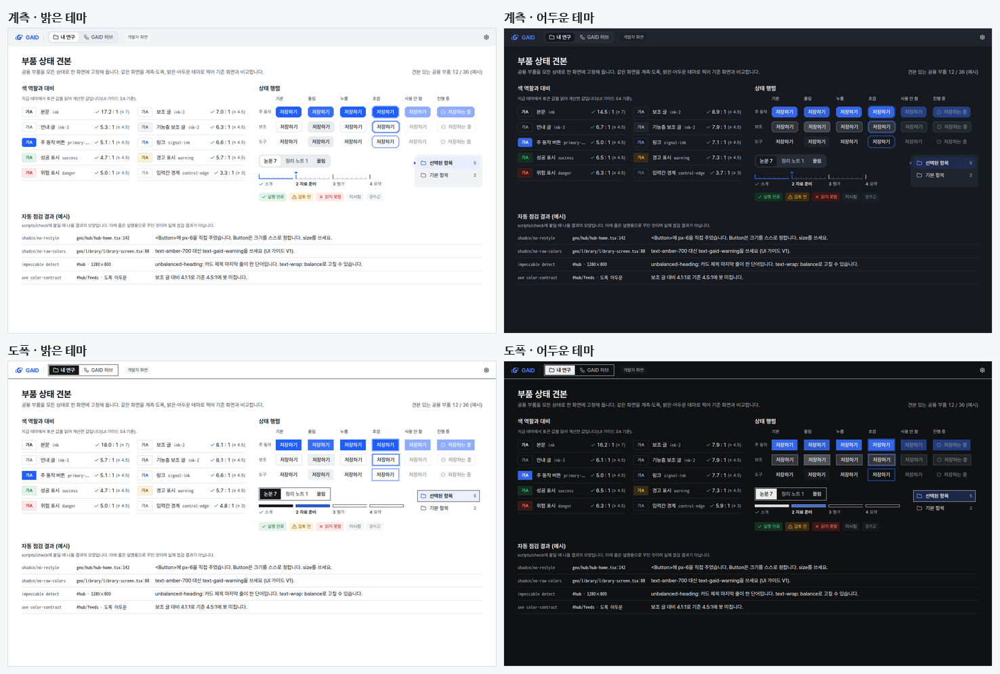

# 최신 UI/UX 스킬·템플릿 조사와 지금 디자인 안에서 할 수 있는 개선 시나리오 4가지

## 0. 한눈에

| | |
|---|---|
| 요청 | Opus 5.5 출시 이후 주목받는 UI/UX 스킬과 shadcn 템플릿을 조사하고, 이미지 생성 없이 지금 시스템에서 구현할 수 있는 시나리오를 목업으로 보여 줍니다. |
| 결론 | impeccable(4.3.1 → 4.7.0)과 taste-skill(1판 → 2.1.4)은 앱 화면을 그림 시안 대신 코드로 만들고 실제 화면을 검사하는 쪽으로 바뀌었습니다. shadcn은 디자인 규칙을 코드에서 잡는 검사기와 AI agent 화면 부품을 새로 냈습니다. 이를 쓰는 시나리오 4가지를 실제 GAID 토큰과 부품으로 그렸고, 네 가지 화면 조합 모두에서 그대로 그려졌습니다. |
| 믿을 수 있는 정도 | 스킬과 shadcn의 버전·날짜는 GitHub에서 직접 확인했습니다. Opus 5.5 출시일, skills.sh 순위, shadcnblocks 신규 블록과 라이선스는 웹 조사 결과를 옮긴 것으로 직접 확인하지 못했습니다. 목업은 그린 화면이며 실제 앱에 구현하지 않았습니다. |
| 결정할 일 | 없음 (6절의 2건은 2026-10-24에 답함: 모두 권장) |

## 1. 요청한 것

> 다음으로는 opus 5.5출시 이후 UI UX와 관련하여 impeccable 과 taste의 업데이트를 포함하여 더 주목받고 있는 스킬이 있는지 조사하였으면한다. Shadcnblock에서도 템플릿도 더 추가되었을수 있다. 이유는 지난 에셋 생성작업에서 이미지를 생성하니 현재 시스템디자인과 어긋난 에셋을 생성하고 테스트하는데 많은시간이 소요되었다. 해당사례를 조심하면서 현재시스템에서 개선된 ui ux를 구현할수 있게하는 최신기술들을 조사하고 적용한다면 구현가능한 시나리오를 목업들로 제공하여 사용자와 논의했으면한다. — 2026-10-24 요청

완료 기준: 날짜와 출처를 붙인 조사, 후보마다 GAID에 맞는 정도(개선할 화면, UI 가이드 v2와 부딪히는 점, 작업량, 위험), 코드로 그린 시나리오 목업 3~5개(계측·도폭, 밝은·어두운 테마, 1440×900, 한국어). 앱 코드는 바꾸지 않고, 구현은 사용자가 고른 뒤 따로 진행합니다.

## 2. 수행한 것

1. impeccable, taste-skill, shadcn의 변경 내역을 GitHub에서 직접 읽었습니다. 웹 조사(Oracle, Extra High)로 다른 주목받는 스킬, shadcnblocks와 다른 shadcn 부품 모음, 이미지 없이 화면 품질을 올리는 검사 도구를 찾았습니다.
2. 후보마다 GAID의 어느 화면을 좋게 하는지, UI 가이드 v2의 어느 규칙과 부딪히는지, 라이선스가 공개 저장소에 맞는지 따졌습니다(3.1절).
3. 지난 그림 작업의 교훈에 따라 목업에는 그림을 새로 만들지 않았습니다. 별도 목업 앱이 이 작업 사본의 실제 토큰 파일, shadcn 부품, GAID 공용 부품(앱 바, 사이드바, 단계 눈금)을 그대로 가져와 그립니다. 그래서 목업의 색, 서체, 모서리, 선택 표시는 앱과 같습니다.
4. 시나리오 4가지를 네 조합(계측·도폭 × 밝은·어두운 테마, 1440×900)으로 찍고, 1280×800에서도 한 번씩 찍어 잘리는 곳을 고쳤습니다.

## 3. 결과

### 3.1 조사 결과

Opus 5.5 출시일은 웹 조사 결과 2026년 9월 22일입니다(Anthropic 발표, 직접 확인 못 함). 그 뒤의 변화만 정리합니다.

#### GAID가 쓰는 디자인 스킬

| 스킬 | 우리 사본 | 최신 (GitHub 확인) | 바뀐 것 중 GAID에 중요한 것 |
|---|---|---|---|
| impeccable | 4.3.1 (9월 9일) | 4.7.0 (10월 19일) | 4.5.2: 앱 화면과 문서는 그림 시안을 건너뛰고 코드로 만듭니다. 블라인드 평가에서 같은 요청의 그림 시안이 코드 화면보다 점수가 크게 낮았기 때문입니다. 4.5.0: 작업 화면은 익숙한 조작부를 지키고 "고유한 세부 하나"만 더합니다. 4.6~4.7: 실제 화면 검사기의 오탐이 줄고 제목·문단 끝 한 단어 검사가 생겼으며, 원격 사용 통계를 끌 수 있습니다. |
| taste-skill (design-taste-frontend) | 1판 (랜딩 페이지 전용) | 2.1.4 (10월 20일) | 2.1: 대시보드와 앱 화면을 따로 다루고, 빈·로딩·오류 상태와 실제 화면 검사를 넣었습니다. 기존 화면 개편 절차가 합쳐져 "먼저 지금 화면을 찍고 기술·내용을 지킨 채 바꾼다"를 따릅니다. 그림 생성 스킬은 별도 저장소로 분리됐습니다. 고유 화풍(새 팔레트·서체)은 GAID 토큰과 부딪힙니다. |
| brand-guide | 별도 사본 없음 | 해당 없음 | Anthropic의 brand-guidelines는 Anthropic 색과 서체를 정하는 스킬이라 GAID에 쓰지 않습니다. GAID 브랜드 기준은 UI 가이드 v2 2절과 로고 안내서가 계속 맡습니다. |

두 스킬은 지난 그림 작업에서 겪은 문제를 피하는 쪽으로 바뀌었습니다. 작업 화면은 그림 시안 대신 코드로 만들고, 지금 화면을 먼저 기준으로 삼습니다.

#### shadcn과 부품 모음

| 후보 | 무엇 | 날짜·라이선스 | GAID 판단 |
|---|---|---|---|
| shadcn 검사기(shadcn lint) | 디자인 규칙을 코드에서 검사합니다. 임의 색, 부품 위에 덧칠한 크기·간격을 잡고 고칠 방법을 알려 줍니다. | 9월 2일 공개, 10월 19일 갱신 · MIT | 채택 후보. GAID 금지 규칙(V1 색 직접 쓰기)과 겹치는 부분을 맞춰 붙입니다. |
| shadcn AI Elements, Trace, Code Block | AI agent 화면 부품 21가지(계획, 작업, 도구 실행, 보조 agent, 확인 요청, 인용, 체크포인트 등). | 10월 14일 · MIT | 채택 후보. 실행 중 표시가 반짝이는 글자 효과(shimmer)라 GAID의 궤도 표시로 바꿔야 합니다(I4, V3). |
| shadcn 스킬의 디자인 시스템 페이지 | 부품을 모든 상태로 고정해 한 화면에 보여 주고 색 대비를 계산합니다. | 10월 9일 · MIT | 채택 후보(시나리오 D). |
| shadcn 새 기본 부품(Empty, Item, Kbd, Skeleton) | 빈 상태, 목록 항목, 단축키 표시, 로딩 자리. GAID에는 아직 없습니다. | MIT | 목업에서 GAID 토큰으로 그대로 그려졌습니다. |
| shadcnblocks.com | 9월 29일 블록 139개 추가(프로젝트 목록·상세, 대시보드, 앱 틀 등). 주요 신규 블록은 Pro(유료). | 웹 조사 결과, 직접 확인 못 함 | 쓰지 않습니다. 유료 라이선스는 공개 GitHub 저장소에 그 코드와 실질적 변형을 올리는 것을 막습니다. GAID는 공개 저장소입니다. 무료 블록은 허용되지만 이번 시나리오에 필요한 것이 없습니다. |
| ReUI | 자료 표, 필터, 단계, 파일 올리기 부품. 기본 부품 MIT, Pro 블록 유료. | 2.8.1, 10월 15일 (웹 조사) | 나중 후보. 표 화면(X1~X5)을 다룰 때 무료 부품만 따로 검토합니다. |
| Magic UI | 움직임·시각 효과 부품. | MIT | 쓰지 않습니다. 장식 움직임은 M3, V3와 부딪힙니다. |

#### 다른 주목받는 스킬과 검사 도구

| 후보 | GAID 판단 |
|---|---|
| Anthropic frontend-design (skills.sh 누적 설치 13위, 웹 조사) | 일반 디자인 지침입니다. impeccable과 겹치고 9월 22일 뒤 변경은 확인하지 못했습니다. 따로 들이지 않습니다. |
| Vercel web-design-guidelines (77위권) | 실행할 때마다 규칙 파일을 raw.githubusercontent.com에서 받습니다. KIGAM망에서 막히고 규칙 버전이 고정되지 않아 쓰지 않습니다. |
| ui-ux-pro-max | 마지막 기능 릴리스가 8월 13일이라 이번 기간의 새 기능이 없습니다. |
| OpenAI 스킬 모음 | 6월 22일부터 폐기된 저장소입니다. 새 모음의 화면 만들기 스킬은 그림 생성 중심이라 이번 목적과 맞지 않습니다. |
| Playwright 화면 비교, axe 접근성 검사 | 채택 후보(시나리오 D). 네 조합 화면을 기준 화면과 비교하고 대비·이름 없는 버튼을 자동으로 찾습니다. |

### 3.2 시나리오 목업

네 시나리오 모두 새 그림 없이 지금 토큰과 부품으로 그렸습니다. 화면 속 논문·자료·문구는 목업용 예시입니다.

#### A. 허브: 그림 없는 Workflow 카드에 그 Workflow의 분석 단계 그리기

그림 1. 허브 첫 화면(계측, 밝은 테마). 볼 것: 지금은 그림이 없는 기본 Workflow 카드에 제목 낱말로 고른 플라스크·원통 아이콘이 들어갑니다. 제안은 그 자리에 Workflow가 가진 분석 단계(1 자료 확인 → 4 해석·결과)와 입력·결과 형식을 글자로 그립니다. 목록 줄의 같은 아이콘은 단계 수로 바꿨습니다. 개념 그림이 있는 Workflow는 지금처럼 그 그림을 씁니다.

그림 2. 같은 제안을 네 조합으로 그린 화면. 볼 것: 계측에서는 눈금자, 도폭에서는 칸이 번갈아 칠해진 축척 막대로 단계가 그려집니다. 부품은 스타일을 나누지 않고 역할 토큰만 씁니다.

- 쓰는 것: impeccable 4.5의 "작업 화면에는 고유한 세부 하나"와 4.5.2의 "앱 화면은 코드로". Workflow 지침의 단계 목록에 이미 있는 자료로 그리므로 새 그림이 필요 없습니다.
- 구현: 추천 카드 자료에 단계 이름과 입력·결과 형식을 더하고 카드 그림 자리 부품을 바꿉니다. 작업량은 작습니다.
- 위험: UI 가이드 I10은 "눈금은 위치를 보일 때만 쓴다"고 합니다. 단계 순서를 눈금으로 보이는 것이 이 규칙 안에 드는지 정해야 합니다. 안 든다면 계측에서는 번호 목록만 씁니다. 이전 형식 Workflow는 단계가 많을 수 있어 4개까지 보이고 "외 n"을 붙입니다.

#### B. 채팅: AI agent가 하는 일을 분석 계획으로 보여 주기

그림 3. 분석 중인 AI agent 창. 볼 것: 지금은 실행 중에 "분석 실행 · n분째 실행 중" 접힌 줄 하나가 보이고, 펼치면 명령·입력·출력 같은 작업 기록이 나옵니다. 제안은 5단계 계획에 지금 단계(궤도 표시와 "블록 2/5"), 보조 작업 상태, 작업 폴더 밖에 쓸 때의 확인 요청을 한 자리에 보이고, 앞선 답의 인용은 서재 논문으로 이어지는 표시로 둡니다.

- 쓰는 것: shadcn AI Elements의 계획(Plan), 작업(Task), 보조 agent(Subagent), 확인 요청(Confirmation), 인용(Inline citation) 부품 구조. 실행 중 반짝이는 글자 효과는 쓰지 않고 GAID 궤도 표시로 바꿉니다.
- 구현: 지금 실행 신호에는 "계획"이 없습니다. Workflow로 시작한 채팅은 Workflow 단계를, 그 밖의 채팅은 AI agent가 계획을 알리는 방식을 새로 정해야 합니다. 확인 요청은 이미 있는 권한 요청 신호를 대화 안 카드로 옮깁니다. 작업량은 큽니다(실행 신호와 화면 둘 다).
- 위험: AI agent가 알린 계획과 실제 실행이 어긋날 수 있습니다. 계획 줄은 관찰한 작업과 대조해 보여 줘야 하고, 도구 이름은 보이지 않아야 합니다(R1). 덧붙여, 지금 작업 기록 부품은 뇌·마법봉 모양 아이콘을 씁니다. V2(AI풍 아이콘 금지) 위반인지 확인이 필요합니다.

#### C. 서재: 오른쪽 상태 카드 세 장을 머리의 버튼 하나로 모으기

그림 4. 서재 논문 목록(계측, 밝은 테마). 볼 것: 지금은 오른쪽에 ORCID, 서재 상태, Zotero, 최근 넣은 논문 카드가 쌓여 첫 화면 글이 많고, 같은 Zotero 실패가 머리와 카드에 두 번 나옵니다. 제안은 연결 상태를 "연결 1곳 확인 필요" 버튼 하나로 모으고(눌렀을 때 펼친 모습), 오른쪽 자리는 고른 논문의 상세가 씁니다.

그림 5. 같은 제안(팝오버를 닫은 기본 모습)을 네 조합으로 그린 화면. 볼 것: 목록과 상세가 나란히 놓이고(P4), 검색칸에 단축키 표시가 붙습니다.

- 쓰는 것: impeccable의 점검·덜어내기(audit, distill)와 taste 2.1의 "지금 화면을 먼저 찍고 내용을 지킨 채 바꾸기". shadcn Kbd, Item 부품.
- 구현: 서재 화면의 배치와 상태 팝오버를 바꿉니다. 서버는 바꾸지 않습니다. 작업량은 중간입니다.
- 위험: 처음 쓰는 연구자가 Zotero·ORCID 연결을 찾기 어려워질 수 있습니다. 연결이 하나도 없을 때는 빈 서재 화면이 연결 방법을 한 줄로 안내해야 합니다(F4).

#### D. 점검 체계: 부품 상태 견본과 자동 점검

그림 6. 개발자용 부품 상태 견본 화면(연구자에게는 보이지 않음). 볼 것: 지금 테마의 토큰 값으로 색 대비를 계산하고, 버튼을 기본·올림·누름·초점·사용 안 함·진행 중 상태로 고정해 나란히 보입니다. 아래 점검 결과 줄은 모양을 보이려고 꾸민 예시이며 실제 점검 결과가 아닙니다.

- 쓰는 것: shadcn 스킬의 상태 고정 방식(버튼을 누르지 않아도 누름 모양을 보이게 하는 CSS 규칙), shadcn 검사기, impeccable 화면 검사기, Playwright 화면 비교, axe 접근성 검사.
- 견본을 그리는 동안 실제 문제 두 가지가 바로 드러났습니다. 첫째, UI 가이드 S1은 파란 버튼 위 글자 색을 on-signal 역할로 적지만 토큰 파일에는 그 변수가 없습니다(실제 버튼은 다른 이름의 흰색 변수를 씁니다). 둘째, 공용 버튼 부품에 누름 상태 모양이 없어 눌러도 기본 모양과 같습니다. S7은 누름 상태를 요구합니다.
- 구현: 견본 화면을 개발 모드에서만 열리게 두고, 네 조합 화면 비교와 검사기를 전체 점검에 "보고만 하는" 단계로 먼저 붙인 뒤, 오탐을 정리하고 막는 단계로 바꿉니다. 작업량은 중간입니다.
- 위험: 화면 비교는 서체·자료·브라우저가 바뀌면 오탐이 납니다. 고정 자료와 고정 서체로 찍어야 합니다.

### 3.3 완료 기준 대조

| 완료 기준 | 결과 | 근거 |
|---|---|---|
| 날짜·출처를 붙인 조사, 확인 못 한 것 표시 | 충족 | 3.1절, 부록 A |
| 후보별 개선 화면, 가이드 충돌, 작업량, 위험 | 충족 | 3.1절 표, 3.2절 각 시나리오 |
| 코드로 그린 시나리오 3~5개, 네 조합, 1440×900, 한국어 | 충족 (4개) | 그림 1~6 |
| 이미지 생성 없음, 앱 코드 변경 없음 | 충족 | 목업은 저장소 밖에서 그렸고, 새 그림은 없습니다(A의 개념 그림은 지금 허브 화면에서 잘라 온 기존 그림) |
| 사용자에게 고를 시나리오 묻기 | 6절 | 6절 |

## 4. 검증

- 과학적 검증: 해당 없음(조사와 화면 목업).
- 조사: impeccable, taste-skill, shadcn, shadcn 검사기의 버전·날짜·라이선스는 GitHub에서 직접 읽었습니다. Opus 5.5 출시일, skills.sh 순위, shadcnblocks 신규 블록과 라이선스 조항, ReUI 버전은 웹 조사 결과이며 직접 확인하지 못했습니다(shadcnblocks 변경 내역 페이지는 스크립트로만 내용을 보여 읽지 못했습니다).
- 목업: 이 작업 사본의 실제 토큰 파일과 부품을 불러 그렸으므로 색·서체·모서리·선택 표시는 앱과 같습니다. 네 조합 1440×900과 계측 밝은 테마 1280×800을 눈으로 확인했습니다. 목업 코드는 저장소 밖에 있어 UI 점검 스크립트(check-ui)를 돌리지 않았습니다.
- 소프트웨어 검증: 앱 코드를 바꾸지 않았으므로 앱 시험은 돌리지 않았습니다.

## 5. 한계

- 목업은 화면 모양만 보입니다. B의 계획 표시는 실행 신호가 없어 지금 앱에서 바로 만들 수 없고, 신호 설계가 먼저 필요합니다.
- 화면 개선 효과(찾는 시간, 읽는 양)는 재지 않았습니다. 3.2절의 개선은 가이드 규칙에 비춘 판단입니다.
- 작업량은 크기 등급(작음·중간·큼)만 적었습니다. 시간은 추정하지 않았습니다.
- 스킬은 설치하지 않고 읽기만 했습니다. 목업 앱에 shadcn 부품 4개(Empty, Item, Kbd, Skeleton)의 원본 코드를 내려받아 썼으며, 이는 작업 폴더 안에만 있습니다.

## 6. 결정할 일

사용자 답(2026-10-24): "모두 권장으로 진행하자." 두 결정 모두 가)로 정했고, 구현은 별도 작업으로 진행합니다.

1. 어떤 시나리오를 구현 작업으로 진행할까요?
   - 가) D(점검 체계)를 먼저 하고, 이어서 A(허브 단계 도식)와 C(서재 정리)를 진행합니다. B(채팅 계획)는 실행 신호 설계부터 따로 논의합니다. (권장: D가 앞으로의 화면 변경을 네 조합에서 자동으로 잡아 지난번 같은 긴 수동 확인을 줄입니다. A와 C는 서버 변경이 거의 없고 작업량이 작거나 중간입니다.)
   - 나) A, B, C, D를 모두 순서대로 진행합니다.
   - 다) 고른 시나리오만 진행합니다(직접 지정).
2. 디자인 스킬 사본을 최신으로 바꿀까요?
   - 가) impeccable 4.7.0과 taste-skill 2.1.4를 읽기용 사본으로 바꾸고, 원격 사용 통계는 끈 상태로 씁니다. 설치는 하지 않습니다. (권장: 두 판 모두 앱 화면을 코드로 만들고 실제 화면을 검사하는 쪽으로 바뀌어, 지난 그림 작업의 문제를 피하는 방향과 맞습니다.)
   - 나) 지금 사본(4.3.1, taste 1판)을 그대로 둡니다.

## 7. 대체되었거나 실패한 시도

펼치기 — 2건

- 허브 목록 줄의 아이콘 자리에 짧은 선을 쌓아 단계 수를 그렸더니 계측에서 메뉴 아이콘(≡)처럼 보였습니다. 숫자와 "단계" 글자로 바꿨습니다.
- 대비 표가 처음에 파란 버튼 글자를 3.4:1로 계산했습니다. 가이드가 적은 on-signal 변수가 토큰 파일에 없어 빈 값을 읽었기 때문입니다. 실제 버튼이 쓰는 변수로 바꾸자 5.1:1로 가이드 값과 맞았습니다. 이 어긋남은 3.2절 D에 적었습니다.

## 용어

없음

## 부록 A. 근거 위치

펼치기 — 실행 방법, 원본, 해시, 출처

| 항목 | 위치 |
|---|---|
| 웹 조사 기록 | Obsidian `웹 조사/geoaidesk/2026-10-24-gaid-geoaidesk-kigam-research-geoaidesk--6d00d3a41c.md` (Oracle 세션 `gaid-geoaidesk-kigam-research-geoaidesk`, Extra High, 2026-10-24) |
| 변경 내역 원문 | `pc74:~/data/geoaidesk/work/gaid-uiux-skills-scan/{impeccable,taste,shadcn}-releases.md` (`gh api repos/<owner>/<repo>/releases`) |
| 목업 원본 화면 | `pc74:~/data/geoaidesk/work/gaid-uiux-skills-scan/shots/*.png` (22장), 해시 목록 `shots.sha256` |
| 목업 코드 | `pc74:~/data/geoaidesk/work/gaid-uiux-skills-scan/mockups-src.tgz` · sha256 809c4112a6561500bd0e81b8b0e22383fe1cdb2d14eba0db9a76a12a8c7b31ac |
| 목업 실행 | `mockups/`에서 Vite 7 개발 서버(127.0.0.1:5391), 장면 `?s=hub-flow|chat-plan|library-distill|states-kit`, `&style=mapsheet`, `&theme=dark`; 캡처 `cap.sh <장면>`, 합성 `montage.py` |
| 현재 화면 비교 기준 | `pc74:~/data/geoaidesk/work/gaid-ui-audit/shots/after/{hub-home,library-papers}-instrument-light-1440.png` (gaid-ui-audit, 2026-10-24) |

출처(직접 확인):

- impeccable 릴리스: https://github.com/pbakaus/impeccable/releases (skill-v4.4.0 2026-10-01 ~ skill-v4.7.0 2026-10-19, Apache-2.0)
- taste-skill 릴리스: https://github.com/Leonxlnx/taste-skill/releases (v2.0.0 2026-10-13 ~ v2.1.4 2026-10-20, MIT)
- shadcn CLI 4.22.1 (2026-10-18): https://github.com/shadcn-ui/ui/releases ; AI Elements·Trace·Code Block PR #12307 (2026-10-14); shadcn 스킬 디자인 시스템 페이지 PR #12252 (2026-10-09)
- shadcn 검사기: https://github.com/shadcn-ui/lint (2026-09-02 생성, 2026-10-19 갱신, MIT)

출처(웹 조사, 직접 확인 못 함): Anthropic Opus 5.5 발표(2026-09-22), https://www.skills.sh/ 순위(2026-10-24 조회), https://www.shadcnblocks.com/changelog · /license · /terms, https://reui.io/docs/changelog, https://github.com/vercel-labs/agent-skills, https://github.com/openai/plugins.

작성 시점: 2026-10-24, commit 10ee8e6d.

