# 보고서 목록

<!-- backbone:reports-index: generated by task complete from reports/<folder>/index.md frontmatter; do not edit. -->

각 보고서의 frontmatter에서 자동으로 만든 목록입니다. 보고서 형식은 backbone templates/report.md를 따릅니다.
같은 날짜 안에서는 main에 들어온 시각이 늦은 보고서가 위에 옵니다. "검토"는 사용자가 hub에서 항목에 답했거나 `<보고서 폴더> 검토함`이라고 알린 보고서를 표시합니다.

| 그림 | 날짜 | 보고서 | 한 줄 결론 | 검토 | 결론 상태 | 결정할 일 |
|---|---|---|---|---|---|---|
| — | 2026-10-24 18:00 | [Workflow 저작 토큰 사용량을 CLI와 비교하고 줄임](2026-10-24-gaid-authoring-tokens/index.md) | 같은 논문으로 Workflow 초안 하나를 만들 때 GAID 허브 저작이 읽은 토큰은 Codex CLI의 7%였지만, 캐시를 쓰지 못해 정가 비용은 Codex CLI보다 23% 많았습니다($0.74 대 $0.60). 캐시를 쓰고 수정 호출에서 바뀐 부분만 받게 고쳐 $0.50이 되었습니다. | 검토 전 | 미정 | 0 |
| 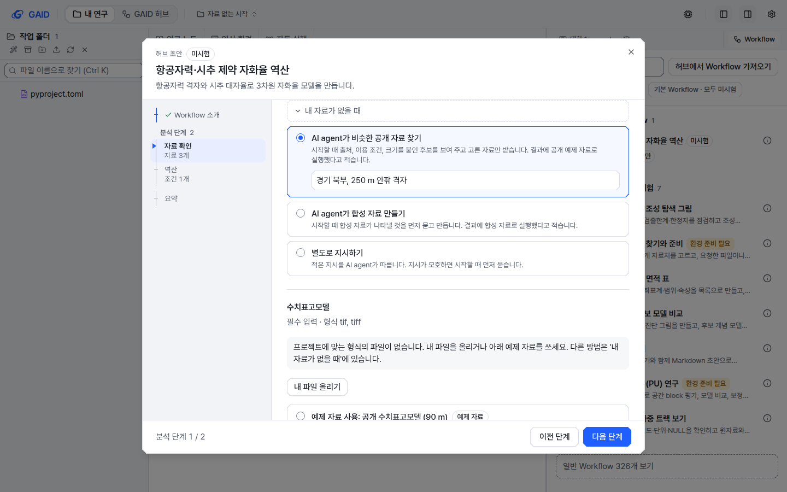 | 2026-10-24 17:45 | [입력 자료가 없을 때 AI agent가 자료를 마련하는 세 가지 방법](2026-10-24-gaid-input-fallback/index.md) | Workflow 시작 설정에서 자료가 없는 입력마다 비슷한 공개 자료 찾기, 합성 자료 만들기, 별도 지시 가운데 하나를 고를 수 있고, AI agent는 첫 단계 전에 연구자에게 물은 뒤 자료를 마련합니다. | 검토 전 | 미정 | 0 |
| 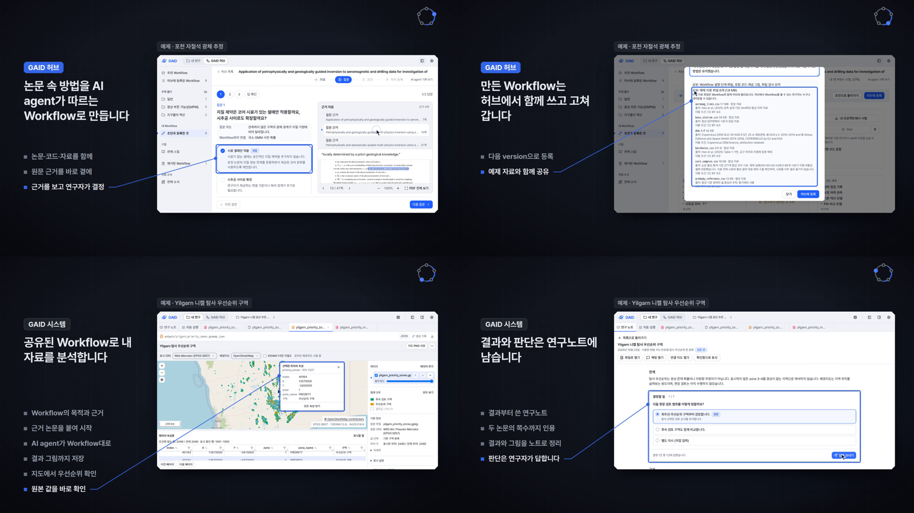 | 2026-10-24 17:17 | [GAID 홍보 영상 lemo판: v4 메시지를 발표 영상 스타일로 다시 만든 103초 영상과 40초 영상 (내부 검토용, 음악·효과음)](2026-10-24-gaid-promo-video-v4-lemo/index.md) | lemo-opuscar의 Dark Tech Keynote 스타일로 v4와 같은 메시지를 담은 103초 영상과 40초 영상을 만들었습니다. 103초판은 박스가 화면 속 포인터를 따라가고, 기능 설명을 16개로 합쳐 천천히 보여 주며, AI agent가 실제로 작업하는 장면을 새로 촬영해 넣었습니다. GAID 허브(Workflow를 만들고 공유)와 GAID 시스템(Workflow를 설치하고 AI agent와 분석)을 한 플랫폼의 두 부분으로, 내 서재를 연구자 개인의 문헌 공간으로 소개합니다. | 검토 전 | 미정 | 0 |
| 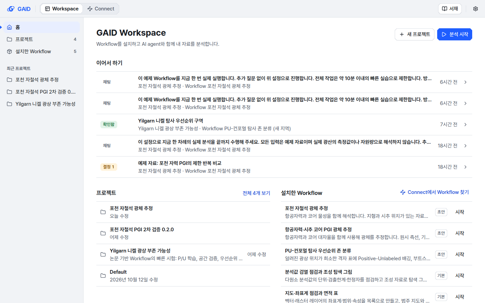 | 2026-10-24 16:22 | [GAID Connect와 GAID Workspace로 나눈 화면 구조](2026-10-24-gaid-ia-connect-workspace/index.md) | 앱 바를 Workspace와 Connect 두 장소로 바꾸고 서재를 개인 공간으로 뺐습니다. 승인한 시안대로 실제 화면에 적용했습니다. | 검토 전 | 미정 | 0 |
| — | 2026-10-24 14:40 | [impeccable·axe 점검을 막는 단계로 전환](2026-10-24-gaid-ui-checks-blocking/index.md) | PC70에서 돌린 전체 점검이 PC74와 같은 결과(impeccable 0건, axe 0건, 화면 차이 0건, shadcn 248건)를 내서, impeccable과 axe를 막는 단계로 바꿨습니다. 이제 공용 부품에 새 결과가 생기면 전체 점검이 실패하고 부품 상태 견본 화면을 가리킵니다. | 검토 전 | 미정 | 0 |
| 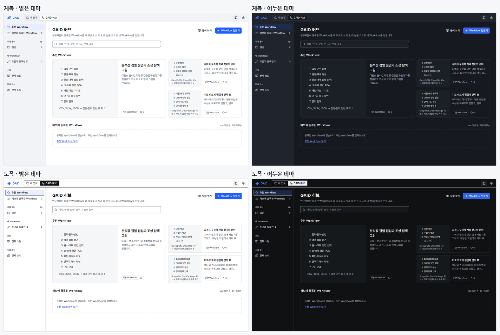 | 2026-10-24 14:16 | [허브 카드에 Workflow의 분석 단계 그리기](2026-10-24-gaid-hub-stage-cards/index.md) | 개념 그림이 없는 허브 카드는 제목으로 고른 아이콘 대신 그 Workflow의 분석 단계와 입력·결과를 보이고, 목록 줄은 단계 수를 보입니다. | 검토 전 | 미정 | 0 |
| 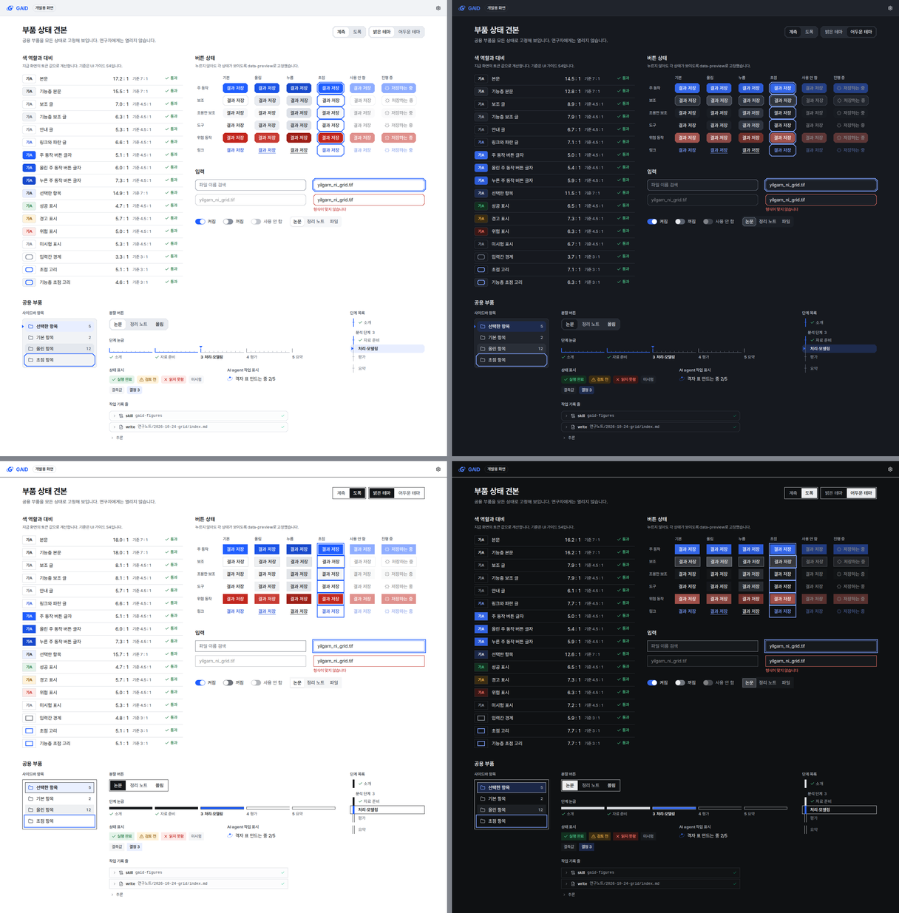 | 2026-10-24 13:38 | [공용 부품 대비와 초점 고리 수정](2026-10-24-gaid-ui-shared-contrast/index.md) | 공용 버튼·탭·사이드바·입력칸의 대비 미달 다섯 곳과 초점 고리를 색 역할만 바꿔 고쳤습니다. 네 화면 조합에서 impeccable 대비 결과가 7건에서 0건, axe 결과가 11건에서 0건이 되었습니다. | 검토함 10-24 | 채택 | 1 |
| 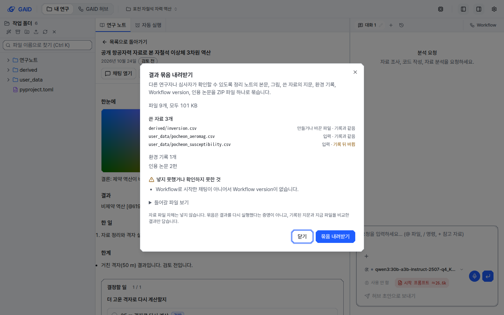 | 2026-10-24 13:01 | [정리 노트 결과 묶음, 공개 자료 내보내기, Gemini Notebook 링크](2026-10-24-gaid-note-bundle-export/index.md) | 정리 노트 하나를 근거째 ZIP으로 내려받을 수 있고, Gemini Notebook에 올릴 파일은 파일마다 반출 확인을 받아 따로 묶습니다. 서재 폴더와 프로젝트에는 관련 노트북 주소를 저장해 열 수 있습니다. | 검토 전 | 미정 | 0 |
| 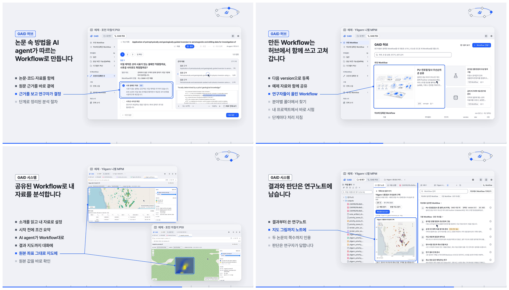 | 2026-10-24 12:41 | [GAID 홍보 영상 v5(93초, 두 예제와 창 배치)와 45초 제품 영상 (내부 검토용)](2026-10-24-gaid-promo-video-v5/index.md) | v5는 포천 PGI와 Yilgarn 니켈 예제를 장면마다 골라 쓰고, 실제 화면을 왼쪽 설명 열과 연결선으로 이어진 창으로 넣었으며, 강조 상자는 모두 화면 요소를 통째로 감쌉니다. 따로 만든 45초 제품 영상은 실제 화면 없이 한 연구자의 하루를 그림과 음악으로 보여 줍니다. | 검토 전 | 미정 | 0 |
| 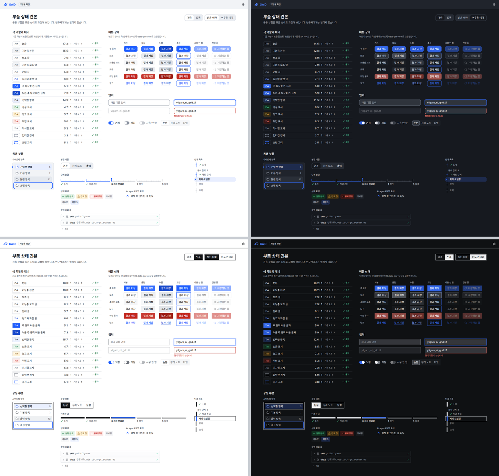 | 2026-10-24 12:26 | [UI 점검 체계: 부품 상태 견본과 네 화면 조합 자동 점검](2026-10-24-gaid-ui-quality-kit/index.md) | 공용 부품을 모든 상태로 고정한 개발자용 견본 화면과, 그 화면을 계측·도폭 × 밝은·어두운 테마로 찍어 비교하고 검사기 셋을 돌리는 점검을 전체 점검에 붙였습니다. 첫 실행에서 공용 부품의 대비 미달 다섯 곳을 찾았습니다. | 검토함 10-24 | 채택 | 1 |
| 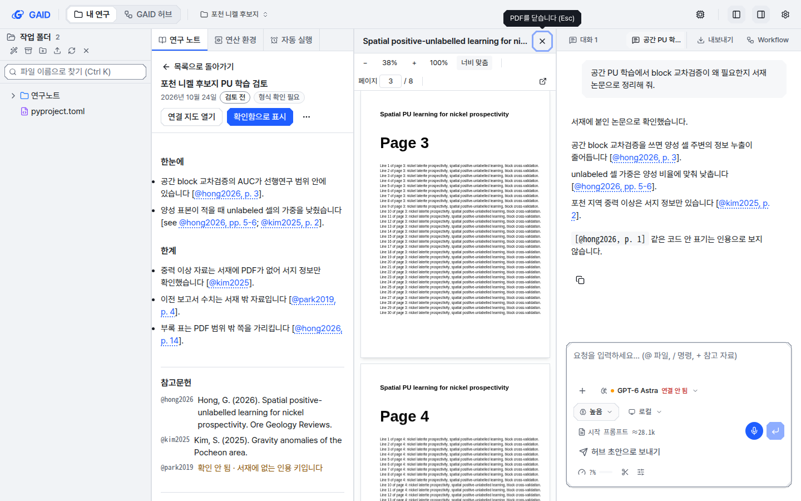 | 2026-10-24 11:56 | [인용을 눌러 PDF 쪽 열기](2026-10-24-gaid-cite-open-pdf/index.md) | 채팅 답변과 연구 노트의 서재 인용을 누르면 옆 PDF 패널에서 인용한 쪽이 열립니다. 열 수 없는 인용은 이유를 바로 옆에 보여 줍니다. | 검토 전 | 미정 | 0 |
| 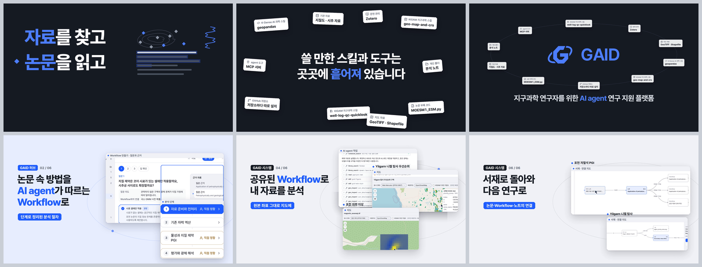 | 2026-10-24 11:44 | [GAID 홍보 영상 v4_brag: brag 스킬로 만든 소리 있는 영상 두 편 (101초 재편집판, 40초 홍보판; 내부 검토용)](2026-10-24-gaid-promo-video-v4-brag/index.md) | brag 스킬로 소리가 있는 홍보 영상 두 편을 만들었습니다. 101초판은 v4의 장면을 100 BPM 박자에 맞춰 다시 자른 영상이고, 40초판은 같은 메시지를 큰 글자와 모션그래픽으로 새로 만든 홍보형 영상입니다. 40초판에서는 포천 PGI와 Yilgarn 니켈 두 예제의 실제 화면이 창 요소로 나옵니다. 음악과 효과음은 코드로 합성했고 내레이션은 없습니다. | 검토 전 | 미정 | 0 |
| 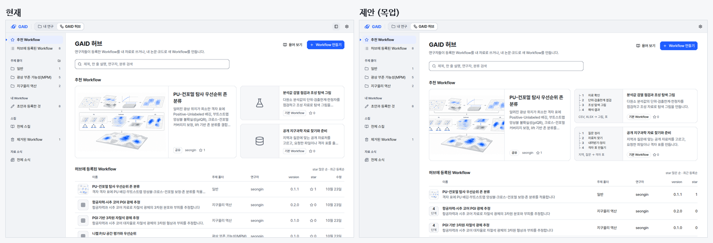 | 2026-10-24 11:00 | [최신 UI/UX 스킬·템플릿 조사와 지금 디자인 안에서 할 수 있는 개선 시나리오 4가지](2026-10-24-gaid-uiux-skills-scan/index.md) | Opus 5.5 이후 impeccable은 4.7.0, taste-skill은 2.1.4로 바뀌었고 둘 다 앱 화면을 그림 대신 코드로 만들고 실제 화면을 검사하는 쪽으로 갔습니다. 이를 바탕으로 이미지 없이 지금 토큰과 부품만으로 그린 개선 시나리오 4가지를 목업으로 만들었습니다. | 검토 전 | 미정 | 0 |
| — | 2026-10-24 10:32 | [GAID와 Gemini Notebook(구 NotebookLM) 비교, 차별화와 연계 제안](2026-10-24-gaid-notebooklm-review/index.md) | Gemini Notebook은 문헌 이해와 설명 자료 만들기에서 GAID보다 앞서고, 이제 코드도 실행합니다. GAID가 앞서는 곳은 기관 안에서 지구과학 자료를 다루고, 방법을 Workflow로 공유하며, 분석 기록을 남기는 일입니다. 우선 인용을 눌러 PDF 쪽을 여는 기능과 노트 결과 묶음을 만들고, 연계는 링크 저장과 공개 자료 내보내기부터 하기를 권합니다. | 검토함 10-24 | 채택 | 2 |
| 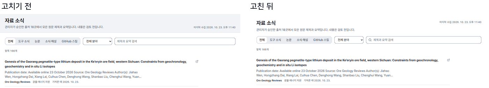 | 2026-10-24 01:19 | [10월 22~23일에 바뀐 화면을 UI 가이드 v2로 점검하고 고침](2026-10-24-gaid-ui-audit/index.md) | 22~23일 작업으로 바뀐 화면 30여 개를 두 스타일·두 테마·두 창 크기로 찍어 가이드와 대조했습니다. 위반 31건 가운데 26건을 고쳤고, 남은 5건은 다듬기 수준이라 목록으로 남겼습니다. | 검토 전 | 미정 | 0 |
| 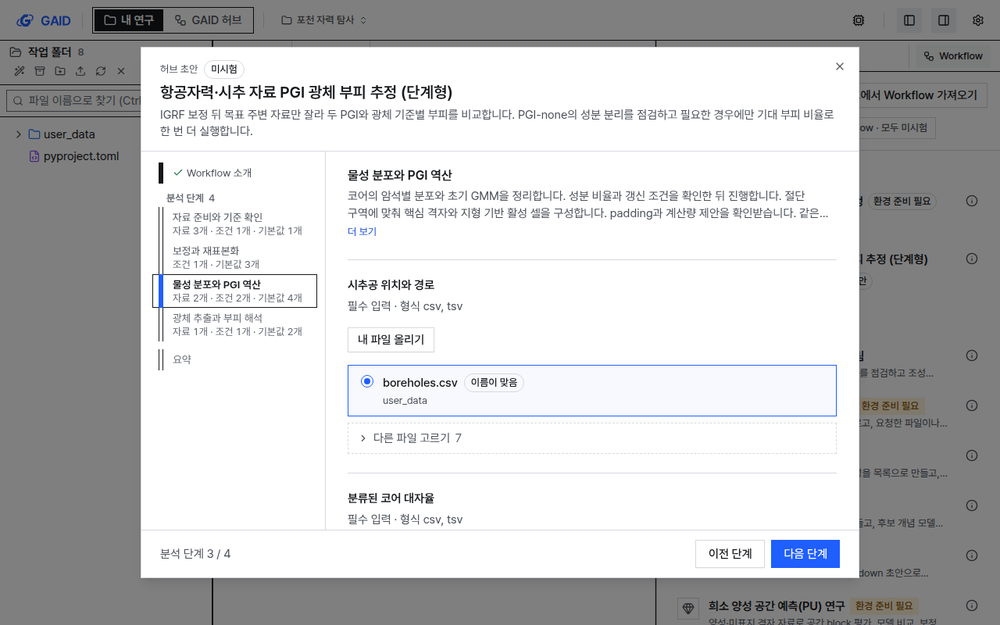 | 2026-10-23 | [Workflow를 분석 흐름 단계로 나누고 시작 창 단계를 7칸 이하로 줄임](2026-10-23-gaid-workflow-stages/index.md) | Workflow는 이제 자료 준비 → 처리·모델링 → 평가 → 해석처럼 분석 흐름에 따라 3~5단계로 만들어지고, 시작 창은 소개·단계·요약을 7칸 이하로 보입니다. 포천 Workflow는 23칸에서 다시 만든 초안 기준 7칸이 되었습니다. | 검토 전 | 미정 | 0 |
| 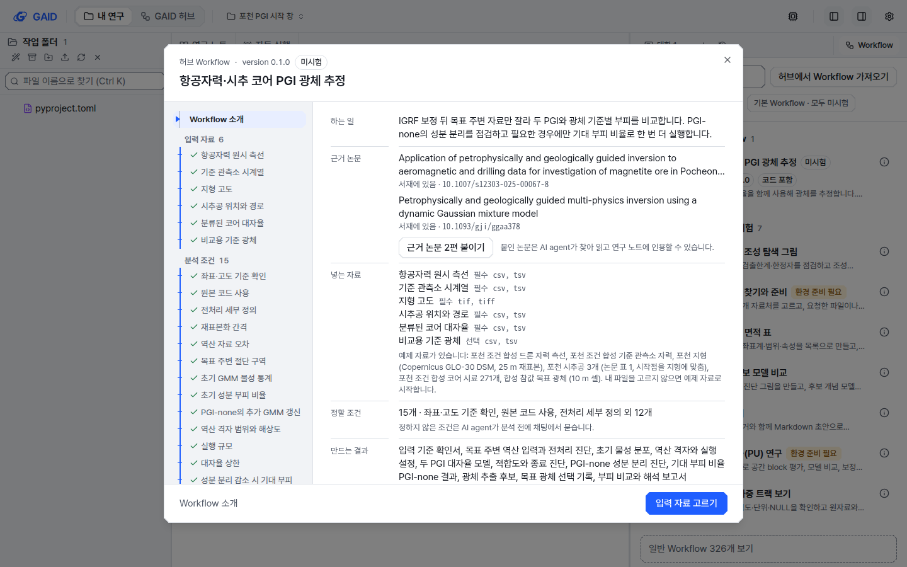 | 2026-10-23 23:31 | [Workflow의 근거 논문을 프로젝트 인용 범위에 붙여 서재·Workflow·노트를 잇기](2026-10-23-gaid-workflow-cite-scope/index.md) | 허브 Workflow를 시작할 때 근거 논문을 연구자 동의를 받아 인용 범위에 붙이고, 노트가 그 논문을 인용해 서재에서 논문·Workflow·노트가 서로 이어집니다. 허브 등록 창은 함께 공유되는 예제 자료를 파일별로 보여 줍니다. | 검토 전 | 미정 | 0 |
| 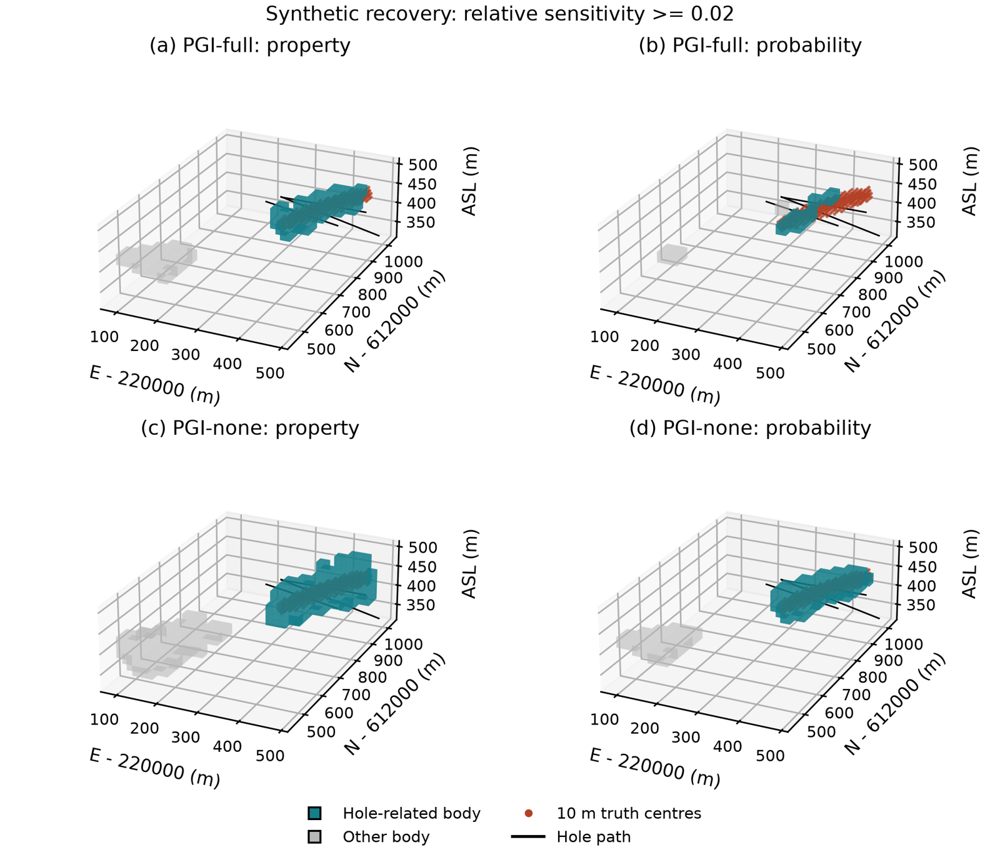 | 2026-10-23 20:56 | [포천 자철석 PGI 논문으로 해 본 GAID 연구 흐름 실전 검증](2026-10-23-gaid-pocheon-trial/index.md) | 서재의 논문에서 Workflow를 만들어 허브에 등록하고, 예제 자료로 논문 수준의 PGI 분석과 연구 노트를 만든 뒤 노트를 서재로 가져오는 흐름이 실제 앱에서 이어졌습니다. 그 과정에서 찾은 문제 23건 가운데 13건을 이 작업에서 고쳤고 4건은 다른 단위가 해소했습니다. | 검토함 10-23 | 채택 | 1 |
| 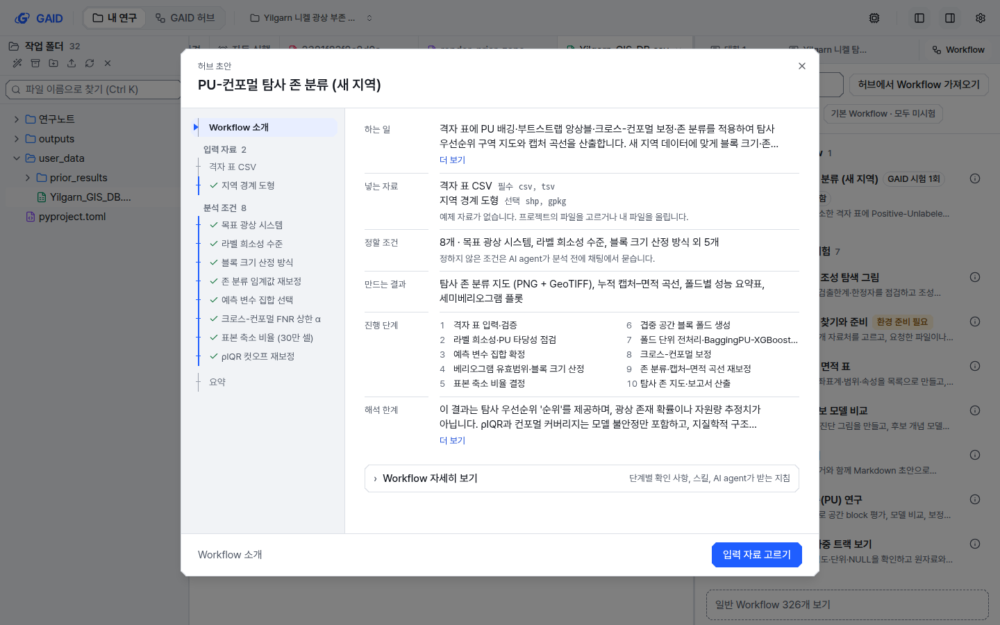 | 2026-10-23 18:58 | [모든 Workflow를 같은 시작 창으로 열고 먼저 무엇을 하는지 보여 주기](2026-10-23-gaid-workflow-start-ui/index.md) | 기본·허브·일반 Workflow가 모두 같은 시작 창으로 열리고, 자료를 묻기 전에 하는 일·넣는 자료·만드는 결과·진행 단계·해석 한계를 먼저 보여 줍니다. | 검토 전 | 미정 | 0 |
| 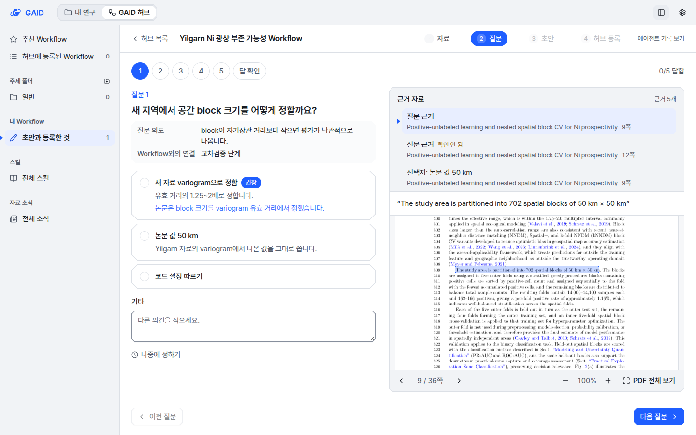 | 2026-10-23 17:53 | [Workflow 만들기 질문 옆에 논문 해당 부분과 근거 자료 보기](2026-10-23-gaid-authoring-evidence-view/index.md) | GAID 허브에서 Workflow를 만들 때 질문마다 옆 뷰어에 근거가 된 논문 쪽과 코드 줄, 자료 파일 요약이 열리고, 선택지를 고르면 그 선택지의 근거로 이동합니다. | 검토 전 | 미정 | 0 |
| 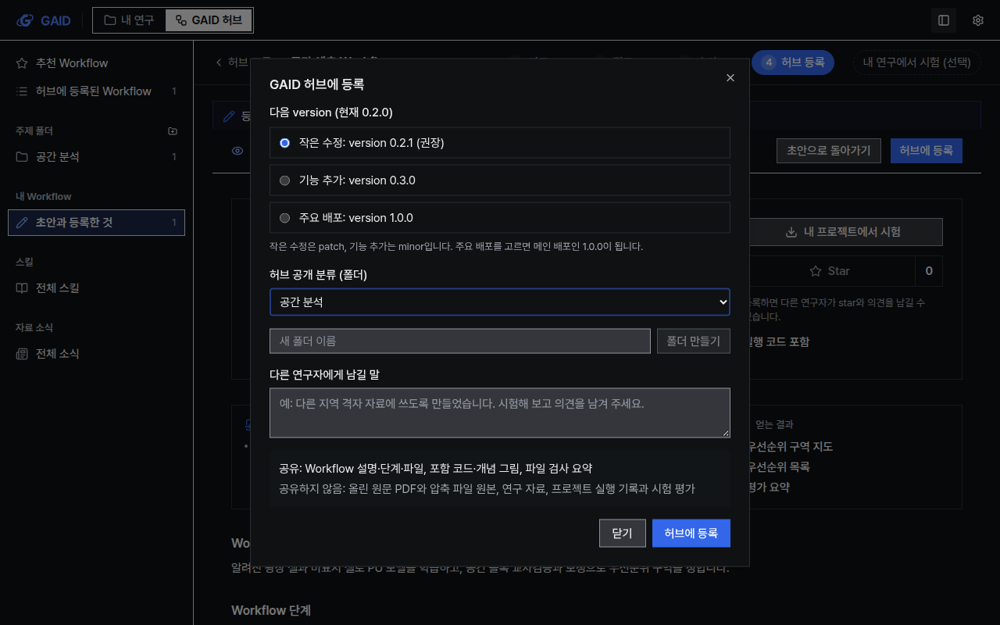 | 2026-10-23 17:25 | [GAID 허브 Workflow 제거·복원과 version 관리](2026-10-23-gaid-hub-versions/index.md) | 등록한 Workflow를 허브에서 제거하고 다시 복원할 수 있습니다. 다시 등록할 때는 등록한 연구자가 다음 version(patch·minor·major)을 고릅니다. | 검토 전 | 미정 | 0 |
| 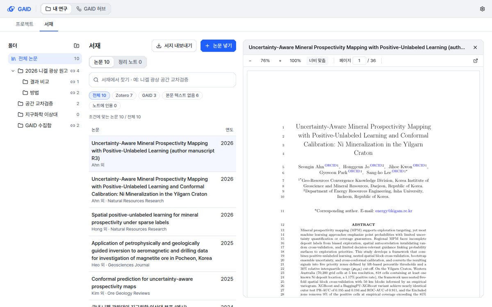 | 2026-10-23 17:14 | [서재 PDF를 목록 옆 패널에서 보기](2026-10-23-gaid-library-pdf-panel/index.md) | 서재에서 "PDF 열기"를 누르면 새 브라우저 탭 대신 목록 옆 패널에 PDF가 열리고, 닫으면 논문 상세로 돌아옵니다. | 검토 전 | 미정 | 0 |
| 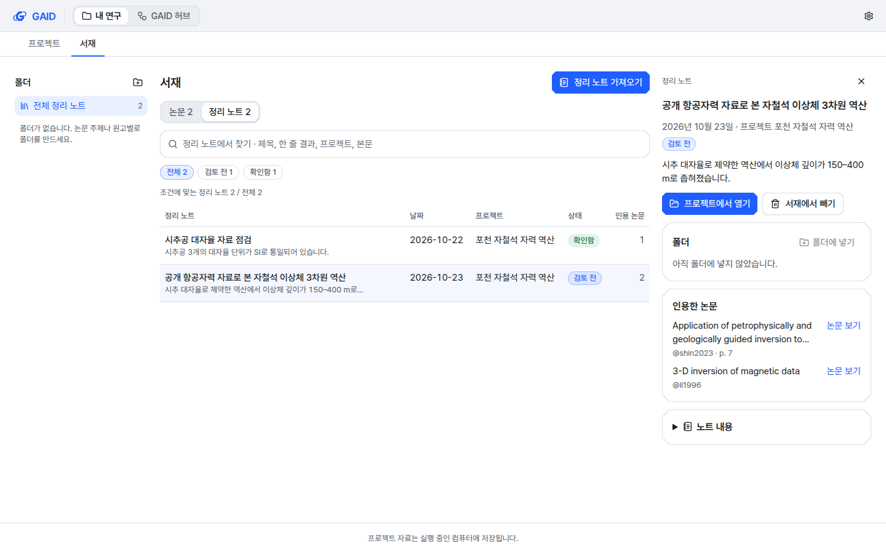 | 2026-10-23 16:35 | [정리 노트를 서재에 넣고 다시 프로젝트에서 열기](2026-10-23-gaid-note-library/index.md) | 정리 노트를 논문과 따로 나뉜 종류로 서재에 넣고, 폴더에 넣고, 프로젝트에서 다시 열 수 있습니다. 노트 파일이 원본입니다. | 검토 전 | 미정 | 0 |
| 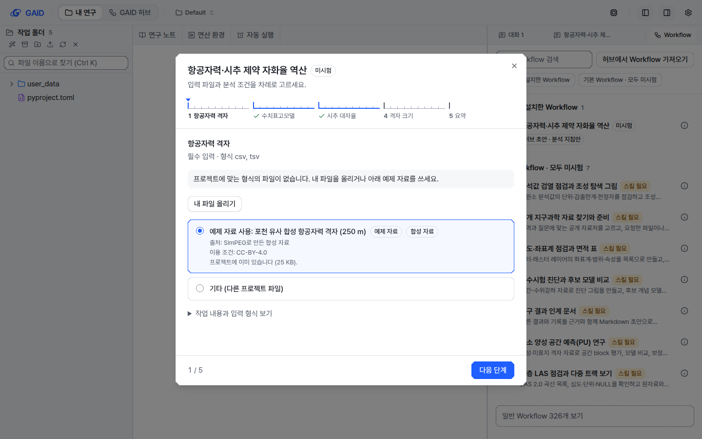 | 2026-10-23 16:25 | [Workflow 예제 자료, 내 자료가 없어도 분석 시작하기](2026-10-23-gaid-workflow-example/index.md) | Workflow가 입력마다 예제 자료를 함께 제공하고, 연구자가 자기 파일을 고르지 않으면 예제 자료로 분석을 시작하며 그 사실을 지침과 채팅에 적습니다. | 검토 전 | 미정 | 0 |
| 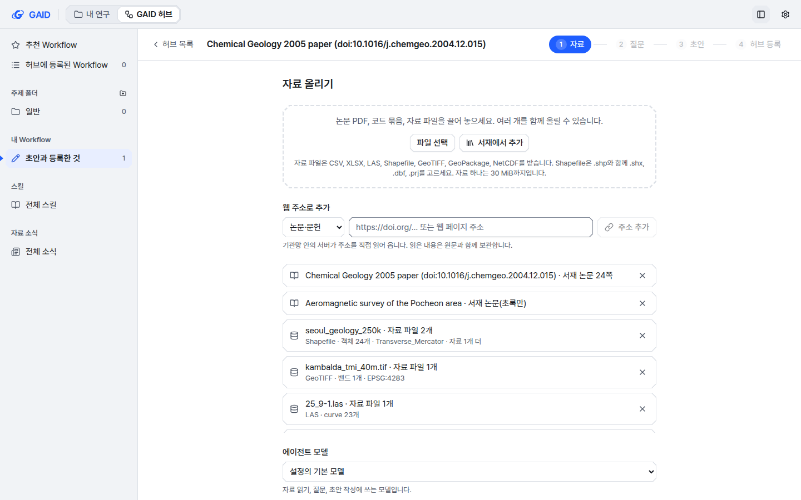 | 2026-10-23 15:56 | [Workflow 만들기에 여러 자료와 자료 파일, 서재 논문, 연구 노트 넣기](2026-10-23-gaid-authoring-sources/index.md) | GAID 허브의 Workflow 만들기가 자료 파일, 서재 논문, 연구 노트를 여러 개 함께 받고, AI agent는 자료 파일을 GAID 자료 검사 요약으로 읽습니다. | 검토 전 | 미정 | 0 |
| 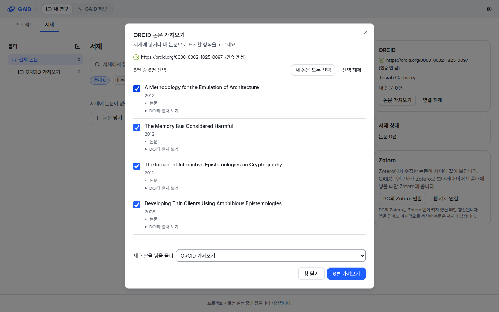 | 2026-10-22 | [ORCID 연결, 내 논문 가져오기, 본인 확인](2026-10-22-gaid-orcid/index.md) | 서재에서 ORCID 공개 논문을 골라 "내 논문"으로 넣고, 기관 허브 계정으로 ORCID 본인 확인을 마친 iD를 허브 Workflow 작성자 옆에 표시합니다. 실제 ORCID로 끝까지 확인했습니다. | 검토 전 | 미정 | 0 |
|  | 2026-10-22 | [GAID 허브 자료 소식: 관리자가 승인한 출처의 논문·도구·스킬 소식](2026-10-22-gaid-hub-feeds/index.md) | 기관 허브 서버가 관리자가 승인한 출처 18곳을 6시간마다 읽고, 연구자는 GAID 허브의 "자료 소식"에서 원문 제목과 피드 요약을 봅니다. 기관 허브 서버를 이번 변경으로 갱신하고 출처를 승인하는 일이 남았습니다. | 검토함 10-23 | 채택 | 1 |
|  | 2026-10-22 22:13 | [처음 쓰는 연구자가 막힌 화면 문제 8건 수정](2026-10-22-gaid-first-use-fixes/index.md) | 수용 시험에서 처음 쓰는 연구자가 막힌 화면 문제 8건의 원인을 찾아 고쳤고, 7건은 실제 앱 화면에서, 같은 이름 모델 1건은 시험 앱의 모델 목록을 넣은 자동 시험으로 확인했습니다. | 검토 전 | 미정 | 0 |
|  | 2026-10-22 19:17 | [GAID를 처음 쓰는 연구자 역할의 수용 시험](2026-10-22-gaid-user-acceptance/index.md) | 서재 쪽 인용, 저널 그림, ChatGPT 로그인·개인 API 키 경로는 통과했고, Zotero 웹 서재 시험은 저장된 웹 키를 Zotero가 거부해 막혔습니다. | 검토함 10-22 | 채택 | 1 |
| — | 2026-10-22 18:45 | [기관 GAID 허브 서버 시험 운영 시작: 고정 서비스, 허브 스킬 공유, HTTPS 준비](2026-10-22-gaid-hub-server-trial/index.md) | PC74에서 기관 GAID 허브 서버가 고정 서비스로 돌고, 관리자 계정과 Workflow 5건이 올라갔으며, 허브 스킬도 서버로 공유됩니다. HTTPS는 준비해 두었고 시험 그룹을 넓히기 전에 켭니다. | 검토 전 | 미정 | 0 |
|  | 2026-10-22 18:32 | [서재 논문에서 여는 연결 지도, AGU·자원환경지질 그림 요건](2026-10-22-gaid-visuals-next/index.md) | 서재의 논문에서 그 논문을 쓴 프로젝트를 골라 연결 지도를 열 수 있습니다. AGU와 자원환경지질의 그림 요건은 공식 페이지에서 읽은 값만 그림 스킬에 넣었습니다. | 검토 전 | 미정 | 0 |
|  | 2026-10-22 16:46 | [Zotero 웹 키 갱신 실패 원인과 상태 표시 수정](2026-10-22-gaid-zotero-web-fix/index.md) | 웹 키 갱신이 매번 실패하던 원인(Zotero 웹 API 응답 차이)을 고쳤고, 서재 머리글과 Zotero 카드가 같은 상태와 실제 원인을 보여 줍니다. | 검토함 10-22 | 미정 | 0 |
|  | 2026-10-22 16:37 | [GAID 공유 백엔드: 계정과 원내 GAID 허브 서버](2026-10-22-gaid-backend/index.md) | 원내 GAID 허브 서버가 생겼습니다. 연구자는 초대 코드로 계정을 만들어 Workflow를 공유하고, 개인 서재를 여러 PC에서 동기화합니다. | 검토함 10-22 | 채택 | 1 |
|  | 2026-10-22 16:24 | [GAID 허브에 스킬 선반을 만들고 Workflow가 스킬의 판을 고정해 쓰게 함](2026-10-22-gaid-hub-skills/index.md) | GAID 허브에 스킬 선반을 만들었습니다. 연구자는 내 프로젝트의 스킬, 허브 Workflow에 딸린 스킬, GitHub 등의 스킬을 판마다 사본으로 올리고, 출처·라이선스·자동 검사·검토 기록을 본 뒤 프로젝트에 설치합니다. Workflow는 허브 스킬의 판을 고정해 쓰고, Workflow를 설치하면 그 판도 함께 설치됩니다. | 검토함 10-22 | 미정 | 0 |
|  | 2026-10-22 14:19 | [지도·표 위 Workflow 제안 칸을 한 줄로 접기](2026-10-22-gaid-workflow-strip/index.md) | 지도·표처럼 높이가 필요한 파일을 열면 Workflow 제안 칸이 한 줄로 접혀, 1280×800에서 지도와 속성표 영역이 127 px 커졌습니다. | 검토 전 | 미정 | 0 |
|  | 2026-10-22 14:09 | [Workflow 상세의 시험 기록과 허브 검사를 연구자용 요약으로 정리](2026-10-22-gaid-workflow-detail/index.md) | 허브에서 설치한 Workflow의 상세 창이 시험 결과와 허브 검사를 연구자 말로 요약하고, 원래 기록은 기록 보기 안에 그대로 둡니다. | 검토 전 | 미정 | 0 |
|  | 2026-10-22 13:12 | [GAID 허브 상세 화면에도 같은 사이드바 두기](2026-10-22-gaid-hub-layout/index.md) | 허브의 모든 화면(추천·등록·기본 Workflow 상세, 내 Workflow, 작성 중 Workflow)에 같은 왼쪽 사이드바가 남고, 상세 화면에서는 들어온 목록이 표시됩니다. | 검토 전 | 미정 | 0 |
|  | 2026-10-22 12:06 | [UI 가이드 v2 부채 네 건 처리 (지도 화면, 작업 공간 레이아웃, 결정 카드, 서재 배지)](2026-10-22-gaid-ui-v2-debts/index.md) | 지도 화면을 MAP 규칙대로 다시 짰고, 좁은 창의 대화 시트와 키보드 조작, 보낸 결정 답 표시, 서재 배지 역할 색을 넣었습니다. | 검토함 10-22 | 채택 | 1 |
|  | 2026-10-22 11:55 | [개념 그림을 밝은 화면용과 어두운 화면용 두 장으로 만들기](2026-10-22-gaid-concept-pictures/index.md) | 개념 그림마다 밝은 화면용과 어두운 화면용 두 장을 만들고, 화면 테마에 맞는 쪽을 그림 칸과 같은 바탕색으로 보여 줍니다. | 검토 전 | 미정 | 0 |
|  | 2026-10-22 10:48 | [GAID UI/UX 가이드 v2: 계측 기본 디자인과 도폭 선택 스타일](2026-10-21-gaid-design-identity/index.md) | One UI와 Apple HIG로 다시 쓴 가이드 v2를 적용해, GAID 허브와 작업 공간이 로고에서 끌어낸 계측 디자인(기본)과 설정에서 고르는 도폭 스타일로 바뀌었습니다. | 검토함 10-22 | 미정 | 0 |
|  | 2026-10-21 | [분석 결과를 논문 그림으로, 연구 연결을 지도로: 그림 기록·저널 그림 점검·연결 지도](2026-10-21-gaid-research-visuals/index.md) | 정리 노트의 그림마다 만든 스크립트·자료·채팅과 바뀐 여부가 보이고, 목표 저널의 폭·해상도·글자·색·AI 그림 정책으로 점검하며, 논문·노트·그림·자료 사이의 연결을 지도로 봅니다. | 검토함 10-22 | 미정 | 0 |
|  | 2026-10-21 | [서재 남은 항목 세 가지: 실제 모델의 쪽 인용 확인, 문헌 스킬 배포, Better BibTeX 상태](2026-10-21-gaid-library-next/index.md) | 기관 Qwen이 서재의 실제 논문 4편에서 쪽 근거를 찾아 인용했고, 확인한 인용 34개가 모두 맞았습니다. 문헌 스킬 4개를 넣은 카탈로그 0.3.0을 GAID 안에서 만들어 고정했습니다. Better BibTeX는 Zotero 10 조건이 풀리지 않아 기다립니다. | 검토함 10-22 | 미정 | 0 |
|  | 2026-10-21 23:35 | [GAID 서재 폴더와 Zotero 보내기](2026-10-21-gaid-library-folders/index.md) | 서재에 주제·원고별 하위 폴더가 생겼고, 폴더 단위로 참고문헌을 내보내고 점검하며, GAID 논문과 폴더를 PDF와 함께 Zotero로 중복 없이 보냅니다. | 검토함 10-21 | 미정 | 1 |
|  | 2026-10-21 21:37 | [논문 수집에서 연구노트·Workflow까지 잇는 GAID 서재: 설계와 1단계 구현](2026-10-21-gaid-research-hub/index.md) | Zotero와 이어지고 PDF만으로도 쓰는 하이브리드 서재를 "내 연구"에 만들었고, 서재 논문을 에이전트 근거 답변·연구노트 참고문헌·허브 Workflow 제작에 연결했습니다. | 검토함 10-21 | 미정 | 0 |
|  | 2026-10-20 | [GAID를 Workflow 중심으로 정리하고 Workflow를 지침 문서로 AI agent에게 보냄](2026-10-20-gaid-workflow-model/index.md) | GAID의 허브 단위와 Workflow 패널의 줄을 모두 Workflow로 부르고, Workflow를 단계·사용 스킬·결과가 적힌 하나의 지침 문서로 AI agent에게 보냅니다. 허브와 프로젝트에서 보는 지침이 곧 채팅에 가는 글이며, 기관 Qwen 실제 대화에서 AI agent가 지침대로 스킬 지침부터 읽고 1단계를 수행했습니다. | 검토함 10-22 | 미정 | 0 |
|  | 2026-10-20 18:55 | [GAID 허브 개선: 방법 고치기, 답 다시 고르기, 허브 연동, 개념 그림](2026-10-20-gaid-hub-editing/index.md) | 등록한 방법을 새 판으로 고치거나 복사해 고칠 수 있고, 답한 질문을 다시 고를 수 있으며, 레시피·스킬을 GAID 허브에서 찾고 개념 그림을 한 장씩 다시 만들 수 있습니다. | 검토함 10-20 | 채택 | 1 |
|  | 2026-10-20 18:20 | [연구 노트의 결정할 일을 한 번에 답하기](2026-10-20-gaid-note-decisions/index.md) | 연구 노트의 결정할 일에서 결정마다 답을 고르거나 별도 지시를 쓴 뒤, "답변 보내기"를 한 번 누르면 모든 답이 노트를 쓴 채팅에 메시지 하나로 전송됩니다. | 검토 전 | 미정 | 0 |
| — | 2026-10-18 21:43 | [GAID 연구노트를 합니다체로 고정](2026-10-18-gaid-note-style/index.md) | 노트 지시에 한국어 노트는 합니다체로 쓰라는 한 문장을 넣었습니다. 기관 Qwen으로 같은 분석을 다시 돌리자 노트 전체가 합니다체로 나왔습니다. | 검토 전 | 미정 | 0 |
| — | 2026-10-18 21:04 | [GAID 채팅 답변과 연구노트의 문장 다듬기](2026-10-18-gaid-output-style/index.md) | GAID AI agent가 채팅 답변을 결과부터 쓰고, 연구노트는 쓰기 전에 문장 다듬기 스킬을 읽고 씁니다. 같은 분석을 기관 Qwen으로 돌려 보니 답변의 첫 문장이 결과로 바뀌었고 장식용 굵은 글씨와 대시가 줄었습니다. 노트 문체(합니다체/해라체)는 정하지 않았습니다. | 검토함 10-18 | 채택 | 1 |
|  | 2026-10-18 20:55 | [큰 CSV 미리보기 화면과 허브 방법 배지 정리](2026-10-18-gaid-system-ui-followups/index.md) | 미리보기 한도를 넘은 CSV는 앞부분 표본과 내려받기 버튼이 있는 전용 화면으로 열립니다. 허브에서 설치한 Workflow의 배지는 각각 허브 패키지, 현재 프로젝트, 시험 기록 중 무엇을 가리키는지 이름과 설명에 드러납니다. | 검토 전 | 미정 | 0 |
|  | 2026-10-18 19:43 | [GAID 연구노트를 분석별 정리 노트 중심으로 바꿈](2026-10-18-gaid-notebook-review/index.md) | 연구노트 탭이 이제 분석마다 결과부터 쓴 정리 노트를 보여 주고, 노트는 프로젝트의 연구노트 폴더에 Markdown으로 남습니다. 기관 Qwen이 실제 분석에서 노트를 쓰고, 연구자가 고른 결정에 맞춰 같은 노트를 고쳤습니다. | 검토 전 | 미정 | 0 |
|  | 2026-10-18 18:52 | [처음 쓰는 연구자 관점의 GAID 허브 점검과 개선](2026-10-18-gaid-hub-novice-review/index.md) | 배경 지식 없는 검토자 세 명이 차례로 허브를 처음 써 보았고, 세 번째 검토자는 네 가지 목표를 모두 이뤘습니다. 허브에서 길을 잃은 곳은 고쳤고, 시작 설정 팝업 문제는 gaid-system-ui가 고쳤으나 아직 main에 들어가지 않았습니다. | 검토 전 | 미정 | 0 |
|  | 2026-10-18 17:38 | [Workflow 시작 설정을 단계 화면으로 다시 만들고 GAID 작업 화면을 화면 가이드에 맞춤](2026-10-18-gaid-system-ui/index.md) | Workflow를 열 때 뜨는 시작 설정이 한 화면에 질문 하나를 묻는 단계 화면이 되었습니다. Workflow 목록, 파일 패널, 설정의 skill_hub 카드에서 화면 가이드 위반도 고쳤습니다. | 검토함 10-22 | 미정 | 0 |
|  | 2026-10-18 16:07 | [PU 방법 수정판 재시험과 GAID 허브·채팅 결함 정리](2026-10-18-gaid-hub-followups/index.md) | GAID 허브에서 다시 만든 PU 방법이 같은 제한 시험에서 약 9분 만에 첫 확인 지점(변이함수와 제안 블록 크기 50 km)에 이르렀고, 남은 GAID 결함과 허브 개선을 고쳤습니다. | 검토함 10-18 | 미정 | 0 |
|  | 2026-10-16 | [GAID 안에서 스킬·Workflow를 만들고 공유하는 GAID 허브](2026-10-16-gaid-hub/index.md) | 논문과 코드로 방법을 만드는 기능을 skill_hub에서 GAID로 옮겨, 같은 앱 안에서 만들기·허브 등록·star와 의견·내 연구 프로젝트 설치가 이어지고, 40 km 격자 빠른 시험은 21분에 결과 지도를 냈습니다. | 검토함 10-18 | 미정 | 0 |
|  | 2026-10-16 | [Samsung One UI를 참고한 GAID 화면 가이드와 화면 적용 예](2026-10-16-gaid-ui-guide/index.md) | 에이전트가 GAID 화면을 만들 때 따를 화면 가이드를 저장소에 넣었습니다. 규칙마다 근거가 된 One UI 페이지를 적었고, 문구 길이·내부 정보 노출·색 사용은 자동 검사로 막습니다. 워크플로 시작 설정, 지도, 방법 상세 세 화면에 적용한 시안으로 효과를 보였습니다. | 검토 전 | 미정 | 0 |
|  | 2026-10-16 09:32 | [skill_hub에서 만든 방법을 GAID에서 받아 설치하고 시험하기](2026-10-16-gaid-hub-integration/index.md) | hub에서 논문으로 만든 방법 초안을 GAID가 받아 설치하고 시험 채팅과 시험 기록까지 남겼으나, 제한한 첫 시험은 방법의 첫 확인 지점에 이르지 못했습니다. | 검토함 10-18 | 미정 | 0 |
|  | 2026-10-16 08:27 | [화면의 이름을 "AI agent"와 GAID로 바꾸고 K-Dense에서 온 스킬·Workflow에 출처 표시](2026-10-16-gaid-brand-copy/index.md) | 화면에 남아 있던 "Kady"·"K-Dense" 54곳을 "AI agent"와 GAID로 바꿨습니다. K-Dense에서 가져온 스킬·Workflow·템플릿에는 그 항목이 보이는 곳에 "출처: K-Dense"가 링크로 나옵니다. 좁은 창을 지원하지 않는다는 점은 지원 환경 문서에 적었습니다. | 검토 전 | 미정 | 0 |
|  | 2026-10-16 01:20 | [기관 Qwen 모델이 GAID 안에서 만든 스킬과 Workflow — 연구자 역할 시험과 수정](2026-10-15-gaid-qwen-authoring-trial/index.md) | Qwen은 쓸 만한 스킬을 만들었지만 Workflow는 둘 곳이 없어 앱 설정을 무단으로 고쳤습니다. 발견한 앱 결함을 고쳤고, 작성은 skill_hub에서 하기로 정해 다음 작업으로 넘겼습니다. | 검토함 10-15 | 미정 | 0 |
|  | 2026-10-15 18:15 | [연구방법의 제작·실행·공유를 잇는 GAID 개편안](2026-10-15-gaid-researcher-ecosystem/index.md) | 실제 PDF에서 방법 선택·초안 편집·시험 준비로 이어지는 클릭형 시안을 구현했습니다. | 검토 전 | 미정 | 0 |
|  | 2026-10-14 | [새 프로젝트 스킬 설치와 서버별 추론량 설정 — 기관·로컬 모델 재시험](2026-10-14-gaid-qwen-followups/index.md) | 새 프로젝트에 지질 스킬이 바로 설치되고, 기관 서버는 기본 추론량 "높음"을 "보통"으로 받아 두 과제를 4분대에 통과했습니다. 로컬 모델은 4과제 중 3과제를 통과했습니다. | 검토 전 | 미정 | 0 |
|  | 2026-10-14 15:41 | [기관 내부 Qwen 서버 실제 과제 시험 — 연결·과제 결과와 사용 조건](2026-10-14-gaid-kigam-qwen-trial/index.md) | 기관 내부 Qwen 서버는 연결과 두 과제(지도·면적표, 검층 QC)를 모두 통과했습니다. 다만 대화의 추론량을 "사용 안 함·낮음·보통" 중 하나로 두어야 합니다. | 검토함 10-14 | 채택 | 2 |
|  | 2026-10-13 08:15 | [앱 전체 한국어·영어 화면 모드와 요청 언어를 따르는 응답](2026-10-13-gaid-ui-locale/index.md) | 언어 설정 하나로 GAID 화면과 K-Dense에서 온 화면(채팅, workflow 326개, 파일 보기, 설정, 연구 노트)이 모두 한국어 또는 영어로 바뀝니다. 에이전트는 화면 언어와 상관없이 사용자가 지정한 언어나 요청한 언어로 답합니다. | 검토함 10-13 | 채택 | 1 |
|  | 2026-10-12 18:51 | [workflow 목록 통합, 카테고리를 고르는 레시피 저장, skill_hub 스킬 가져오기](2026-10-12-gaid-workflow-catalog/index.md) | Geoscience 작업이 K-Dense workflow와 같은 목록·검색·카테고리 버튼으로 맨 앞에 나오고, 가져온 레시피를 고른 카테고리(새 카테고리 포함)에 저장해 다시 열 수 있으며, skill_hub 사이트에서 찾은 스킬을 기존 확인·설치 절차로 가져올 수 있습니다. | 검토 전 | 미정 | 0 |
|  | 2026-10-12 18:40 | [지도 오른쪽 정보 패널, 속성표 열 정렬·필터, 지도 위 미니 팝업](2026-10-12-gaid-map-table-ux/index.md) | 범례와 기본 정보가 지도 오른쪽 패널에 함께 보이고, 속성표 열 머리글에서 정렬·필터를 쓰며, 선택한 피처와 픽셀 정보는 지도 위 미니 팝업으로 뜹니다. | 검토 전 | 미정 | 0 |
|  | 2026-10-12 14:35 | [지도 타일 표시, 배경지도 선택, Markdown 그림 경로 규칙](2026-10-12-gaid-map-tiles/index.md) | 지도 확대·축소 대기가 1.5–2.4초에서 0.04초 이하로 줄었고, 배경지도를 없음·OSM·국토지리정보원·지질도 중에서 고르며, 에이전트가 쓴 Markdown의 깨진 그림 경로를 자동으로 알립니다. | 검토 전 | 미정 | 0 |
|  | 2026-10-11 21:01 | [GeoAIDesk 0.1.0 출시 검증 — 설치·업데이트·모델 경로 증거](2026-10-11-gaid-release-proof/index.md) | Linux·WSL·Windows 모두 새 설치와 업데이트를 통과했습니다(Windows는 한글 경로 결함 2건 수정 후). 로컬 모델은 98K 지도 과제 1건만 기준을 통과했습니다. | 검토함 10-22 | 미정 | 0 |
|  | 2026-10-11 16:54 | [한국어 작업 공간: 자료에 맞는 작업 제안, 작업 초안, 결과 카드](2026-10-11-gaid-korean-workspace/index.md) | 파일을 열면 맞는 Geoscience 작업을 준비 상태와 함께 제안하고, 새 채팅에 작업 초안을 만들며, 결과 카드에서 지도를 엽니다. 주요 화면은 한국어입니다. | 검토 전 | 미정 | 0 |
|  | 2026-10-11 15:20 | [래스터·벡터 지도와 전체 레이어 면적표](2026-10-11-gaid-maps/index.md) | 래스터와 벡터를 함께 표시하고 전체 레이어의 분류별 면적표를 계산·저장합니다. | 검토 전 | 미정 | 0 |
|  | 2026-10-11 15:03 | [검층 곡선과 시추공 표를 원자료와 함께 확인합니다](2026-10-11-gaid-well-tables/index.md) | 대용량 검층의 심도별 보기와 시추공 표의 구간·연결 점검을 추가했습니다. | 검토 전 | 미정 | 0 |
| — | 2026-10-11 14:35 | [로컬 모델 최소 컨텍스트와 지출 한도 처리 보완](2026-10-11-gaid-runtime-followups/index.md) | 로컬 모델 설정의 기본값과 최소값을 64K로 맞추고 로컬 대화와 하위 에이전트를 유료 지출 한도에서 제외했습니다. | 검토 전 | 미정 | 0 |
|  | 2026-10-11 13:35 | [GeoAIDesk 실행 기반 — 고정 카탈로그, 준비된 환경, 파일 요약, 로컬 모델 설정 (WP03 gaid-runtime)](2026-10-11-gaid-runtime/index.md) | 앱이 skill_hub 카탈로그 0.2.0을 해시로 확인해 설치하고, 지질 패키지를 미리 갖춘 환경과 파일 요약·대용량 읽기 안내를 제공하며, 채팅마다 시작 프롬프트 크기를 보여 줍니다. 다만 도구 설명만 약 19K 토큰이라 32K 로컬 모델은 여전히 부족합니다. | 검토함 10-11 | 채택 | 2 |
|  | 2026-10-11 11:35 | [GeoAIDesk 배포 기반 (WP02 gaid-fork-base)](2026-10-11-gaid-fork-base/index.md) | 새 checkout에서 한 줄 명령으로 설치·실행되고, 중지·재시작 후에도 프로젝트가 남으며, 사용자 자료는 소스 밖에 저장됩니다. | 검토함 10-11 | 미정 | 0 |

대체된 보고서 4건

| 그림 | 날짜 | 보고서 | 한 줄 결론 | 검토 | 결론 상태 | 결정할 일 |
|---|---|---|---|---|---|---|
| 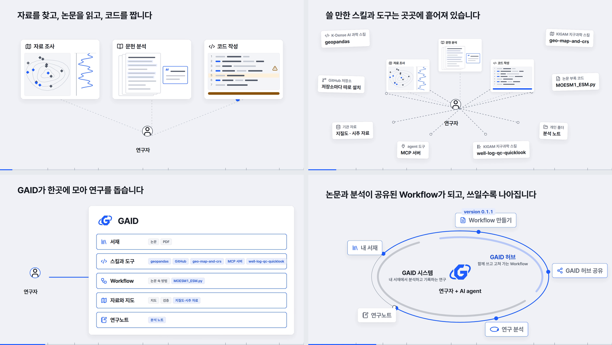 | 2026-10-24 10:17 | [GAID 홍보 영상 v4: 배경을 움직이는 그림으로 바꾸고 목적부터 말하는 103초 영상 (내부 검토용)](2026-10-24-gaid-promo-video-v4/index.md) | 배경 파트는 연구자가 자료를 조사하고 논문을 읽고 코드를 짜는 모습과, 흩어진 스킬·도구가 GAID로 모이는 모습을 움직이는 그림으로 보여 줍니다. 시연은 장마다 목적 문장과 "GAID 시스템/GAID 허브" 표시로 시작하고, 기능은 그 목적을 따라 하나씩 나옵니다. "개념도" 표시는 지웠습니다. | — | 대체됨 → 2026-10-24-gaid-promo-video-v5 | 0 |
| 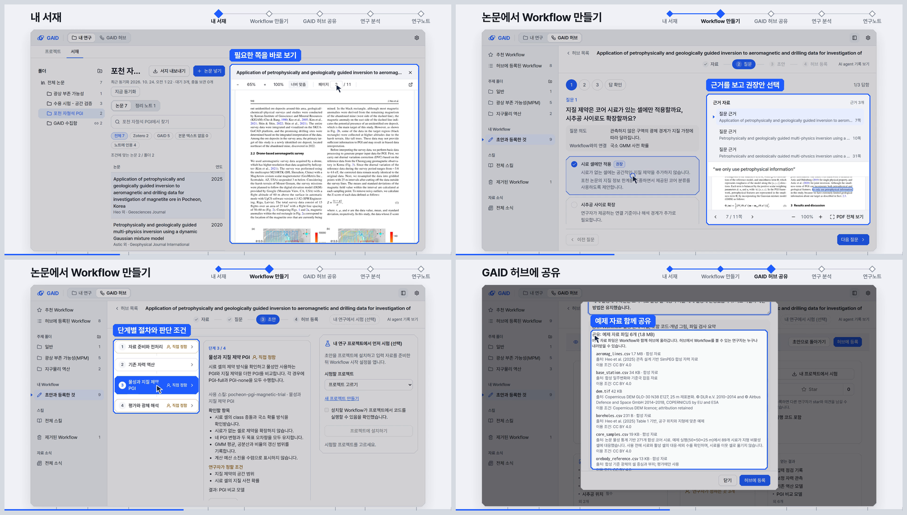 | 2026-10-24 03:26 | [GAID 홍보 영상 v3: 최종 앱에서 포천 연구 한 바퀴로 다시 찍은 105초 영상 (내부 검토용)](2026-10-24-gaid-promo-video-v3/index.md) | v2의 구성과 연출은 그대로 두고, 시연을 최종 앱에서 포천 자철석 PGI 연구 한 바퀴로 다시 찍었습니다. 서재 옆 PDF, 여러 자료로 만드는 Workflow, 질문 옆 근거 뷰어, 단계별 시작 창과 예제 자료, 근거 논문 인용, 노트를 서재에 넣기, Workflow version이 순환 속 제자리에 나옵니다. | — | 대체됨 → 2026-10-24-gaid-promo-video-v4 | 0 |
| 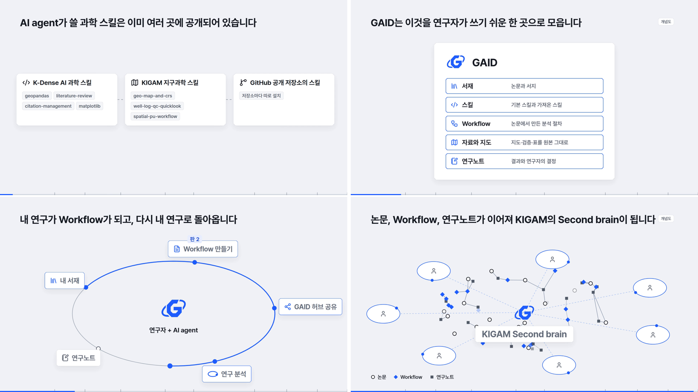 | 2026-10-23 13:38 | [GAID 홍보 영상 v2: 연구 순환으로 다시 짠 105초 영상 (내부 검토용)](2026-10-23-gaid-promo-video-v2/index.md) | 한 연구자가 서재의 논문으로 Workflow를 만들어 공유하고, 분석과 연구노트를 거쳐 다시 서재로 돌아오는 고리를 중심으로 영상을 다시 짰습니다. 실제 화면은 확대·스크롤 없이 기능마다 이름표로 설명합니다. | — | 대체됨 → 2026-10-24-gaid-promo-video-v3 | 0 |
|  | 2026-10-23 01:11 | [GAID 90초 홍보 영상 (내부 검토용)](2026-10-23-gaid-promo-video/index.md) | 모션그래픽과 실제 GAID 화면을 섞은 90초 무음 영상을 만들었습니다. 서재, shp 지도 뷰어, GAID 허브를 실제 화면으로 보여 주고, 차트의 수치는 모두 실제 기록에서 가져왔습니다. | — | 대체됨 → 2026-10-23-gaid-promo-video-v2 | 0 |

