# 보고서 목록

<!-- backbone:reports-index: generated by task complete from reports/<folder>/index.md frontmatter; do not edit. -->

각 보고서의 frontmatter에서 자동으로 만든 목록입니다. 보고서 형식은 backbone templates/report.md를 따릅니다.
같은 날짜 안에서는 main에 들어온 시각이 늦은 보고서가 위에 옵니다. "검토"는 사용자가 hub에서 항목에 답했거나 `<보고서 폴더> 검토함`이라고 알린 보고서를 표시합니다.

| 그림 | 날짜 | 보고서 | 한 줄 결론 | 검토 | 결론 상태 | 결정할 일 |
|---|---|---|---|---|---|---|
| 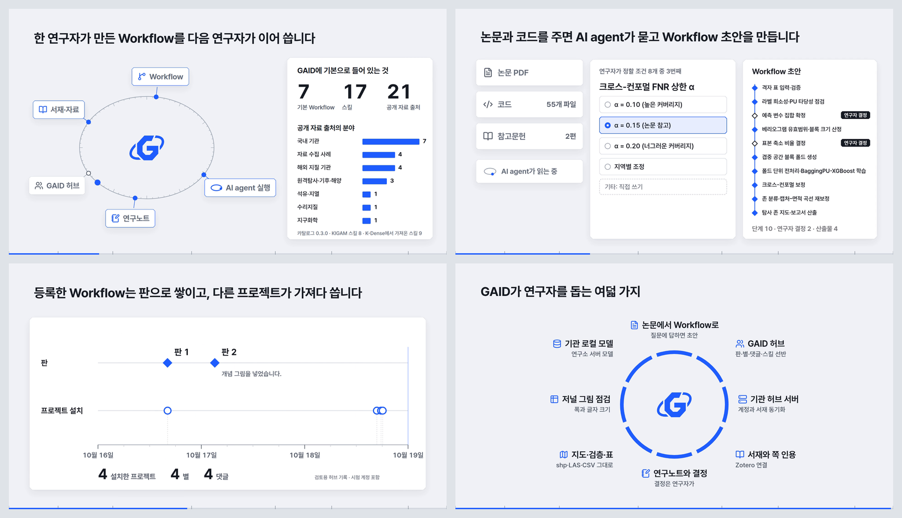 | 2026-10-23 01:11 | [GAID 90초 홍보 영상 (내부 검토용)](2026-10-23-gaid-promo-video/index.md) | 모션그래픽과 실제 GAID 화면을 섞은 90초 무음 영상을 만들었습니다. 서재, shp 지도 뷰어, GAID 허브를 실제 화면으로 보여 주고, 차트의 수치는 모두 실제 기록에서 가져왔습니다. | 검토 전 | 미정 | 0 |
| 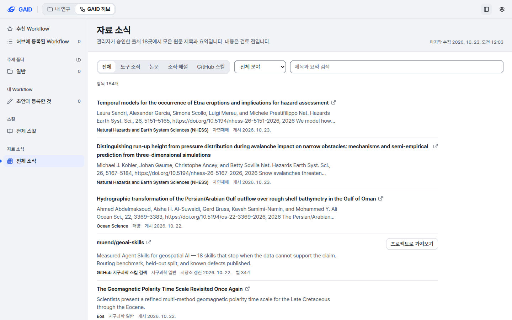 | 2026-10-22 | [GAID 허브 자료 소식: 관리자가 승인한 출처의 논문·도구·스킬 소식](2026-10-22-gaid-hub-feeds/index.md) | 기관 허브 서버가 관리자가 승인한 출처 18곳을 6시간마다 읽고, 연구자는 GAID 허브의 "자료 소식"에서 원문 제목과 피드 요약을 봅니다. 기관 허브 서버를 이번 변경으로 갱신하고 출처를 승인하는 일이 남았습니다. | 검토함 10-23 | 미정 | 1 |
| 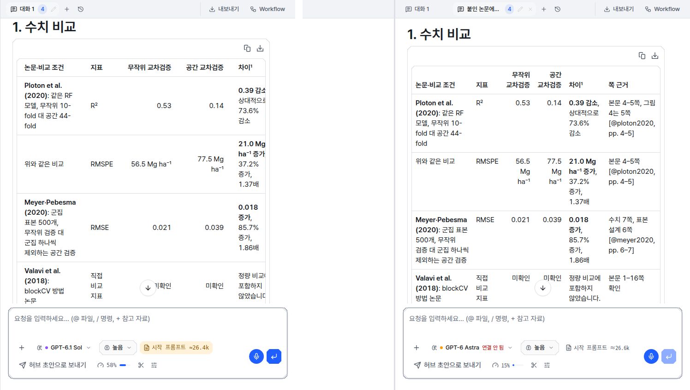 | 2026-10-22 22:13 | [처음 쓰는 연구자가 막힌 화면 문제 8건 수정](2026-10-22-gaid-first-use-fixes/index.md) | 수용 시험에서 처음 쓰는 연구자가 막힌 화면 문제 8건의 원인을 찾아 고쳤고, 7건은 실제 앱 화면에서, 같은 이름 모델 1건은 시험 앱의 모델 목록을 넣은 자동 시험으로 확인했습니다. | 검토 전 | 미정 | 0 |
| 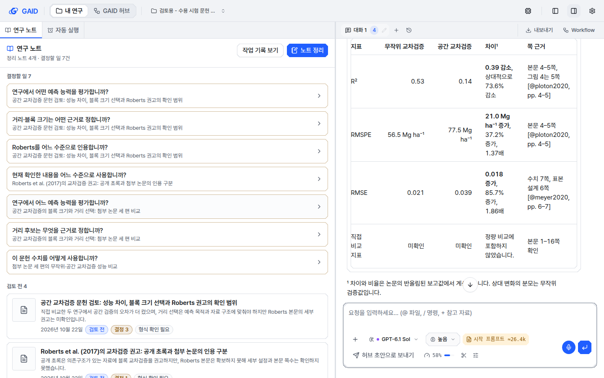 | 2026-10-22 19:17 | [GAID를 처음 쓰는 연구자 역할의 수용 시험](2026-10-22-gaid-user-acceptance/index.md) | 서재 쪽 인용, 저널 그림, ChatGPT 로그인·개인 API 키 경로는 통과했고, Zotero 웹 서재 시험은 저장된 웹 키를 Zotero가 거부해 막혔습니다. | 검토함 10-22 | 채택 | 1 |
| — | 2026-10-22 18:45 | [기관 GAID 허브 서버 시험 운영 시작: 고정 서비스, 허브 스킬 공유, HTTPS 준비](2026-10-22-gaid-hub-server-trial/index.md) | PC74에서 기관 GAID 허브 서버가 고정 서비스로 돌고, 관리자 계정과 Workflow 5건이 올라갔으며, 허브 스킬도 서버로 공유됩니다. HTTPS는 준비해 두었고 시험 그룹을 넓히기 전에 켭니다. | 검토 전 | 미정 | 0 |
| 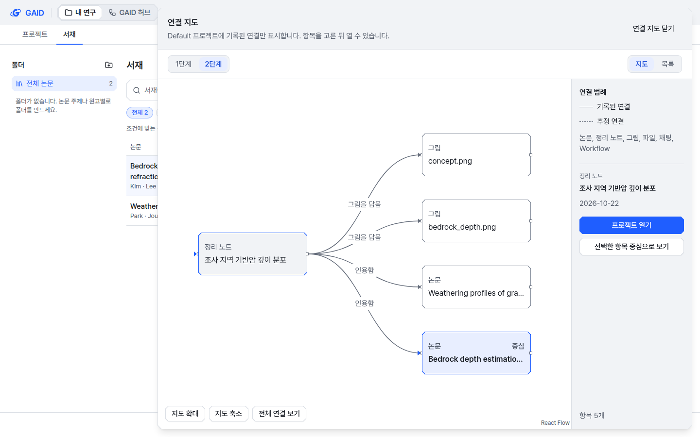 | 2026-10-22 18:32 | [서재 논문에서 여는 연결 지도, AGU·자원환경지질 그림 요건](2026-10-22-gaid-visuals-next/index.md) | 서재의 논문에서 그 논문을 쓴 프로젝트를 골라 연결 지도를 열 수 있습니다. AGU와 자원환경지질의 그림 요건은 공식 페이지에서 읽은 값만 그림 스킬에 넣었습니다. | 검토 전 | 미정 | 0 |
| 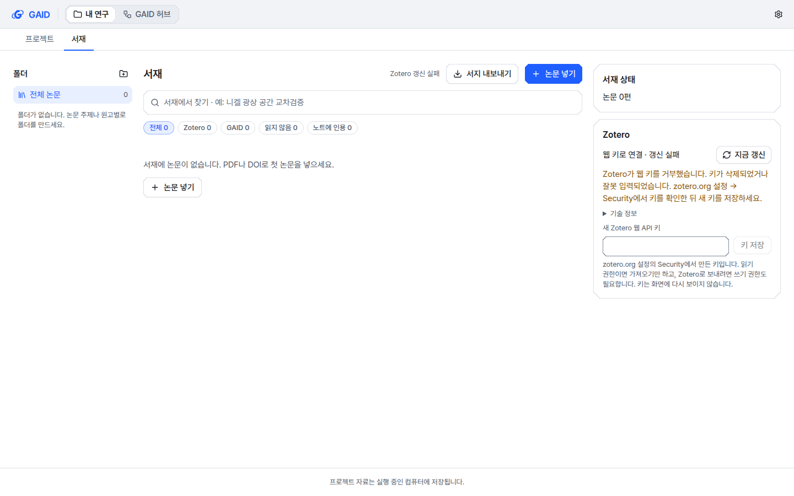 | 2026-10-22 16:46 | [Zotero 웹 키 갱신 실패 원인과 상태 표시 수정](2026-10-22-gaid-zotero-web-fix/index.md) | 웹 키 갱신이 매번 실패하던 원인(Zotero 웹 API 응답 차이)을 고쳤고, 서재 머리글과 Zotero 카드가 같은 상태와 실제 원인을 보여 줍니다. | 검토함 10-22 | 미정 | 0 |
| 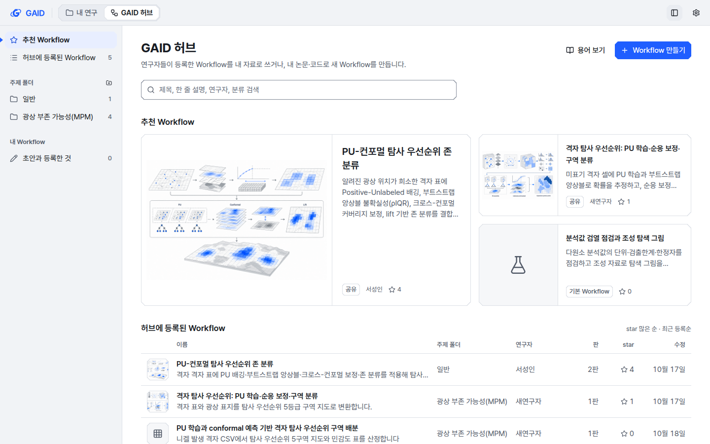 | 2026-10-22 16:37 | [GAID 공유 백엔드: 계정과 원내 GAID 허브 서버](2026-10-22-gaid-backend/index.md) | 원내 GAID 허브 서버가 생겼습니다. 연구자는 초대 코드로 계정을 만들어 Workflow를 공유하고, 개인 서재를 여러 PC에서 동기화합니다. | 검토함 10-22 | 채택 | 1 |
| 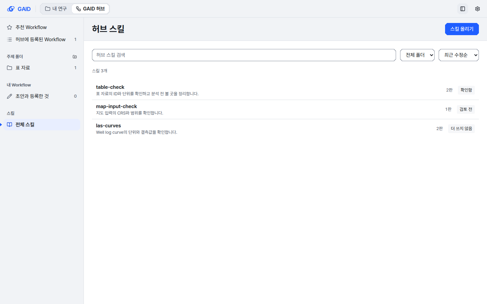 | 2026-10-22 16:24 | [GAID 허브에 스킬 선반을 만들고 Workflow가 스킬의 판을 고정해 쓰게 함](2026-10-22-gaid-hub-skills/index.md) | GAID 허브에 스킬 선반을 만들었습니다. 연구자는 내 프로젝트의 스킬, 허브 Workflow에 딸린 스킬, GitHub 등의 스킬을 판마다 사본으로 올리고, 출처·라이선스·자동 검사·검토 기록을 본 뒤 프로젝트에 설치합니다. Workflow는 허브 스킬의 판을 고정해 쓰고, Workflow를 설치하면 그 판도 함께 설치됩니다. | 검토함 10-22 | 미정 | 0 |
| 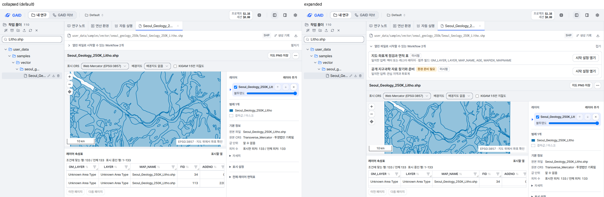 | 2026-10-22 14:19 | [지도·표 위 Workflow 제안 칸을 한 줄로 접기](2026-10-22-gaid-workflow-strip/index.md) | 지도·표처럼 높이가 필요한 파일을 열면 Workflow 제안 칸이 한 줄로 접혀, 1280×800에서 지도와 속성표 영역이 127 px 커졌습니다. | 검토 전 | 미정 | 0 |
| 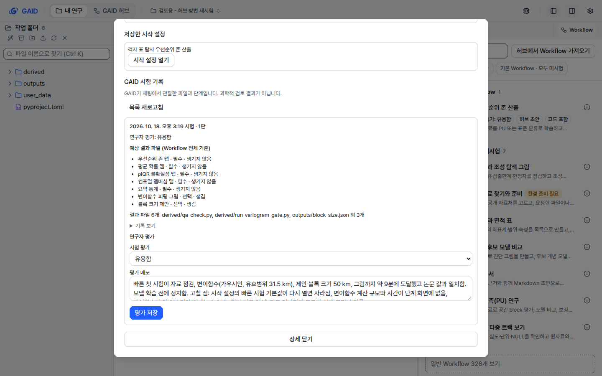 | 2026-10-22 14:09 | [Workflow 상세의 시험 기록과 허브 검사를 연구자용 요약으로 정리](2026-10-22-gaid-workflow-detail/index.md) | 허브에서 설치한 Workflow의 상세 창이 시험 결과와 허브 검사를 연구자 말로 요약하고, 원래 기록은 기록 보기 안에 그대로 둡니다. | 검토 전 | 미정 | 0 |
| 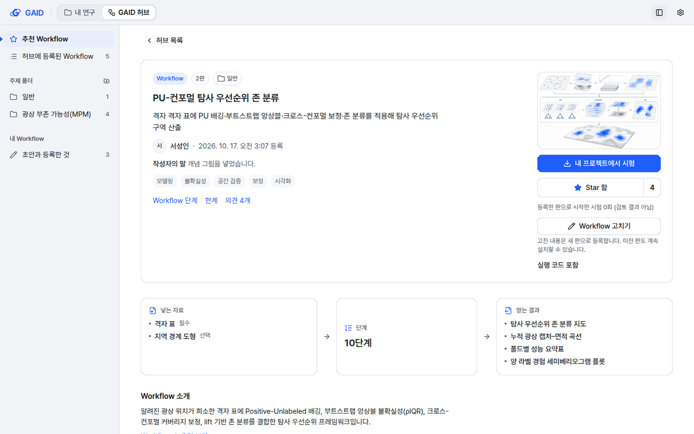 | 2026-10-22 13:12 | [GAID 허브 상세 화면에도 같은 사이드바 두기](2026-10-22-gaid-hub-layout/index.md) | 허브의 모든 화면(추천·등록·기본 Workflow 상세, 내 Workflow, 작성 중 Workflow)에 같은 왼쪽 사이드바가 남고, 상세 화면에서는 들어온 목록이 표시됩니다. | 검토 전 | 미정 | 0 |
| 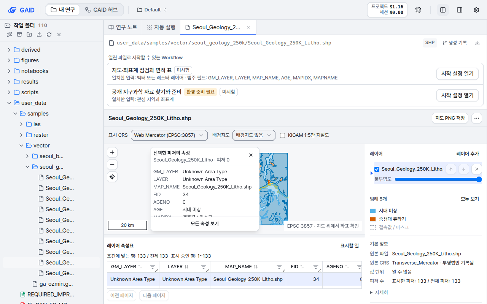 | 2026-10-22 12:06 | [UI 가이드 v2 부채 네 건 처리 (지도 화면, 작업 공간 레이아웃, 결정 카드, 서재 배지)](2026-10-22-gaid-ui-v2-debts/index.md) | 지도 화면을 MAP 규칙대로 다시 짰고, 좁은 창의 대화 시트와 키보드 조작, 보낸 결정 답 표시, 서재 배지 역할 색을 넣었습니다. | 검토함 10-22 | 채택 | 1 |
| 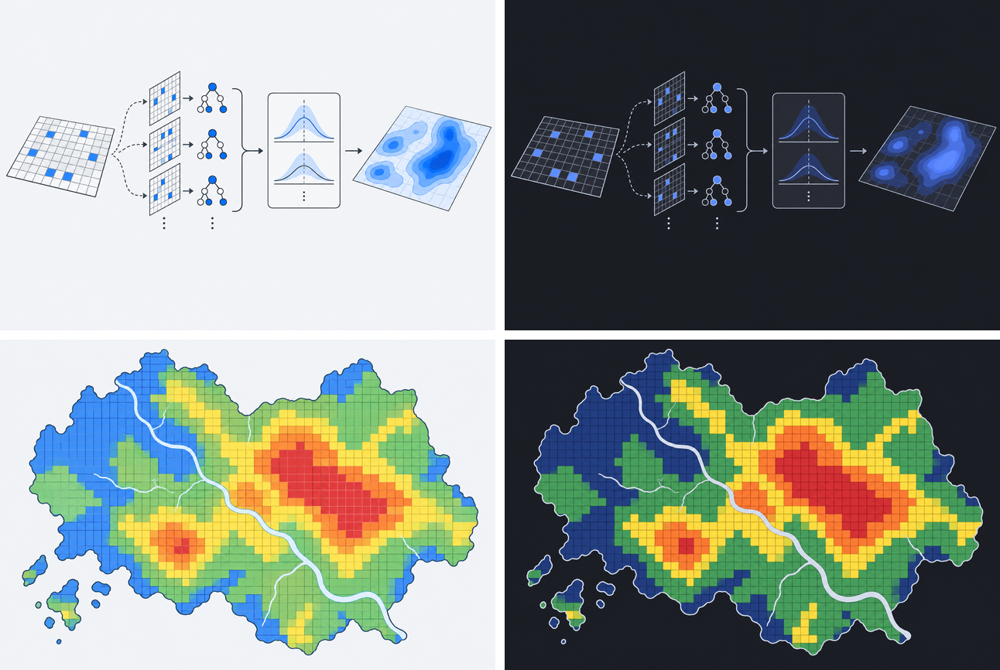 | 2026-10-22 11:55 | [개념 그림을 밝은 화면용과 어두운 화면용 두 장으로 만들기](2026-10-22-gaid-concept-pictures/index.md) | 개념 그림마다 밝은 화면용과 어두운 화면용 두 장을 만들고, 화면 테마에 맞는 쪽을 그림 칸과 같은 바탕색으로 보여 줍니다. | 검토 전 | 미정 | 0 |
| 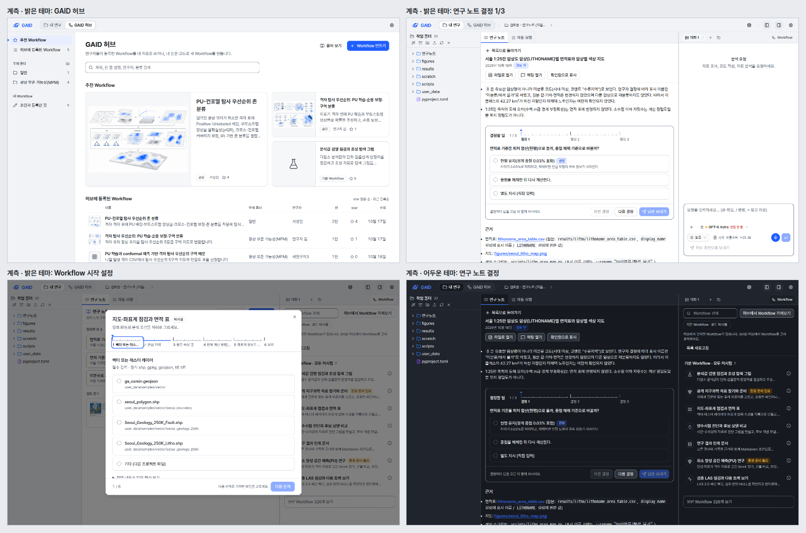 | 2026-10-22 10:48 | [GAID UI/UX 가이드 v2: 계측 기본 디자인과 도폭 선택 스타일](2026-10-21-gaid-design-identity/index.md) | One UI와 Apple HIG로 다시 쓴 가이드 v2를 적용해, GAID 허브와 작업 공간이 로고에서 끌어낸 계측 디자인(기본)과 설정에서 고르는 도폭 스타일로 바뀌었습니다. | 검토함 10-22 | 미정 | 0 |
| 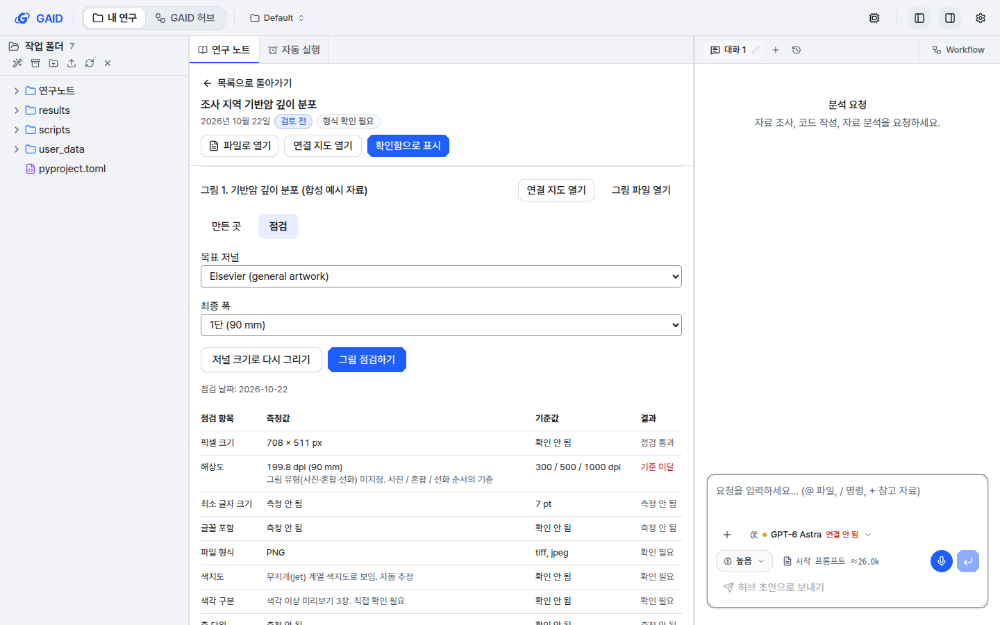 | 2026-10-21 | [분석 결과를 논문 그림으로, 연구 연결을 지도로: 그림 기록·저널 그림 점검·연결 지도](2026-10-21-gaid-research-visuals/index.md) | 정리 노트의 그림마다 만든 스크립트·자료·채팅과 바뀐 여부가 보이고, 목표 저널의 폭·해상도·글자·색·AI 그림 정책으로 점검하며, 논문·노트·그림·자료 사이의 연결을 지도로 봅니다. | 검토함 10-22 | 미정 | 0 |
| 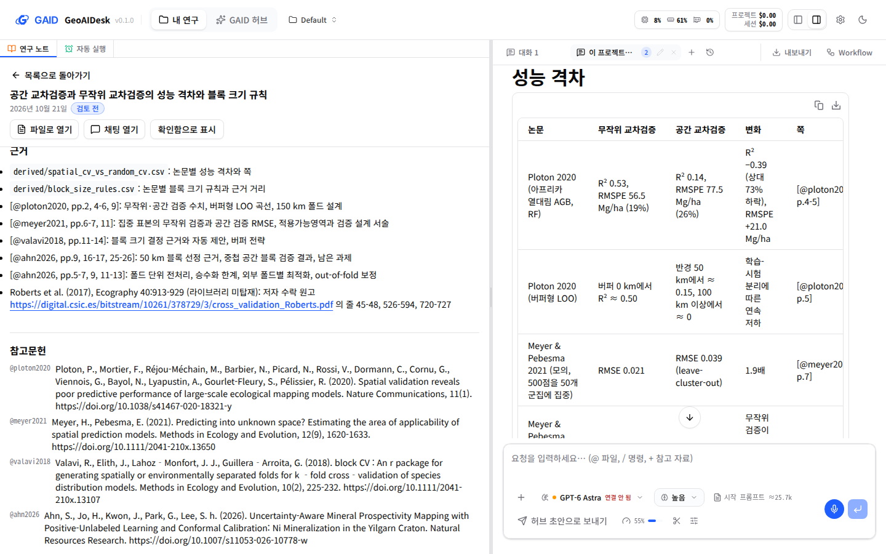 | 2026-10-21 | [서재 남은 항목 세 가지: 실제 모델의 쪽 인용 확인, 문헌 스킬 배포, Better BibTeX 상태](2026-10-21-gaid-library-next/index.md) | 기관 Qwen이 서재의 실제 논문 4편에서 쪽 근거를 찾아 인용했고, 확인한 인용 34개가 모두 맞았습니다. 문헌 스킬 4개를 넣은 카탈로그 0.3.0을 GAID 안에서 만들어 고정했습니다. Better BibTeX는 Zotero 10 조건이 풀리지 않아 기다립니다. | 검토함 10-22 | 미정 | 0 |
| 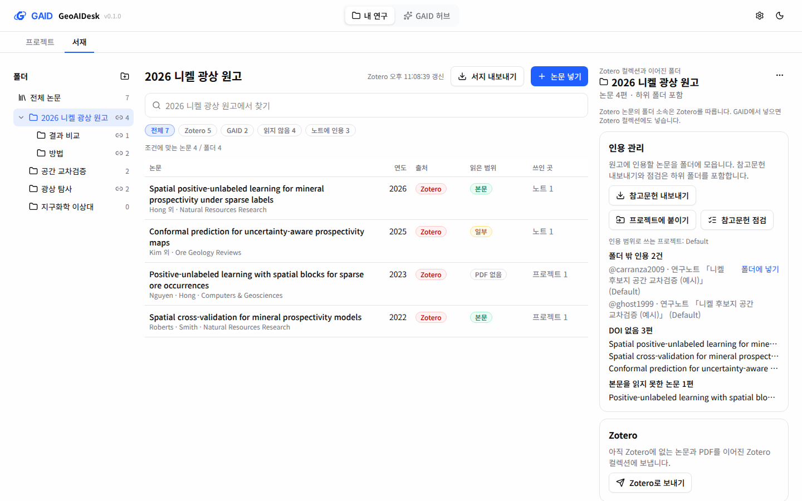 | 2026-10-21 23:35 | [GAID 서재 폴더와 Zotero 보내기](2026-10-21-gaid-library-folders/index.md) | 서재에 주제·원고별 하위 폴더가 생겼고, 폴더 단위로 참고문헌을 내보내고 점검하며, GAID 논문과 폴더를 PDF와 함께 Zotero로 중복 없이 보냅니다. | 검토함 10-21 | 미정 | 1 |
| 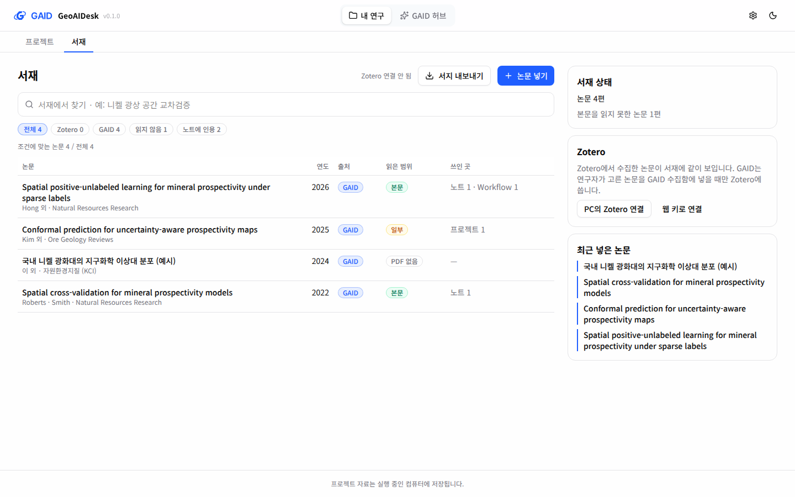 | 2026-10-21 21:37 | [논문 수집에서 연구노트·Workflow까지 잇는 GAID 서재: 설계와 1단계 구현](2026-10-21-gaid-research-hub/index.md) | Zotero와 이어지고 PDF만으로도 쓰는 하이브리드 서재를 "내 연구"에 만들었고, 서재 논문을 에이전트 근거 답변·연구노트 참고문헌·허브 Workflow 제작에 연결했습니다. | 검토함 10-21 | 미정 | 0 |
| 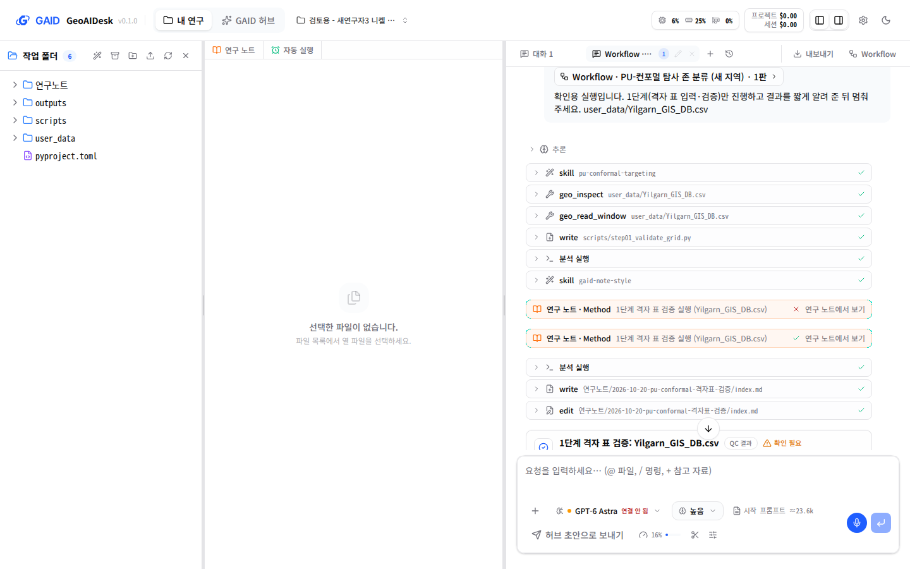 | 2026-10-20 | [GAID를 Workflow 중심으로 정리하고 Workflow를 지침 문서로 AI agent에게 보냄](2026-10-20-gaid-workflow-model/index.md) | GAID의 허브 단위와 Workflow 패널의 줄을 모두 Workflow로 부르고, Workflow를 단계·사용 스킬·결과가 적힌 하나의 지침 문서로 AI agent에게 보냅니다. 허브와 프로젝트에서 보는 지침이 곧 채팅에 가는 글이며, 기관 Qwen 실제 대화에서 AI agent가 지침대로 스킬 지침부터 읽고 1단계를 수행했습니다. | 검토함 10-22 | 미정 | 0 |
| 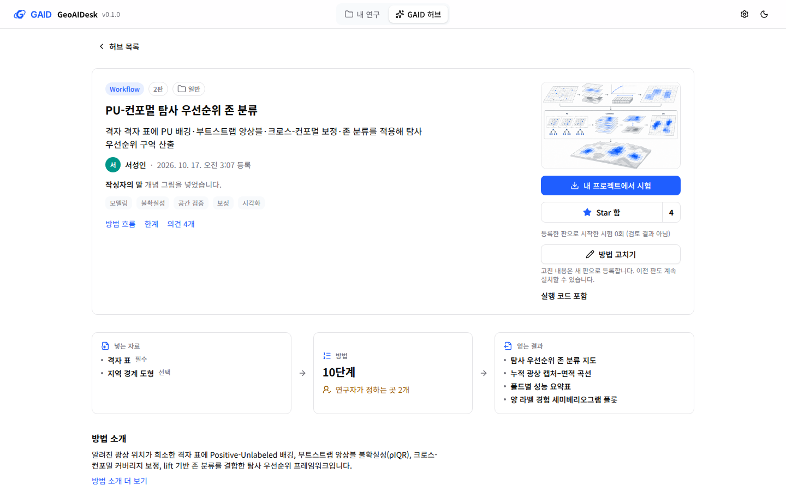 | 2026-10-20 18:55 | [GAID 허브 개선: 방법 고치기, 답 다시 고르기, 허브 연동, 개념 그림](2026-10-20-gaid-hub-editing/index.md) | 등록한 방법을 새 판으로 고치거나 복사해 고칠 수 있고, 답한 질문을 다시 고를 수 있으며, 레시피·스킬을 GAID 허브에서 찾고 개념 그림을 한 장씩 다시 만들 수 있습니다. | 검토함 10-20 | 채택 | 1 |
| 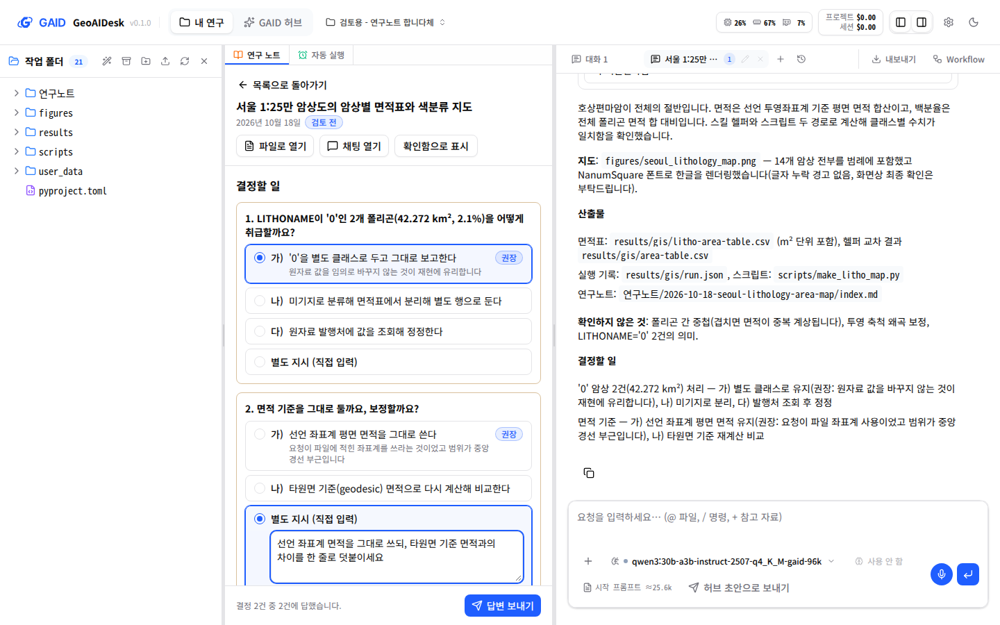 | 2026-10-20 18:20 | [연구 노트의 결정할 일을 한 번에 답하기](2026-10-20-gaid-note-decisions/index.md) | 연구 노트의 결정할 일에서 결정마다 답을 고르거나 별도 지시를 쓴 뒤, "답변 보내기"를 한 번 누르면 모든 답이 노트를 쓴 채팅에 메시지 하나로 전송됩니다. | 검토 전 | 미정 | 0 |
| — | 2026-10-18 21:43 | [GAID 연구노트를 합니다체로 고정](2026-10-18-gaid-note-style/index.md) | 노트 지시에 한국어 노트는 합니다체로 쓰라는 한 문장을 넣었습니다. 기관 Qwen으로 같은 분석을 다시 돌리자 노트 전체가 합니다체로 나왔습니다. | 검토 전 | 미정 | 0 |
| — | 2026-10-18 21:04 | [GAID 채팅 답변과 연구노트의 문장 다듬기](2026-10-18-gaid-output-style/index.md) | GAID AI agent가 채팅 답변을 결과부터 쓰고, 연구노트는 쓰기 전에 문장 다듬기 스킬을 읽고 씁니다. 같은 분석을 기관 Qwen으로 돌려 보니 답변의 첫 문장이 결과로 바뀌었고 장식용 굵은 글씨와 대시가 줄었습니다. 노트 문체(합니다체/해라체)는 정하지 않았습니다. | 검토함 10-18 | 채택 | 1 |
| 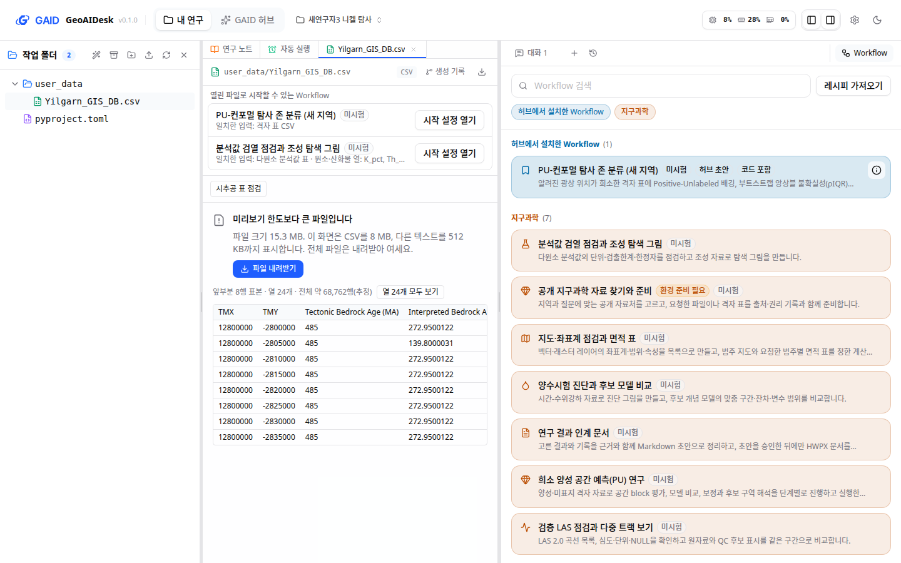 | 2026-10-18 20:55 | [큰 CSV 미리보기 화면과 허브 방법 배지 정리](2026-10-18-gaid-system-ui-followups/index.md) | 미리보기 한도를 넘은 CSV는 앞부분 표본과 내려받기 버튼이 있는 전용 화면으로 열립니다. 허브에서 설치한 Workflow의 배지는 각각 허브 패키지, 현재 프로젝트, 시험 기록 중 무엇을 가리키는지 이름과 설명에 드러납니다. | 검토 전 | 미정 | 0 |
| 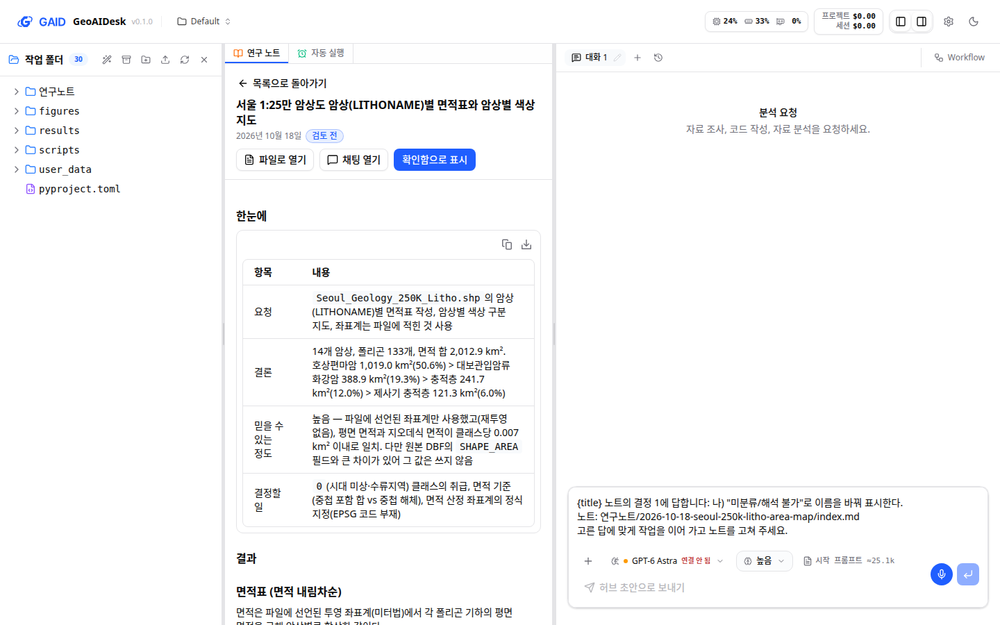 | 2026-10-18 19:43 | [GAID 연구노트를 분석별 정리 노트 중심으로 바꿈](2026-10-18-gaid-notebook-review/index.md) | 연구노트 탭이 이제 분석마다 결과부터 쓴 정리 노트를 보여 주고, 노트는 프로젝트의 연구노트 폴더에 Markdown으로 남습니다. 기관 Qwen이 실제 분석에서 노트를 쓰고, 연구자가 고른 결정에 맞춰 같은 노트를 고쳤습니다. | 검토 전 | 미정 | 0 |
| 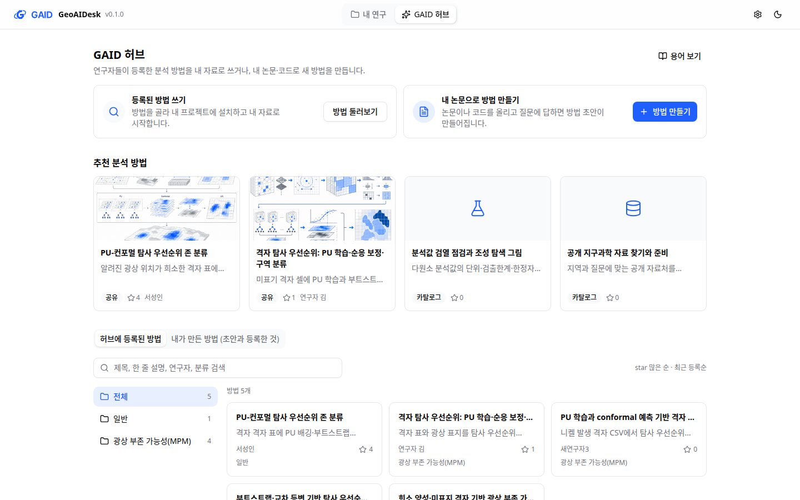 | 2026-10-18 18:52 | [처음 쓰는 연구자 관점의 GAID 허브 점검과 개선](2026-10-18-gaid-hub-novice-review/index.md) | 배경 지식 없는 검토자 세 명이 차례로 허브를 처음 써 보았고, 세 번째 검토자는 네 가지 목표를 모두 이뤘습니다. 허브에서 길을 잃은 곳은 고쳤고, 시작 설정 팝업 문제는 gaid-system-ui가 고쳤으나 아직 main에 들어가지 않았습니다. | 검토 전 | 미정 | 0 |
| 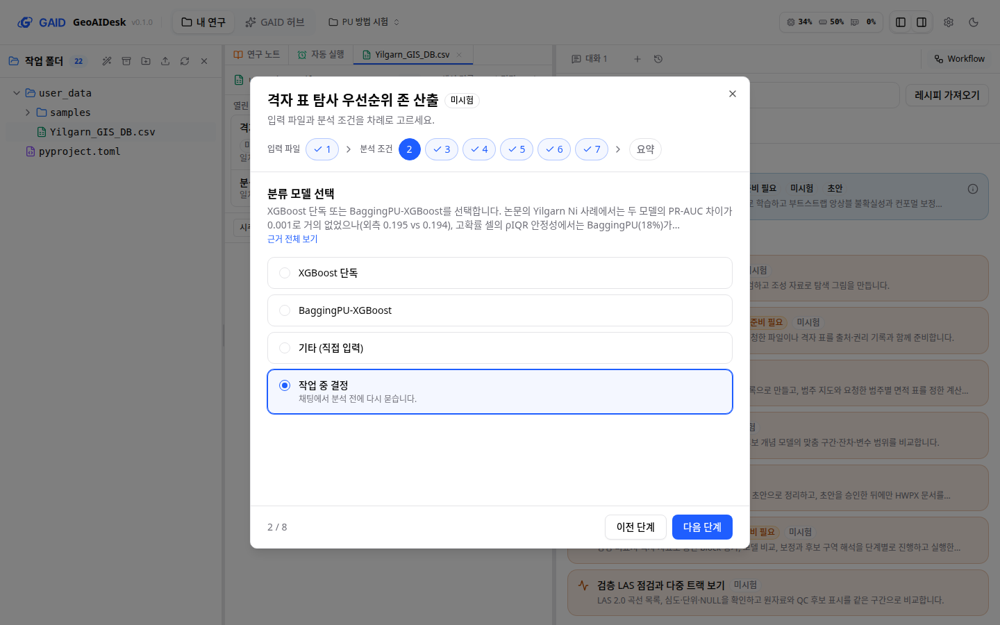 | 2026-10-18 17:38 | [Workflow 시작 설정을 단계 화면으로 다시 만들고 GAID 작업 화면을 화면 가이드에 맞춤](2026-10-18-gaid-system-ui/index.md) | Workflow를 열 때 뜨는 시작 설정이 한 화면에 질문 하나를 묻는 단계 화면이 되었습니다. Workflow 목록, 파일 패널, 설정의 skill_hub 카드에서 화면 가이드 위반도 고쳤습니다. | 검토함 10-22 | 미정 | 0 |
| 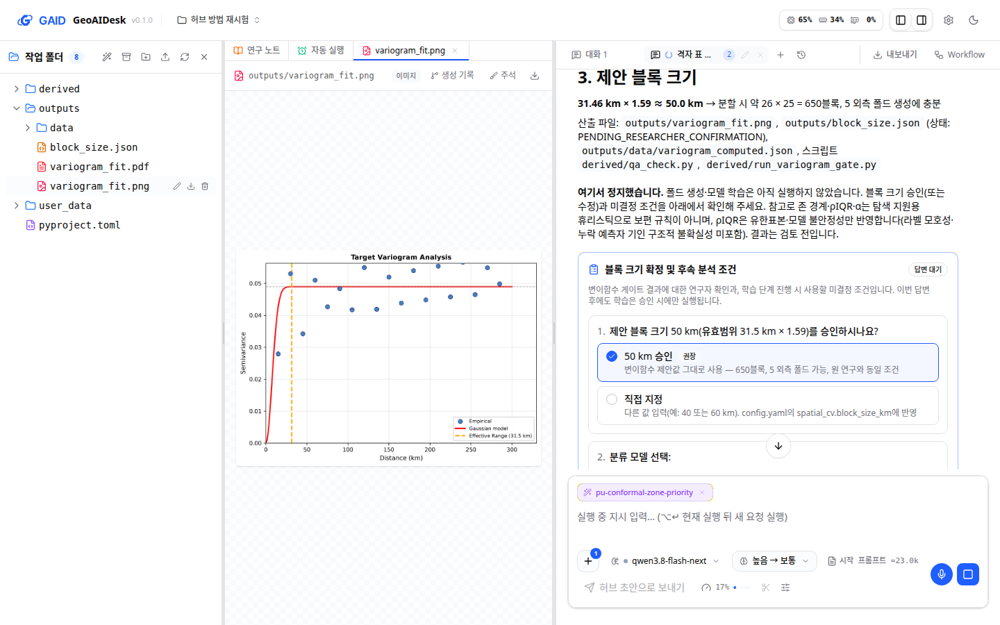 | 2026-10-18 16:07 | [PU 방법 수정판 재시험과 GAID 허브·채팅 결함 정리](2026-10-18-gaid-hub-followups/index.md) | GAID 허브에서 다시 만든 PU 방법이 같은 제한 시험에서 약 9분 만에 첫 확인 지점(변이함수와 제안 블록 크기 50 km)에 이르렀고, 남은 GAID 결함과 허브 개선을 고쳤습니다. | 검토함 10-18 | 미정 | 0 |
| 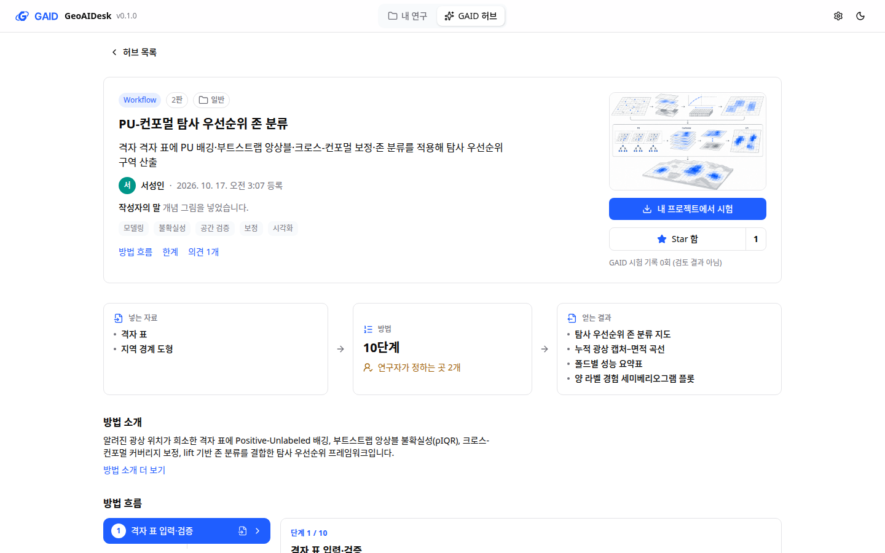 | 2026-10-16 | [GAID 안에서 스킬·Workflow를 만들고 공유하는 GAID 허브](2026-10-16-gaid-hub/index.md) | 논문과 코드로 방법을 만드는 기능을 skill_hub에서 GAID로 옮겨, 같은 앱 안에서 만들기·허브 등록·star와 의견·내 연구 프로젝트 설치가 이어지고, 40 km 격자 빠른 시험은 21분에 결과 지도를 냈습니다. | 검토함 10-18 | 미정 | 0 |
| 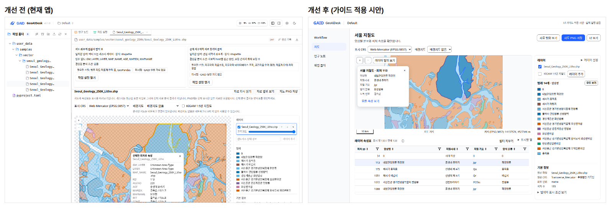 | 2026-10-16 | [Samsung One UI를 참고한 GAID 화면 가이드와 화면 적용 예](2026-10-16-gaid-ui-guide/index.md) | 에이전트가 GAID 화면을 만들 때 따를 화면 가이드를 저장소에 넣었습니다. 규칙마다 근거가 된 One UI 페이지를 적었고, 문구 길이·내부 정보 노출·색 사용은 자동 검사로 막습니다. 워크플로 시작 설정, 지도, 방법 상세 세 화면에 적용한 시안으로 효과를 보였습니다. | 검토 전 | 미정 | 0 |
| 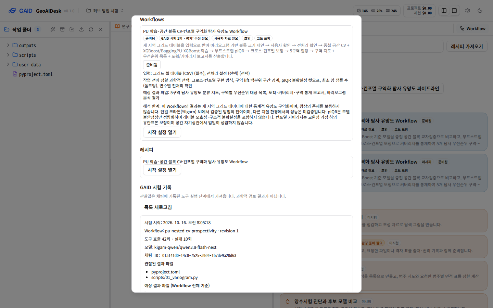 | 2026-10-16 09:32 | [skill_hub에서 만든 방법을 GAID에서 받아 설치하고 시험하기](2026-10-16-gaid-hub-integration/index.md) | hub에서 논문으로 만든 방법 초안을 GAID가 받아 설치하고 시험 채팅과 시험 기록까지 남겼으나, 제한한 첫 시험은 방법의 첫 확인 지점에 이르지 못했습니다. | 검토함 10-18 | 미정 | 0 |
| 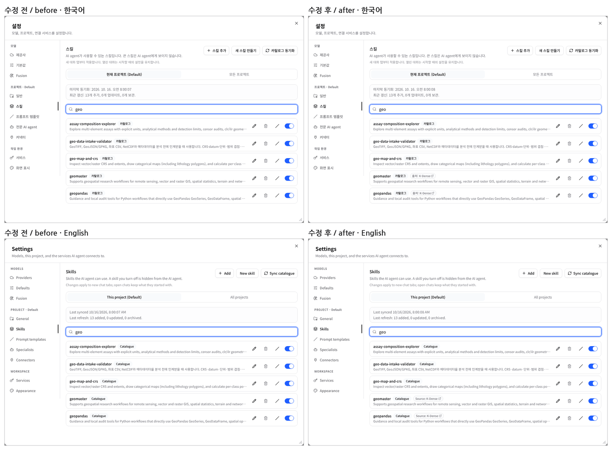 | 2026-10-16 08:27 | [화면의 이름을 "AI agent"와 GAID로 바꾸고 K-Dense에서 온 스킬·Workflow에 출처 표시](2026-10-16-gaid-brand-copy/index.md) | 화면에 남아 있던 "Kady"·"K-Dense" 54곳을 "AI agent"와 GAID로 바꿨습니다. K-Dense에서 가져온 스킬·Workflow·템플릿에는 그 항목이 보이는 곳에 "출처: K-Dense"가 링크로 나옵니다. 좁은 창을 지원하지 않는다는 점은 지원 환경 문서에 적었습니다. | 검토 전 | 미정 | 0 |
| 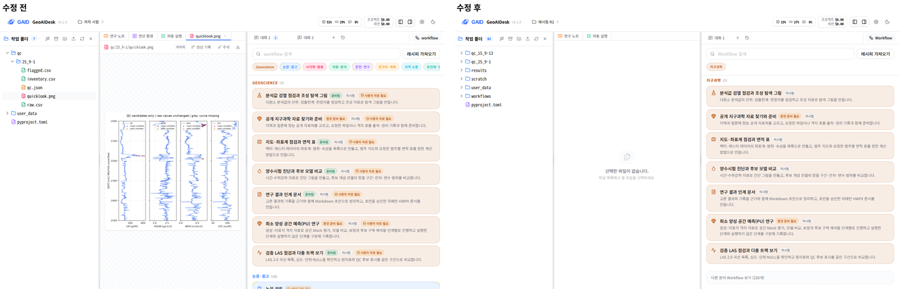 | 2026-10-16 01:20 | [기관 Qwen 모델이 GAID 안에서 만든 스킬과 Workflow — 연구자 역할 시험과 수정](2026-10-15-gaid-qwen-authoring-trial/index.md) | Qwen은 쓸 만한 스킬을 만들었지만 Workflow는 둘 곳이 없어 앱 설정을 무단으로 고쳤습니다. 발견한 앱 결함을 고쳤고, 작성은 skill_hub에서 하기로 정해 다음 작업으로 넘겼습니다. | 검토함 10-15 | 미정 | 0 |
| 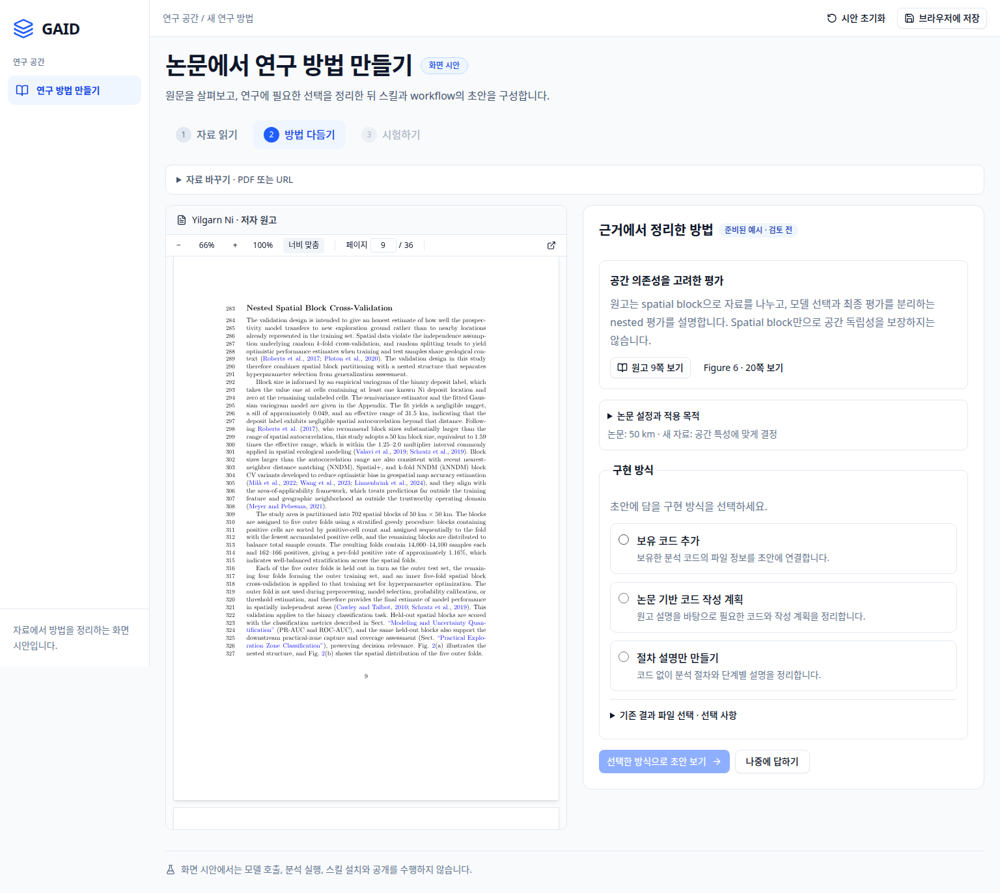 | 2026-10-15 18:15 | [연구방법의 제작·실행·공유를 잇는 GAID 개편안](2026-10-15-gaid-researcher-ecosystem/index.md) | 실제 PDF에서 방법 선택·초안 편집·시험 준비로 이어지는 클릭형 시안을 구현했습니다. | 검토 전 | 미정 | 0 |
| 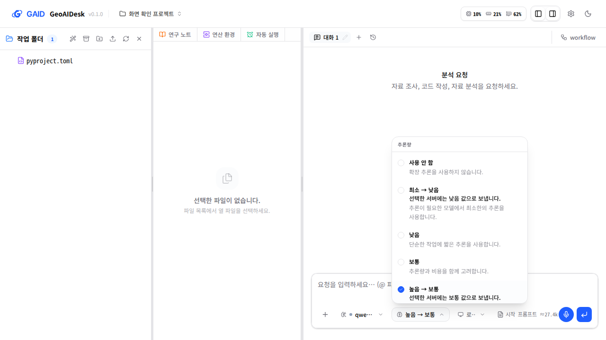 | 2026-10-14 | [새 프로젝트 스킬 설치와 서버별 추론량 설정 — 기관·로컬 모델 재시험](2026-10-14-gaid-qwen-followups/index.md) | 새 프로젝트에 지질 스킬이 바로 설치되고, 기관 서버는 기본 추론량 "높음"을 "보통"으로 받아 두 과제를 4분대에 통과했습니다. 로컬 모델은 4과제 중 3과제를 통과했습니다. | 검토 전 | 미정 | 0 |
| 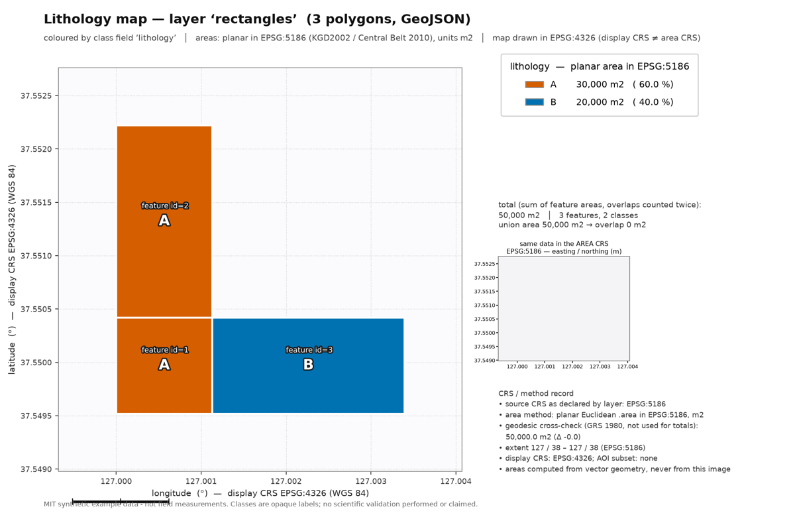 | 2026-10-14 15:41 | [기관 내부 Qwen 서버 실제 과제 시험 — 연결·과제 결과와 사용 조건](2026-10-14-gaid-kigam-qwen-trial/index.md) | 기관 내부 Qwen 서버는 연결과 두 과제(지도·면적표, 검층 QC)를 모두 통과했습니다. 다만 대화의 추론량을 "사용 안 함·낮음·보통" 중 하나로 두어야 합니다. | 검토함 10-14 | 채택 | 2 |
| 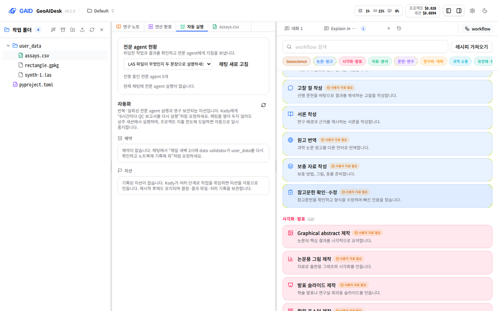 | 2026-10-13 08:15 | [앱 전체 한국어·영어 화면 모드와 요청 언어를 따르는 응답](2026-10-13-gaid-ui-locale/index.md) | 언어 설정 하나로 GAID 화면과 K-Dense에서 온 화면(채팅, workflow 326개, 파일 보기, 설정, 연구 노트)이 모두 한국어 또는 영어로 바뀝니다. 에이전트는 화면 언어와 상관없이 사용자가 지정한 언어나 요청한 언어로 답합니다. | 검토함 10-13 | 채택 | 1 |
| 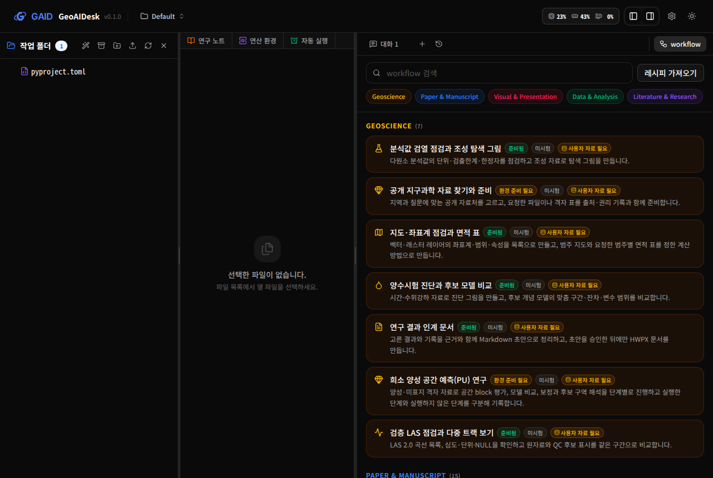 | 2026-10-12 18:51 | [workflow 목록 통합, 카테고리를 고르는 레시피 저장, skill_hub 스킬 가져오기](2026-10-12-gaid-workflow-catalog/index.md) | Geoscience 작업이 K-Dense workflow와 같은 목록·검색·카테고리 버튼으로 맨 앞에 나오고, 가져온 레시피를 고른 카테고리(새 카테고리 포함)에 저장해 다시 열 수 있으며, skill_hub 사이트에서 찾은 스킬을 기존 확인·설치 절차로 가져올 수 있습니다. | 검토 전 | 미정 | 0 |
| 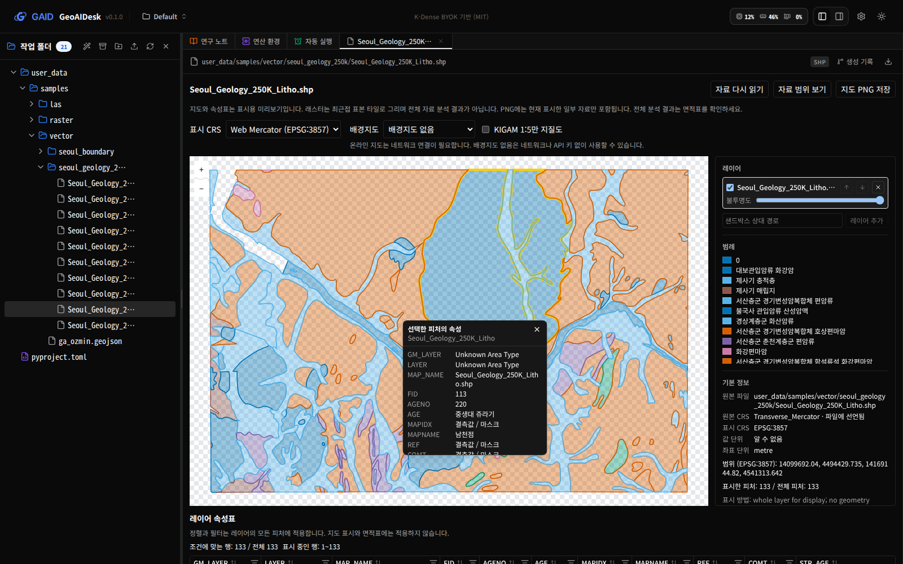 | 2026-10-12 18:40 | [지도 오른쪽 정보 패널, 속성표 열 정렬·필터, 지도 위 미니 팝업](2026-10-12-gaid-map-table-ux/index.md) | 범례와 기본 정보가 지도 오른쪽 패널에 함께 보이고, 속성표 열 머리글에서 정렬·필터를 쓰며, 선택한 피처와 픽셀 정보는 지도 위 미니 팝업으로 뜹니다. | 검토 전 | 미정 | 0 |
| 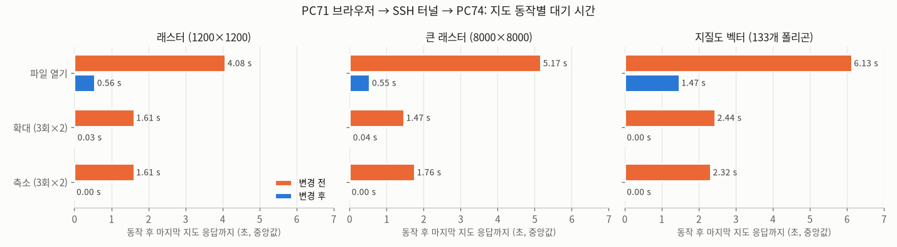 | 2026-10-12 14:35 | [지도 타일 표시, 배경지도 선택, Markdown 그림 경로 규칙](2026-10-12-gaid-map-tiles/index.md) | 지도 확대·축소 대기가 1.5–2.4초에서 0.04초 이하로 줄었고, 배경지도를 없음·OSM·국토지리정보원·지질도 중에서 고르며, 에이전트가 쓴 Markdown의 깨진 그림 경로를 자동으로 알립니다. | 검토 전 | 미정 | 0 |
| 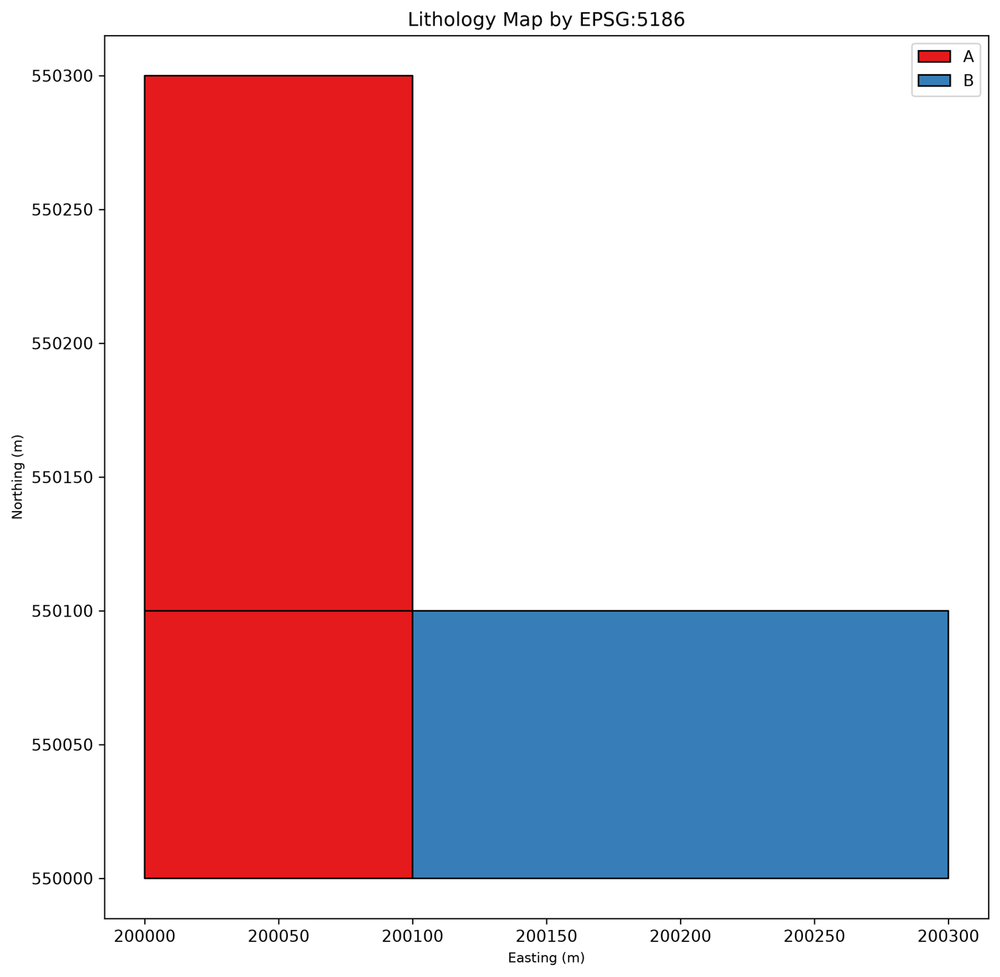 | 2026-10-11 21:01 | [GeoAIDesk 0.1.0 출시 검증 — 설치·업데이트·모델 경로 증거](2026-10-11-gaid-release-proof/index.md) | Linux·WSL·Windows 모두 새 설치와 업데이트를 통과했습니다(Windows는 한글 경로 결함 2건 수정 후). 로컬 모델은 98K 지도 과제 1건만 기준을 통과했습니다. | 검토함 10-22 | 미정 | 0 |
| 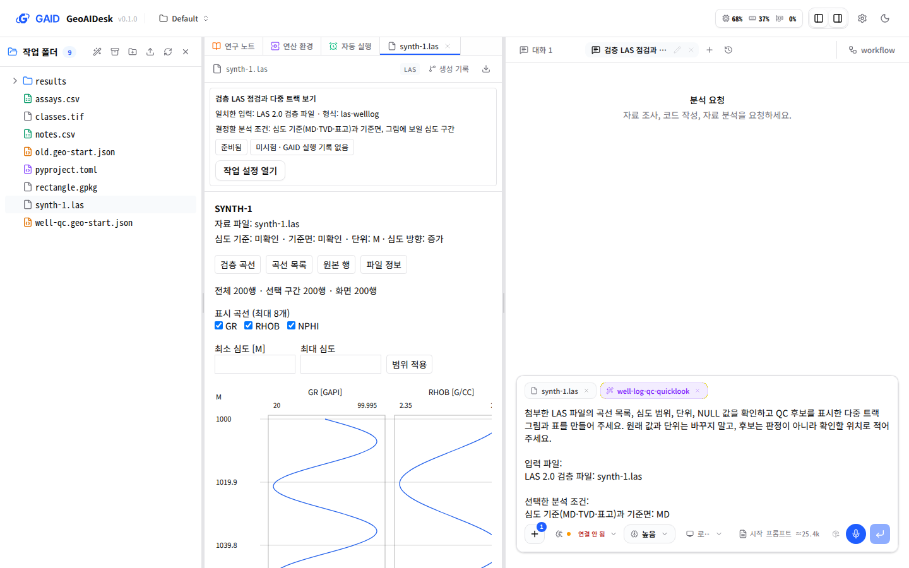 | 2026-10-11 16:54 | [한국어 작업 공간: 자료에 맞는 작업 제안, 작업 초안, 결과 카드](2026-10-11-gaid-korean-workspace/index.md) | 파일을 열면 맞는 Geoscience 작업을 준비 상태와 함께 제안하고, 새 채팅에 작업 초안을 만들며, 결과 카드에서 지도를 엽니다. 주요 화면은 한국어입니다. | 검토 전 | 미정 | 0 |
| 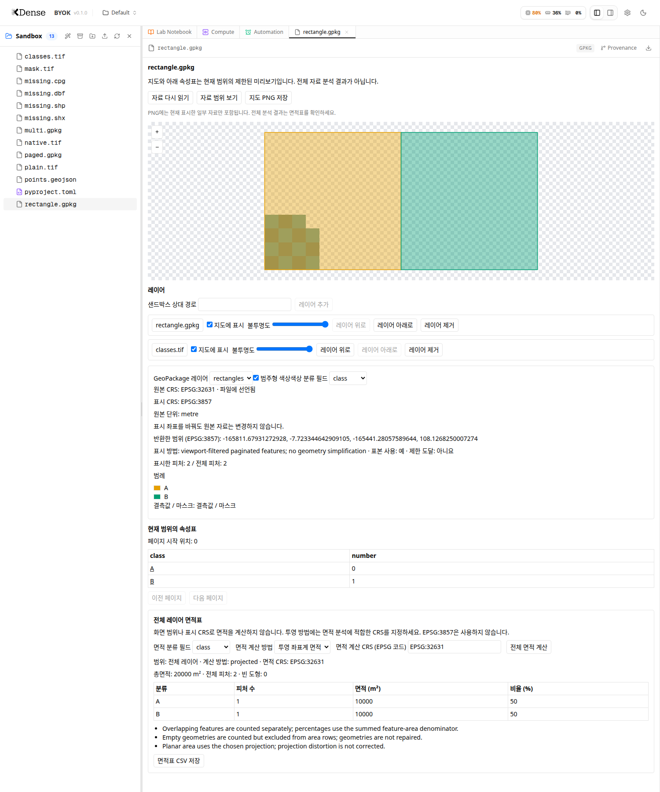 | 2026-10-11 15:20 | [래스터·벡터 지도와 전체 레이어 면적표](2026-10-11-gaid-maps/index.md) | 래스터와 벡터를 함께 표시하고 전체 레이어의 분류별 면적표를 계산·저장합니다. | 검토 전 | 미정 | 0 |
| 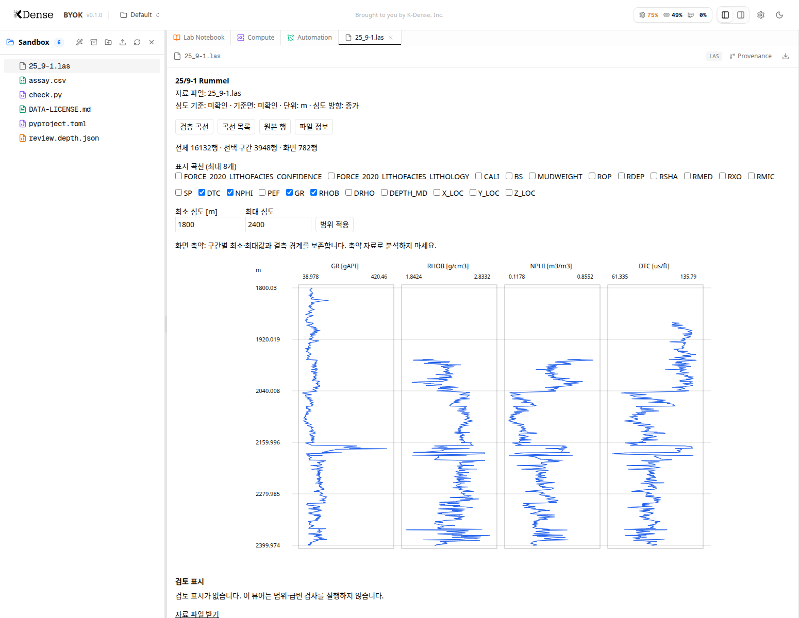 | 2026-10-11 15:03 | [검층 곡선과 시추공 표를 원자료와 함께 확인합니다](2026-10-11-gaid-well-tables/index.md) | 대용량 검층의 심도별 보기와 시추공 표의 구간·연결 점검을 추가했습니다. | 검토 전 | 미정 | 0 |
| — | 2026-10-11 14:35 | [로컬 모델 최소 컨텍스트와 지출 한도 처리 보완](2026-10-11-gaid-runtime-followups/index.md) | 로컬 모델 설정의 기본값과 최소값을 64K로 맞추고 로컬 대화와 하위 에이전트를 유료 지출 한도에서 제외했습니다. | 검토 전 | 미정 | 0 |
| 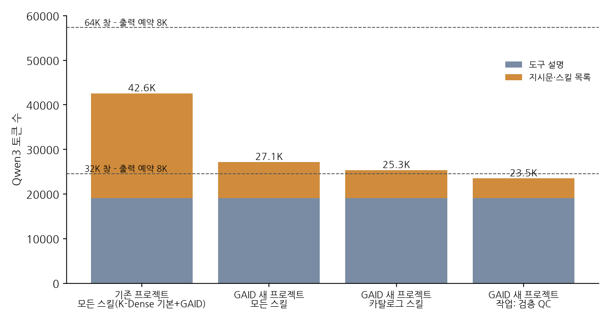 | 2026-10-11 13:35 | [GeoAIDesk 실행 기반 — 고정 카탈로그, 준비된 환경, 파일 요약, 로컬 모델 설정 (WP03 gaid-runtime)](2026-10-11-gaid-runtime/index.md) | 앱이 skill_hub 카탈로그 0.2.0을 해시로 확인해 설치하고, 지질 패키지를 미리 갖춘 환경과 파일 요약·대용량 읽기 안내를 제공하며, 채팅마다 시작 프롬프트 크기를 보여 줍니다. 다만 도구 설명만 약 19K 토큰이라 32K 로컬 모델은 여전히 부족합니다. | 검토함 10-11 | 채택 | 2 |
| 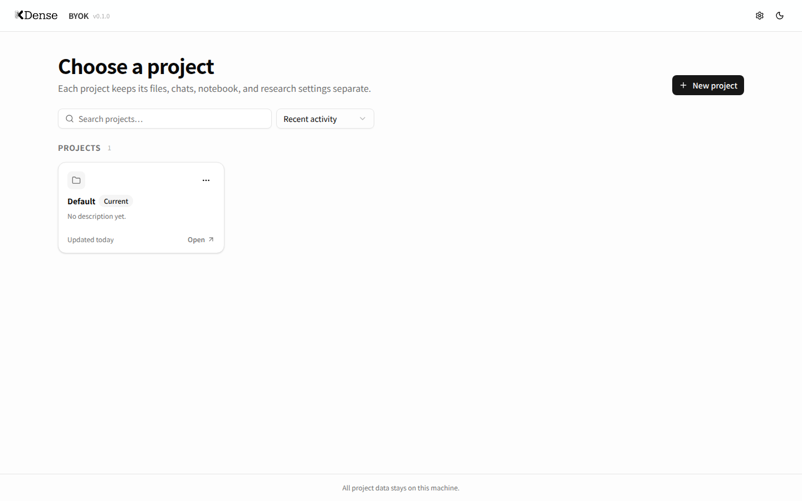 | 2026-10-11 11:35 | [GeoAIDesk 배포 기반 (WP02 gaid-fork-base)](2026-10-11-gaid-fork-base/index.md) | 새 checkout에서 한 줄 명령으로 설치·실행되고, 중지·재시작 후에도 프로젝트가 남으며, 사용자 자료는 소스 밖에 저장됩니다. | 검토함 10-11 | 미정 | 0 |
